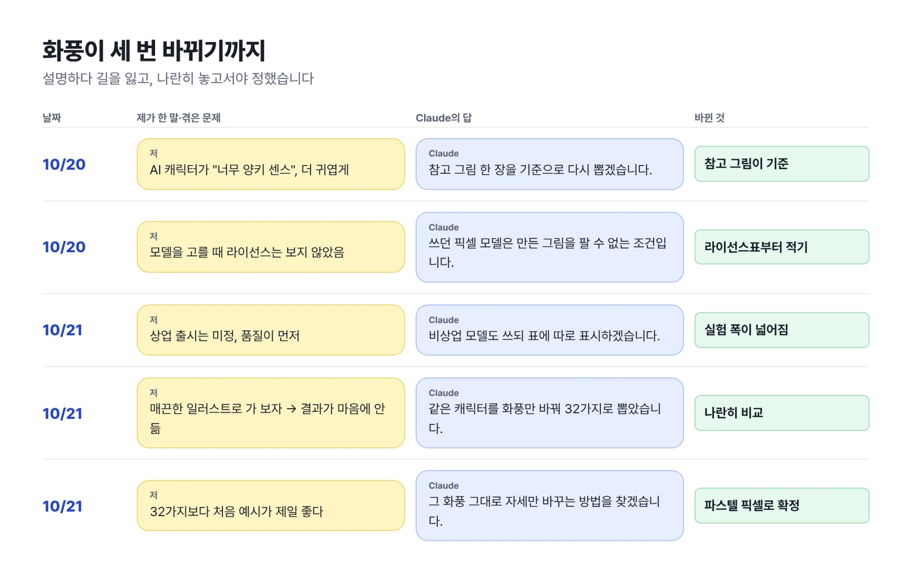
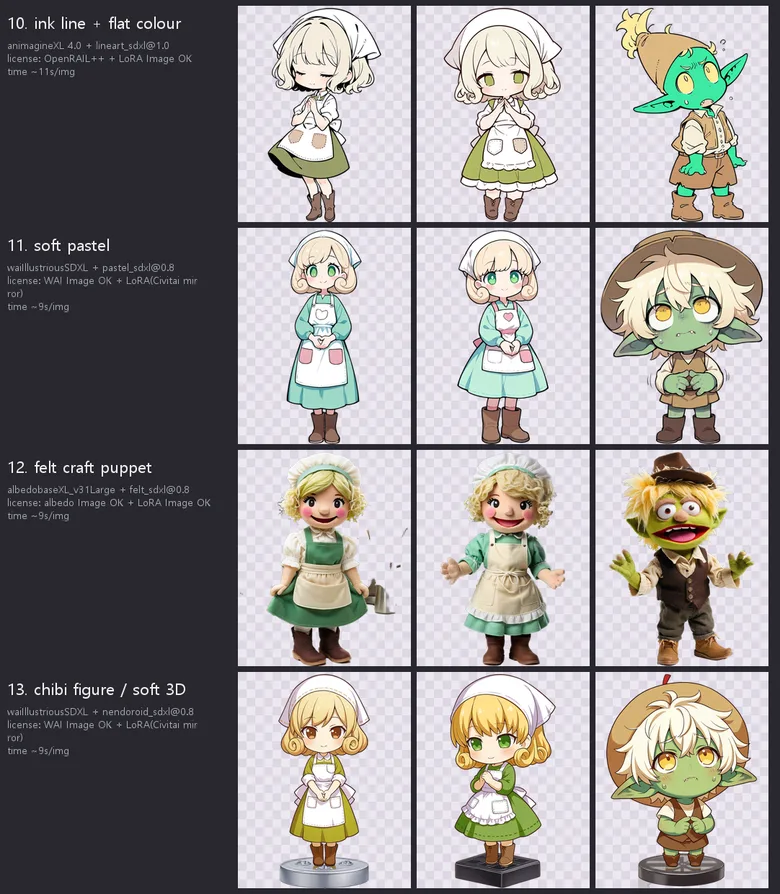
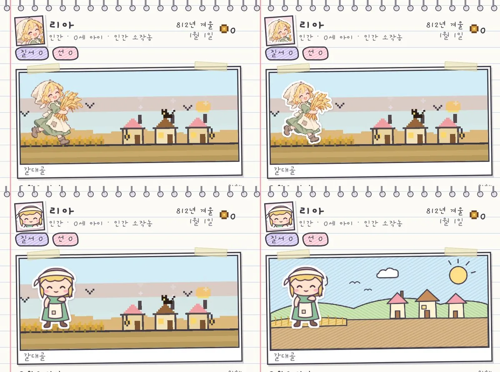
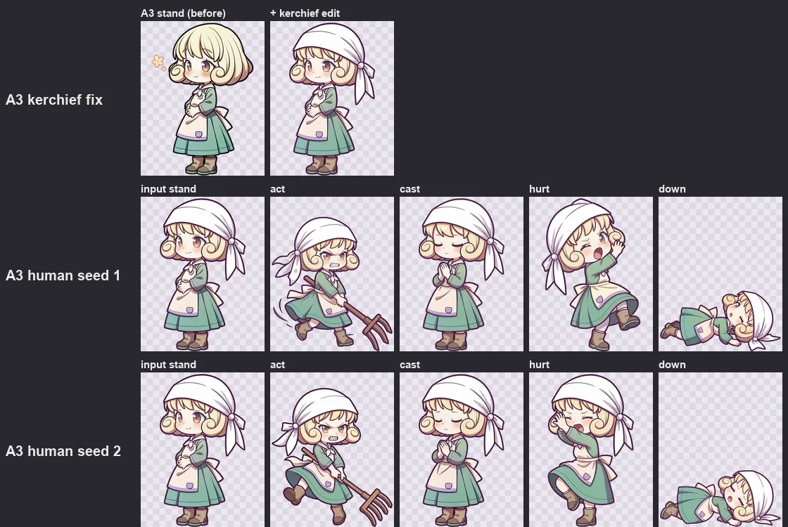

미용실에 가서 "자연스러우면서 좀 세련되게 해 주세요"라고 주문하는 손님이 있습니다. AI로 게임 캐릭터를 뽑던 첫 주, 그 손님이 바로 저였습니다.

불과 며칠 사이에 그림체를 세 번이나 갈아엎고 나서야 원인을 알았습니다. 머릿속에 둥둥 떠다니는 막연한 느낌을 굳이 '말로' 설명하려고 버텼던 겁니다.

<figure><figcaption>화풍 하나 정하겠다고 AI와 주고받은 다섯 번의 대화입니다.</figcaption></figure>

## "뭔가 너무 양키 센스야..."

첫날 AI가 자신 있게 내민 캐릭터는 근육과 음영이 묵직하게 들어간 정통 서양 판타지풍이었습니다. 제가 원한 건 머리가 큼지막하고 눈이 또렷한 일본 인디 게임 감성이었는데, 막상 그걸 프롬프트로 적으려니 어떤 단어를 써야 할지 막막하더군요.

결국 입에서 나온 피드백은 **"너무 양키 센스야"**, **"좀 더 귀엽게 해 줘"** 같은 뜬구름 잡는 말뿐이었습니다. 몇 번을 다시 뽑아도 결과물은 비슷한 자리를 맴돌았습니다.

답답하던 차에 평소 좋아하던 분위기의 참고 그림 한 장을 건네 줬습니다. 그제야 대화가 풀리더군요. Claude가 그림을 뜯어보더니 색감, 등신 비율, 이목구비 특징을 알아서 정리해 내고 그 기준에 맞춰 새로 그려 왔습니다. 백 마디 형용사를 늘어놓는 것보다 예시 한 장이 훨씬 정확했습니다.

## 아차, 팔 수 없는 그림이었습니다

그림이 꽤 마음에 들기 시작해 신나 있던 날, Claude가 조심스럽게 제동을 걸었습니다.

잘 쓰고 있던 픽셀 아트 모델의 약관을 확인해 봤더니 **원작자 허락 없이는 상업적 이용이 불가능한 라이선스**라는 겁니다. 그림만 예쁘면 끝인 줄 알고 라이선스는 열어 볼 생각조차 못 했습니다. 모르고 계속 쌓아 두다가 나중에 게임을 유료로 내기라도 했으면, 수백 장을 한꺼번에 버릴 뻔한 아찔한 순간이었습니다.

그날부터 새 그림 모델을 내려받기 전에는 무조건 라이선스 조건부터 표로 정리해 달라고 규칙을 세웠습니다. "아직 유료 출시할지 정하지 않았으니 일단 품질이 우선이야"라고 했더니, Claude가 꽤 영리한 절충안을 내놓더군요. 비상업용 모델도 테스트에는 써 보되 나중에 섞이지 않도록 표에 빨간 딱지를 붙여 두자는 방식이었습니다.

## 32가지 맛을 다 보고 나서야

중간에 한 번은 픽셀 아트가 괜히 답답해 보여서 매끈한 일반 일러스트로 핸들을 확 꺾은 적도 있습니다. 그런데 막상 뽑아 놓고 보니 또 어딘가 성에 차지 않더군요.

제가 갈피를 못 잡고 흔들리니까, 아예 똑같은 캐릭터를 화풍만 바꿔 32가지 버전으로 뽑아 한 판에 나란히 깔아 보자고 했습니다. 캐릭터 설정, 포즈, 크기는 똑같이 고정해 두고 오직 '화풍' 변수 하나만 바꾼 셈입니다. 말하자면 화풍 시식 코너였습니다.

<figure class="narrow"><figcaption>32가지 화풍 시식 코너의 일부입니다. 잉크 펜선부터 양모 펠트 인형, 3D 피규어 풍까지 한 번에 비교해 봤습니다.</figcaption></figure>

팔짱을 끼고 32가지를 한참 들여다본 끝에 나온 결론은 허무할 만큼 간결했습니다.

"32가지 다 필요 없고, 맨 처음에 봤던 파스텔 픽셀이 제일 예쁘네."

멀리 돌아온 헛걸음 같지만, 제겐 꼭 필요한 시간이었습니다. 다른 선택지를 눈으로 확인하고 하나씩 지워 본 뒤에야 첫 번째 화풍에 확신이 섰거든요. 이 비교를 건너뛰고 곧장 달렸더라면, 개발 내내 "그냥 일러스트로 갈걸 그랬나?" 하며 미련을 끌고 다녔을 겁니다.

최종 후보로 남은 몇 가지는 실제 게임 배경 위에 직접 올려 보고 결정했습니다. 흰 배경에서 혼자 빛나는 그림과 게임 화면 안에서 자연스럽게 어우러지는 그림은 생각보다 꽤 다르더군요.

<figure><figcaption>실제 게임 화면 위에 캐릭터 스티커 처리 방식 네 가지를 얹어 놓고 최종 면접을 봤습니다.</figcaption></figure>

## 같은 얼굴로 포즈만 바꾸기

화풍을 확정하자마자 다음 숙제가 기다리고 있었습니다. 한 캐릭터가 서 있는 모습, 마법 쓰는 모습, 다친 모습 등 여러 포즈를 취해야 하는데, 포즈마다 새로 그려 달라고 하면 매번 옷만 똑같이 입은 낯선 사람이 나타났습니다.

이리저리 시험해 본 끝에 찾은 해법은 **기본 서 있는 그림 한 장을 원본으로 삼고 거기서 자세만 고쳐 그리는 편집 방식**이었습니다. 그래야 얼굴과 옷차림이 가장 덜 흔들립니다. 요즘은 여기서 한 걸음 더 나아가 머리와 몸통을 따로 그려 레고처럼 조립하는 방식까지 발전시켰습니다. 이 조립식 작업 이야기는 [에셋 작업대 글]()로 이어집니다.

<figure><figcaption>맨 왼쪽 원본 캐릭터의 얼굴과 옷을 유지한 채 일하기, 마법, 부상, 기절 포즈만 새로 빚어냈습니다.</figcaption></figure>

## 세 줄 요약

1. 원하는 그림체를 형용사로 설명하려 애쓰기보다, 취향에 가까운 레퍼런스 그림 한 장을 보여 주는 편이 훨씬 빠르고 정확합니다.
2. 여러 화풍을 한 화면에 나란히 깔아 비교해 보면 "다른 게 더 낫지 않았을까" 하는 미련 없이 취향을 확정할 수 있습니다.
3. AI 그림 모델은 정들기 전에 상업적 이용 라이선스부터 표로 확인해 두세요. 예쁜 그림 수백 장을 나중에 버리는 일만큼 허무한 것도 없습니다.
