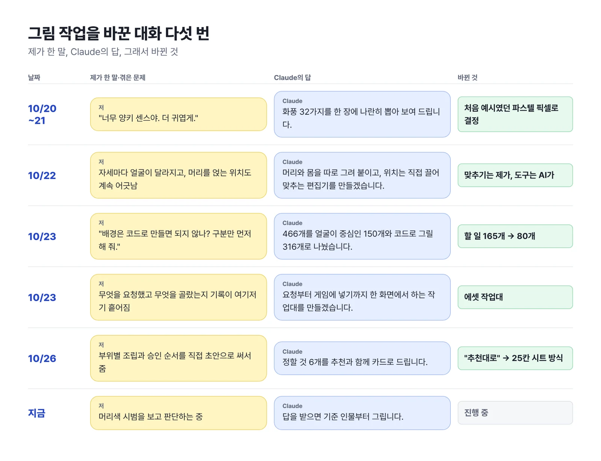
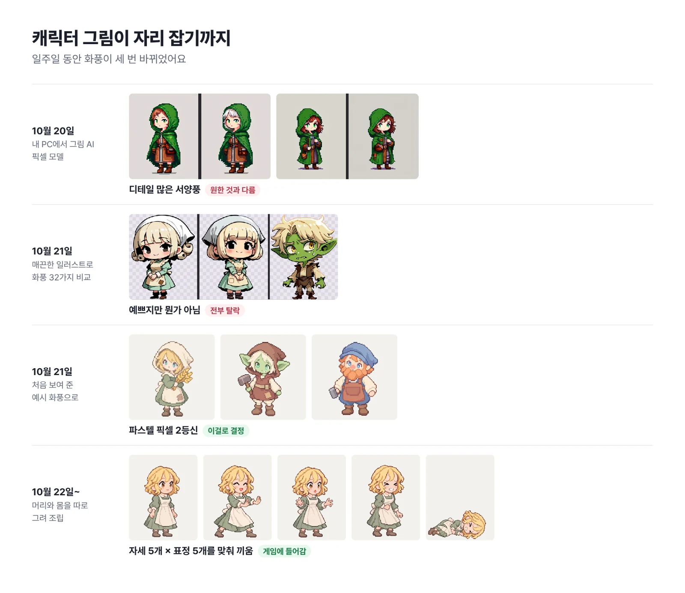
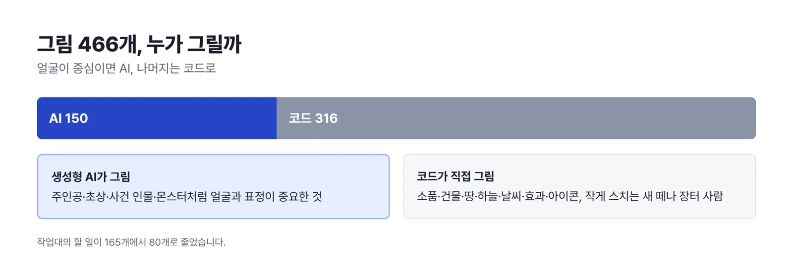
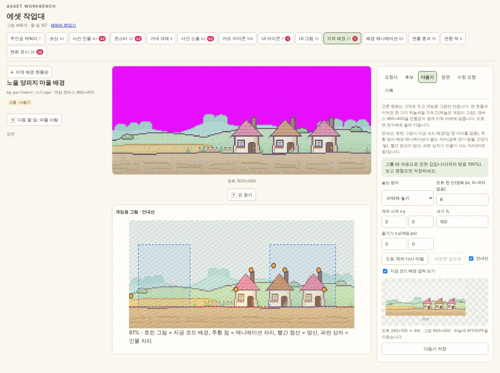
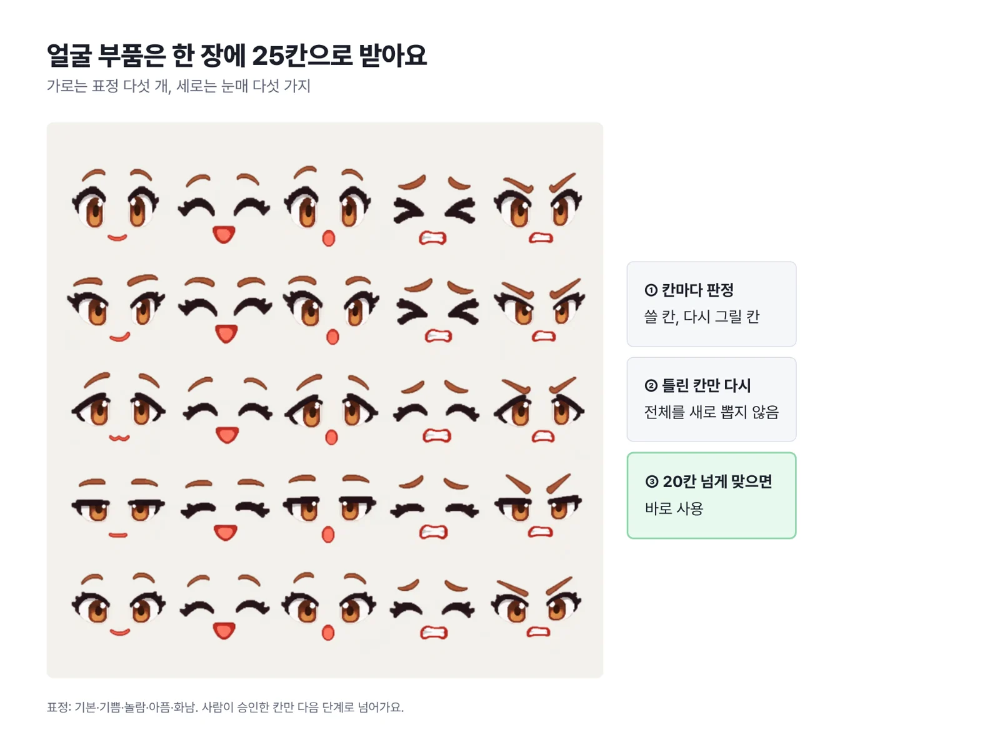

AI와 게임을 만들면서 가장 진을 뺀 건 코드가 아니라 의외로 **그림**이었습니다.

코드는 자동 검사를 돌리면 맞았는지 틀렸는지 1초 만에 답이 나옵니다. 반면 그림은 결국 사람인 제가 눈으로 보고 합격 도장을 찍어야 합니다. 거기에 한 캐릭터가 다섯 가지 포즈를 취할 때 다섯 장 모두 같은 얼굴이어야 한다는 조건까지 붙습니다. 지금도 진행 중인 싸움이지만, 일주일 동안 Claude와 부딪히며 전용 작업대까지 차리게 된 과정을 정리해 봤습니다.

<figure><figcaption>지난 일주일간 그림 작업의 물줄기를 바꾼 결정적 대화들입니다.</figcaption></figure>

## "너무 양키 센스야, 더 귀엽게!"

첫날 받은 캐릭터는 갑옷 주름까지 세밀한 서양 판타지풍이었습니다. 저는 일본 인디 게임처럼 머리가 큼지막하고 귀여운 2등신을 원했는데, 그 감성을 말로 풀어낼 어휘가 없더군요. 결국 내놓은 주문은 "너무 양키 센스야, 더 귀엽게 해 줘"가 전부였습니다.

보다 못한 Claude가 아예 32가지 화풍을 한 장에 나란히 뽑아 왔습니다. 눈앞에 펼쳐 놓고 하나씩 지워 나가다 보니, 돌고 돌아 맨 처음 예시로 보여 줬던 '파스텔 픽셀'이 제일 낫다는 결론이 나왔습니다. 내가 뭘 원하는지 애매할 때는 말로 붙잡고 늘어지는 대신 한 판에 깔아 놓고 눈으로 찍는 편이 빠릅니다.

<figure><figcaption>일주일 동안 겪은 캐릭터 변천사입니다. 멀리 돌아 맨 아래의 파스텔 픽셀 주인공으로 정착했습니다.</figcaption></figure>

## 목 위치 맞추는 건 그냥 제가 할게요

간신히 화풍을 정했더니 곧바로 다음 벽이 나타났습니다. 몸통과 얼굴을 한 번에 통째로 그리게 했더니, 포즈가 바뀔 때마다 얼굴이 미묘하게 딴사람으로 바뀌는 겁니다.

그래서 **머리와 몸통을 따로 그린 뒤 합치는 조립식**으로 방식을 바꿨습니다. 그랬더니 이번엔 AI가 몸통 위에 머리를 얹는 좌표를 영 못 잡더군요. 픽셀 아트에서는 두세 픽셀만 어긋나도 기린처럼 목이 길어지거나 거북목이 되어 버립니다.

좌표를 몇 번이나 고쳐 시키다가 결국 전략을 바꿨습니다.

"위치는 내가 눈으로 보고 직접 맞출 테니까, 마우스로 끌어다 맞출 수 있는 편집기를 하나 만들어 줘."

그렇게 생긴 편집기에서는 제가 마우스로 머리를 쓱 옮겨 몸통 위에 얹고 저장 버튼만 누르면 깔끔한 합성본이 바로 나옵니다. 사람 눈이 1초 만에 해치울 일은 사람이 하고, AI에게는 그 일을 편하게 해 주는 도구를 만들게 시키는 편이 훨씬 속 편하더군요.

## 질문 한 줄로 작업량을 반토막 내다

게임에 들어갈 그림 목록을 전부 세어 보니 무려 **466개**였습니다. 이걸 언제 다 AI로 뽑고 검수하나 막막해지던 순간, 문득 한 가지 생각이 스쳤습니다.

"잠깐, 배경이나 소품 같은 건 굳이 AI로 안 그리고 그냥 코드로 그려도 되지 않나? 일단 그리지 말고 구분부터 먼저 해 봐."

바로 작업에 들어가지 않고 '분류부터 해 오라'고 멈춰 세운 덕분에 꽤 명쾌한 기준이 섰습니다. 살아 움직이는 생명체의 얼굴과 표정이 핵심이면 AI로 그리고, 나머지 배경이나 기하학적인 요소는 코드로 그린다는 원칙입니다.

이 기준 하나로 AI가 그려야 할 그림이 466개에서 150개로 뚝 떨어졌고, 작업대에 쌓여 있던 대기열도 165개에서 80개로 반토막이 났습니다.

<figure><figcaption>표정이 생명인 캐릭터만 AI에게 맡기고, 나머지 316개는 깔끔하게 코드로 그립니다.</figcaption></figure>

## 흩어진 그림들을 '전용 작업대' 한 화면에

생성한 그림이 수백 장으로 불어나자 관리가 한계에 부딪혔습니다. 어떤 프롬프트로 요청했는지, 후보 중 몇 번을 골랐는지, 왜 퇴짜를 놨는지 기록이 여기저기 흩어져 도무지 추적이 안 되더군요.

그래서 아예 에셋 전용 작업대 웹 화면을 하나 통째로 만들었습니다. 그림 하나당 전용 폴더를 배정하고, 주문서 작성부터 후보 채택, 실제 게임 화면 합성 테스트까지 한 곳에서 끝내는 종합 상황실입니다.

이제는 브라우저에서 숫자 키로 마음에 드는 후보를 고르고, 게임 배경 위에 얹어 본 뒤, 어색한 곳에 마우스로 핀을 꽂아 "여기 손가락 여섯 개임"이라고 메모를 남깁니다. 그러면 다음 차례에 투입된 AI가 그 핀 메모부터 읽고 수정을 시작합니다.

<figure><figcaption>직접 만든 에셋 작업대 화면입니다. 땅 높이와 캐릭터가 설 자리가 가이드라인으로 겹쳐 보여서, 게임에 넣었을 때 어색하지 않은지 바로 확인할 수 있습니다.</figcaption></figure>

## 제가 큰 그림을 던지고, AI가 세부 안건을 정리하고

10월 26일에는 제가 먼저 거친 아이디어를 적어 건넸습니다. "캐릭터 파츠를 부위별로 쪼개서 그리고, 단계마다 내 승인을 받아서 넘어가는 건 어떨까?"라는 초안이었습니다. Claude는 제 초안을 뜯어보더니 결정해야 할 세부 안건 여섯 가지를 추천안이 달린 선택지 카드로 정리해 왔고, 저는 그대로 "추천안대로 진행해"라고 도장을 찍었습니다.

그 결과물이 아래의 **25칸 표정 시트**입니다. 눈과 입 파츠를 낱개로 뽑지 않고, 다섯 가지 표정과 다섯 가지 눈매를 바둑판처럼 한 장에 몰아 그리는 방식입니다. 한 판에 같이 뽑아야 25개 파츠의 화풍이 흔들리지 않거든요. 저는 바둑판을 보며 이상하게 나온 칸만 콕콕 찍어 다시 그리게 시키고, 20칸 이상 합격점이면 바로 게임에 투입합니다.

<figure><figcaption>25칸 파츠 시트 검수 화면입니다. 칸마다 합격·불합격 도장을 찍고, 불합격 칸만 재시험을 치르게 합니다.</figcaption></figure>

## 아직도 현재진행형인 씨름

지금은 기본 머리 모양 하나를 두고 코드로 염색(색상 변경)만 입히는 방식을 시험해 보고 있습니다. 손 모양이 뭉개지는 건 여전히 제가 눈을 부릅뜨고 일일이 잡아내야 하고, 인간 외의 다른 종족은 아직 손도 못 댔습니다.

그래도 초창기처럼 "어제 그 귀여운 애는 어디 가고 웬 낯선 사람이 서 있지?" 하며 멍해지던 시절은 지났습니다. 조만간 이 작업대를 거쳐 첫 번째 완성형 캐릭터가 나오는 과정도 정리해 보겠습니다.

## 세 줄 요약

1. 원하는 그림 느낌을 말로 풀기 어려울 땐, 여러 화풍을 한 판에 나란히 뽑게 해서 눈으로 고르는 편이 훨씬 빠릅니다.
2. AI가 영 못 하는 미세한 위치 맞추기는 억지로 시키지 말고, 사람이 마우스로 1초 만에 맞출 수 있는 편집 도구를 만들라고 시키세요.
3. 무작정 다 그리게 하기 전에 "코드로 그릴 것과 AI로 그릴 것부터 나눠 봐"라고 던진 질문 하나가 그림 작업량을 절반으로 줄여 줬습니다.
