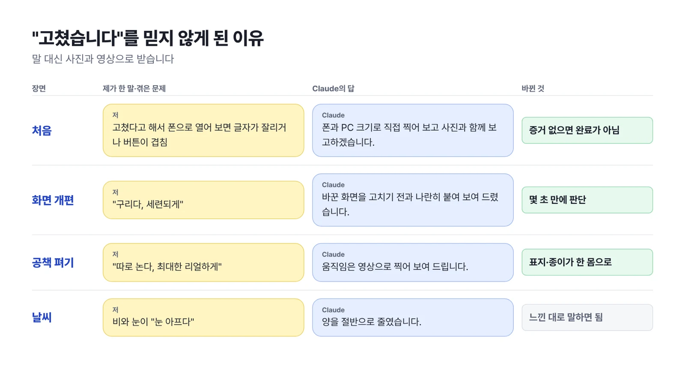
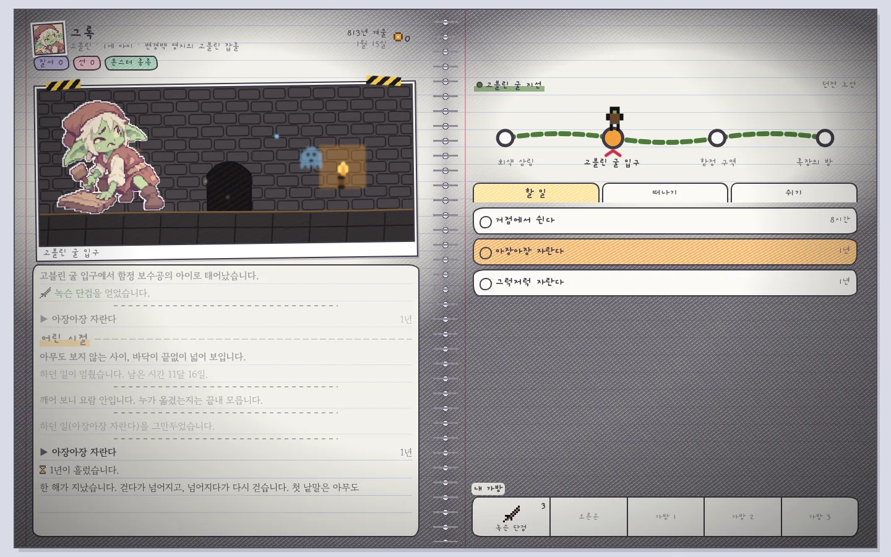
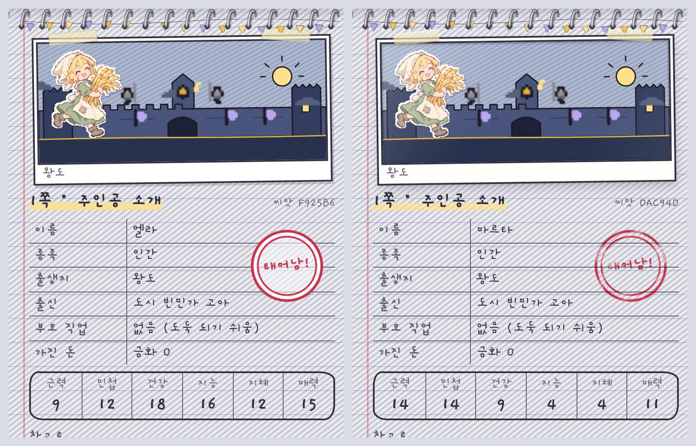

초반에는 Claude가 "화면을 깔끔하게 고쳤습니다!"라고 말할 때마다 순진하게 믿었습니다. 들뜬 마음으로 스마트폰을 열어 보면 글자가 반쯤 잘려 있거나 버튼 두 개가 얌전히 포개져 있더군요. 코드에 에러가 안 났으니 AI 입장에서는 진짜 다 고친 줄 알았던 겁니다. 화면을 직접 보지 못하니 탓하기도 애매했습니다.

결국 말로 하는 완료 보고는 믿지 않기로 했습니다. 화면을 건드리는 작업이면 무조건 가상 브라우저를 띄워 직접 캡처하고, 사진이나 녹화 영상을 들고 와서 보고하라고 규칙을 바꿨습니다.

<figure><figcaption>'말로만 완료 보고 금지령'이 자리 잡기까지의 대화 과정입니다.</figcaption></figure>

## 인증샷이 없으면 완료가 아닙니다

제일 먼저 못 박은 규칙은 단순합니다. 폰 화면 크기 하나, PC 화면 크기 하나. 이렇게 두 장을 세트로 찍어 오지 않으면 "고쳤다"는 보고를 받지 않는 겁니다.

넓은 PC 모니터에서는 멀쩡하던 화면이 좁은 폰으로 넘어오면 와르르 무너지는 일이 흔하니까요. 이 규칙을 건 뒤로는 제가 폰으로 열어 보고 "이거 깨졌잖아!" 하며 돌려보내는 횟수가 눈에 띄게 줄었습니다.

뜻밖의 보너스도 있었습니다. Claude가 보고용 사진을 찍다가 **자기 눈으로 깨진 화면을 먼저 발견하고는 슬쩍 고친 뒤에야 멀쩡한 사진을 들고 오기 시작**한 겁니다. 남에게 보여 줄 사진을 찍어 보고서야 민망해지는 건 사람이나 AI나 비슷한 모양입니다.

<figure><figcaption>Claude가 직접 찍어 온 PC 화면 인증샷입니다. 보고할 땐 늘 스마트폰 비율 캡처본도 세트로 따라옵니다.</figcaption></figure>

## 고치기 전과 후를 한 장에 나란히

한번은 개편된 화면을 보고 제가 다소 거칠게 "아, 뭔가 구리다. 좀 세련되게 바꿔 봐"라고 던진 적이 있습니다.

그날 이후로는 수정본만 덜렁 가져오는 일이 사라졌습니다. 고치기 전(Before)과 고친 후(After)를 한 장에 나란히 붙여 들고 오더군요. 새 화면만 따로 보면 "이게 전보다 나아진 게 맞나, 그냥 달라진 건가?" 헷갈릴 때가 잦습니다. 둘을 옆에 세워 두니 3초 만에 "어, 훨씬 낫네. 통과!" 하고 도장을 찍을 수 있게 됐습니다.

<figure><figcaption>스마트폰 화면 수정 전(왼쪽)과 후(오른쪽) 비교 샷입니다. 나란히 놓고 보면 고민할 시간이 사라집니다.</figcaption></figure>

## 움직이는 연출은 무조건 동영상으로

게임을 시작할 때 공책이 촤르륵 펼쳐지는 애니메이션을 처음 넣었을 때 일입니다. 막상 열어 보니 표지와 속지가 서로 모르는 사이처럼 따로 놀더군요. "표지랑 종이가 따로 논다, 진짜 공책 넘기는 것처럼 자연스럽게 해 줘"라고 주문하면서, 이때부터는 아예 폰 화면을 mp4 동영상으로 녹화해 오게 했습니다.

움직임과 타이밍은 정지 화면 백 장을 봐도 감이 오지 않습니다. 영상으로 받아 보니 피드백도 한결 가벼워졌습니다. 한 번은 비와 눈이 내리는 날씨 연출 영상을 받아 보고 딱 세 글자로 **"눈 아파"**라고 답했는데, 곧바로 알아듣고 빗줄기 양을 절반으로 줄여 다시 찍어 오더군요. CSS 수치나 프레임 단위 용어를 하나도 몰라도, 눈에 거슬리는 느낌 그대로만 건네면 소통이 충분히 굴러갑니다.

아, 가상 브라우저로 화면을 녹화할 때 영상이 뚝뚝 끊기던 문제를 해결한 이야기는 [한 장씩 찍어 영상을 만드는 글]()에 따로 적어 두었습니다.

## 세 줄 요약

1. UI 작업은 AI가 스마트폰과 PC 해상도로 직접 찍어 오게 하고, 인증샷 없이는 완료 보고를 받지 마세요. 찍어 보다가 자기가 먼저 버그를 잡습니다.
2. 수정된 화면은 고치기 전과 후를 나란히 붙여 보고하게 하면 3초 만에 판단이 끝납니다.
3. 애니메이션처럼 움직임이 핵심인 작업은 영상으로 받아 보고, 전문 용어 대신 "따로 논다", "눈 아프다"처럼 느낀 그대로만 피드백해도 충분합니다.
