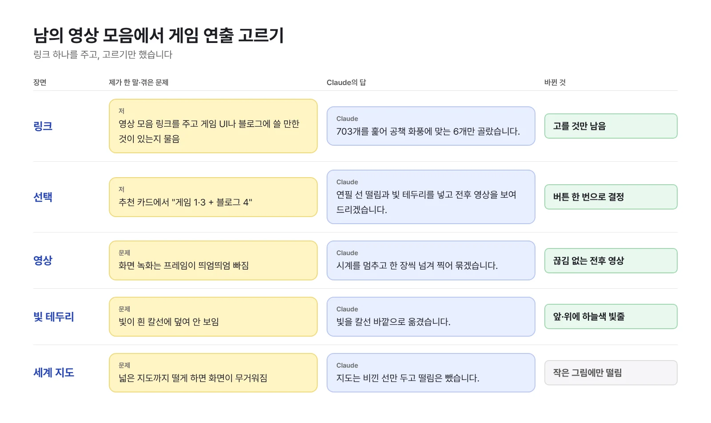
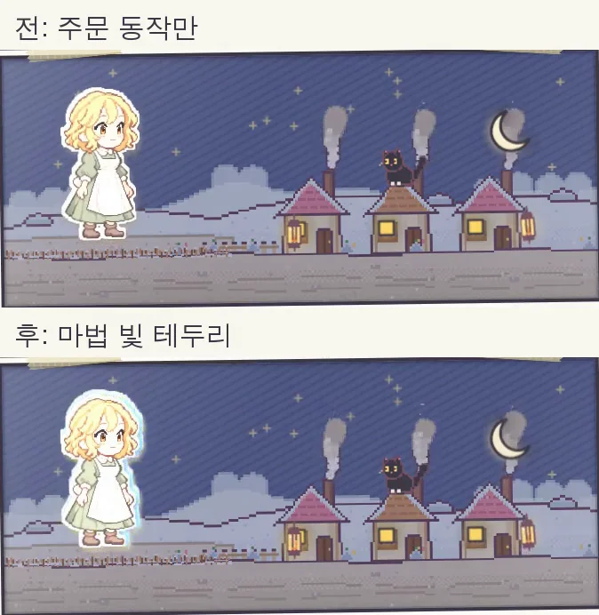
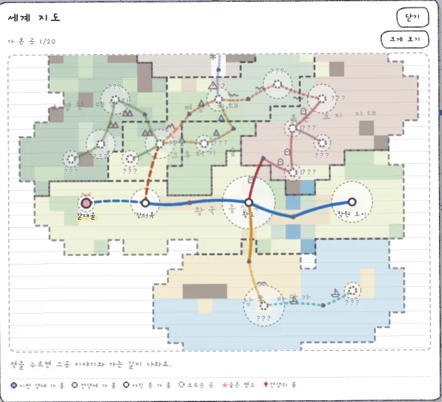

웹서핑을 하다가 사람들이 AI로 짠 애니메이션 영상 700여 개와 프롬프트를 모아 둔 사이트를 발견했습니다([참고 자료]()).

문제는 700개가 넘는 영상을 언제 다 눌러 보고 앉아 있느냐였죠. 마우스 휠 돌리다가 손가락에 쥐가 날 판이라, 링크 하나만 띡 복사해서 Claude에게 넘겼습니다. 이 중에서 우리 게임에 써먹을 만한 연출만 추려 오라고요.

<figure><figcaption>링크 하나 던져 주고 게임 연출 두 가지를 공짜로 건지기까지의 대화 흐름입니다.</figcaption></figure>

## 700개 중에서 딱 6개만 살아남았습니다

"저 사이트 싹 훑어보고 우리 게임 UI나 블로그에 어울릴 만한 게 있는지 찾아봐 줘." 숙제는 딱 한 줄이었습니다.

잠시 뒤 돌아온 보고서는 꽤 명쾌하더군요. 700개 중 대다수는 화려한 3D 그래픽이나 쇼핑몰 제품 홍보용이라 우리의 소박한 '공책 RPG' 감성과는 영 딴판이라는 겁니다. 거기에 우리 게임에 이미 들어가 있는 기법들까지 알아서 솎아 내고, **진짜로 어울리는 6개만 추려서 '왜 어울리는지'와 '어디에 넣으면 좋을지' 한 줄 요약**을 붙여 왔습니다.

보고서 맨 끝에는 늘 그렇듯 "어느 것부터 적용해 볼까요?" 객관식 카드가 달려 있었고, 저는 Claude가 추천한 패키지(게임 연출 1·3번 + 블로그 도구 4번)를 골랐습니다. 손으로 그린 듯 사각거리며 떨리는 연필 선 효과, 주문을 외울 때 캐릭터 외곽에 감도는 빛(림 라이트), 그리고 비교 영상을 끊김 없이 찍는 기술이 그렇게 한 번에 들어왔죠.

## 녹화하면 뚝뚝 끊기길래 시간을 멈춰 버렸습니다

새 연출을 넣었으면 전후 비교 영상을 봐야 직성이 풀립니다. 그런데 가상 브라우저 화면을 실시간으로 녹화하니 컴퓨터가 조금만 버벅거려도 프레임이 숭덩숭덩 빠져서, 이게 바뀐 건지 화면이 렉 걸린 건지 도무지 알 수가 없더군요.

이때 Claude가 꽤 영리한 꼼수를 냈습니다. 실시간 녹화를 포기하고, 브라우저의 시간을 아예 멈춰 세운 뒤 30분의 1초씩 시계바늘을 수동으로 똑딱똑딱 넘기면서 한 컷씩 사진을 찍어 동영상으로 이어 붙이는 방식입니다.

덕분에 컴퓨터 사양이 어떻든 언제 찍어도 똑같이 부드러운 영상이 나옵니다. 고치기 전과 후 영상을 0.01초 단위까지 정확히 나란히 맞춰 놓고 비교할 수 있게 된 건 덤이고요.

<figure><video src="/assets/img/posts/ai-clip/board-compare.mp4" poster="/assets/img/posts/ai-clip/board-compare.jpg" controls muted playsinline preload="none"></video><figcaption>이동 노선표 비교 영상입니다. 위가 적용 전, 아래가 적용 후입니다. 자세히 보시면 아래쪽 선과 동그라미가 1초에 8번씩 새로 그린 것처럼 아날로그 감성으로 자글자글 떨립니다.</figcaption></figure>

## 흰색 스티커 테두리가 마법 빛을 집어삼키다

두 번째로 넣은 연출은 마법을 쓸 때 캐릭터 몸 가장자리에 푸른 빛이 감도는 효과였습니다. 그런데 막상 적용하고 영상을 찍어 보니 아무리 눈을 씻고 봐도 빛이 코빼기도 안 보이더라고요.

원인을 캐 보니 꽤 허무했습니다. 우리 게임 캐릭터들은 다꾸 스티커처럼 가장자리에 두꺼운 흰색 테두리가 둘러져 있는데, 마법 빛이 그 흰 테두리 안쪽에 깔리는 바람에 흰색에 묻혀 흔적도 없이 증발해 버렸던 겁니다. Claude가 직접 찍은 캡처를 확대해 보고서야 범인을 잡았고, 빛이 맺히는 자리를 스티커 바깥선으로 옮긴 뒤에야 주문 외우는 0.7초 동안 하늘색 빛이 반짝이기 시작했습니다.

<figure><figcaption>마법 빛이 가장 밝게 차오른 순간입니다. 아래쪽 수정본에서 캐릭터 머리와 어깨선을 따라 하늘색 빛이 선명하게 돕니다.</figcaption></figure>

<figure><video src="/assets/img/posts/ai-clip/rim-compare.mp4" poster="/assets/img/posts/ai-clip/rim-compare.jpg" controls muted playsinline preload="none"></video><figcaption>연속으로 주문을 두 번 외울 때의 실제 화면입니다.</figcaption></figure>

## 아무리 예뻐도 무거우면 뺍니다

연필 선이 사각거리며 떨리는 효과가 꽤 마음에 들어서, 내친김에 큼지막한 '세계 지도' 전체에도 똑같이 입혀 보려 했습니다.

욕심이 과했는지, 화면 전체를 덮는 큰 그림을 1초에 8번씩 다시 그려 대니 화면이 눈에 띄게 버거워지더군요. Claude가 성능을 측정해 보더니 세계 지도에는 연필로 두 번 덧그린 듯한 손그림 느낌만 남기고 실시간 떨림 애니메이션은 빼는 게 좋겠다고 선을 그었습니다.

결국 자글거리는 떨림은 자그마한 이동 노선표에만 살려 두고, 큰 지도에서는 과감히 뺐습니다. 기기 설정에서 '동작 줄이기'를 켜 둔 분들에게는 그 작은 노선표마저 얌전히 멈춰 있도록 처리해 두었고요.

<figure><figcaption>세계 지도 화면입니다. 연필로 두 번 겹쳐 그은 듯한 아날로그 선 맛은 살리되, 기기 부담을 줄이기 위해 흔들림은 뺐습니다.</figcaption></figure>

## 세 줄 요약

1. 혼자 다 보기엔 양이 너무 방대한 레퍼런스 모음집은 링크만 던져 주고 AI에게 "우리 프로젝트에 어울리는 것만 추려 오라"고 시키세요.
2. 디렉터는 추천 사유가 적힌 객관식 카드에서 찍기만 하고, 결과물은 시간 축을 맞춘 비포·애프터 영상으로 검수합니다.
3. 아무리 예쁜 연출이라도 화면이 느려지면 과감히 덜어 내도록 AI에게 성능 측정까지 맡기는 것이 안전합니다.
