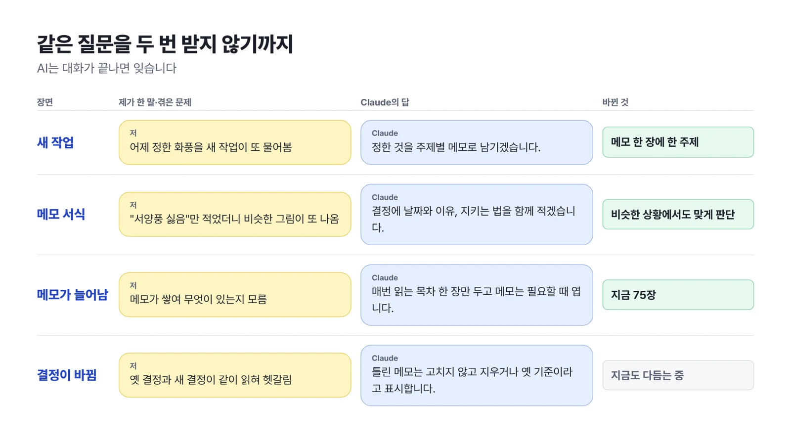
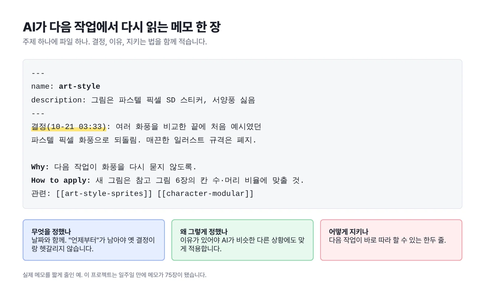

매일 아침 출근할 때마다 어제 인수인계받은 내용을 싹 잊고 해맑게 "우리 무슨 팀이죠?" 묻는 동료가 있다면 어떨까요. AI와 일하면서 제일 먼저 찾아온 번아웃이 딱 그랬습니다. **'했던 말 또 하기'**였죠.

분명 어제 몇 시간을 들여 캐릭터 그림체를 확정했는데, 오늘 새 작업 창을 열면 어제의 일은 까맣게 잊고 처음부터 다시 물어봅니다. Claude Code 특성상 대화창을 닫으면 기억이 초기화되고, 새 작업은 백지에서 시작하기 때문입니다.

<figure><figcaption>도돌이표 같던 질문을 끊어 내기 위해 인수인계 시스템을 만든 과정입니다.</figcaption></figure>

## 퇴근하기 전에 인수인계 노트를 쓰게 했습니다

이대로는 제가 먼저 지쳐 나가떨어질 것 같아서, 중요한 결정을 내릴 때마다 **'인수인계 메모'**를 남기게 했습니다. 그림 방향, 데이터 저장 방식, 전투 규칙, 블로그 작성법처럼 주제별로 메모 파일을 한 장씩 따로 만들고, 새 작업 창을 열 때마다 무조건 이 메모들부터 읽고 시작하도록 규칙을 세웠습니다.

Claude Code에는 기억을 담아 두는 공간이 크게 두 군데 있습니다. 사람이 헌법처럼 직접 적어 두는 규칙 파일(`CLAUDE.md`)과, AI가 스스로 적고 관리하는 메모 폴더입니다. 저는 **"앞으로 어떤 작업이든 반드시 지켜야 할 원칙"**은 규칙 파일에 넣어 두고, **"몇 월 며칠에 어떤 이유로 무엇을 결정했는가"** 같은 이력은 메모 폴더에 쌓아 두도록 역할을 나눴습니다.

## "서양풍 싫음" 네 글자로는 택도 없었습니다

그런데 메모장을 도입한 뒤에도 한동안은 비슷한 헛발질이 이어졌습니다. 왜 그런가 메모 파일을 열어 봤더니 달랑 **"서양풍 싫음"**이라고만 적혀 있더군요. 무엇이 싫은지만 적어 두고 정작 무엇을 원하는지, 왜 그런 결론에 이르렀는지가 빠져 있으니 AI가 새 상황에 응용할 도리가 없었던 겁니다.

그날 이후로는 메모 한 장에 반드시 **세 가지 항목**을 한 세트로 적어 넣게 못 박았습니다.

1. **무엇을 정했는지 (날짜 포함)**
2. **왜 그렇게 정했는지 (이유와 취향)**
3. **다음 작업에서 어떻게 적용할지 (행동 지침)**

<figure><figcaption>실제 메모 파일을 요약한 예시입니다. 결정 사항과 이유, 행동 지침이 한 세트로 들어갑니다.</figcaption></figure>

이렇게 "머리가 크고 눈이 땡그란 일본 인디 게임 감성을 원해서"라는 이유까지 꼬박꼬박 적게 했더니, 처음 맞닥뜨리는 작업에서도 알아서 제 취향에 가까운 결과물을 들고 왔습니다.

특히 **날짜**가 생각보다 훨씬 중요했습니다. 일주일 새 그림체가 세 번이나 바뀌었는데, 날짜가 없으면 어느 메모가 최신 기준인지 AI도 헷갈려서 한참 지난 옛날 결정과 싸우게 됩니다.

## 메모가 75장이 넘어가니 목차가 필요해졌습니다

메모가 차곡차곡 쌓여 70장을 넘어가자 새 문제가 생겼습니다. 작업을 시작할 때마다 메모를 전부 읽어 들이느라 시간과 토큰이 줄줄 새기 시작한 겁니다.

그래서 도서관 색인처럼 **'한 줄 목차 파일'**을 맨 앞에 두었습니다. 새 작업을 시작할 때는 이 가벼운 목차 한 장만 훑어보고, 오늘 할 일과 관련된 메모만 골라 열어 보게 만든 겁니다. 현재 메모가 75장까지 불어났지만, 이 목차 덕분에 토큰도 아끼고 같은 질문을 다시 받는 일도 사실상 사라졌습니다.

## 요즘도 계속 고치고 있는 부작용들

물론 처음부터 깔끔하게 굴러간 건 아닙니다. 가장 골치 아팠던 건 **'수정된 메모'**였습니다. 기존 결정이 바뀌었을 때 AI가 옛날 메모 아래에 새 결정을 그냥 이어 붙여 놓는 바람에, 나중에 읽는 AI가 윗줄과 아랫줄 중 아무거나 골라 적용하는 촌극이 벌어졌습니다.

지금은 결정이 바뀌면 옛날 내용을 아예 지워 버리거나, 기록을 남겨야 한다면 `[폐기된 옛 기준]`이라고 눈에 띄게 꼬리표를 달아 두게 합니다. 같은 주제로 메모가 두 장씩 중복 생성되는 걸 막으려고, 새 메모를 만들기 전에 반드시 목차부터 검색해 보라는 규칙도 덧붙였습니다.

## 세 줄 요약

1. 대화창을 닫으면 기억이 초기화되는 AI에게는 주제별 인수인계 메모를 남기게 하고, 새 작업을 시작할 때 목차부터 훑어보게 만듭니다.
2. 메모에는 결론만 짧게 적지 말고 '날짜, 결정한 이유, 다음 행동 지침'을 한 세트로 적어야 AI가 새로운 작업에도 응용합니다.
3. 결정이 뒤집혔을 때 옛 메모 밑에 새 내용을 덧붙이면 AI가 혼란에 빠지니, 지난 기준은 과감히 지우거나 폐기 표시를 확실히 해 두세요.
