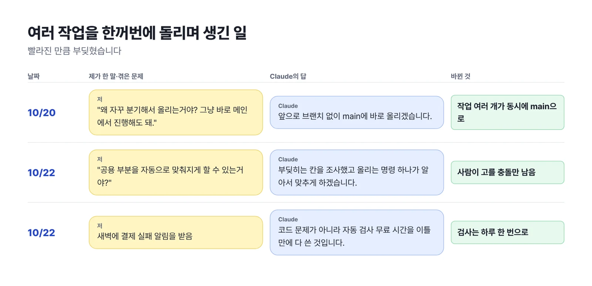
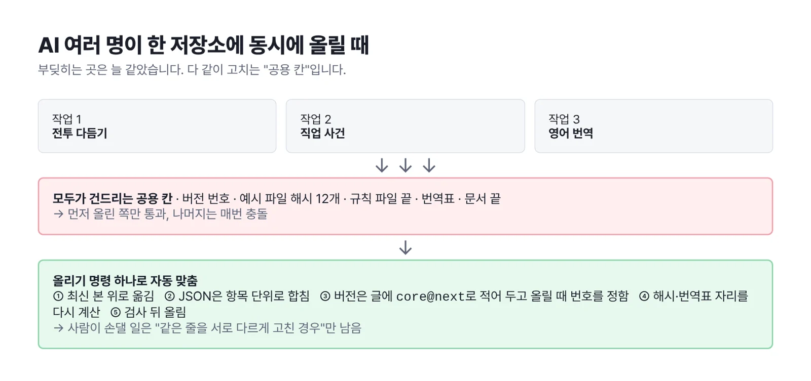
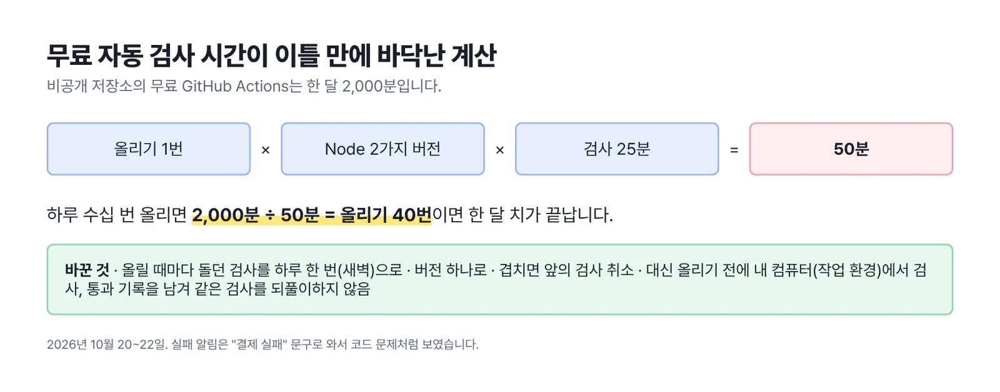

기다리는 걸 잘 못 참는 성격이라, 게임을 만들 때 Claude 작업 창을 여러 개 띄워 놓고 동시에 일을 시킵니다. 1번 방에서는 전투 밸런스를 다듬고, 2번 방에서는 직업 이벤트를 쓰고, 3번 방에서는 영어 번역을 돌리는 식이죠.

혼자 하나씩 밀 때보다 속도는 확실히 달랐습니다. 다만 AI 여러 명을 같은 방에 풀어 놓자, 제가 미처 생각하지 못한 종류의 사고가 차례로 터졌습니다.

<figure><figcaption>여러 창을 동시에 돌리면서 겪은 세 번의 위기와 해결 과정입니다.</figcaption></figure>

## "귀찮으니까 그냥 main에 바로 올려!"

처음엔 Claude가 정석대로 움직였습니다. 작업마다 따로 가지(브랜치)를 따고, 끝나면 저한테 합쳐 달라고(PR) 허락을 구했죠. 그런데 어차피 혼자 만드는 프로젝트에서 매번 확인 버튼을 누르고 있자니 은근히 귀찮았습니다.

결국 10월 20일에 선을 넘었습니다. **"왜 자꾸 분기해서 올리는 거야? 번거로우니까 그냥 바로 본선(`main`)에 올려!"** 시원하게 고속도로를 뚫어 준 줄 알았는데, 톨게이트 없는 도로에서 벌어질 일은 미처 계산에 없었습니다.

## 각자 다른 일을 시켰는데 왜 같은 칸에서 부딪힐까

모든 작업이 `main`으로 직행하자마자 여기저기서 충돌(Conflict) 경보가 울리기 시작했습니다. 분명 한쪽은 전투를 고치고 다른 쪽은 번역을 고쳤는데, 도대체 어디서 마주친 걸까요.

범인은 **모두가 마지막에 한 번씩 들르는 공용 칸**이었습니다. 콘텐츠 버전 번호, 파일 무결성 지문(해시), 번역 목록표, 패치 노트 맨 아랫줄. 누가 무슨 작업을 하든 퇴근 도장 찍듯 똑같은 줄을 건드리고 나가니, 좁은 문 앞에서 계속 어깨를 부딪칠 수밖에요. 이틀쯤 교통정리를 하다가 슬슬 지쳐서 물었습니다. **"이런 공용 구역은 올릴 때 알아서 합쳐지게 못 만드나?"**

<figure><figcaption>사고 다발 구역은 늘 같았습니다. 누구나 작업 끝에 도장을 찍고 가는 공용 칸이었죠.</figcaption></figure>

Claude가 최근 충돌 기록을 훑어 상습 사고 구역을 표로 정리해 왔고, 딱 두 가지 규칙을 세웠습니다.

1. 버전 번호나 파일 지문처럼 **계산하면 나오는 값**은 작업 중엔 건드리지 않고, 서버에 올리는 마지막 순간에 계산해서 찍는다.
2. 문서나 번역표처럼 **양쪽 다 파일 맨 끝에 줄만 보탠 경우**에는 싸우지 말고 두 줄을 다 살려 이어 붙인다.

이 두 과정을 전용 '올리기 명령' 하나로 묶고, 모든 AI가 먼저 읽는 규칙 문서(`CLAUDE.md`) 맨 위에 **"코드를 올릴 땐 무조건 이 명령만 쓸 것"**이라고 못 박아 두었습니다. 그 뒤로는 두 AI가 진짜로 같은 문장을 다르게 고친 드문 경우에만 멈춰서 제 판정을 기다리고, 자잘한 접촉 사고는 알아서 정리하고 넘어갑니다.

## 새벽에 날아온 "결제 실패" 알림

이제 좀 편해지려나 싶던 10월 22일 새벽, GitHub에서 뜬금없이 **"결제 실패"** 알림이 왔습니다. 자다 깨서 저장소가 날아간 줄 알고 철렁했는데, Claude에게 이유를 캐 보라 했더니 원인은 엉뚱한 데 있었습니다.

GitHub 비공개 저장소가 한 달에 공짜로 주는 **자동 검사(CI) 시간 2,000분을 단 이틀 만에 바닥까지 써 버린 것**입니다.

<figure><figcaption>산수는 정직합니다. 한 번 올릴 때마다 50분이 빠지니, 40번만 올리면 한 달 무료 할당량이 끝납니다.</figcaption></figure>

계산해 보니 금방 답이 나왔습니다. 코드를 한 번 올릴 때마다 25분짜리 전체 검사가 환경 두 벌로 돌아가며 **50분**을 쓰고 있었거든요. 거기에 AI 여러 명을 풀어 놓고 하루에 수십 번씩 코드를 올렸으니, 48시간 만에 한 달 치가 증발한 건 오히려 당연한 결과였습니다.

부랴부랴 서버에서 도는 무거운 자동 검사는 하루 한 번으로 줄이고, 대신 각 AI가 코드를 올리기 전에 제 컴퓨터(로컬)에서 직접 검사를 돌리게 바꿨습니다. 자동화를 켜기 전에 **'올리는 횟수 × 1회당 검사 시간'**을 한 번만 곱해 봤어도, 새벽에 심장 철렁할 일은 없었을 텐데 말입니다.

## 세 줄 요약

1. AI 여러 명에게 서로 다른 일을 맡겨도, 버전 번호나 목록표처럼 모두가 끝에서 거치는 공용 파일에서는 어김없이 충돌이 납니다.
2. 상습 충돌 구역을 AI에게 먼저 조사하게 한 뒤, 올리는 순간 자동으로 정리해 주는 전용 명령 하나로 묶으면 대부분 해결됩니다.
3. 병렬로 일하는 AI에게 자유로운 코드 업로드 권한을 주기 전에, `업로드 횟수 × 자동 검사 시간`부터 곱해 보세요. 무료 할당량은 생각보다 빨리 바닥납니다.
