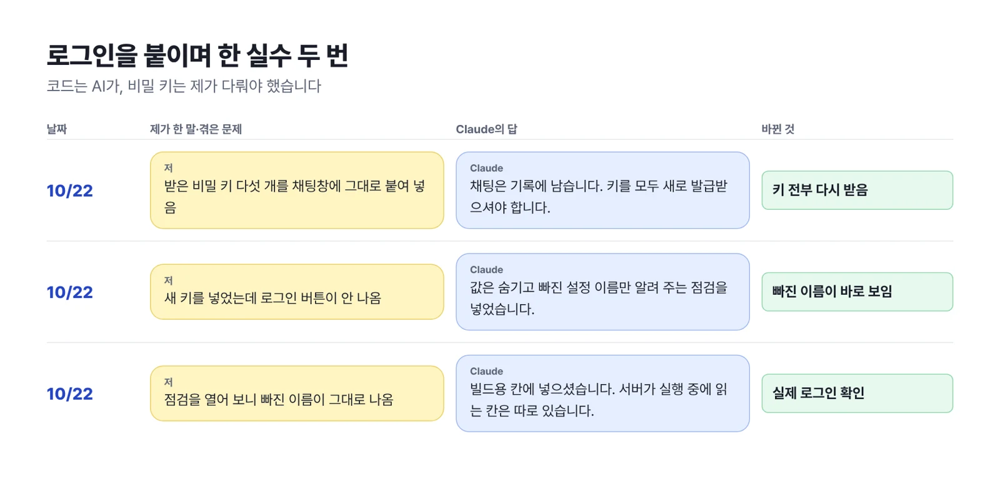
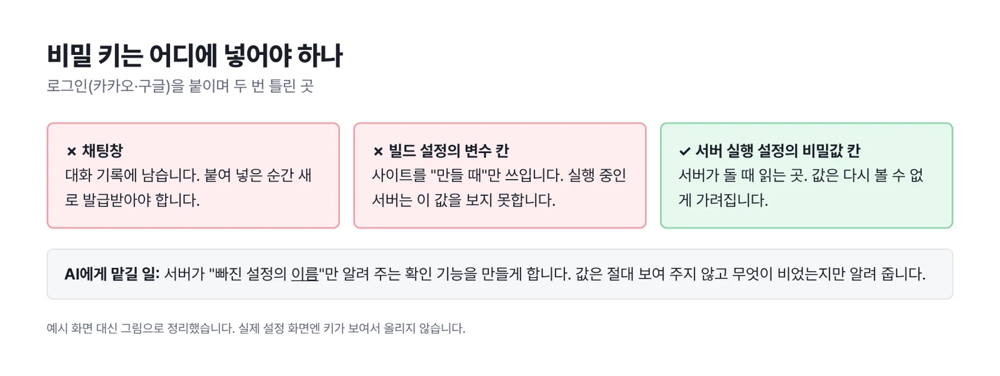

플레이 기록을 서버에 안전하게 저장하려고 게임에 카카오와 구글 로그인을 붙이기로 했습니다.

복잡한 연동 코드는 Claude가 막힘없이 짜 주었습니다. 다만 보안상 **비밀 키(Secret Key)**를 발급받아 서버에 넣는 일만큼은 사람인 제 몫이었죠. 그리고 딱 그 남은 한 조각에서, 하루 만에 사고를 두 번이나 쳤습니다.

<figure><figcaption>10월 22일 하루 동안 비밀 키 때문에 진땀을 뺀 기록입니다.</figcaption></figure>

## 1차 사고: 비밀 키 다섯 개를 채팅창에 그대로 붙여 넣다

카카오와 구글 개발자 센터에서 막 발급받은 비밀 키 다섯 개를 복사해서, 별생각 없이 Claude 채팅창에 그대로 붙여 넣었습니다. "내가 잘 모르니까 네가 알아서 제자리에 넣어 줘"라는 순진한 생각이었습니다.

Claude가 평소와 달리 단호하게 막아섰습니다.

**"채팅창에 한 번이라도 입력된 비밀 키는 이미 외부에 유출된 것으로 간주해야 합니다. 지금 당장 다섯 개 모두 폐기하고 새로 발급받으세요."**

정신이 번쩍 들었습니다. 개발자 센터로 돌아가 방금 만든 키 다섯 개를 전부 폐기하고 처음부터 다시 뽑았죠. 그날 이후 규칙을 하나 못 박아 두었습니다. **AI에게는 비밀 키의 '값'을 보여 주는 게 아니라, 키를 넣을 '빈칸의 위치'만 묻는다.**

## 2차 사고: 분명 넣었는데 왜 로그인 버튼이 안 뜨지?

새로 발급받은 키 다섯 개를 이번엔 제가 직접 서버 설정 화면에 하나씩 적어 넣었습니다. 그런데 게임을 켜 보니 로그인 버튼이 아예 보이지 않더군요. 화면만 쳐다봐서는 키가 틀린 건지, 코드가 꼬인 건지 도무지 감이 안 왔습니다.

답답해하고 있으니 Claude가 서버에 작은 **자가 진단 기능**을 붙여 주었습니다. 비밀 키의 실제 값은 화면에 한 글자도 띄우지 않고, 서버 입장에서 **"지금 어떤 이름의 키가 비어 있는지"**만 O/X로 보여 주는 안전한 점검 도구였습니다.

진단 화면을 열어 보니 황당한 결과가 떴습니다. 방금 정성껏 입력한 키 다섯 개가 전부 '비어 있음(누락)'으로 나오는 겁니다.

범인은 서버 관리 화면의 닮은꼴 입력 칸이었습니다. 이름이 거의 똑같은 설정 칸이 위아래로 나란히 붙어 있었는데, 저는 '실제 서버가 돌아갈 때 읽는 칸(런타임 변수)'이 아니라 **'홈페이지를 처음 조립할 때만 잠깐 쓰는 칸(빌드 변수)'**에 키를 잔뜩 넣어 두고 있었던 겁니다. 올바른 칸으로 옮겨 적자마자 로그인 버튼이 그제야 모습을 드러냈습니다.

<figure><figcaption>비밀 키가 가야 할 자리와 가면 안 되는 자리입니다. 실제 서버 화면을 캡처하면 또 사고가 날까 봐 그림으로 대신했습니다.</figcaption></figure>

## 사고 치며 건진 요령

비밀 키 관리는 아무리 유능한 AI에게도 떠넘길 수 없는 사람의 일입니다. 그래도 **비밀 키를 직접 보지 않고도 내가 뭘 잘못 넣었는지 짚어 주는 진단 도구**는 AI가 몇 분 만에 만들어 줍니다. "값은 가리고 누락된 키 이름만 알려 줘"라는 점검 화면이 없었다면, 저는 한밤중까지 엉뚱한 칸에서 키를 지웠다 다시 쓰며 씨름하고 있었을 겁니다.

김에 나중에 비밀 키를 주기적으로 바꿀 때의 순서도 Claude에게 물어 적어 두었습니다. **'새 키 먼저 추가 → 정상 작동 확인 → 옛날 키 비활성화 → 옛날 키 최종 삭제'**. 성급하게 옛날 키부터 지웠다간 교체하는 사이 모든 유저의 로그인이 끊긴다니, 미리 물어보길 잘했습니다.

## 세 줄 요약

1. 비밀 키는 AI 채팅창에 절대 붙여 넣지 마세요. 한 번이라도 들어갔다면 미련 두지 말고 바로 폐기하고 재발급받는 게 안전합니다.
2. AI에게는 키의 값 대신 넣을 자리만 묻고, 안 될 때는 값을 숨긴 채 누락된 이름만 O/X로 체크해 주는 진단 도구를 만들게 하세요.
3. 나중에 키를 교체할 땐 로그인이 끊기지 않도록 `새 키 추가 → 작동 확인 → 옛날 키 끄기 → 삭제` 순서를 지킵니다.
