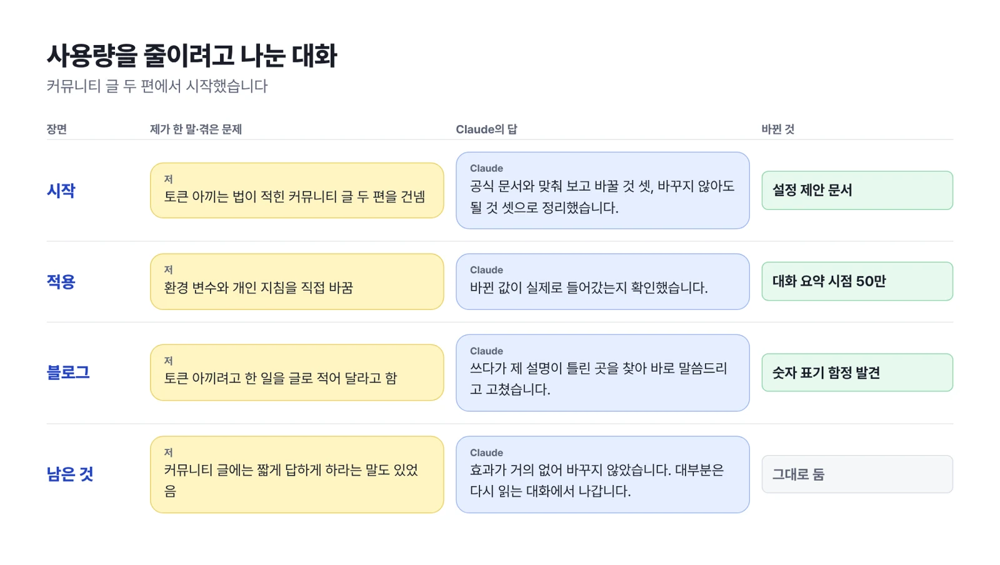
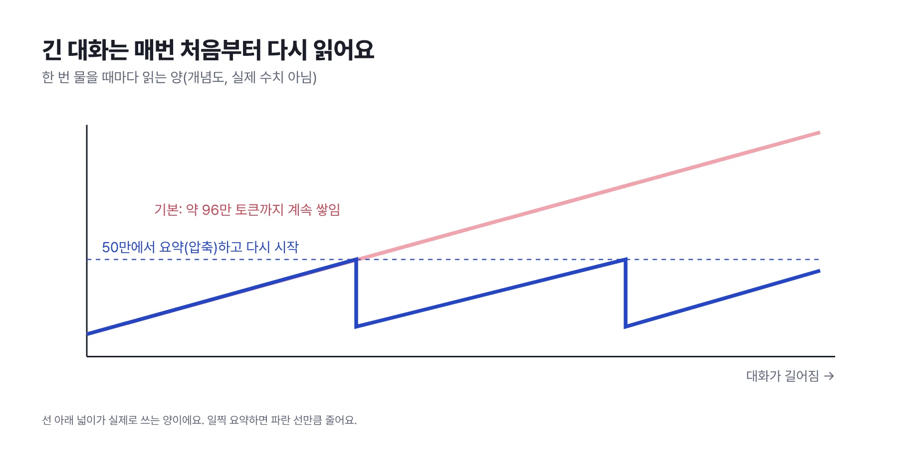
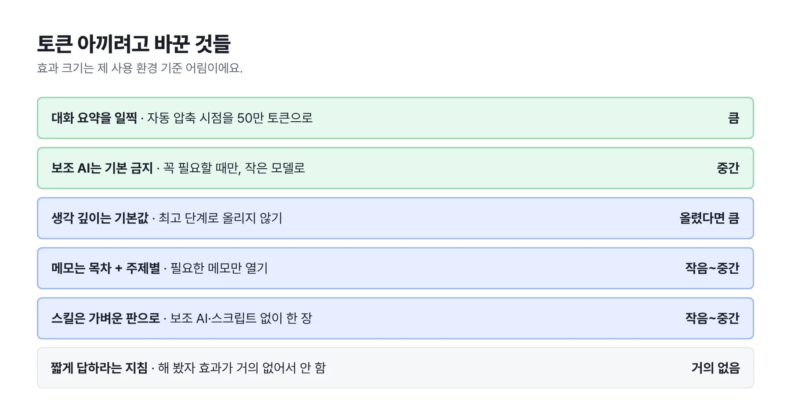

Claude Code와 손발이 슬슬 맞아 갈 무렵, 생각보다 훨씬 일찍 '사용량 한도 도달' 경고창이 뜨기 시작했습니다.

흐름을 한창 탄 순간에 맥이 뚝 끊기니 꽤 답답하더군요. 마침 개발자 커뮤니티에서 토큰을 아끼는 설정 글 두 편을 찾았습니다. 예전 같았으면 눈에 띄는 대로 복붙했을 텐데, 이번엔 당사자인 Claude에게 두 글을 그대로 건네며 먼저 물었습니다. **"공식 문서랑 대조해서 우리 작업에 진짜 효과 있는 것만 골라 줘."**

<figure><figcaption>토큰 다이어트를 시작하기까지 Claude와 주고받은 대화 정리입니다.</figcaption></figure>

## 남의 세팅을 베끼기 전에 공식 문서로 검증부터

Claude는 두 글을 꼼꼼히 읽고 공식 매뉴얼과 하나씩 맞대 보더니, **당장 바꾸면 효과가 큰 설정 세 가지**와 **굳이 손댈 필요 없는 세 가지**로 깔끔하게 나눠 주었습니다. 남들이 좋다더라 하는 설정을 통째로 베끼지 않고 한 번 걸러 낸 덕분에, 우리 작업 방식과 맞지 않는 헛수고를 꽤 줄였습니다.

## 토큰을 잡아먹던 진짜 주범은 '눈덩이 대화방'

설명을 듣고 나서야 뒤통수를 맞은 기분이 들었습니다.

Claude Code는 제가 질문을 하나 던질 때마다, **그 대화방을 연 순간부터 지금까지 주고받은 기록을 처음부터 끝까지 통째로 다시 읽습니다.** 아침에 열어 둔 방에서 저녁까지 붙잡고 있으면, 막판에 고작 "이 버튼 색깔 바꿔 줘" 한 줄을 시켜도 아침부터 쌓인 대화 뭉치를 매번 등에 지고 달리는 꼴이 됩니다.

결국 AI에게 "대답을 짧게 하라"고 다그치는 것보다, **매번 다시 읽어야 하는 지난 대화의 부피를 줄이는 것**이 훨씬 중요했습니다.

<figure><figcaption>토큰 소모 개념도입니다. 대화가 너무 불어나기 전에 일찍 요약(압축)해 주면 매번 다시 읽는 짐이 확 줄어듭니다.</figcaption></figure>

## 그래서 바로 손본 두 가지

체감 효과가 가장 컸던 건 **대화 자동 요약(Compact) 시점을 앞당긴 것**입니다. 기본 설정은 대화가 약 96만 7천 토큰까지 꽉 차야 요약을 시작하는데, 이 기준선을 **50만 토큰**으로 절반 가까이 낮췄습니다. 눈덩이가 굴러가기 전에 미리미리 털어 내는 셈이죠.

두 번째는 **보조 AI(서브에이전트) 남발 금지**였습니다. 메인 AI가 일을 빨리 끝내려고 보조 AI를 여럿 불러내곤 했는데, 이 친구들이 각자 자기 대화방을 따로 열어 토큰을 배로 쓰고 있었습니다. 그래서 개인 지침서에 **"보조 AI는 꼭 필요할 때만 부르고, 부를 때도 가벼운 모델(Haiku 등)로 써라"**라고 분명히 적어 두었습니다.

보안상 설정 파일은 제가 직접 열어 수정했고, 바뀐 숫자가 제대로 적용됐는지는 다음 작업 때 Claude가 확인해 주었습니다.

<figure><figcaption>적용한 여섯 가지 처방과 체감 효과입니다. 흔히 추천되는 '짧게 대답하기' 지침은 전체 소모량에 비하면 미미했습니다.</figcaption></figure>

## 블로그 글 쓰다가 발견한 천 배짜리 함정

재미있는 건, 이 내용을 블로그에 정리하던 도중에 Claude가 자기 보고서에서 아찔한 오류를 스스로 발견해 자수했다는 점입니다.

요약 시점을 바꿀 때 채팅창 명령어로 `"500"`을 치면 **50만**으로 알아듣지만, 설정 파일(환경 변수)에 `"500"`을 적으면 글자 그대로 **500**으로 읽힌다는 겁니다. 단위가 **천 배**나 차이 나는 함정이었죠. 다행히 저는 의심이 많아 처음부터 `500000`이라고 0을 다섯 개 다 채워 적어 두어서 사고는 피했습니다. 그래도 AI의 설명이 아무리 그럴듯해도 숫자와 단위가 걸린 설정은 한 번 더 확인해야 한다는 걸 뼈저리게 배웠습니다.

## 과감히 뺀 팁들

커뮤니티에서 단골로 권하는 **"모든 대답을 두세 문장으로 짧게 하라"**는 지침은 넣지 않았습니다. 토큰의 9할 이상은 AI가 새로 쓰는 답장이 아니라, 매 턴마다 다시 읽는 이전 대화 기록에서 빠져나가니까요. 생각 깊이(`effort`) 설정 역시 기본값이 균형이 가장 좋아 그대로 두었습니다.

## 세 줄 요약

1. 커뮤니티에서 좋은 설정 글을 발견하면 바로 복붙하지 말고, AI에게 공식 문서와 대조시켜 우리 환경에 맞는 것만 추려 쓰세요.
2. 토큰을 가장 많이 쓰는 주범은 길어진 대화방입니다. 자동 요약 시점을 절반으로 앞당기고 보조 AI 소환을 줄이는 게 가장 확실합니다.
3. AI가 알려 준 설정값도 단위가 천 배씩 어긋날 수 있으니, 숫자가 들어간 옵션은 적용 전에 한 번 더 확인하세요.
