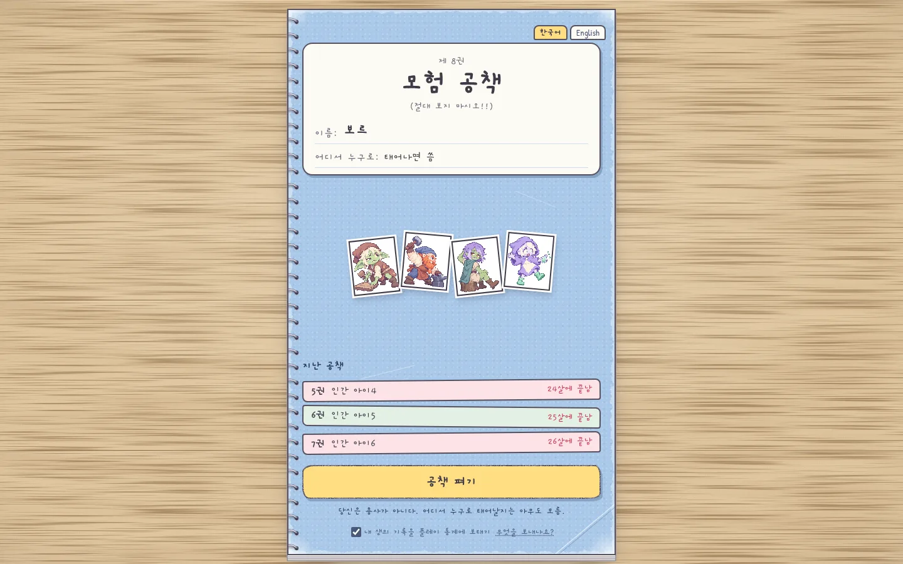
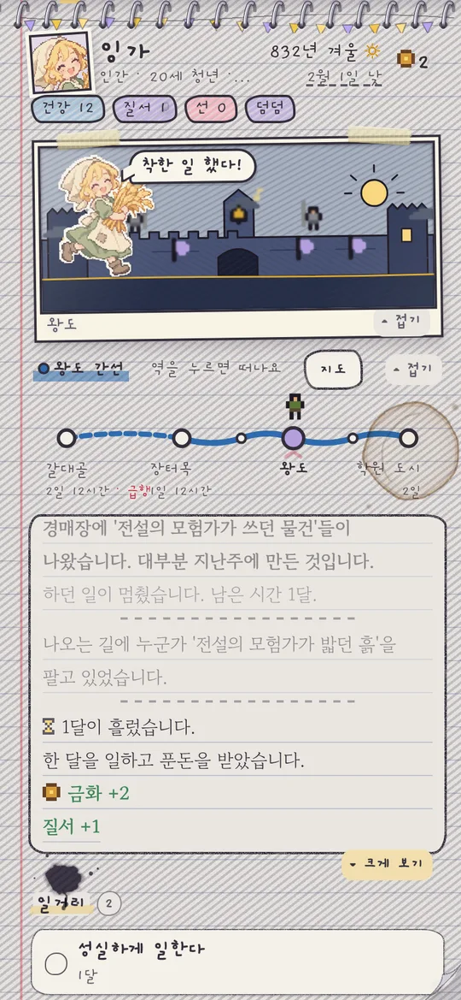
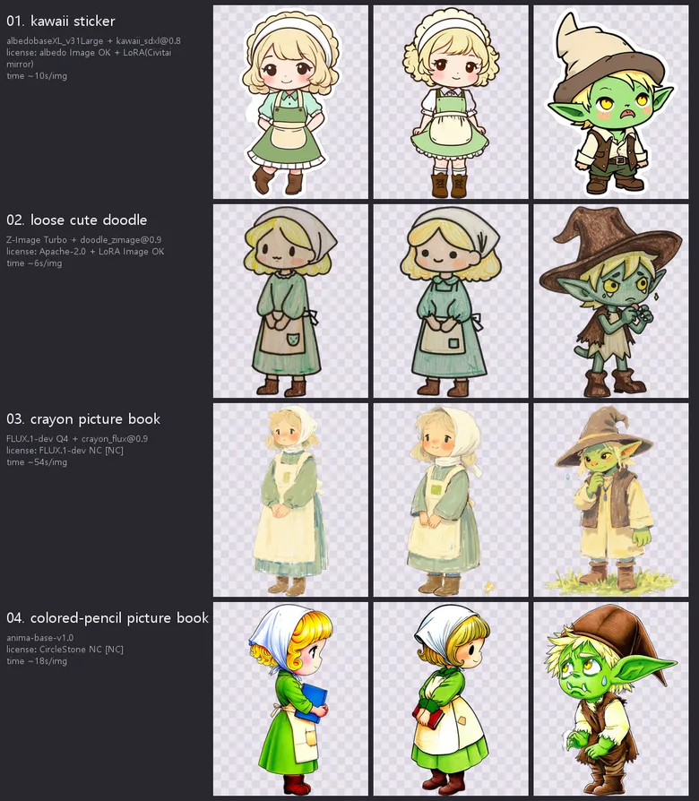
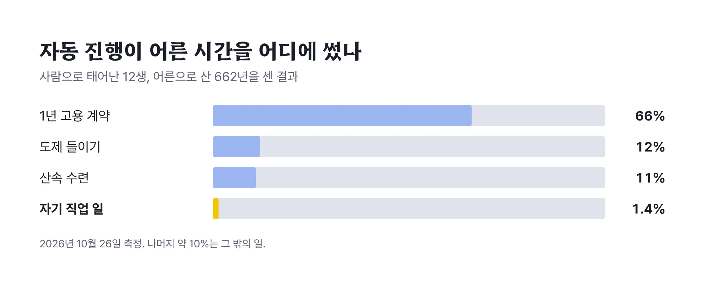

10월 20일에 시작한 뒤로 딱 일주일이 지났습니다. 그사이 판타지 웹 게임이 하나 제법 그럴듯하게 굴러가기 시작했는데, 정작 제 손으로 짠 코드는 단 한 줄도 없습니다.

제 역할은 세 가지가 전부입니다. 무엇을 만들지 큰 그림을 그리는 것, 돌아온 화면을 보고 마음에 드는지 고개를 끄덕이거나 젓는 것, 그리고 갈림길에서 하나를 찍는 것. 실제 코딩과 문서 정리는 전담 개발자인 Claude가 도맡아 합니다.

저는 말로만 방향을 잡는 디렉터고, AI가 개발팀 전체인 구도입니다. 둘이서 일주일 동안 부딪히며 정한 것들과, 몇 번 헛발질 끝에 건진 요령들을 가볍게 풀어 보려 합니다.

## 도대체 어떤 게임인가요?

이 게임에서 플레이어는 판타지 세계의 지극히 평범한 주민으로 무작위 환생합니다. 세상을 구하는 용사가 아니라, 옆집 농부의 딸이나 동네 대장장이의 셋째 아들 같은 사람으로요.

인생의 고비마다 20면체 주사위를 굴리며 살아가는데, 몇 분이면 한 생이 훌쩍 지나갑니다. 그렇게 죽음을 맞이하면 공책 마지막 쪽에 묘비와 사망 통지서가 붙고, 그 위로 **"참 잘했어요"** 도장이 쾅 찍힙니다. 길바닥에서 객사했는데 참 잘했다니, 위로인지 약 올리는 건지 조금 아리송하죠.

<figure><figcaption>첫 화면입니다. 공책 한 권이 곧 한 사람의 일생이고, 죽을 때마다 아래쪽에 지난 생의 공책들이 차곡차곡 쌓입니다.</figcaption></figure>

삶이 끝나면 그 사람이 평생 어디를 헤매고 살았는지 지도 위에서 발자취를 다시 짚어 줍니다.

<figure><video src="/assets/img/posts/first-week/journey.mp4" poster="/assets/img/posts/first-week/journey-poster.jpg" controls muted playsinline preload="none"></video><figcaption>태어난 마을부터 굵직한 사건들을 따라 지도 위를 아장아장 걸어가는 회고 영상입니다.</figcaption></figure>

겉모습은 초등학생이 수업 시간에 몰래 공책에 끄적인 모험 RPG 같습니다. 줄 공책에 스프링, 삐뚤빼뚤한 연필 글씨, 꾸미기용 스티커까지 붙어 있거든요. 하지만 안에서 벌어지는 일들은 겉모습만큼 다정하지 않습니다. **"겉은 무해하고 귀엽게, 결과는 가차 없고 적나라하게."** 첫날부터 못 박아 둔 이 게임의 뼈대입니다.

<figure class="narrow"><figcaption>스마트폰으로 한 생을 살아가는 화면입니다. 맨 위엔 현재 장면, 가운데엔 지하철 노선도 같은 이동 지도, 아래엔 그동안 겪은 파란만장한 일들이 쌓입니다.</figcaption></figure>

## 키보드 대신 입으로 개발하기

일하는 방식은 단순합니다. 결정은 제가 하고, 손발이 바쁜 일은 AI가 맡습니다.

작업하다 선택의 기로가 나오면 Claude가 두세 가지 대안과 본인 추천안을 '결정 카드'라는 짧은 보고서 형태로 정리해 옵니다. 저는 그걸 읽어 보고 "이번엔 B로 갑시다" 하고 고르기만 하면 됩니다. 일주일 동안 그렇게 넘긴 안건만 수십 개입니다. AI에게 이런 식으로 선택지를 올리게 만드는 요령은 [고르게 하는 법]()에 따로 적어 두었습니다.

성격이 급하다 보니 전투 다듬기나 로그인 붙이기 같은 굵직한 작업은 창을 여러 개 띄워 동시에 시키곤 했습니다. 속도는 확실히 빠른데, 가끔 AI들이 같은 파일을 동시에 건드리다 충돌이 나곤 했죠. 다행히 코드를 합칠 때 겹치는 부분을 알아서 정리해 주는 자동화 명령을 만들어 두고 나서는 평화가 찾아왔습니다([동시 작업 글]()).

하나 더. AI는 대화창을 닫는 순간 직전 맥락을 싹 잊어버립니다. 그래서 중요한 결정을 내릴 때마다 '왜 그렇게 정했는지'를 프로젝트 메모장에 스스로 적어 두게 했더니, 다음 날 같은 질문을 처음 듣는 표정으로 다시 묻는 일이 말끔히 사라졌습니다([메모 글]()).

## 그림체는 세 번이나 갈아엎었습니다

처음 AI가 뽑아 온 캐릭터는 근육과 갑옷 디테일이 살아 있는 정통 서양 판타지풍이었습니다. 잘 그리긴 했는데, 제가 머릿속에 그린 분위기와는 영 딴판이었죠. 저는 머리가 큼지막하고 눈이 동그란 일본 인디 게임 감성의 2등신 캐릭터를 원했거든요.

그 뒤로 도트 픽셀로 갔다가, 매끈한 일러스트로 갔다가, 결국 맨 처음 예시로 슬쩍 봤던 '파스텔 톤 픽셀 스티커'가 제일 예쁘다는 걸 깨닫고 돌고 돌아 원점으로 돌아왔습니다.

<figure class="narrow"><figcaption>같은 캐릭터를 화풍만 바꿔 나란히 세워 둔 비교표입니다. 이렇게 한눈에 펼쳐 놔야 비로소 제 취향이 보이더군요.</figcaption></figure>

이번에 확실히 배운 건, 그림체는 백 마디 설명보다 마음에 드는 참고 그림 한 장 건네는 편이 훨씬 빠르다는 사실입니다. 그리고 여러 시안을 나란히 붙여 보기 전까지는, 정작 저 자신도 내가 뭘 원하는지 잘 모른다는 것도요([화풍 정하는 순서]()).

## 감으로 고치기 전에 숫자로 까보기

10월 24일쯤 되니 직접 해 보면서 불만이 하나둘 쌓였습니다. *"잡다한 사건이 너무 자주 터져서 진도가 안 나간다"*, *"원하는 직업을 갖기가 하늘의 별 따기다"* 같은 것들이었죠.

예전 같았으면 당장 확률표부터 뜯어고쳤겠지만, 이번엔 숫자부터 재 보기로 했습니다. AI에게 자동 플레이 봇을 돌려 백 번 넘게 인생을 살아 보게 한 뒤, 캐릭터가 어른이 된 다음 시간을 대체 어디에 쓰고 있는지 통계를 뽑았습니다.

<figure><figcaption>어른이 된 캐릭터들이 시간을 어디에 썼는지 까본 결과입니다. 범인은 전혀 엉뚱한 곳에 있었습니다.</figcaption></figure>

결과는 꽤 황당했습니다. 캐릭터들이 어른 시절의 무려 **66%를 '1년 단기 고용 계약'**에 쏟아붓고 있었고, 정작 **자기 본업에 쓴 시간은 고작 1.4%**에 불과했던 겁니다. 까닭을 좇아 보니 초급 직업으로 버는 돈보다 단기 계약 보수가 더 짭짤해서, 영리한 AI 캐릭터들이 본업은 팽개치고 줄기차게 단기 일만 뛰고 있던 거였죠.

직업 이벤트가 안 떴던 건 이벤트 수가 모자라서가 아니었습니다. 애초에 본업을 안 하니 볼 기회 자체가 없었던 겁니다. 만약 감만 믿고 고쳤다면, 엉뚱하게 직업 이벤트만 수십 개 더 찍어 내느라 밤을 새웠을 겁니다.

"불만이 생기면 바로 고치지 말고 일단 측정부터 시키자." 첫 주에 얻은 가장 값진 버릇입니다.

## 로그인 붙이다가 간담이 서늘해진 날

카카오와 구글 로그인을 연동할 때의 일입니다. 막 발급받은 비밀 키 다섯 개를 아무 생각 없이 채팅창에 그대로 붙여 넣었다가, 아차 싶어 전부 폐기하고 처음부터 다시 발급받는 소동을 치렀습니다. 다시는 같은 실수를 안 하려고 [비밀 키 글]()에 고스란히 적어 두었습니다.

## 다음 주에는요

지금은 사건과 사건 사이에 '인과관계'를 엮어 넣는 중입니다. 어릴 때 스쳐 지나간 인물이 몇 년 뒤 원수로 돌아온다거나, 젊을 때 무심코 내린 선택이 노년에 부메랑처럼 되돌아오게 만들려 합니다. 진도가 나가는 대로 다음 주 기록도 들고 오겠습니다.

## 세 줄 요약

1. 방향을 정하고 선택지를 고르는 건 사람, 코드를 짜고 확인하는 건 AI로 역할을 나누니 비개발자도 일주일 만에 돌아가는 게임을 만들 수 있었습니다.
2. 그림체처럼 말로 설명하기 애매한 영역은, 설명을 늘리기보다 시안 여러 개를 나란히 놓고 고르는 편이 훨씬 빠릅니다.
3. 게임이 이상하게 느껴질 땐 감으로 손대기 전에 먼저 숫자를 재 보세요. 진짜 원인은 늘 예상 밖의 곳에 숨어 있습니다.
