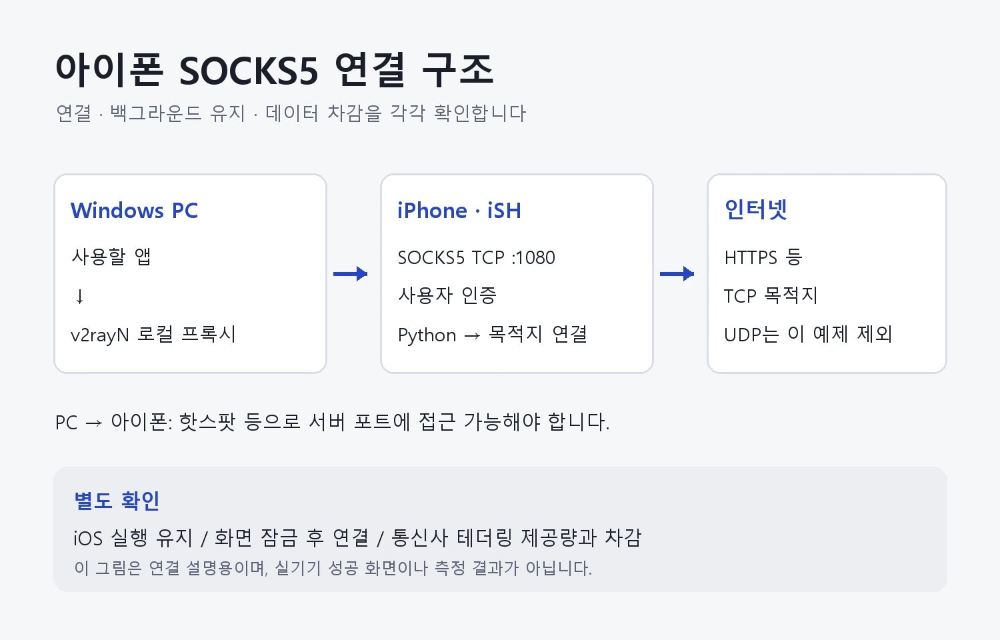
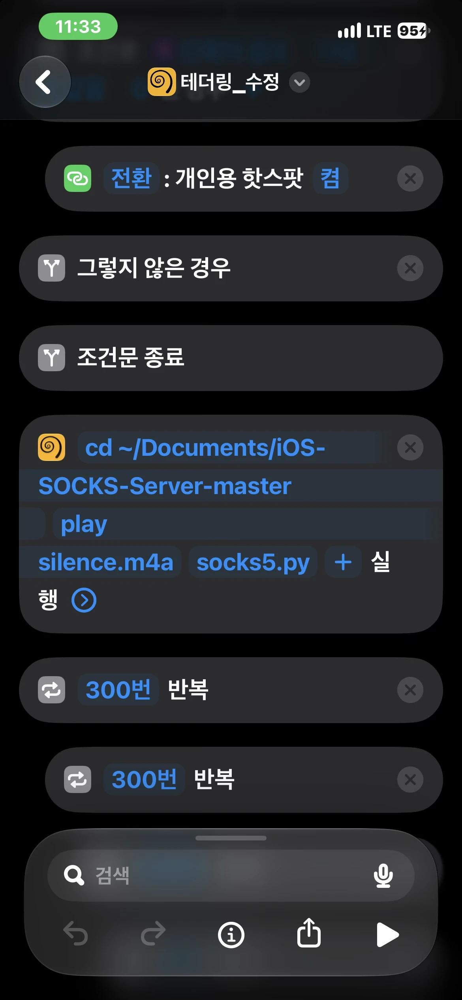

알뜰폰 요금제의 테더링 제한이 대체 어떻게 돌아가는지 호기심에 뜯어보다가, 어느새 아이폰 터미널 앱인 **a-Shell**과 **iSH** 안에 직접 SOCKS5 프록시 서버를 띄우는 곳까지 와 버렸습니다. 이왕 여기까지 온 김에, 매번 터미널을 열어 명령어를 치는 번거로움을 어디까지 줄일 수 있는지 끝까지 실험해 보았습니다.

인터넷에 흩어진 단편 명령어만 따라 치다 보면 정작 핵심 실행 파일의 내용이 빠져 있거나, 인증 없이 서버가 활짝 열려 있는 경우가 흔합니다. 그래서 이 글에서는 **① 서버 세팅 → ② PC 연결 → ③ 백그라운드 유지 및 자동 실행** 순서로 빠짐없이 따라 할 수 있게 묶어 두었습니다.

배경 이야기는 건너뛰고 당장 아이폰에 설치부터 하고 싶다면 **[1. iSH에 Python과 작업 폴더 준비하기](#ish-install)**로 바로 내려가시면 됩니다. 코드 블록 아래의 **‘코드 복사’** 버튼을 누르면 파일 생성 명령어까지 한 번에 복사됩니다.

<script src="/assets/js/iphone-ish-code-copy.js" defer></script>
<style>
.ish-copybar { display: flex; justify-content: flex-end; margin-top: 1rem; }
.ish-copybtn { min-height: 44px; padding: .5rem .9rem; border: 1px solid var(--line); border-radius: .4rem; color: var(--ink); background: var(--paper-2); font: inherit; font-size: .875rem; cursor: pointer; }
.ish-copybtn:focus-visible { outline: 2px solid var(--accent); outline-offset: 2px; }
</style>

## 시작하기 전에: 프록시가 붙는 것과 테더링 데이터 차감은 별개입니다

알뜰폰 요금제에서 흔히 말하는 '데이터 무제한'과 '테더링(핫스팟) 기본 제공량'은 통신사와 요금제 약관마다 계산 기준이 다릅니다. ([Apple 공식 안내](https://support.apple.com/ko-kr/111785)에도 핫스팟 지원 여부와 정책은 통신사를 따른다고 적혀 있습니다.)

SOCKS5 프록시를 쓰면 PC가 보낸 인터넷 요청을 아이폰 안의 앱이 받아 대신 전달하는 구조가 됩니다. 다만 이렇게 우회로를 냈다고 해서 통신사가 그 트래픽을 100% 폰 자체 데이터 사용량으로 쳐 준다는 보장은 없습니다. **'프록시가 잘 연결되는지'**와 **'내 요금제에서 테더링 한도가 실제로 안 깎이는지'**는 별개 문제이니, 연결에 성공한 뒤 소량의 데이터로 직접 확인해 보시는 편이 안전합니다.

물론 PC와 아이폰 사이에 기본 길(핫스팟 연결 등)부터 먼저 열려 있어야 합니다. 핫스팟 자체가 막혀 있거나 PC에서 아이폰 포트로 접근할 수 없다면 프록시 설정만으로는 해결되지 않으니, 본인 요금제 조건부터 가볍게 확인해 두세요.

<figure><figcaption>전체 연결 흐름입니다. 프록시로 통로를 여는 것과, iOS 백그라운드 유지·통신사 데이터 차감 여부는 각각 따로 확인해야 합니다.</figcaption></figure>

## 왜 a-Shell을 접고 iSH로 넘어갔을까?

처음엔 Python이 기본 내장된 iOS 터미널 앱 **a-Shell**로 시작했습니다. [공식 문서](https://github.com/holzschu/a-shell#shortcuts)만 봐도 iOS 단축어와 손발이 잘 맞게 되어 있었거든요.

그래서 흔히 알려진 조합대로 '무음 오디오 파일 무한 재생 + `socks5.py` 실행 + 단축어 무한 반복'을 짜 보았습니다. 아래가 그때 만든 단축어 화면인데, 결론부터 말씀드리면 **이 방식은 권하지 않습니다.**

<figure class="narrow"><figcaption>초기에 실험했던 a-Shell 단축어입니다. 무음 파일 재생과 반복문을 걸어 두어도 iOS가 백그라운드 서버를 곧잘 재워 버렸습니다.</figcaption></figure>

단축어에 대기나 반복 동작을 걸어 둔다고 iOS가 터미널 앱에 무제한 실행 시간을 내어 주지 않습니다. 무음 오디오 꼼수 역시 요즘 iOS에서는 금방 걸러져 서버가 조용히 종료되곤 합니다. 실제로 [a-Shell 깃허브 이슈](https://github.com/holzschu/a-shell/issues/721)를 봐도 SOCKS 프록시와 무음 재생을 같이 돌리다 강제 종료된 사례가 여럿 올라와 있습니다.

그래서 방향을 틀어 위치 서비스(`/dev/location`)로 백그라운드 유지를 훨씬 안정적으로 걸 수 있는 **iSH**로 처음부터 다시 짰습니다. (참고로 아래 나오는 `/root` 경로나 `apk` 패키지 명령어는 iSH 전용이라 a-Shell에서는 돌아가지 않으니 꼭 iSH 앱에서 진행하세요.)

## 인터넷에 자주 보이는 'iSH 두 줄 명령어'의 정체

관련 자료를 찾다 보면 십중팔구 아래 두 줄을 만나게 됩니다.

```sh
cat /dev/location > /dev/null &
cd /root/socks && python3 socks5.py
```

- **첫 번째 줄 (`cat /dev/location ...`)**: 아이폰의 GPS 위치 장치를 계속 읽어서, iOS가 "이 앱은 지금 위치 안내 중이구나" 하고 백그라운드에서 강제 종료하지 못하게 붙잡아 두는 방법입니다. ([iSH 공식 위키](https://github.com/ish-app/ish/wiki/Running-in-background)에서도 안내하는 정석 팁이죠.) 쏟아지는 위치 데이터는 `/dev/null`로 흘려보내고, 끝에 `&`를 붙여 백그라운드에서 조용히 돌게 만듭니다.
- **두 번째 줄 (`cd /root/socks ...`)**: 작업 폴더로 들어가 본격적으로 프록시 서버를 켭니다. 서버가 켜지면 터미널 프롬프트가 멈춘 것처럼 보이는데, 얼어붙은 게 아니라 요청을 기다리며 정상 대기 중인 상태입니다. 끌 때는 `Ctrl+C`를 누르면 됩니다.

다만 돌아다니는 글에는 정작 제일 중요한 **`socks5.py` 안에 어떤 코드가 들어가는지**, 그리고 **백그라운드에 띄워 둔 위치 읽기 프로세스를 나중에 어떻게 깔끔하게 끄는지**가 빠져 있는 경우가 많습니다. 아래부터는 아이디·비밀번호 인증이 걸린 서버 코드부터 종료 시 자동 뒷정리 스크립트까지 빠짐없이 만들어 보겠습니다.

<h2 id="ish-install">1. iSH에 Python과 작업 폴더 준비하기</h2>

아이폰으로 이 글을 보고 있다면 각 코드 블록의 **코드 복사** 버튼을 눌러 iSH 터미널에 붙여넣고 엔터를 치시면 됩니다. 1~4단계는 처음 한 번만 순서대로 밟으면 되고, 세팅이 끝나면 그다음부터는 명령어 한 줄로 바로 켤 수 있습니다.

우리가 만들 `socks5.py`는 검증된 오픈소스인 [pproxy](https://github.com/qwj/python-proxy) 엔진을 써서 아이디·비밀번호 인증이 걸린 TCP SOCKS5 서버를 띄웁니다. (UDP는 지원하지 않습니다.)

iSH 앱을 열고 터미널 입력창이 뜨면 아래 블록을 통째로 복사해 붙여넣으세요. 패키지를 받아야 하니 인터넷이 연결된 상태여야 합니다.

```sh
(
  set -eu
  apk update
  apk add python3 py3-pip curl
  mkdir -p /root/socks
  cd /root/socks
  if ! python3 -m venv .venv; then
    apk add py3-virtualenv
    python3 -m virtualenv .venv
  fi
  .venv/bin/python -m pip install 'pproxy==2.7.9'
  .venv/bin/python -c 'import pproxy; print("Python / pproxy OK")'
)
```

설치 로그가 쭉 올라간 뒤 마지막 줄에 **`Python / pproxy OK`**가 찍히면 1단계 완료입니다. 혹시 중간에 오류가 나면 괄호 안의 `set -eu` 덕분에 알아서 멈추니, 네트워크 상태를 확인한 뒤 다시 실행해 보세요.

## 2. socks5.py 서버 파일 만들기

이제 방금 만든 폴더에 실제 서버 프로그램인 `socks5.py`를 채워 넣을 차례입니다. 아래 블록을 복사해 iSH에 붙여넣고, 마지막 줄에서 커서가 멈춰 있으면 엔터를 한 번 눌러 주세요.

```sh
cat > /root/socks/socks5.py <<'PY'
#!/usr/bin/env python3
"""Authenticated TCP SOCKS5 example using pproxy 2.7.9. No UDP listener.

Local credentials stay beside this script in credentials.json. Do not publish it.
The SOCKS5 username/password exchange is NOT encrypted. Use a trusted network.
"""
import argparse
import asyncio
import getpass
import json
import os
from pathlib import Path
import re

CONFIG = Path(__file__).resolve().with_name("credentials.json")


def credentials():
    cfg = json.loads(CONFIG.read_text(encoding="utf-8"))
    user, password = cfg["username"], cfg["password"]
    if not isinstance(user, str) or not re.fullmatch(r"[A-Za-z0-9_-]{1,64}", user) or "__" in user:
        raise ValueError("Use 1-64 ASCII letters, digits, _ or - for username; do not use consecutive underscores")
    if not isinstance(password, str) or not re.fullmatch(r"[A-Za-z0-9_-]{16,128}", password) or "__" in password:
        raise ValueError("Use 16-128 ASCII letters, digits, _ or - for password; do not use consecutive underscores")
    return user, password


async def serve(host, port):
    import pproxy
    user, password = credentials()
    proxy = pproxy.Server(f"socks5://{host}:{port}#{user}:{password}")
    # Disable IP-based authentication reuse; authenticate every connection.
    server = await proxy.start_server(dict(rserver=[], authtime=-1))
    print(f"SOCKS5 TCP listening on {host}:{port}; authentication required", flush=True)
    async with server:
        await server.serve_forever()


def main():
    parser = argparse.ArgumentParser(description=__doc__)
    parser.add_argument("--configure", action="store_true")
    parser.add_argument("--host", default="127.0.0.1",
                        help="IPv4 bind address; use the phone LAN IP for PC access")
    parser.add_argument("--port", default=1080, type=int)
    args = parser.parse_args()
    if args.configure:
        if CONFIG.exists():
            raise SystemExit("credentials.json already exists; edit or remove it locally first")
        user = input("Username (ASCII letters/digits/_/-): ").strip()
        password = getpass.getpass("Password (16+ ASCII letters/digits/_/-): ")
        if password != getpass.getpass("Repeat password: "):
            raise SystemExit("Passwords do not match")
        # Validate before saving. The restrictive alphabet avoids URI delimiters.
        if not re.fullmatch(r"[A-Za-z0-9_-]{1,64}", user) or "__" in user:
            raise SystemExit("Invalid username (consecutive underscores are not allowed)")
        if not re.fullmatch(r"[A-Za-z0-9_-]{16,128}", password) or "__" in password:
            raise SystemExit("Invalid password (consecutive underscores are not allowed)")
        fd = os.open(CONFIG, os.O_WRONLY | os.O_CREAT | os.O_EXCL, 0o600)
        with os.fdopen(fd, "w", encoding="utf-8") as handle:
            json.dump(dict(username=user, password=password), handle)
        print("Saved local credentials.json. Keep it private.")
        return
    try:
        asyncio.run(serve(args.host, args.port))
    except KeyboardInterrupt:
        pass


if __name__ == "__main__":
    main()
PY
```

파일이 깨지지 않고 잘 저장됐는지 아래 한 줄로 가볍게 문법 검사를 돌려 봅니다. **`socks5.py OK`**가 뜨면 준비 끝입니다.

```sh
cd /root/socks && .venv/bin/python -m py_compile socks5.py && echo 'socks5.py OK'
```

*(복사·붙여넣기가 번거로우시면 [같은 socks5.py 파일 직접 내려받기](/assets/downloads/iphone-socks5/socks5.py)를 쓰셔도 됩니다.)*

## 3. 아이디와 비밀번호 걸어 두기

아무나 내 폰 프록시에 올라타면 곤란하니 아이디와 비밀번호를 설정합니다. 아래 명령어를 실행하면 순서대로 입력을 받습니다.

```sh
cd /root/socks && .venv/bin/python socks5.py --configure
```

참고로 pproxy 내부 문법 때문에 밑줄 두 개(`__`)를 연달아 쓰면 오류가 나도록 막아 두었습니다.

1. **`Username`**: 영문, 숫자, `_`, `-` 조합으로 편하게 입력합니다.
2. **`Password`**: 같은 문자 조합으로 **16자 이상** 입력합니다. (보안상 평소 포털에서 쓰는 비밀번호 말고 완전히 새 비밀번호로 정해 주세요. 입력할 때 화면에 글자가 보이지 않는 게 정상입니다.)
3. **`Repeat password`**: 방금 입력한 비밀번호를 한 번 더 입력합니다.

**`Saved local credentials.json. Keep it private.`** 메시지가 뜨면 인증 정보 파일이 안전하게 저장된 겁니다. 잠시 뒤 PC(v2rayN)에서 접속할 때 바로 이 아이디와 비밀번호를 쓰게 됩니다.

## 4. 서버 테스트 가동해 보기

자동화를 붙이기 전에, 서버 자체부터 문제없이 뜨는지 확인합니다.

```sh
cd /root/socks && .venv/bin/python -u socks5.py --host 0.0.0.0 --port 1080
```

화면에 **`SOCKS5 TCP listening on 0.0.0.0:1080; authentication required`**가 뜨면 아이폰 안에서 프록시 서버가 제대로 문을 연 것입니다. (iOS가 '로컬 네트워크 접근 권한'을 물으면 **허용**을 눌러 주세요.)

여기서 `--host 0.0.0.0`은 핫스팟으로 붙은 내 PC가 아이폰 서버에 접속할 수 있도록 열어 주는 옵션입니다. 테스트를 마치고 서버를 끌 때는 iSH 화면 위쪽 보조 키보드에서 `Ctrl`을 누른 뒤 `C`를 누르시면 됩니다.

## Windows PC와 v2rayN에서 접속하기

아이폰 서버를 켜 둔 채로 PC를 아이폰 개인용 핫스팟에 연결합니다.

Windows에서 PowerShell을 열고 `ipconfig`를 실행해 핫스팟 연결의 **'기본 게이트웨이(Default Gateway)'** IP 주소를 찾습니다. 보통 `172.20.10.1` 같은 형태인데, 그게 핫스팟 안에서 아이폰의 주소입니다.

먼저 PC에서 아이폰의 1080번 포트로 노크가 닿는지부터 확인해 봅니다.

```powershell
$phoneIp = Read-Host '아이폰 연결 주소'
Test-NetConnection -ComputerName $phoneIp -Port 1080
```

결과에 `TcpTestSucceeded : True`가 뜨면 통로가 열린 겁니다. (`False`가 나오면 핫스팟 연결 상태와 iSH의 로컬 네트워크 권한을 다시 확인해 주세요.)

이어서 방금 설정한 아이디·비밀번호로 실제 웹 페이지가 불러와지는지 테스트합니다.

```powershell
$proxyUser = Read-Host '설정한 SOCKS 사용자 이름'
curl.exe --connect-timeout 10 --max-time 30 `
  --proxy "socks5h://${phoneIp}:1080" `
  --proxy-user "$proxyUser" https://example.com/
```

비밀번호 입력창이 뜨면 아이폰에서 정한 16자 이상 비밀번호를 입력합니다. 화면에 `Example Domain` HTML 코드가 쏟아져 나오면 성공입니다. PC의 요청이 아이폰 iSH 프록시를 거쳐 인터넷에 다녀온 셈이죠.

이제 실사용을 위해 윈도우용 프록시 클라이언트인 **[v2rayN](https://github.com/2dust/v2rayN)**에 서버를 등록합니다.

| 항목 | 입력할 값 |
| --- | --- |
| 유형 (Type) | `SOCKS` (또는 `SOCKS5`) |
| 주소 (Address) | 방금 확인한 아이폰 게이트웨이 IP 주소 |
| 포트 (Port) | `1080` |
| 사용자 이름·비밀번호 | 아이폰 3단계에서 설정한 아이디와 비밀번호 |
| 활성 서버 지정 | 방금 추가한 항목을 우클릭해 활성 서버로 선택 |

처음 연결할 때는 복잡한 TUN 모드보다 기본 **'시스템 프록시 설정(Set system proxy)'**부터 켜서 웹 브라우저가 잘 열리는지 확인하는 편이 깔끔합니다.

> **💡 잊지 마세요!** 사용을 마치고 v2rayN을 끌 때는 하단에서 **'시스템 프록시 해제(Clear system proxy)'**를 먼저 눌러 주세요. 시스템 프록시를 켜 둔 채 프로그램만 닫으면, 윈도우가 꺼진 프록시만 계속 찾느라 인터넷이 끊긴 것처럼 보입니다.

## 위치 읽기와 서버 실행을 스크립트 하나로 묶기

PC 연결까지 확인됐으니, 이제 번거로운 단계를 하나로 합칠 차례입니다. iSH로 돌아와 켜 두었던 테스트 서버를 `Ctrl+C`로 끕니다.

아래 블록을 복사해 붙여넣으면 **① 백그라운드 유지용 위치 읽기 실행 + ② 중복 실행 방지 잠금장치 + ③ 프록시 서버 실행 + ④ 종료 시 뒷정리**까지 알아서 처리하는 실행 스크립트(`start-socks.sh`)가 만들어집니다.

```sh
cat > /root/socks/start-socks.sh <<'SH'
#!/bin/sh
set -eu
cd /root/socks

# A directory lock avoids starting multiple copies from different login shells.
if ! mkdir .run-lock 2>/dev/null; then
    echo 'Already running, or stale .run-lock. Check ps before removing the lock.'
    exit 1
fi
location_pid=''
cleanup() {
    if [ -n "$location_pid" ]; then
        kill "$location_pid" 2>/dev/null || :
        wait "$location_pid" 2>/dev/null || :
    fi
    rmdir .run-lock 2>/dev/null || :
}
trap cleanup EXIT
trap 'exit 130' INT
trap 'exit 143' TERM HUP

if [ ! -c /dev/location ]; then
    echo '/dev/location is unavailable; background keep-alive is not enabled.'
    exit 1
fi
cat /dev/location > /dev/null &
location_pid=$!

# Foreground server: Ctrl+C returns to the shell and stops this location reader.
# All IPv4 interfaces are reachable: only use a trusted private hotspot/network.
.venv/bin/python -u socks5.py --host 0.0.0.0 --port 1080
SH
chmod 700 /root/socks/start-socks.sh
```

*(파일로 받으시려면 [같은 start-socks.sh 내려받기](/assets/downloads/iphone-socks5/start-socks.sh)를 이용하세요.)*

이제부터는 긴 명령어 대신 딱 **이 한 줄**이면 위치 유지와 서버가 함께 켜집니다. (처음 실행할 때 iOS가 위치 권한을 물으면 **'항상 허용' 또는 '앱을 사용하는 동안 허용'**을 선택해 주세요.)

```sh
sh /root/socks/start-socks.sh
```

이 스크립트의 진짜 장점은 뒷정리입니다. 나중에 `Ctrl+C`로 서버를 끄면, 백그라운드에서 배터리를 쓰던 위치 읽기 프로세스(`cat /dev/location`)까지 알아서 깔끔하게 종료해 줍니다.

혹시 iSH가 비정상 종료돼서 다음에 켤 때 `Already running, or stale .run-lock` 메시지가 뜨더라도 당황하지 마세요. `ps` 명령어로 실행 중인 서버가 없는 걸 확인한 뒤, 아래 명령어로 남은 잠금 폴더만 지우고 다시 켜면 됩니다.

```sh
rmdir /root/socks/.run-lock
sh /root/socks/start-socks.sh
```

물론 `/dev/location` 방식도 만능은 아닙니다. 아이폰 메모리가 빠듯하거나 iOS가 작정하고 앱을 정리할 때는 끊길 수 있으니, 화면을 잠근 상태에서 얼마나 오래 버티는지 본인 사용 환경에 맞춰 미리 확인해 두세요.

## 한 걸음 더: iSH를 열자마자 자동으로 서버 띄우기 (`.profile`)

"저 한 줄 치는 것도 귀찮다, iSH를 열면 바로 서버가 켜졌으면 좋겠다" 싶다면 아래 블록을 실행해 두세요. (켜져 있던 서버는 `Ctrl+C`로 끈 상태에서 입력합니다.)

```sh
if ! grep -Fq '# BEGIN iSH SOCKS5 autostart' /root/.profile 2>/dev/null; then
  cat >> /root/.profile <<'PROFILE'

# BEGIN iSH SOCKS5 autostart
case $- in
  *i*)
    if [ ! -e /root/socks/disable-autostart ] &&
       [ -x /root/socks/start-socks.sh ]; then
      sh /root/socks/start-socks.sh
    fi
    ;;
esac
# END iSH SOCKS5 autostart
PROFILE
fi
```

이제 iSH를 새로 실행해 로그인 셸이 열릴 때마다 별도 입력 없이 자동으로 프록시 서버가 가동됩니다.

다른 터미널 작업이 필요해 자동 실행을 잠시 꺼 두고 싶다면, `Ctrl+C`로 서버를 멈춘 뒤 아래 명령어로 '일시 중지 팻말' 파일을 하나 만들어 두면 됩니다.

```sh
touch /root/socks/disable-autostart
```

자동 실행을 다시 켜고 싶을 땐 그 파일만 지워 주면 끝입니다.

```sh
rm /root/socks/disable-autostart
```

## iOS 단축어와 함께 쓰는 요령

마지막으로 아이폰 기본 **단축어** 앱까지 엮어 두면 손이 한결 편해집니다.

아쉽게도 iSH는 `ish://실행할명령어` 같은 외부 명령어 전달을 지원하지 않습니다([공식 깃허브 이슈](https://github.com/ish-app/ish/issues/2063)에서도 지원 계획 없음으로 닫혔습니다). 그래서 단축어의 '앱 열기'로 iSH를 부를 때, 앱이 완전히 닫혀 있었다면 방금 설정한 `.profile` 덕분에 서버가 자동으로 켜지지만, 이미 열려 있던 창으로 돌아갈 때는 자동 실행이 안 걸릴 수 있습니다.

이 틈을 메우려면 단축어를 아래처럼 **두 단계**로 짜 두는 게 실용적입니다.

1. **텍스트를 클립보드에 복사**: `sh /root/socks/start-socks.sh`
2. **앱 열기**: `iSH` 선택

이 단축어를 홈 화면 아이콘이나 아이폰 동작 버튼(Action Button)에 걸어 두면 됩니다. 눌렀을 때 서버가 알아서 켜지면 그대로 쓰면 되고, 혹시 꺼져 있더라도 터미널을 톡 눌러 **붙여넣기**만 하면 1초 만에 서버가 살아납니다.

## 마무리와 보안 주의사항

- **공용 와이파이에선 절대 금지**: SOCKS5 프로토콜 자체는 비밀번호를 암호화하지 않고 평문으로 주고받습니다([RFC 1929](https://www.rfc-editor.org/rfc/rfc1929)). 카페 공용 와이파이 같은 환경에서는 켜 두지 마시고, 내 아이폰 핫스팟에 내 PC만 일대일로 붙는 신뢰할 수 있는 환경에서만 사용하세요.
- **한 단계씩 확인하며 붙이기**: 처음부터 자동 실행(`.profile`)까지 한 번에 밀어 넣으면 막혔을 때 원인을 찾기 어렵습니다. **수동 서버 실행 → PC 연결 테스트 → 실행 스크립트 → 자동 실행** 순으로 하나씩 확인하며 올리는 편이 훨씬 빠릅니다.

## 세 줄 요약

1. a-Shell의 무음 재생 꼼수보다 iSH에서 `/dev/location`으로 백그라운드를 유지하고 `pproxy`로 인증 걸린 SOCKS5 서버를 띄우는 편이 훨씬 안정적입니다.
2. 위치 프로세스 실행과 종료 뒷정리를 `start-socks.sh` 하나로 묶고 `.profile`에 등록하면 iSH를 열자마자 서버가 자동으로 뜹니다.
3. PC(v2rayN) 연결을 먼저 확인한 뒤, 본인의 알뜰폰 요금제에서 실제 테더링 데이터가 어떻게 차감되는지 소량으로 꼭 검증해 보세요.
