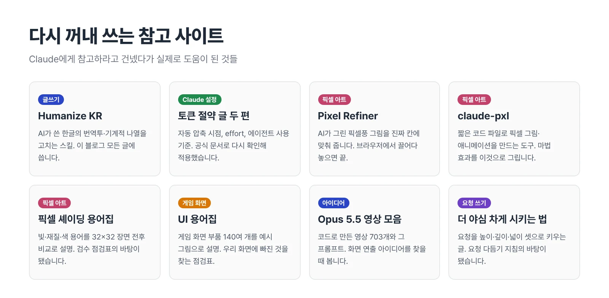
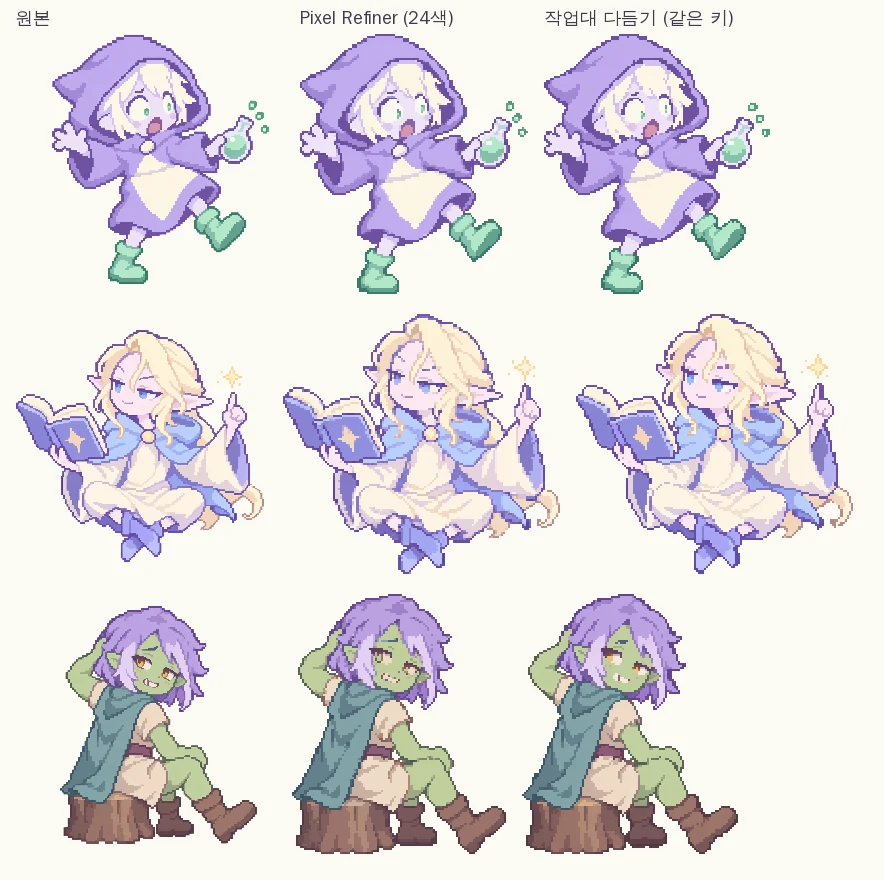
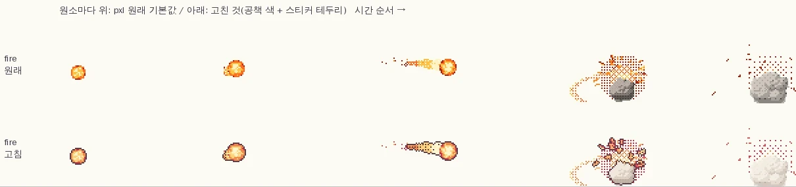

게임을 만들다 괜찮은 커뮤니티 꿀팁이나 신박한 웹 도구를 발견하면 일단 Claude에게 **"야, 이거 한 번 읽어 봐"** 하고 링크부터 던져 줍니다. 

그렇게 쏠쏠하게 재미를 본 사이트가 꽤 되는데, 문제는 며칠만 지나도 "그때 그 사이트 주소가 뭐였더라?" 하며 다시 찾느라 헤맨다는 거였습니다. 그래서 제가 직접 써 보고 **진짜로 밥값을 했던 알짜배기 사이트들**만 이곳에 박제해 둡니다.

<figure><figcaption>분야별로 추려 둔 즐겨찾기 목록입니다.</figcaption></figure>

## 글쓰기 & 말투 교정

**[Humanize KR](https://github.com/epoko77-ai/im-not-ai)** · AI가 쓴 한국어 특유의 어색한 번역투와 로봇 같은 문장 나열을 사람 말투로 자연스럽게 다듬어 주는 Claude 전용 스킬입니다. 팩트나 숫자는 건드리지 않고 문장의 결만 매끄럽게 정돈해 주는 게 특징입니다. 우리 블로그에서도 글을 올리기 전에 초안을 다듬는 용도로 요긴하게 참고하고 있습니다.

## Claude 설정과 토큰 다이어트

**디시인사이드 [AI 개발 갤러리 글](https://gall.dcinside.com/mgallery/board/view/?id=aidevelop&no=4369)과 [AI 활용 갤러리 글](https://gall.dcinside.com/mgallery/board/view/?id=ai_utilize&no=137000)** · Claude Code 고인물 유저분들이 토큰 아끼는 실전 세팅법을 아낌없이 풀어 놓은 글입니다. 대화 자동 요약을 일찍 돌리기, 보조 에이전트 함부로 소환하지 않기 같은 뼈가 되고 살이 되는 팁들이 담겨 있습니다. Claude에게 이 글들을 읽히고 공식 매뉴얼과 팩트 체크를 시켜서 우리 환경에 맞게 적용한 과정은 [토큰 아끼기 글]()에 자세히 적어 두었습니다.

## 픽셀 아트 & 그래픽 도구

**[Pixel Refiner](https://pixel-refiner.app/)** · AI가 그럴싸하게 흉내만 낸 '무늬만 픽셀' 그림을 **진짜 도트 격자(그리드)**에 딱딱 들어맞게 정렬해 주는 고마운 무료 웹 도구입니다. 사이트에 접속해서 그림 파일을 마우스로 툭 끌어다 놓기만 하면 끝납니다. 저희가 자체 제작한 에셋 작업대의 보정 기능과 나란히 비교해 봤는데도 결과물이 막상막하더군요. 별도의 자체 작업대가 없는 분들께 무조건 1순위로 추천합니다.

<figure><figcaption>왼쪽부터 AI 원본, Pixel Refiner 보정본, 저희 자체 작업대 보정본입니다. 지저분하던 도트 선이 깔끔하게 정돈됩니다.</figcaption></figure>

**[claude-pxl](https://github.com/augusto-scarvalho/claude-pxl)** · 짧은 코드로 도트 그림과 프레임 애니메이션을 찍어 내는 도구인데, 태생부터 AI가 다루기 쉽게 설계되어 있습니다. Claude에게 이걸 쥐여 주고 불 마법 이펙트를 그려 보라고 시켰더니, 처음엔 밝은 공책 배경색에 파스텔 톤 불꽃이 묻혀서 영 안 보이더군요. 거기에 진한 외곽선을 두르는 옵션만 살짝 얹었더니 단숨에 게임에 쓸 만한 퀄리티가 나왔습니다.

<figure><figcaption>위가 기본 설정으로 뽑은 불 마법, 아래가 공책 배경에 맞춰 외곽선을 덧입힌 버전입니다.</figcaption></figure>

**[픽셀 셰이딩 용어집](https://tuiella.github.io/pixel-glossary/)** · 도트 아트의 빛, 그림자, 색감 관련 전문 용어들을 귀여운 전후 비교 짤로 알기 쉽게 설명해 둔 한국어 도감입니다. AI에게 그냥 "그림자 좀 자연스럽게 쳐 줘"라고 하면 매번 엉뚱한 결과물을 가져오는데, 이 사전에 나오는 정확한 용어(예: 필로우 셰이딩 금지, 휴 시프팅 적용 등)로 콕 집어 명령하면 결과물이 놀랍도록 일관되게 나옵니다. 아예 Claude에게 이 사전을 통째로 외우게 해서 그림 검수용 체크리스트로 만들어 두었습니다.

**[문제의 이름-도트](https://tuiella.github.io/b3/dot/)** · 용어집을 만든 그분이 새로 연 칼럼입니다. "부글거려요", "자글자글해요"처럼 말로만 맴돌던 도트 문제 열다섯 가지에 보일링, 믹셀, 피벗 흔들림 같은 이름을 붙이고 원인과 고치는 법까지 짝지어 줍니다. 그림 문제는 이름을 모르면 검색도 못 하잖아요. Claude에게 이 목록을 들고 우리 게임을 훑어보게 했더니 쓰러질 때 캐릭터를 딱 90도로 눕히는 연출은 "45도·90도 단위면 괜찮다"는 기준에 이미 맞아 있었습니다. 대신 AI로 한 장씩 뽑은 전신 세트는 첫 항목인 보일링부터 들여다볼 숙제로 남았고요.

## 게임 화면(UI) 설계

**[UI 용어집](https://tuiella.github.io/ui-glossary/)** · 앞의 픽셀 셰이딩 용어집과 같은 분이 만든 한국어 사전인데, 이번엔 게임 화면 부품 140여 개를 예시 그림과 함께 풀어 줍니다. 체력바 잔상, 피격 비네트, 도감 실루엣처럼 "그거 뭐라고 부르더라" 싶던 것들에 이름이 붙어 있어서, Claude에게 말로 설명하느라 진땀 뺄 일이 확 줄어듭니다. 저는 이 목록을 통째로 Claude에게 건네서 우리 게임 화면과 한 줄씩 대조하게 했거든요. **이미 있는 것과 빠진 것이 한눈에 갈리니, 아이디어 회의가 체크리스트 점검처럼 빨라지더군요.**

**[unslop](https://github.com/heydamir/unslop)** · "AI가 만든 티 나는 화면"을 잡아 내는 Claude용 점검 스킬입니다(CC BY 4.0). 회사 대시보드와 홍보 페이지를 기준으로 만들어서 이모지 빼기, 회색 바탕 같은 규칙은 공책 RPG와 정반대더군요. 그래서 Claude에게 먼저 읽히고 안 맞는 규칙을 걸러 낸 뒤 나머지로만 화면을 훑게 했습니다. 칩 색, 작은 글씨, 스물일곱 가지나 되던 글자 크기를 잡았고, 그 덕에 [노선도를 색연필 지도로]() 바꾸는 데까지 갔습니다.

**[Game UI Database](https://www.gameuidatabase.com/)** · 게임 300여 편의 화면 캡처를 상점, 인벤토리, HUD 같은 화면 종류별로 모아 둔 무료 사이트입니다. UI 용어집으로 이름을 알았다면 여기서는 실물을 볼 수 있죠. Celeste나 Rogue Legacy 같은 픽셀 게임, 카드·턴제 게임도 꽤 들어 있습니다. 다음에 상점이나 가방 화면을 손볼 때는 여기서 비슷한 화면을 몇 개 골라 게임 이름과 함께 Claude에게 건네 볼 생각입니다. 캡처는 각 게임 회사 것이니 블로그에는 링크만 걸어 둡니다.

## 연출 아이디어 보물창고

**[Opus 5.5 영상 모음](https://github.com/yihui-dev/awesome-opus5-5-videos)** · AI에게 코드로 애니메이션을 짜게 시킨 결과물 영상 703개와 실제 프롬프트를 한데 모아 둔 저장소입니다. 머릿속에만 맴도는 연출을 말로 설명하기 답답할 때, 여기서 비슷한 느낌의 영상을 찾아 프롬프트 표현을 빌려 쓰면 직빵입니다. 우리 게임에서 연필 선이 사각거리며 미세하게 떨리는 아날로그 연출도 바로 이곳에서 힌트를 얻어 [영상 만드는 글]()에 적용했습니다.

**디시인사이드 [AI 게임 개발 갤러리 글](https://gall.dcinside.com/mgallery/board/view/?id=aidevelop&no=2572)** · "AI한테 게임 만들어 달라고 했는데 왜 이렇게 허접하지?"라는 제목 그대로, 기능은 다 도는데 맛이 없는 이유를 게임 필(game feel)과 주스(juice)로 풀어 준 글입니다. "juicy하게 해 줘"는 마법 주문이 아니니 먼저 빈틈을 진단하고, 우선순위를 매기고, 동작마다 강도를 적어 주라는 조언이 핵심이죠. Claude에게 그 순서 그대로 우리 게임을 재 보게 했더니, 싸움에서 주사위가 아직 구르는데 장면에서 주인공이 먼저 물려 버리는 엇갈림이 1.1초나 나 있었습니다. 눈으로 수십 번 봤는데도 몰랐던 일입니다.

**[손맛의 이름](https://tuiella.github.io/b3/sonmat/)** · 같은 분의 칼럼인데, 이번엔 "타격감 좀 살려 주세요"를 고칠 수 있는 말로 바꿔 줍니다. 히트스톱, 이징, 숫자 굴려 올리기 같은 손맛 부품 열세 가지마다 "0.06초 멈춰 주세요"처럼 숫자가 박힌 주문 문장이 붙어 있어서, 복사해서 AI에게 그대로 건네면 끝입니다. 읽고 나서 Claude에게 "획득 연출" 항목과 우리 금화를 맞대 보라고 했습니다. 금화가 주인공에게서 돈 칸으로 날아가는 건 이미 해 뒀는데 정작 숫자는 금화가 날아가기도 전에 한 번에 바뀌어 있더군요. 이름 하나 알았을 뿐인데 고칠 자리가 바로 보이니 신기합니다.

## 밸런스와 플레이 데이터

**디시인사이드 [인디 게임 개발 갤러리 글](https://gall.dcinside.com/mgallery/board/view/?id=game_dev&no=233476)** · 파칭코 로그라이트 「하이롤러 페니」를 만드는 분이 런 기록 5만 8천 개를 모아 밸런스를 고친 경험담입니다. 수학 공식 대신 "어느 스테이지에서 제일 많이 죽지?" 같은 질문부터 정하고, 그 답이 나오게 기록 모양을 짜는 순서가 인상적이었습니다. Claude에게 이 글을 읽히고 우리 게임에 대입해 보라고 했더니 승률 대신 생애 단계와 사인을, 아이템 승률 대신 '고른 선택지와 그 뒤의 삶'을 보는 질문표 여덟 줄이 나왔습니다. 기록은 진작부터 쌓고 있었는데 그걸 들여다볼 질문이 없었다는 걸 그제야 알았네요.

## 세 줄 요약

1. 괜찮은 팁 사이트를 발견하면 일단 AI에게 던져 줘서 공식 문서와 대조해 보게 한 뒤, 진짜 알짜만 뽑아 먹습니다.
2. AI 픽셀 아트는 Pixel Refiner로 격자를 맞추고, 이펙트는 claude-pxl로 찍어 내고, 품질 검수는 용어집 체크리스트로 잡으면 든든합니다. 게임 화면도 UI 용어집과 한 줄씩 대조하면 빠진 게 보입니다.
3. 앞으로도 실전에서 써 보고 밥값 하는 도구들을 찾으면 이 글에 계속 추가해 나가겠습니다.
