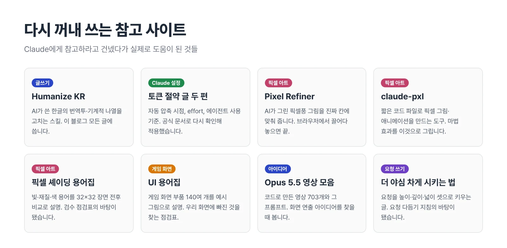
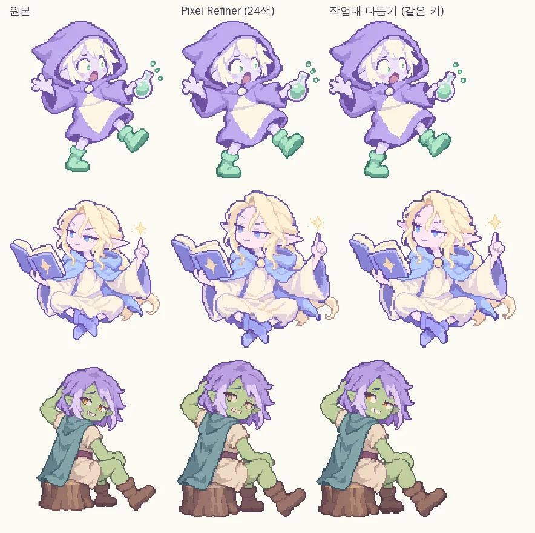
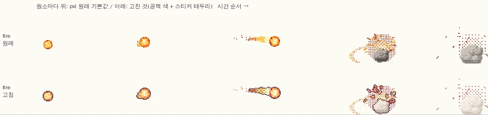
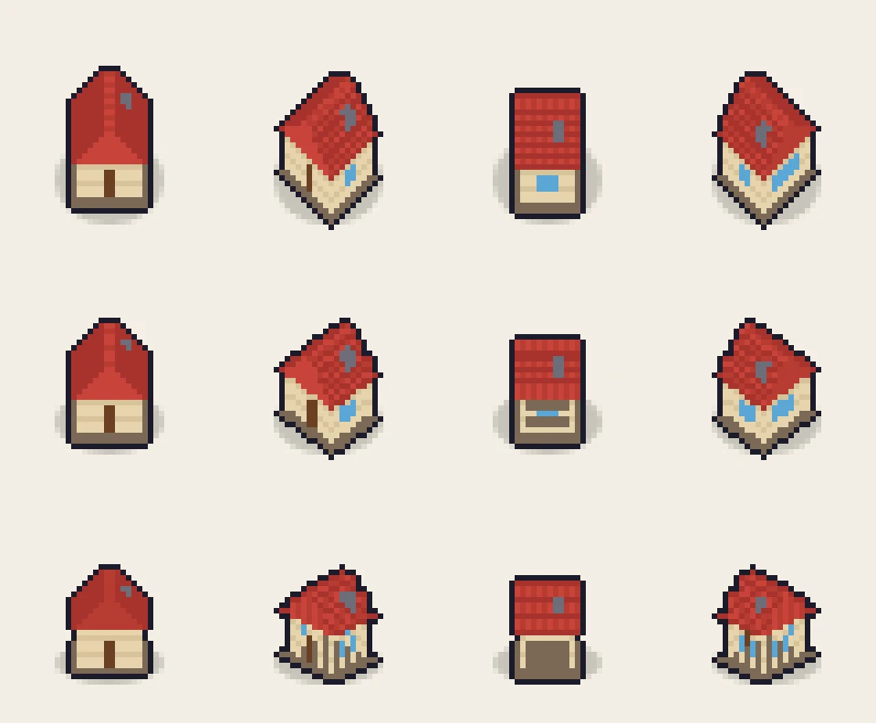

게임을 만들다 쓸 만한 커뮤니티 글이나 도구를 만나면, 일단 Claude에게 **"이거 한번 읽어 봐"** 하고 링크부터 건넵니다.

그렇게 의외의 소득을 얻은 사이트가 제법 쌓였는데, 며칠만 지나도 "그때 그 주소가 뭐였지?" 하며 브라우저 기록을 뒤지는 일이 잦더군요. 그래서 직접 써 보고 실제로 덕을 본 링크들만 분야별로 묶어 이곳에 정리해 둡니다.

<figure><figcaption>분야별로 추려 둔 즐겨찾기 목록입니다.</figcaption></figure>

## 글쓰기와 말투 다듬기

**[Humanize KR](https://github.com/epoko77-ai/im-not-ai)** · AI가 쓴 한국어 특유의 번역투와 딱딱한 문장 나열을 자연스러운 사람 말투로 다듬어 주는 Claude용 스킬입니다. 사실과 숫자는 그대로 두고 문장의 결만 정리해 주는 게 장점입니다. 이 블로그에서도 초안을 발행하기 전에 말투를 점검하는 용도로 요긴하게 쓰고 있습니다.

## Claude 설정과 토큰 다이어트

**디시인사이드 [AI 개발 갤러리 글](https://gall.dcinside.com/mgallery/board/view/?id=aidevelop&no=4369)과 [AI 활용 갤러리 글](https://gall.dcinside.com/mgallery/board/view/?id=ai_utilize&no=137000)** · Claude Code를 오래 써 온 유저들이 토큰을 아끼는 실전 설정을 정리해 둔 글입니다. 대화 자동 요약을 일찍 당겨 쓰기, 보조 에이전트(서브에이전트)를 함부로 부르지 않기처럼 바로 체감되는 내용이 담겨 있습니다. 두 글을 Claude에게 읽혀 공식 매뉴얼과 대조하고 우리 환경에 적용한 과정은 [토큰 아끼기 글]()에 따로 정리해 두었습니다.

## 픽셀 아트와 그래픽 도구

**[Pixel Refiner](https://pixel-refiner.app/)** · AI가 얼핏 비슷하게 흉내만 낸 '무늬만 픽셀' 그림을 **진짜 도트 격자(그리드)**에 깔끔하게 맞춰 주는 무료 웹 도구입니다. 사이트에 그림 파일을 끌어다 놓기만 하면 끝납니다. 저희가 직접 만든 에셋 작업대의 보정 결과와 나란히 놓고 비교해 봤는데 품질이 거의 막상막하더군요. 별도의 자체 작업대가 없다면 가장 먼저 권하고 싶은 도구입니다.

<figure><figcaption>왼쪽부터 AI 원본, Pixel Refiner 보정본, 자체 작업대 보정본입니다. 흐트러진 도트 선이 깔끔하게 정렬됩니다.</figcaption></figure>

**[claude-pxl](https://github.com/augusto-scarvalho/claude-pxl)** · 짧은 코드로 도트 그림과 프레임 애니메이션을 뽑아내는 도구로, 애초에 AI가 다루기 쉽게 설계되어 있습니다. Claude에게 불 마법 이펙트를 그려 보라고 시켰더니 처음엔 밝은 공책 배경에 파스텔 불꽃이 묻혀 영 흐릿하더군요. 거기에 진한 외곽선 옵션만 살짝 얹었더니 단번에 게임에 넣을 만한 그림이 나왔습니다.

<figure><figcaption>위가 기본 설정으로 뽑은 불 마법, 아래가 공책 배경에 맞춰 외곽선을 덧입힌 버전입니다.</figcaption></figure>

**[픽셀 셰이딩 용어집](https://tuiella.github.io/pixel-glossary/)** · 도트 아트의 빛, 그림자, 색감 용어를 전후 비교 그림으로 알기 쉽게 풀어 둔 한국어 도감입니다. AI에게 막연히 "그림자 좀 자연스럽게 쳐 줘"라고 하면 매번 딴소리를 가져오는데, 여기에 나오는 정확한 용어(예: 필로우 셰이딩 금지, 휴 시프팅 적용)로 짚어 주면 결과물이 훨씬 일관됩니다. 아예 Claude에게 통째로 읽혀 그림 검수용 체크리스트로 만들어 두었습니다.

**[문제의 이름-도트](https://tuiella.github.io/b3/dot/)** · 위 용어집을 만든 분이 새로 연 칼럼입니다. "부글거려요", "자글자글해요"처럼 말로만 맴돌던 도트 문제 열다섯 가지에 보일링, 믹셀, 피벗 흔들림 같은 이름을 붙이고 원인과 해결법까지 짝지어 줍니다. 그림 문제는 이름을 알아야 검색도, 지시도 할 수 있으니까요. Claude에게 이 목록을 들고 우리 게임을 훑어보게 했더니, 쓰러질 때 캐릭터를 딱 90도로 눕히는 연출은 "45도·90도 단위면 괜찮다"는 기준을 이미 통과하고 있었습니다. 대신 AI로 한 장씩 뽑은 전신 세트는 첫 항목인 보일링부터 손볼 숙제로 남았고요.

**[당신은 빛을 알아야 한다](https://tuiella.github.io/b3/light/)** · 같은 분의 B3 칼럼 1부입니다. 텍스처에 적힌 숫자 하나가 모니터의 빛이 되기까지 여덟 단계를 따라가며 감마, 선형 계산, HDR, 톤매핑, LUT, 색역을 차근차근 설명합니다. 끝에 붙은 "색이 이상하다는 보고가 오면 이 순서로 묻는다" 다섯 줄 점검표가 특히 실용적입니다. Claude에게 우리 게임과 대조시켜 봤더니 화면 색 섞기 307곳은 포토샵과 같은 방식이라 공책 색감을 지키려면 그대로 두는 게 맞았습니다. 횃불 빛을 '덮기' 대신 '더하기'로 바꿔 봤더니 오히려 벽이 뿌옇게 떠서 되돌렸고요. 다만 캐릭터 그림을 축소할 때 선형 빛 계산을 쓰면 눈동자의 흰 점이 더 또렷하게 남는 차이는 있었습니다. 이론 글이 "여긴 고칠 것 없음"을 확인해 주는 것도 충분히 값어치가 있더군요.

**[다이나믹 라이트의 원리와 적용](https://tuiella.github.io/b3/light2/)** · 같은 칼럼 2부입니다. 칠한 빛과 계산하는 빛의 차이부터 횃불 하나 넣는 순서까지, 선술집 장면에서 효과를 하나씩 껐다 켜며 보여 줍니다. 우리 게임에 비춰 보니 밤 싸움에서 검은 옷 노상강도가 배경에 그대로 파묻혀 있더군요. 글의 "어두워도 반드시 보여야 하는 것"을 따라 밤에는 인물 앞쪽 가장자리에 1점짜리 노란 테를 두르고, 가장 어두운 밝기에 바닥을 깔았습니다. 밤길 등불도 매끈하게 번지던 빛을 세 겹 띠로 끊었고요. "픽셀 아트는 밝기를 몇 단계로 묶어야 팔레트가 산다"는 대목 그대로입니다. 노멀 맵은 그림 466장마다 한 장씩 더 그려야 해서 과감히 건너뛰었습니다.

**[스프라이트 스태킹](https://www.spritecook.ai/blog/sprite-stacking-pixel-art)** · 물체를 얇게 썬 그림 여러 장을 1점씩 올려 쌓으면 3D 모델 없이도 도트 그림이 입체적으로 돌아갑니다. SpriteCook 블로그가 자동차 한 대로 처음부터 끝까지 풀어 준 글이에요. 다음 게임에 써먹으려고 Claude에게 요약을 맡겼더니, 정리만 한 게 아니라 코드로 작은 집 한 채를 14장으로 썰어 직접 돌려 보더군요. 카메라 기울기를 세 단계로 비교해 보니 0.75쯤이 가장 보기 좋았고, 0.5까지 눕히니 판 사이가 벌어져 지붕이 쩍 갈라졌습니다. 공책 RPG는 옆에서 보는 화면이라 당장 쓸 일은 없지만, 위에서 내려다보는 지도에 배나 수레를 띄울 날이 오면 바로 꺼낼 생각입니다.

<figure><figcaption>위에서부터 카메라 기울기 1, 0.75, 0.5입니다. 맨 아래 줄은 판 사이가 벌어져 지붕이 갈라져 보입니다.</figcaption></figure>

**[Scenario Agent Skills](https://github.com/scenario-labs/skills)** · 게임 아트 서비스 Scenario가 공개한 스킬 175개 묶음입니다(MIT). 대부분은 유료 Scenario 서버에 연결해야 돌아가지만, 스프라이트 시트 칸 계산이나 한 캐릭터를 여러 동작에서 일관되게 유지하는 요령은 문서만 읽어도 배울 거리가 많습니다. 특히 눈에 띈 건 Blender·Unity·Godot을 직접 다루는 "전문가 도구" 쪽인데, 이건 Scenario 계정 없이 해당 프로그램만 있으면 됩니다. 집 PC에 Blender가 깔려 있으니 다음에 마네킹 자세를 잡을 때 이 묶음부터 꺼내 볼 생각입니다.

## 게임 화면(UI) 설계

**[UI 용어집](https://tuiella.github.io/ui-glossary/)** · 앞의 픽셀 셰이딩 용어집과 같은 분이 만든 한국어 사전으로, 이번엔 게임 화면 부품 140여 개를 예시 그림과 함께 정리해 둡니다. 체력바 잔상, 피격 비네트, 도감 실루엣처럼 "그거 뭐라고 부르더라" 싶던 부품들에 정확한 이름이 붙어 있어서 Claude에게 설명하느라 진땀 뺄 일이 확 줄어듭니다. 목록을 통째로 Claude에게 넘겨 우리 화면과 한 줄씩 대조시켰더니, 있는 것과 빠진 것이 한눈에 갈리며 회의가 체크리스트 점검처럼 술술 풀렸습니다.

**[unslop](https://github.com/heydamir/unslop)** · 이른바 'AI가 만든 티 나는 화면'을 잡아내는 Claude용 점검 스킬입니다(CC BY 4.0). 회사 대시보드와 홍보 페이지를 기준으로 만들어져서 이모지 빼기, 회색 바탕 같은 규칙은 공책 RPG와 정반대더군요. 그래서 Claude에게 먼저 읽히고 안 맞는 규칙을 걷어 낸 뒤 나머지로만 화면을 훑게 했습니다. 칩 색, 너무 작은 글씨, 스물일곱 가지나 난립하던 글자 크기를 잡았고, 그 흐름이 [노선도를 색연필 지도로]() 바꾸는 작업까지 이어졌습니다.

**[Game UI Database](https://www.gameuidatabase.com/)** · 게임 300여 편의 화면 캡처를 상점, 인벤토리, HUD 같은 종류별로 모아 둔 무료 아카이브입니다. UI 용어집으로 이름을 익혔다면 여기서는 실제 게임에 어떻게 들어갔는지 눈으로 확인할 수 있습니다. Celeste나 Rogue Legacy 같은 픽셀 게임과 카드·턴제 게임도 꽤 많더군요. 다음에 상점이나 가방 화면을 손볼 때는 비슷한 화면을 몇 개 골라 게임 이름과 함께 Claude에게 참고 자료로 넘겨 볼 생각입니다. 캡처 저작권은 각 게임사에 있으니 여기엔 링크만 남겨 둡니다.

**[Impeccable](https://github.com/pbakaus/impeccable)** · unslop과 같은 결의 화면 디자인 스킬입니다(Apache-2.0). "좀 더 과감하게(`bolder`)", "차분하게(`quieter`)", "점수 매겨 검토(`critique`)" 같은 명령 24개로 막연한 디자인 주문을 구체적인 언어로 바꿔 줍니다. AI 없이 돌아가는 'AI 티' 검사 규칙 62개도 따로 들어 있고요. 역시 회사 웹페이지 기준이라 unslop처럼 공책 RPG와 안 맞는 규칙부터 거르고 쓸 생각입니다. 브라우저에서 바로 수정하는 live 모드는 권한 확인 없이 에이전트를 부르는 설정이 있으니 켤 때 주의해야 합니다. 검사기만 우리 게임에 돌려 봤더니 26곳이 걸렸는데, 전부 공책 여백선·모눈종이·스티커 반짝임을 'AI 티'로 오해한 것이라 고칠 일은 없었습니다. 대신 글씨 대비와 작은 글씨는 깨끗하다는 판정을 받아 기분은 좋더군요.

## 연출과 손맛 아이디어

**[Opus 5.5 영상 모음](https://github.com/yihui-dev/awesome-opus5-5-videos)** · AI에게 코드로 애니메이션을 짜게 시킨 결과물 영상 703개와 실제 프롬프트를 한데 모아 둔 저장소입니다. 머릿속에만 맴도는 연출을 말로 설명하기 막막할 때, 비슷한 느낌의 영상을 찾아 프롬프트 표현을 빌려 쓰면 훨씬 빠릅니다. 우리 게임에서 연필 선이 사각거리며 미세하게 떨리는 아날로그 연출도 여기서 힌트를 얻어 [영상 만드는 글]()에 써먹었습니다.

**디시인사이드 [AI 게임 개발 갤러리 글](https://gall.dcinside.com/mgallery/board/view/?id=aidevelop&no=2572)** · "AI한테 게임 만들어 달라고 했는데 왜 이렇게 허접하지?"라는 솔직한 제목 그대로, 기능은 다 돌아가는데 어딘가 심심한 이유를 게임 필(game feel)과 주스(juice) 관점으로 풀어 줍니다. "juicy하게 해 줘"는 만능 주문이 아니니 빈틈을 먼저 진단하고, 우선순위를 매기고, 동작마다 강도를 숫자로 적어 주라는 조언이 핵심입니다. Claude에게 그 순서 그대로 우리 게임을 재 보게 했더니, 전투에서 주사위가 아직 구르는데 화면에서는 주인공이 먼저 물려 버리는 엇갈림이 1.1초나 나 있었습니다. 눈으로 수십 번 보고도 몰랐던 틈이었습니다.

**[손맛의 이름](https://tuiella.github.io/b3/sonmat/)** · 같은 분의 칼럼으로, 이번엔 "타격감 좀 살려 주세요"를 바로 코드로 옮길 수 있는 문장으로 바꿔 줍니다. 히트스톱, 이징, 숫자 굴려 올리기 같은 손맛 부품 열세 가지마다 "0.06초 멈춰 주세요"처럼 숫자가 박힌 주문 문장이 붙어 있어 그대로 복사해 AI에게 건네면 됩니다. 읽고 나서 Claude에게 "획득 연출" 항목과 우리 금화를 대조해 보라고 했더니, 금화가 주인공에게서 돈 칸으로 날아가기는 하는데 정작 숫자는 금화가 출발하기도 전에 한 번에 바뀌어 있더군요. 이름 하나를 알았을 뿐인데 고칠 자리가 바로 눈에 들어옵니다.

## AI에게 일 시키는 요령

**[더 야심 차게 시키는 법(How to be more ambitious)](https://felixrieseberg.com/how-to-be-more-ambitious-a-tutorial-for-humans-with-models/)** · 펠릭스 리제베르크가 쓴 영어 에세이로, AI에게 더 큰 일을 맡기는 방향을 높이·깊이·넓이 셋으로 나눕니다. 만들 물건 대신 달라져야 할 결과를 목표로 잡고(높이), 그 분야 최고 전문가가 쓰는 원자료와 방법으로 시키되 채점은 AI가 아닌 바깥 기준으로 맡기고(깊이), 다른 직무의 시선을 빌려 오라는(넓이) 이야기입니다. 특히 "더 크게 말고 더 깊게 해 줘"로 시작하는 프롬프트 틀이 바로 써먹기 좋더군요. 아예 Claude에게 이 글을 읽히고 제 요청을 매번 이 방식의 영어 프롬프트로 다듬은 뒤 작업하라는 프로젝트 지침을 만들게 했습니다. 짧은 질문이나 오타 수정까지 거창하게 부풀리면 피곤하니, 단순한 부탁은 그냥 바로 처리하라는 예외 조항도 같이 넣어 두었고요.

## 밸런스와 플레이 데이터

**디시인사이드 [인디 게임 개발 갤러리 글](https://gall.dcinside.com/mgallery/board/view/?id=game_dev&no=233476)** · 파칭코 로그라이트 「하이롤러 페니」 개발자가 런 기록 5만 8천 개를 모아 밸런스를 다듬은 경험담입니다. 거창한 수학 공식 대신 "어느 스테이지에서 제일 많이 죽지?" 같은 질문부터 정하고, 그 답이 나오도록 기록 구조를 설계하는 순서가 인상적이었습니다. Claude에게 우리 게임에 대입해 보게 했더니 승률 대신 생애 단계와 사인을, 아이템 승률 대신 '고른 선택지와 그 뒤의 삶'을 살펴보는 질문표 여덟 줄이 나왔습니다. 로그는 진작부터 쌓고 있었는데, 정작 그 기록에 던질 질문이 없었다는 걸 그제야 깨달았습니다.

## 세 줄 요약

1. 쓸 만한 팁이나 칼럼을 찾으면 바로 적용하기 전에 AI에게 건네 우리 프로젝트와 대조시켜 보세요. 맞는 것과 버릴 것이 금방 갈립니다.
2. 픽셀 아트는 Pixel Refiner로 격자를 잡고, 이펙트는 claude-pxl로 만들며, 품질과 화면은 용어집으로 대조하면 막연한 주문이 확 줄어듭니다.
3. 좋은 프롬프트 원칙은 아예 프로젝트 지침으로 심어 두면 매번 신경 쓰지 않아도 됩니다. 새로 덕을 보는 사이트가 생기면 이곳에 계속 보태 두겠습니다.
