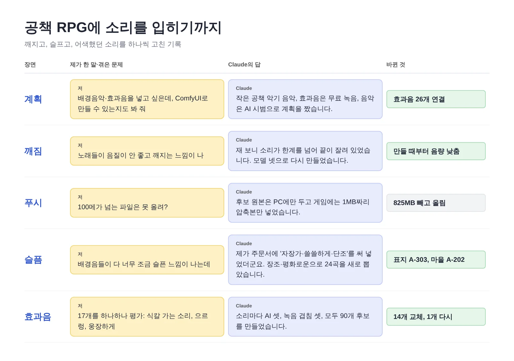
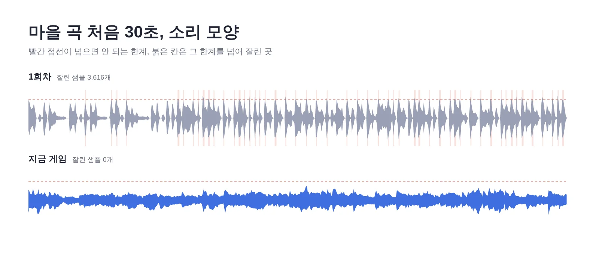
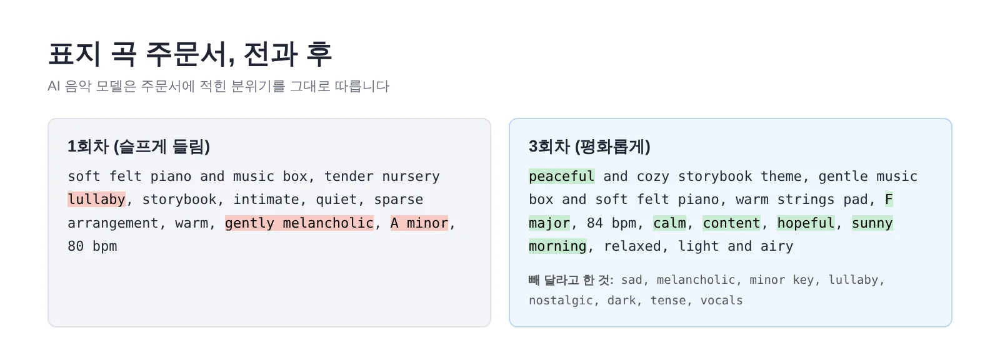
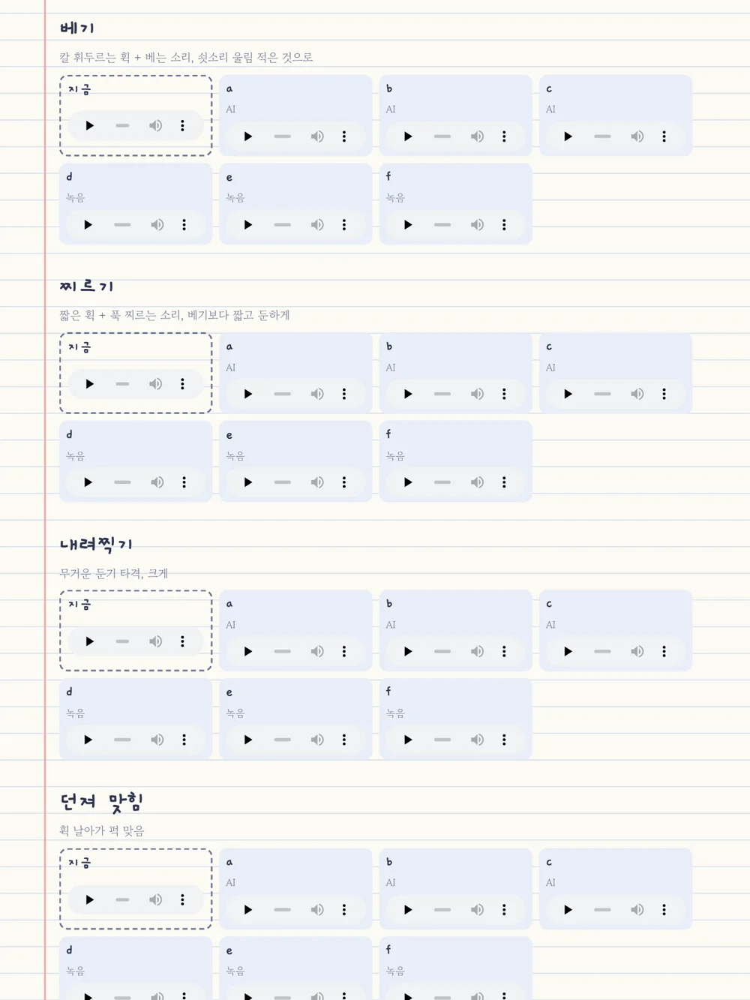

연필로 끄적여 만든 공책 RPG인데, 정작 연필 사각거리는 소리 하나 안 나니 무성 영화를 보는 기분이었습니다. 그림이 어느 정도 자리를 잡자 화면의 정적이 유독 크게 다가오더군요. 결국 Claude에게 배경음악과 효과음을 입히자고 제안했고, 음악은 제 PC의 ComfyUI로 직접 뽑아 보기로 했습니다. 다만 소리를 하나 얹을 때마다 작은 사고도 어김없이 세트로 따라붙더군요.

<figure><figcaption>계획부터 효과음 재시험까지, 소리 작업에서 벌어진 다섯 장면입니다.</figcaption></figure>

## 1차 사고: 음악이 지직거리며 찢어집니다

처음 계획은 소박했습니다. 오르골이나 리코더처럼 작고 조용한 공책 악기로 배경음악을 만들고, 효과음은 누구나 자유롭게 쓸 수 있는 무료 녹음(CC0)에서 골라 오기로 했죠. Claude가 연필·주사위·도장 같은 장면에 효과음 26개를 붙였고, 음악은 ACE-Step이라는 공개 모델로 표지와 마을 곡 열 곡을 뽑아 왔습니다.

기대하며 재생 버튼을 눌렀는데, 곡마다 "노래들이 음질이 안좋고 깨지는 느낌"이 심했습니다. 내 귀가 예민해진 건지 모델이 고장 난 건지 헷갈려 Claude에게 물어보니, 말로 추측하는 대신 소리 파일부터 측정해 보더군요. 범인은 금방 잡혔습니다. 빠른 설정으로 돌린 모델이 소리를 허용 한계보다 크게 질러 버려서, 파형 꼭대기가 칼로 썬 듯 납작하게 잘려 나가 있었던 겁니다. 노래방 마이크에 입을 바짝 대고 소리 지를 때 찢어지는 현상, 오디오 쪽에서는 이걸 **클리핑(clipping)**이라고 부릅니다.

<figure><figcaption>위가 처음 뽑은 곡, 아래가 지금 게임에 들어간 곡입니다. 붉은 칸이 소리가 한계선을 넘어 지직거리던 자리입니다.</figcaption></figure>

한 번 잘려 나간 파형은 뒤에서 아무리 매만져 봐야 되살아나지 않더군요. 후처리로 버티는 대신 생성 단계에서 음량부터 낮춰 여유를 두니 거짓말처럼 깨끗해졌습니다. AI 오디오를 뽑을 때 잡음이 낀다면 보정 필터부터 찾기 전에 생성 볼륨부터 줄이는 편이 백 배 빠릅니다.

## 2차 사고: 100MB짜리 짐이 GitHub 길을 막았습니다

후보곡을 신나게 뽑아 모으다 보니 이번엔 제 PC에서 저장소로 올리는 길이 통째로 막혔습니다. GitHub는 파일 하나가 100MB를 넘으면 아예 받아 주지 않거든요. 확인해 보니 후보 원본을 묶은 파일 하나가 369MB, 후보 전체를 합치니 825MB나 불어나 있었습니다.

Claude의 처방은 이사할 때 짐 정리와 비슷했습니다. 무거운 원본은 제 PC 창고에만 두고, 게임에는 한 곡에 1MB 남짓한 압축본만 싣는 거죠. 앞으로 후보 폴더 자체가 저장소에 올라가지 않도록 아예 문단속까지 해 두니 같은 사고는 다시 나지 않았습니다.

## "배경음들이 다 너무 조금 슬픈 느낌이 나는데"

지직거림은 잡혔는데, 이번엔 곡들이 하나같이 짠했습니다. 평화로운 모험 마을이 아니라 비 오는 날 버스터미널에서 이별하는 분위기였거든요. 모델이 우울증에 걸린 줄 알고 뜯어봤더니 범인은 주문서였습니다. Claude가 표지 곡 프롬프트에 '자장가(lullaby)', '살짝 쓸쓸하게(gently melancholic)', '단조(A minor)'를 적어 둔 겁니다. AI는 시킨 대로 너무나 성실하게 눈물을 짜내고 있었을 뿐입니다.

<figure><figcaption>빨간 단어가 곡을 슬프게 만든 범인들, 초록 단어가 그 자리를 대신한 단어들입니다.</figcaption></figure>

곧바로 장조와 '평화로운·포근한·만족스러운'으로 갈아 끼우고, 슬픔·단조·자장가는 '빼 달라'는 제외 칸에 못 박아 두었습니다. 그 김에 요즘 게임 개발자들은 AI 음악을 어떻게 쓰는지 알아보라고 했더니, 보통 **후보를 8~12곡씩 뽑아 그중 하나를 고른 뒤 30분쯤 다듬어** 쓴다고 하더군요. 그래서 모델 셋으로 24곡을 새로 뽑았고, 그중 표지 한 곡과 마을 한 곡을 골라냈습니다. 10월 순위표에서 연주곡 1위는 유료 서비스였고 제가 쓴 무료 모델은 한 계단 아래였지만, 여러 후보를 듣고 다듬어 놓으니 꽤 들을 만한 곡이 나왔습니다.

<figure><audio src="/assets/img/posts/ai-sound/title.m4a" controls preload="none"></audio><figcaption>지금 게임 표지에 흐르는 곡입니다. 끝과 처음을 살짝 겹쳐 끊김 없이 되풀이됩니다.</figcaption></figure>

## 식칼 가는 소리로 칼싸움을 할 순 없잖아요

배경음악이 자리를 잡자, 이번엔 효과음의 어색함이 귀에 확 띄었습니다. 결국 효과음 17개를 하나씩 들으며 솔직한 평을 적어 보냈습니다. 베기는 "식칼 가는듯한 소리", 물기는 "무는 느낌이 아니라 으르렁 거리는 효과음", 메테오는 "좀 더 웅장해야지", 대성공은 "그냥 쿵 하는 소리면 될 것 같은데" 같은 식이었죠. 다시 읽어 보니 거의 음악 학원 성적표 수준이었습니다.

Claude는 업계에서 효과음을 만드는 기본기부터 꺼내 왔습니다. 좋은 효과음은 소리 하나를 뚝 던지지 않고 '휙(시작) + 사각(몸통) + 울림(끝)'처럼 **두세 겹으로 쌓고**, 화면 속 동작 길이에 딱 맞춘다는 겁니다. 그러고는 소리마다 AI로 만든 후보 셋, 무료 녹음을 겹쳐 만든 후보 셋—총 90개를 한 번에 비교해 들을 수 있는 웹 페이지를 뚝딱 만들어 줬습니다.

<figure><figcaption>점선 칸이 원래 소리, a~c는 AI, d~f는 녹음을 겹친 후보입니다. 객관식 시험 풀듯 귀로 골랐습니다.</figcaption></figure>

채점 결과는 14개 교체, 1개 재시험이었습니다. 끝까지 타격감이 심심했던 '주인공이 맞는 소리'만 주먹 소리에 둔기 소리를 반쯤 겹친 후보를 한 번 더 받아 해결했습니다. 최종 선택을 세어 보니 AI와 실제 녹음이 거의 반반이더군요. 어느 한쪽이 일방적으로 이기기보다, 소리 성격마다 어울리는 재료가 달랐습니다.

이제 공책 RPG에서는 연필이 사각거리고 주사위가 데굴데굴 구르며, 메테오가 떨어지면 꽤 그럴듯하게 쾅 하고 터집니다. 다음엔 밤·던전·전투 곡도 같은 방식으로 채워 볼 생각입니다.

## 세 줄 요약

1. AI 음악이 지직거린다면 후처리로 매만지기 전에 생성 단계 볼륨부터 낮추세요. 클리핑으로 잘린 파형은 되살아나지 않습니다.
2. 곡 분위기가 엉뚱하면 모델 탓을 하기 전에 프롬프트부터 확인하세요. '자장가' 한 단어가 마을 전체를 이별 분위기로 만듭니다.
3. 효과음은 후보를 여럿 띄워 두고 귀로 고르는 게 제일 빠릅니다. 피드백은 "식칼 가는 소리"처럼 노골적이고 구체적일수록 잘 고쳐집니다.
