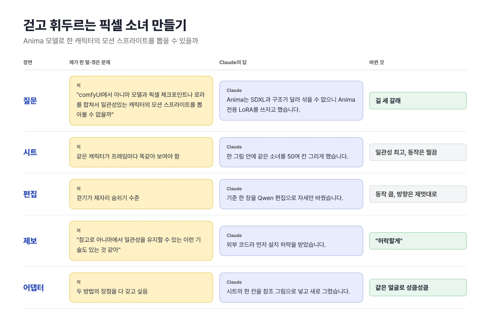
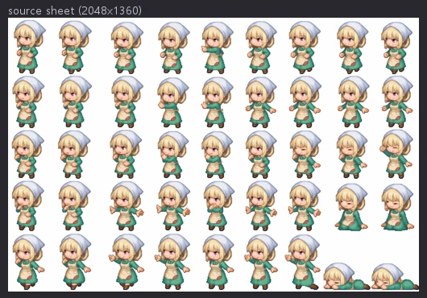
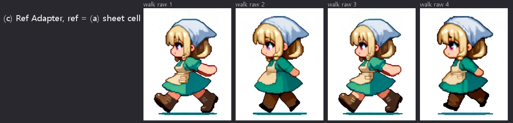

AI로 게임 스프라이트를 뽑을 때 가장 맥 빠지는 순간은, 프레임이 넘어갈 때마다 캐릭터가 성형수술을 하고 나타날 때입니다. 1번 프레임에선 단발이던 소녀가 2번 프레임에선 갑자기 앞머리를 내리고, 3번 프레임에선 앞치마 색까지 갈아입고 있거든요. 지금 만드는 게임과는 별개로 "진짜 AI로 일관된 픽셀 모션이 되긴 하는 걸까?" 궁금해서 Claude에게 물어보며 실험을 시작했습니다.

<figure><figcaption>호기심 질문 하나로 시작해 링크 하나로 판이 뒤집힌 시험입니다.</figcaption></figure>

## "아니마가 체크포인트인가...?"

시작은 이 질문이었습니다. **"comfyUI에서 아니마 모델과 픽셀 체크포인트나 로라를 합쳐서 일관성있는 캐릭터의 모션 스프라이트를 뽑아볼 수 없을까"**

Claude의 첫 대답은 단호했습니다. "그대로 합치는 건 안 됩니다." Anima는 애니풍에 강한 모델인데, 지난번에 쓰던 SDXL 픽셀 모델과 뼈대부터 달라서 부품을 섞어 끼울 수 없다는 거죠. 제가 고개를 갸웃하며 "체크포인트는 사용하지 않는거야? anima가 체크포인트인가...?" 하고 되물었더니, 맞답니다. 쉽게 말해 체크포인트가 '기본 화가'이고 LoRA가 '보충 교재'라면, Anima 자체가 그 기본 화가 자리에 들어가는 녀석이었던 겁니다. 다행히 Civitai에 Anima 전용 픽셀·스프라이트 LoRA가 이미 몇 개 올라와 있었고, Claude는 그걸로 세 갈래 실험 경로를 짰습니다.

## 1번 길: 한 장에 다 그리게 하면 쌍둥이가 됩니다

첫 번째 방법은 RPG 전투 동작 시트를 그리는 LoRA에 픽셀 화풍 LoRA를 얹어, 도화지 한 장 안에 같은 소녀를 50여 칸 한꺼번에 그리게 하는 방식이었습니다. 한 장 안에서 동시에 그리면 모델이 칸마다 다른 사람을 상상할 틈이 줄어들거든요. 결과는 놀라울 만큼 똑같았습니다. 얼굴, 두건, 앞치마 덧댐, 색감, 픽셀 크기까지 칸마다 쌍둥이였죠. 시트 한 장에 55초, 프레임당 1초꼴이라 속도도 압도적이었습니다.

<figure><figcaption>시트 한 장에 소녀가 50명. 전부 영락없는 같은 사람입니다.</figcaption></figure>

문제는 동작이 너무 얌전하다는 점이었습니다. RPG 전투 화면 규칙을 따르다 보니 "걷기"는 제자리에서 숨 쉬는 수준이고, "공격"도 팔을 살짝 내미는 데 그쳤습니다. 쇠스랑 같은 무기는 아예 손에 들지도 않더군요.

## 2번 길: 자세는 시원해졌는데 방향이 제멋대로

두 번째는 지난번 실험에서 재미를 본 편집 모델(Qwen-Image-Edit)입니다. 기준 그림 한 장을 잡아 두고, 프레임마다 "자세만 바꿔"라고 시키는 거죠. 이번엔 동작이 큼직했습니다. 두 다리가 앞뒤로 성큼 엇갈리고, 쇠스랑을 치켜들었다가 내려찍는 움직임이 한눈에 읽혔습니다.

대신 소녀가 제멋대로 빙글빙글 돌아섰습니다. 한 프레임은 오른쪽, 다음은 정면, 그다음은 등을 보입니다. 쇠스랑 길이 때문에 그림마다 자동 맞춤 배율이 달라져 키도 들쭉날쭉했고요. 일관성을 취하자니 동작이 작고, 큰 동작을 취하자니 방향이 무너지는 진퇴양난이었습니다.

## 링크 하나가 판을 뒤집었습니다

여기서 제가 인터넷에서 찾은 링크 하나를 슬쩍 건넸습니다. "참고로 아니마에서 일관성을 유지할 수 있는 이런 기술도 있는 것 같아." 참조 그림 한 장으로 캐릭터 생김새를 붙들어 둔 채 자세는 글로 바꾸게 해 주는 **Anima Ref Adapter**였습니다.

Claude는 바로 설치하지 않고 먼저 허락부터 구했습니다. 남이 만든 코드를 제 PC에 까는 일이니까요. "허락할게"라고 답하자 설치를 마친 뒤 코드에 외부 인터넷 접속이나 수상한 실행 명령이 없는지부터 훑어보았습니다. 그리고 1번 길에서 뽑은 시트의 한 칸을 참조 그림으로 집어넣었죠.

<figure><figcaption>시트 속에 갇혀 있던 소녀가 드디어 성큼성큼 걷습니다.</figcaption></figure>

결과는 두 길의 장점만 쏙 빼 온 모양새였습니다. 네 프레임 모두 같은 얼굴, 같은 두건, 같은 앞치마, 같은 옆모습, 같은 키를 유지하면서 다리만 앞뒤로 시원하게 바뀝니다. 아래 영상에서 세 길을 나란히 돌려 보면 차이가 단번에 드러납니다.

<figure><video src="/assets/img/posts/anima-motion/walk.mp4" controls muted playsinline preload="none" poster="/assets/img/posts/anima-motion/walk.jpg"></video><figcaption>왼쪽부터 한 장 시트, 편집 모델, 참조 어댑터. 맨 오른쪽만 진짜로 걷습니다.</figcaption></figure>

물론 만사형통은 아니었습니다. "오른쪽을 봐"라고 지시해도 대부분 왼쪽을 보는 고집이 있어서 나중에 좌우를 뒤집어야 했고, 발밑에 시키지도 않은 바닥 선을 슬쩍 그려 넣었습니다. 공격 동작은 쇠스랑을 매 프레임 새로 쥐여 주다 보니 모양이 조금씩 흔들렸고, 2번 길 그림을 참조로 넣었을 땐 앞치마 덧댐이 갑자기 꽃무늬로 바뀌기도 했죠. 프레임당 약 55초로 가장 느리기도 했습니다.

<figure><video src="/assets/img/posts/anima-motion/attack.mp4" controls muted playsinline preload="none" poster="/assets/img/posts/anima-motion/attack.jpg"></video><figcaption>공격 동작 비교입니다. 맨 오른쪽 소녀가 쇠스랑을 머리 위로 번쩍 들어 올립니다.</figcaption></figure>

중간에 실전에서 꽤 중요한 함정도 하나 잡았습니다. 픽셀 격자를 복원하는 후처리 단계가 프레임마다 격자 크기를 따로 재는 바람에, 어떤 프레임에서만 소녀가 갑자기 쪼그라들어 버린 겁니다. **첫 프레임에서 잰 격자 크기를 모든 프레임에 똑같이 고정 적용**하자 그제야 키가 딱 맞았습니다.

## 그래서 어떻게 쓰면 되나

세 길을 나란히 세워 보면 장단점이 또렷합니다.

1. **한 장 시트**: 일관성 최고, 동작은 작음, 프레임당 1초로 가장 빠름.
2. **기준 그림 + 편집**: 동작은 크지만 방향과 키가 흔들림, 프레임당 약 31초.
3. **기준 그림 + 참조 어댑터**: 일관성과 큰 동작을 둘 다 잡음, 프레임당 약 55초.

실제 워크플로로 가장 강력했던 조합은 **한 장 시트로 캐릭터 디자인을 먼저 확정한 뒤, 그중 잘 나온 한 칸을 참조 어댑터에 넣어 큰 동작을 뽑는 것**이었습니다. Anima와 참조 어댑터는 모델 자체는 비상업 라이선스여도 만든 결과물은 상업적으로 쓸 수 있습니다. 다만 이번에 함께 쓴 스프라이트 LoRA 일부가 그림 판매를 막아 둬서 팔 게임에 그대로 넣진 못합니다. 가능성을 확실히 검증한 카드로 서랍에 보관해 두고, 상업용 LoRA 길이 열리면 바로 꺼내 쓸 생각입니다.

## 세 줄 요약

1. 한 캐릭터를 여러 칸에 똑같이 세우고 싶다면 한 도화지 안에 시트로 한꺼번에 그리게 하세요.
2. 큰 동작까지 욕심이 난다면 그 시트의 한 칸을 참조 어댑터에 넣어 다시 뽑는 2단계 조합이 답입니다.
3. 스프라이트 프레임마다 픽셀 격자를 따로 재면 키가 들쭉날쭉해지니 첫 프레임 격자를 고정해 쓰고, 외부 도구를 PC에 깔 때는 허락과 코드 점검을 습관화하세요.
