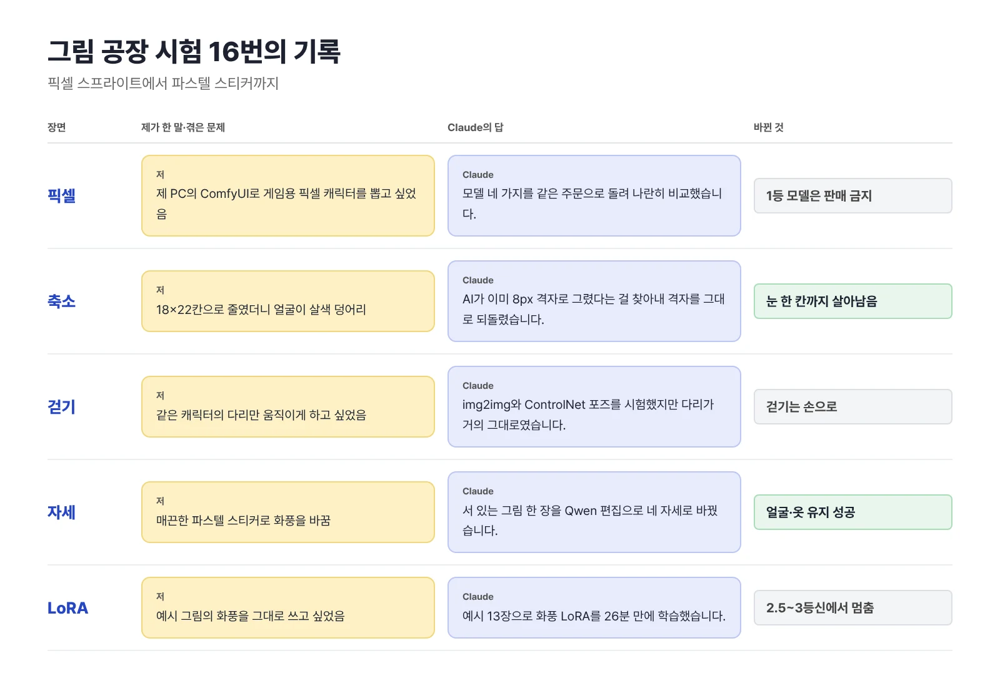
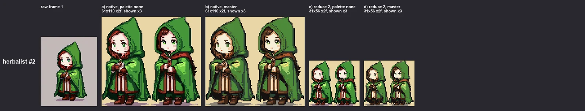
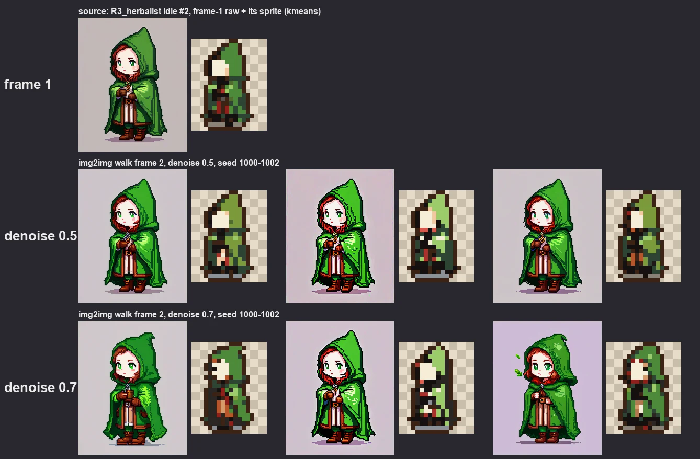
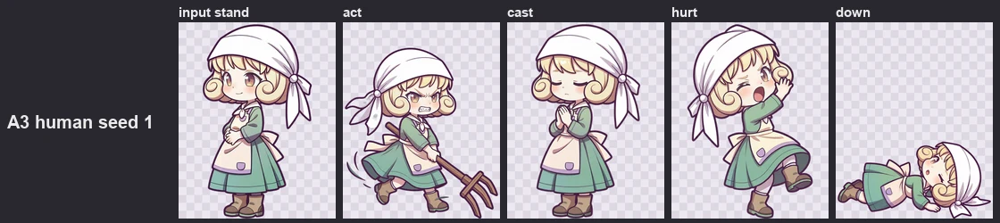
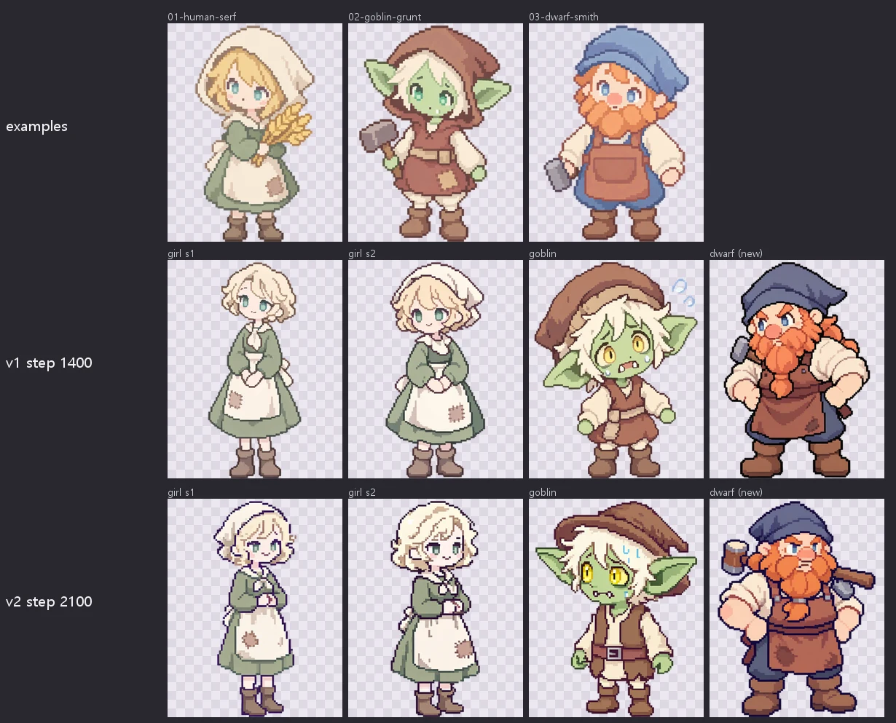

게임 캐릭터를 내 손으로 직접 뽑아 보겠다고 제 PC에 ComfyUI(내 컴퓨터에 차리는 AI 그림 작업실)를 깔고 Claude에게 원격 조종을 맡겼습니다. RTX 4070 Ti(12GB) 그래픽카드 팬을 이틀 내내 돌리며 시험만 열여섯 번 치렀죠. 결론부터 말하면 지금 게임 그림은 다른 도구로 만들고 있습니다. 그렇다고 이틀을 허공에 날린 건 아닙니다. 다음 게임에서 똑같은 벽에 이마를 찧지 않으려고, 된 것과 안 된 것을 실험 노트처럼 정리해 둡니다.

<figure><figcaption>열여섯 번의 시험을 다섯 장면으로 압축했습니다. 회색 칸은 실패, 초록 칸은 건진 수확입니다.</figcaption></figure>

## 1차 시험: 1등 모델이 하필 판매 금지

첫 주문은 단순했습니다. 픽셀 아트 캐릭터를 뽑고 싶다고 했더니, Claude가 SDXL 계열 픽셀 모델 네 가지에 똑같은 프롬프트를 넣어 약초꾼·고블린·동굴을 나란히 뽑아 왔습니다. 마트 시식 코너처럼 한 판에 깔아 놓으니 우열은 단번에 갈리더군요. 색면이 평평하고 외곽선이 칼같이 또렷한 모델 하나가 압도적 1등이었습니다.

문제는 그다음이었습니다. 1등 모델의 약관을 열어 보니 제작자 허락 없이는 결과물을 상업적으로 팔 수 없는 모델이었던 겁니다. 이때부터 시험표 맨 끝에는 늘 라이선스 칸이 붙었습니다. 예쁜 그림이 나오면 여전히 신나지만, 이제는 예쁠수록 약관부터 펼쳐 보는 버릇이 생겼습니다.

덤으로 얻은 요령도 하나 있습니다. 프롬프트에 "스프라이트 시트"라고 적으면 모델들이 지나치게 의욕을 내서 한 장에 사람을 열 명, 스무 명씩 늘어놓더군요. 그 뒤로는 무조건 한 장에 한 명씩 그리는 쪽으로 규칙을 바꿨습니다.

## 18×22칸으로 줄였더니 얼굴이 사라졌습니다

게임 화면에 올리려면 그림을 손톱만 하게 줄여야 했습니다. 그런데 18×22칸으로 축소하는 순간 캐릭터 얼굴이 살색 덩어리 하나로 뭉개지더군요. 후드와 옷 색은 읽히는데 눈이 통째로 증발하니 모험가가 아니라 달걀귀신이 됐습니다.

원본을 확대해 들여다보던 Claude가 의외의 사실을 발견했습니다. 픽셀 모델이 뽑은 이미지는 겉보기엔 큰 그림이지만, 실은 한 칸이 8px쯤 되는 격자 위에 이미 픽셀 아트로 그려져 있었던 겁니다. 그러니 억지로 크기를 뭉개는 대신, 원래 격자를 찾아 칸마다 대표색 하나씩만 읽어 되돌리면 됩니다.

여기서 실전 함정이 하나 있었습니다. 첫 시도에서는 격자를 읽기 전에 색부터 16색으로 줄이는 바람에 눈과 볼 분홍이 또 날아가 버렸거든요. **격자부터 복원하고 색을 줄이는 순서로 뒤집자** 그제야 눈 한 칸까지 멀쩡히 살아남았습니다.

<figure><figcaption>맨 왼쪽이 AI 원본, 그 옆이 격자를 복원한 결과입니다. 오른쪽 작은 그림은 절반으로 줄여도 얼굴이 남는지 확인한 것입니다.</figcaption></figure>

## 다리만 움직여 달라는 게 그렇게 어려운 부탁인가요

걷기 애니메이션은 다리 위치만 살짝 바꾸면 되니 금방 끝날 줄 알았습니다. 첫 프레임을 밑그림 삼아 다시 그리게 하는 img2img를 걸고, 원본에서 얼마나 벗어날지 정하는 denoise(일종의 창작 자유도)를 0.5, 0.7까지 올려 봤죠. 결과는 보시는 대로입니다. 망토 무늬만 슬쩍 바뀌고 두 다리는 차렷 자세 그대로 꿈쩍도 하지 않았습니다.

<figure><figcaption>"걸어라"라고 세 번이나 다시 그렸는데 세 번 다 굳건한 차렷 자세입니다.</figcaption></figure>

다음 카드로 뼈대 그림을 넣어 자세를 강제하는 ControlNet 포즈까지 꺼냈습니다. 그런데 포즈 인식기가 머리가 몸의 절반인 치비(2등신) 그림을 아예 사람으로 알아보지 못하더군요. 치비 비율 뼈대를 직접 그려 넣어 줘도 다리는 요지부동이었습니다. 여기서 깔끔하게 접었습니다. 픽셀 한두 칸 옮기는 걷기는 AI를 설득하는 것보다 손으로 찍는 편이 훨씬 빠릅니다.

## 화풍을 바꾸자 편집 모델이 빛났습니다

그사이 게임 화풍이 매끈한 파스텔 스티커 쪽으로 방향을 틀었습니다(그 우여곡절은 [화풍을 정하기까지]()에 적어 두었습니다). 화풍이 바뀌니 숙제도 달라졌죠. 이제는 같은 캐릭터가 무기를 휘두르고, 기도하고, 아파하고, 바닥에 쓰러지는 그림이 필요해졌습니다.

여기서 해결사로 등장한 게 이미지 편집 모델 **Qwen-Image-Edit**였습니다. 백지에서 새로 그리는 게 아니라, 서 있는 캐릭터 한 장을 건네주고 "자세만 바꿔"라고 시키는 방식입니다. 장당 20~25초 만에 **얼굴·옷·색감·화풍은 거의 그대로 둔 채 자세만 갈아 끼워 주더군요.** 열여섯 번의 시험 가운데 가장 묵직하게 건진 수확이었습니다.

<figure><figcaption>맨 왼쪽 한 장만 건네고 나머지 넷은 편집으로 뽑았습니다. 바닥에 쓰러져도 두건이 벗겨지지 않는 건 애교로 봐 주세요.</figcaption></figure>

## 내 화풍 LoRA를 26분 만에 굽긴 했는데

마지막으로 욕심을 하나 더 부렸습니다. 아예 마음에 드는 예시 그림의 화풍을 모델에 통째로 가르쳐 버리면 어떨까 싶었거든요. 기본 모델에 특정 화풍만 덧붙이는 작은 학습 파일, 즉 화풍 LoRA를 직접 만들어 본 겁니다. 예시 13장을 먹여 26분 만에 구웠고, 2100걸음(스텝)까지 돌려 비교해 보니 1400걸음 무렵이 가장 균형이 좋았습니다. 2차에서는 편집 모델로 뽑은 그림 10장을 더 얹고 "2등신", "3/4 방향" 같은 꼬리표도 꼼꼼히 붙였습니다.

<figure><figcaption>맨 윗줄이 예시, 아래 두 줄이 LoRA 결과입니다. 색감은 닮았는데 캐릭터 키가 자꾸 자랍니다.</figcaption></figure>

색감과 덧댄 천 같은 디테일은 제법 따라왔지만, 캐릭터가 자꾸 2.5~3등신으로 훌쩍 커지고 외곽선도 예시보다 진하게 나왔습니다. 열세 장 남짓으로는 "무조건 머리를 크게 그려라"라는 고집까지 새겨 넣기엔 역부족이었던 모양입니다.

## 다음에 그림 공장을 다시 차린다면

이쯤에서 그림 작업은 다른 도구로 옮기기로 하고 ComfyUI 공장은 잠시 불을 껐습니다. 그래도 다음 프로젝트에서 다시 스위치를 올린다면 이번엔 이 순서대로 움직이려 합니다.

1. 모델을 고르기 전에 약관부터 표로 정리한다.
2. 픽셀 아트는 억지로 줄이지 말고 원래 격자부터 찾아 복원한다.
3. 같은 캐릭터의 여러 자세는 새로 뽑지 말고 한 장을 편집한다.
4. 화풍 LoRA는 예시 그림을 수십 장 모은 뒤에 굽는다.

다음 편에서는 이번 주에 다시 전원을 켠 ComfyUI로 "한 캐릭터가 같은 얼굴로 걷고 휘두르는 픽셀 스프라이트"에 도전한 이야기를 풀어 보겠습니다.

## 세 줄 요약

1. 픽셀 모델은 이미 큰 격자 위에 도트를 찍어 두고 있으니, 축소하지 말고 그 격자를 먼저 복원한 뒤 색을 줄이세요.
2. 같은 캐릭터의 여러 자세는 새로 그리는 것보다 편집 모델로 한 장을 고치는 쪽이 일관성에서 압도적입니다.
3. 모델 비교표에는 늘 라이선스 칸을 붙이세요. 눈이 제일 번쩍 뜨이는 1등 모델이 판매 금지일 수 있습니다.
