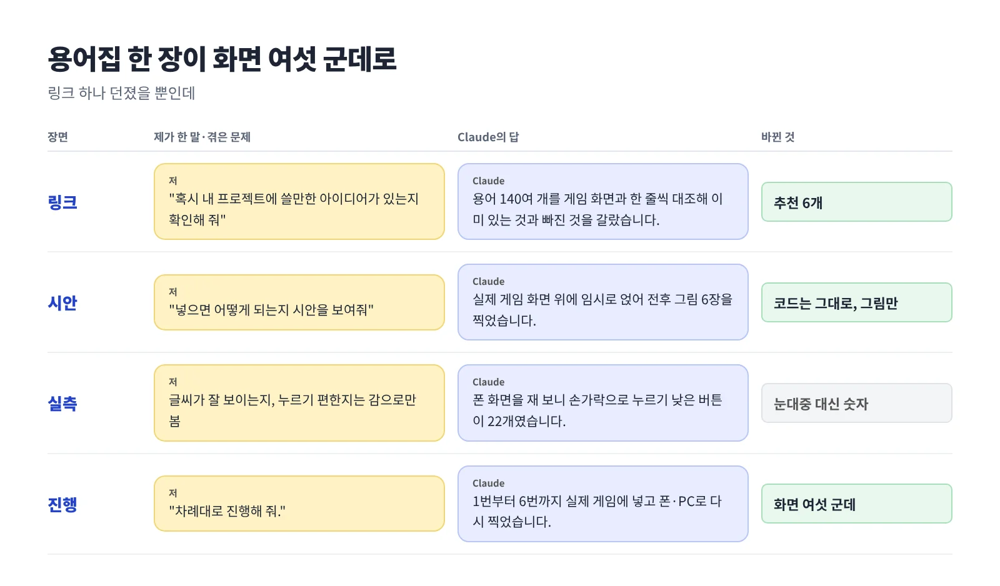
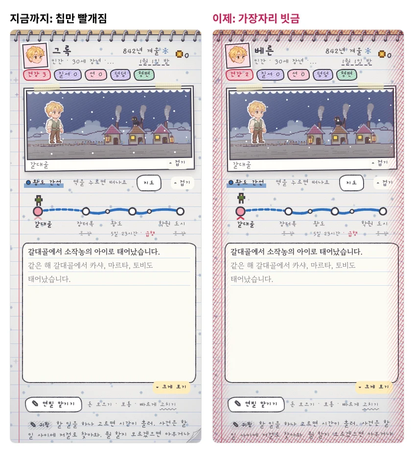
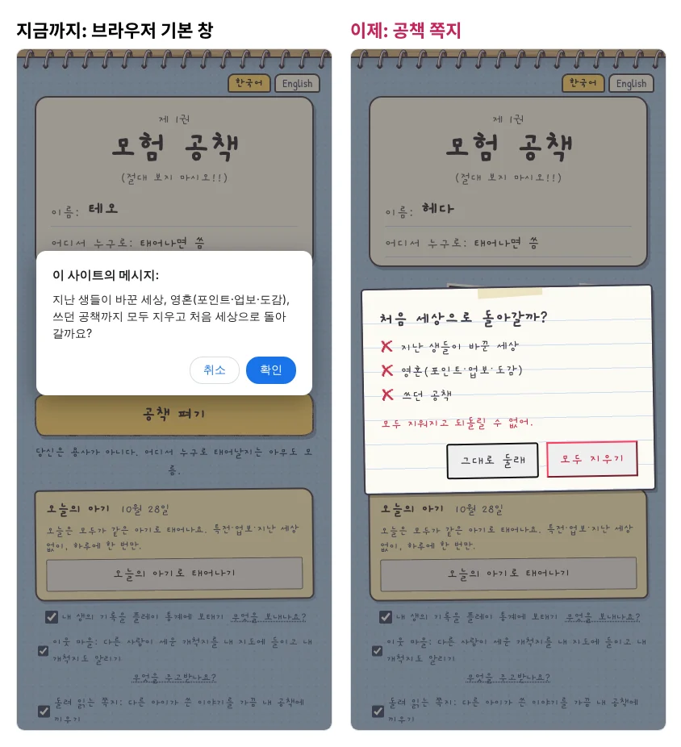
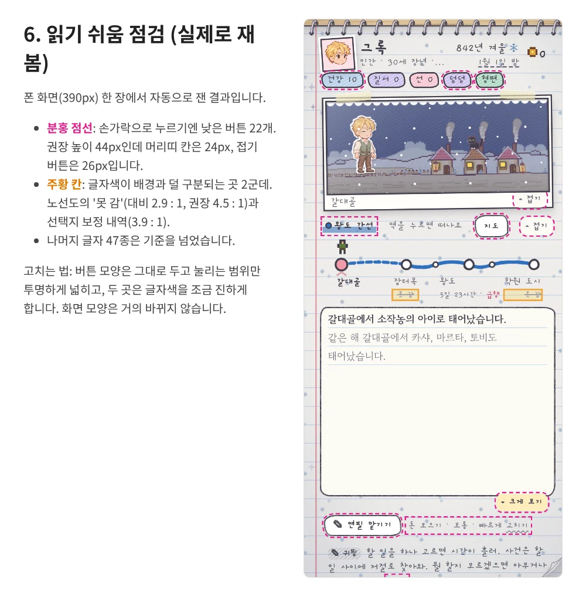
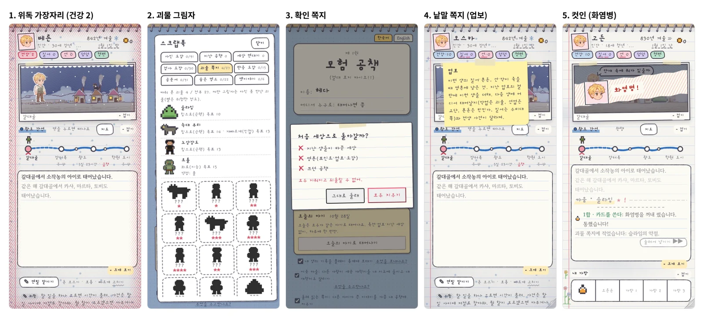

게임 화면을 만들다 보면 "그거 있잖아, 맞으면 화면 가장자리가 빨개지는 거" 같은 말을 자주 하게 됩니다. 정확한 이름을 모르니 설명이 길어지고, 설명이 길어질수록 AI도 엉뚱한 걸 만들어 오죠.

그러다 게임 UI 부품 140여 개에 이름을 붙여 정리해 둔 한국어 [UI 용어집](https://tuiella.github.io/ui-glossary/)을 발견했습니다. 링크를 Claude에게 던지며 딱 한마디 붙였습니다. **"혹시 내 프로젝트에 쓸만한 아이디어가 있는지 확인해 줘."**

<figure><figcaption>링크 한 줄이 화면 여섯 군데로 번지기까지의 대화 기록입니다.</figcaption></figure>

## 사전을 통째로 체크리스트로 쓰기

Claude는 용어집을 처음부터 끝까지 읽고, 항목마다 우리 게임 코드를 뒤져 보았습니다. 돌아온 답은 깔끔하게 세 갈래로 나뉘어 있었습니다. **이미 있는 것, 이 게임과 안 맞는 것, 그리고 정말 빠진 것.**

선택지가 한 글자씩 써지는 연출이나 성공 확률 미리보기는 이미 들어가 있었습니다. 조준점, 배틀패스, 뽑기 연출은 실시간 슈팅이나 과금 게임용이라 빠졌고요. 소리를 글로 띄워 주는 자막은 제가 예전에 정한 "의성어는 쓰지 말자"는 원칙과 부딪힌다며 스스로 걸러 냈습니다. 몇 주 전 결정을 기억하고 피해 가는 걸 보니 은근히 기특하더군요.

그렇게 추려진 게 딱 여섯 개였습니다. 위독할 때 물드는 공책 가장자리, 아직 못 만난 괴물의 그림자, 제대로 된 확인 창, 낱말 설명 쪽지, 큰 기술 컷인, 그리고 누르기 쉬운 버튼.

<figure><figcaption>용어집의 '피격 비네트'를 공책 스타일로 옮긴 장면입니다. 건강이 바닥나면 빨간 색연필 빗금이 가장자리를 물들입니다.</figcaption></figure>

## 말로 고르지 말고 실제 화면 시안으로 고르기

글로 된 목록만 봐서는 게임에 얹었을 때 어떤 느낌일지 감이 잘 안 왔습니다. 그래서 바로 부탁했습니다. **"넣으면 어떻게 되는지 시안을 보여줘."**

Claude는 원본 코드는 건드리지 않은 채 실제 게임을 띄우고, 그 위에 시안을 임시로 얹어 전후 비교 사진을 찍어 왔습니다. 왼쪽은 지금 화면, 오른쪽은 바뀐 화면. 우리 게임 화면 그대로 비교하니 "이건 어울린다, 저건 과하다"가 단번에 보였습니다. 저는 사진을 넘기며 고개만 끄덕이면 됐죠.

<figure><figcaption>공책 분위기를 깨던 회색 확인 창이 공책 쪽지로 바뀌었습니다. 버튼에도 "확인" 대신 "모두 지우기"처럼 실제 동작을 적었습니다.</figcaption></figure>

## 눈대중 대신 자로 재기

여섯 번째 항목인 '읽기 쉬움'은 앞의 다섯 가지와 결이 달랐습니다. 그림으로 보여 줄 수 있는 문제가 아니라 직접 재 봐야 알 수 있었거든요. Claude는 스마트폰 화면의 버튼 크기와 글자 대비를 하나씩 측정해 숫자로 들고 왔습니다.

결과는 뜻밖이었습니다. 손가락으로 누르기엔 높이가 부족한 버튼이 **22개**. 권장 높이는 44px인데 머리띠 칩은 24px로 절반을 겨우 넘기고 있었습니다. **제 눈에는 멀쩡해 보이던 화면이라 숫자가 아니었으면 그냥 지나쳤을 겁니다.** 고친 방식도 영리했습니다. 버튼의 겉모양은 그대로 두고, 손가락이 닿는 터치 영역만 투명하게 넓혔습니다.

<figure><figcaption>분홍 점선은 누르기 낮은 버튼, 주황 칸은 배경과 대비가 약한 글자입니다.</figcaption></figure>

## "차례대로 진행해 줘."

시안을 다 보고 제가 한 말은 이 한 줄이 전부였습니다. Claude는 1번부터 6번까지 실제 게임에 반영한 뒤 폰과 PC 화면을 다시 찍어 보고했습니다. 이제 건강이 떨어지면 공책 가장자리가 숨 쉬듯 짙어졌다 옅어지고, 화염병을 던지면 주인공 얼굴이 그려진 찢은 종이 띠가 화면을 휙 가로지릅니다.

<figure><figcaption>실제 게임에 들어간 다섯 가지입니다. 여섯 번째(터치 영역)는 눈에 안 보이는 게 정상입니다.</figcaption></figure>

<figure class="narrow"><video src="/assets/img/posts/ui-glossary/pulse.mp4" poster="/assets/img/posts/ui-glossary/pulse.jpg" controls muted playsinline preload="none"></video><figcaption>건강이 1 남았을 때의 가장자리 연출. 체력이 낮을수록 더 넓고 빠르게 맥박 칩니다.</figcaption></figure>

## 세 줄 요약

1. 잘 정리된 용어집을 찾으면 AI에게 프로젝트와 한 줄씩 대조시켜 보세요. 이미 있는 것, 안 맞는 것, 빠진 것이 저절로 갈립니다.
2. 코드를 고치기 전에 실제 화면 위에 얹은 전후 시안부터 받으면, 글 목록만 보고 고민할 때보다 결정이 훨씬 빠릅니다.
3. 버튼 크기나 대비처럼 눈대중으로 놓치기 쉬운 요소는 직접 측정하게 하세요. 멀쩡해 보이던 화면에서도 의외의 숫자가 튀어나옵니다.
