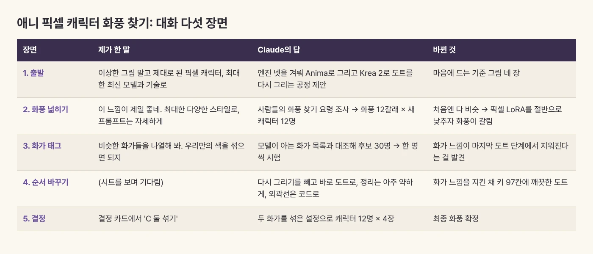
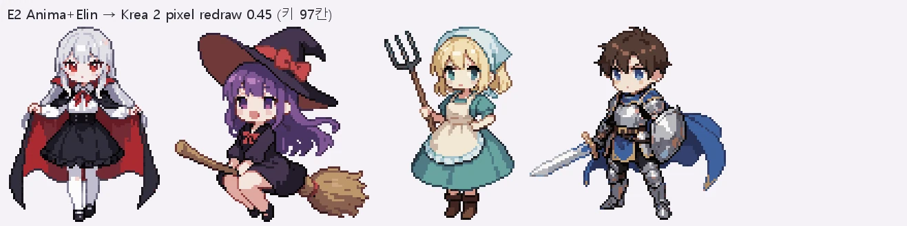
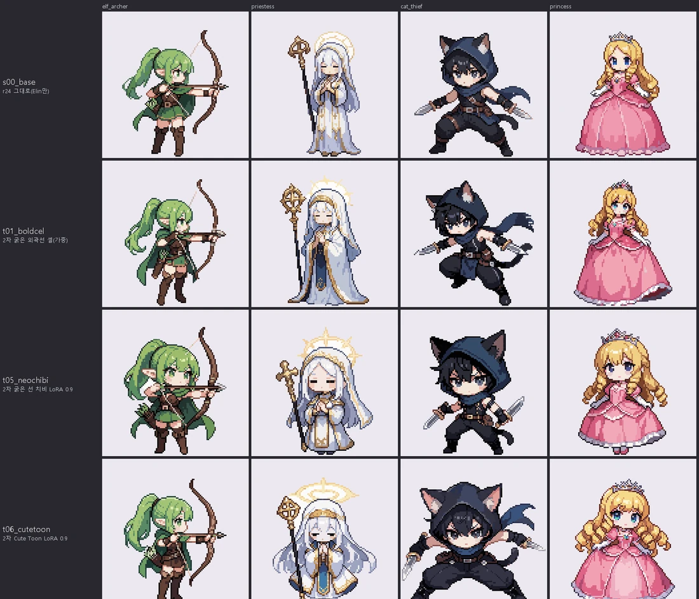
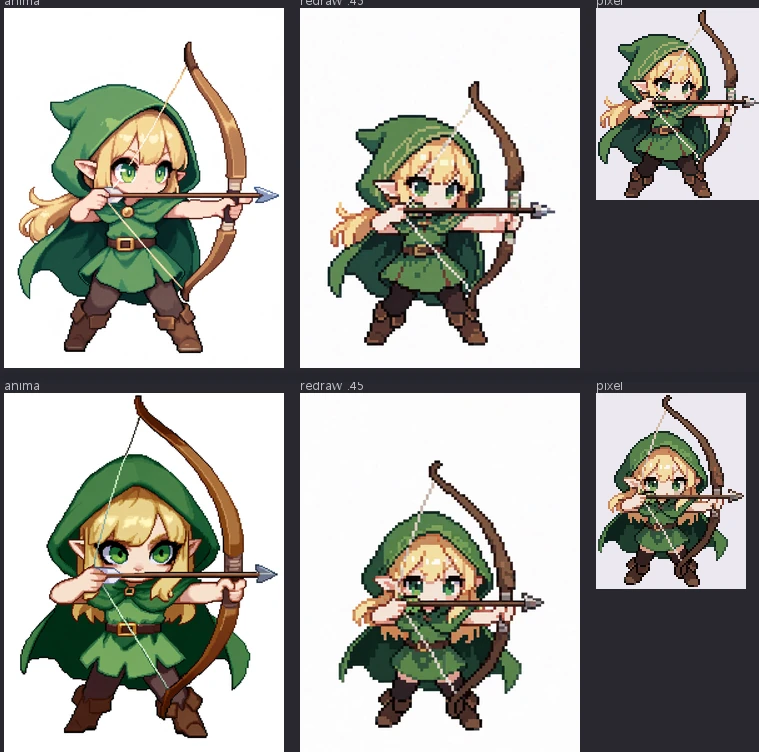
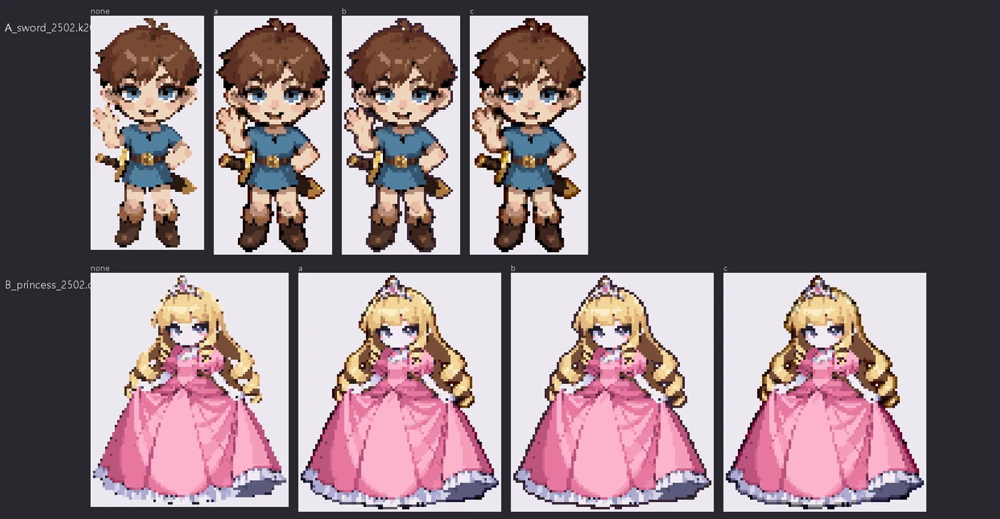
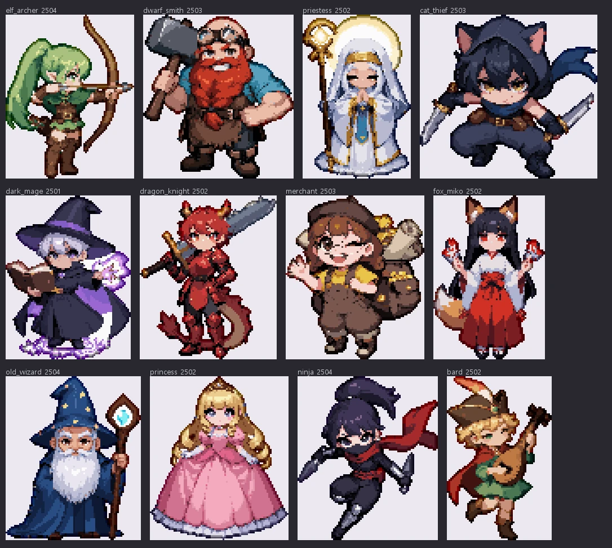
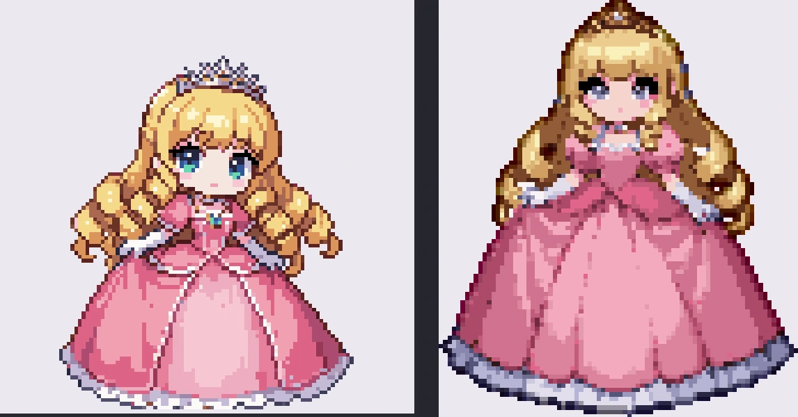

AI에게 픽셀 캐릭터를 부탁하면 처음 몇 장은 그럴듯해 보입니다. 그러다 장수가 쌓이면 슬슬 묘한 그림들이 섞여 들죠. 눈빛은 흐리멍덩하고 도트는 뭉개지고, 어딘가 어색한 서양 게임풍 얼굴이 불쑥 튀어나옵니다. 그래서 이번엔 지금 만드는 게임과 별개로, 아예 하루를 통째로 비워 "진짜 마음에 드는 애니 픽셀 화풍"을 바닥부터 찾아 보기로 했습니다.

<figure><figcaption>이틀 동안 오간 대화를 여섯 장면으로 압축했습니다.</figcaption></figure>

## "이런 이상한 그림 말고"

발단은 투정 한 줄이었습니다. **"흠 이런 이상한 그림 말고 좀 더 제대로 된 픽셀 캐릭터로 구현해보고 싶은데."** 그러고는 바로 조건을 달았죠. "최대한 최신 모델과 기술을 사용하는 방법으로."

Claude는 ComfyUI 진영에서 픽셀 캐릭터를 뽑는 최신 방식을 훑고 엔진 네 개를 겨루게 했습니다. 그림체 매력은 애니풍에 강한 Anima와 픽셀 LoRA 조합이 가장 좋았고, 도트 마감의 깔끔함은 새로 나온 Krea 2와 픽셀 LoRA 조합이 한 수 위였습니다. 그래서 둘을 이어 붙였습니다. Anima로 그림을 그린 뒤, Krea 2로 도트만 한 번 더 깔끔하게 다시 찍어 주는 2단 공정이죠. 아래 네 장을 보자마자 제 입에서 말이 나왔습니다. "이 느낌이 제일 좋네."

<figure><figcaption>출발점. 여기서 멈췄으면 편했을 텐데, "더 좋은 화풍이 있지 않을까" 하는 욕심이 고개를 들었습니다.</figcaption></figure>

## 화풍 12갈래를 뽑았더니 전부 쌍둥이

욕심이 붙었습니다. "이런 방향으로 최대한 다양한 스타일로 뽑아봐서 최선의 화풍을 찾아보자. 프롬프트를 최대한 자세하고 다양하게 써봐." 남들이 자기 화풍을 찾을 때 프롬프트를 어떻게 짜는지도 조사해 적용해 달라고 했죠.

Claude가 모델 공식 문서와 커뮤니티 가이드에서 챙겨 온 원칙은 세 가지였습니다.

1. 한 번에 딱 하나만 바꾼다.
2. 바꿀 때마다 시드(랜덤 번호) 네 개 이상을 나란히 놓고 비교한다.
3. 단어 태그만 나열하지 말고 두 문장 이상의 구체적 묘사를 붙인다.

이 규칙대로 화풍 12갈래에 엘프 궁수, 드워프 대장장이, 고양이 도적, 여우 무녀, 음유시인까지 새 캐릭터 12명을 뽑았습니다. 자세한 문장 묘사는 확실히 먹혔습니다. 활을 겨누고, 기도하고, 웅크리고, 치맛자락을 잡고 인사하는 자세가 적어 준 그대로 나왔거든요.

그런데 화풍은 **12갈래가 죄다 쌍둥이**였습니다. 프롬프트를 아무리 뜯어고쳐도 소용이 없었죠. 범인은 픽셀 LoRA였습니다. 강도가 너무 세게 걸려 있어서 "굵은 외곽선", "파스텔", "90년대 레트로" 같은 화풍 키워드를 모조리 찍어 누르고 있었던 겁니다. 픽셀 LoRA 힘을 절반으로 낮추고 화풍 쪽에 힘을 싣자 그제야 12갈래가 제 색깔로 갈라졌습니다.

<figure><figcaption>맨 윗줄이 원래 화풍, 아래 두 줄이 화풍 LoRA를 섞은 결과입니다. 머리가 커지고 인상이 동글동글해졌습니다.</figcaption></figure>

## "공식 문서에도 없으면 효과가 약하다고 되어있잖아"

여기서 Claude와 한 번 부딪혔습니다. Claude는 프롬프트에 특정 화가 이름을 넣지 않겠다고 선을 그었습니다. 남의 화풍을 그대로 베끼면 우리 색깔이 아니고, 나중에 게임을 팔 때 문제가 생길 수 있다는 이유였죠. 저는 생각이 달랐습니다. **"화가도 우리가 만드려는 화풍과 비슷한 화가들을 나열해 봐. 해당 화풍에 우리만의 색을 섞으면 되지. 공식 문서에도 없으면 효과가 약하다고 되어있잖아."**

근거를 들이밀자 Claude도 곧장 방향을 틀었습니다. 그림 게시판에서 픽셀·치비 그림과 자주 붙는 화가 400명을 추린 뒤, 모델이 실제로 학습한 화가 목록 5만 9천 명과 대조해 243명으로 걸러 냈습니다. 성인 그림 비중이 높은 작가를 빼고 최종 30명을 골라, 같은 시드·같은 캐릭터 조건으로 화가 이름만 바꿔 한 명씩 돌려 보았죠.

그런데 결과를 열자마자 **황당한 반전**이 기다리고 있었습니다. 화가 이름은 첫 단계인 Anima에서는 기가 막히게 먹혔습니다. 눈매가 날카로워지고, 머리가 커지고, 선이 또렷해지더군요. 하지만 마지막 Krea 2 도트 다시 그리기 단계를 거치면 그 개성이 감쪽같이 지워져 버렸습니다. 공들여 양념을 쳐 놓고 마지막에 물로 싹 헹궈 낸 꼴이었죠.

<figure><figcaption>위는 화가 태그 없음, 아래는 화가 한 명을 넣은 결과입니다. 왼쪽 원본에선 딴판인데 오른쪽 도트에선 거의 똑같아집니다.</figcaption></figure>

## 답은 프롬프트가 아니라 순서에 있었습니다

그래서 Claude가 마무리 공정의 순서를 바꿔 보자고 제안했습니다. Krea 2 다시 그리기를 빼고 Anima 그림을 바로 도트로 변환해 보니 화가 특유의 느낌이 고스란히 살았습니다. 대신 인물이 너무 크고 잡색이 섞였죠. 여기서 몇 차례 조율을 거쳐 새 순서를 뽑아냈습니다.

1. 인물을 목표 크기(키 97칸)로 먼저 줄인 다음 바로 도트로 바꾼다.
2. Krea 2는 아주 살짝만 정리한다. 강도(denoise) 0.45면 화가 느낌이 날아가고, 0.25부터는 입과 눈 하이라이트가 흐려져서 0.20이 딱 맞았다.
3. 동떨어진 잡티를 지우고 진한 외곽선을 한 칸 두른다. 이건 AI가 아니라 코드 처리라 장당 0.003초면 끝난다.

<figure><figcaption>맨 왼쪽은 외곽선 없음. 오른쪽으로 갈수록 테두리가 선명해져 밝은 배경에서도 또렷합니다.</figcaption></figure>

최종 선택은 결정 카드(Claude가 후보와 장단점을 정리해 주는 선택지 표)로 내렸습니다. 눈매가 날카로운 화가, 얼굴이 둥근 화가, 둘을 섞은 조합 가운데 Claude는 섞은 쪽을 추천했고 저도 그쪽에 손을 들었습니다. 한 사람 그림체를 그대로 따라가지 않고 우리 색을 섞는다는 처음 취지와도 맞았으니까요. 그렇게 캐릭터 12명을 네 장씩 다시 뽑아 낸 결과가 아래입니다.

<figure><figcaption>새 공정으로 뽑아 낸 열두 명. 이 밤까지만 해도 이게 최종인 줄 알았습니다.</figcaption></figure>

## "도트가 너무 지글지글해져서"

하룻밤 자고 다음 날 아침, 결과물을 하나씩 크게 확대해 보다가 손이 멈췄습니다. Claude에게 바로 적었죠. **"r27부터 작업한 작업물들은 모두 도트가 너무 지글지글해져서 실제로 사용하지 못하는 수준이야. r25에서 도트가 가장 잘 유지되었어."** 화가 이름 시험도 "r25까지만 거의 유효하고 r26부터는 별로 쓸모가 없네"라고 냉정하게 정리했습니다.

Claude도 원인을 바로 인정했습니다. Anima 그림은 애초에 도트로 찍은 그림이 아니다 보니, 그대로 칸을 쪼개면 한 칸 안에 여러 색이 섞이면서 지글지글한 잡점이 생긴다는 겁니다. 반면 강도 0.45로 세게 돌렸던 Krea 2 다시 그리기는 화가 맛을 씻어 내는 대신, **진짜 픽셀 아트처럼 도트 구조를 깔끔하게 다시 짜 주는 역할**을 하고 있었던 거죠. 화가 맛을 살리려다 정작 픽셀 아트의 생명인 도트 품질을 내주고 말았습니다. 작게 모아 볼 땐 그럴듯했지만 게임 화면 크기로 키우자마자 바로 들통났습니다.

<figure><figcaption>왼쪽이 r25 공정, 오른쪽이 새 공정입니다. 확대해 보면 오른쪽 머리카락과 치맛자락이 지글거립니다.</figcaption></figure>

결국 마무리는 다시 r25 공정(Krea 2로 0.45 다시 그리기)으로 돌아가 못 박고, 화풍도 r25에서 뽑은 갈래 안에서 고르기로 했습니다. 화가 이름 실험과 새 공정은 "이 길로 가면 도트가 망가진다"는 값비싼 기록으로 서랍에 넣어 두었죠.

마지막으로 라이선스도 짚고 넘어갑니다. 바탕 모델 Anima는 모델 자체는 비상업 라이선스지만, 약관에 생성된 그림은 상업적 목적을 포함해 어디든 써도 된다고 명시돼 있습니다. 막힌 건 모델 자체를 돈 버는 서비스 안에서 돌리는 쪽이죠. Krea 2는 연 매출 100만 달러 미만이라면 상업적으로 사용할 수 있습니다. 다음 차례는 r25 화풍 하나를 골라 참조 그림으로 넣고, 같은 캐릭터의 여러 자세를 뽑아 보는 실험입니다.

## 세 줄 요약

1. 화풍 키워드가 전혀 안 먹힌다면 프롬프트를 길게 늘이기 전에, 다른 LoRA 강도가 너무 세서 키워드를 누르고 있진 않은지부터 낮춰 보세요.
2. 여러 단계를 거치는 공정에서는 중간 결과물도 꺼내 보되, 최종 합격은 반드시 게임에 올릴 실제 크기로 확대해서 내리세요.
3. AI가 "이건 못 하겠다"고 선을 그을 때 납득이 안 가면 공식 문서 같은 근거를 들어 되물으세요. 방향을 트는 데는 한 줄이면 충분합니다.
