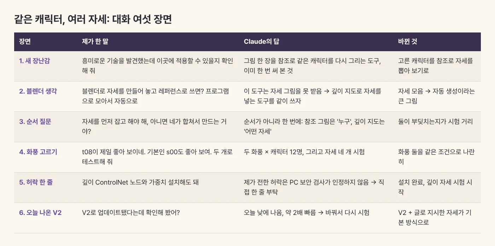
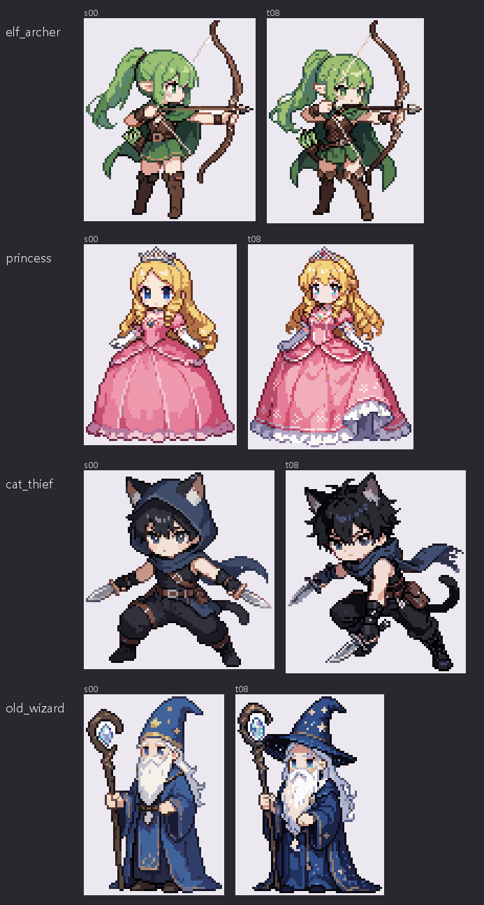
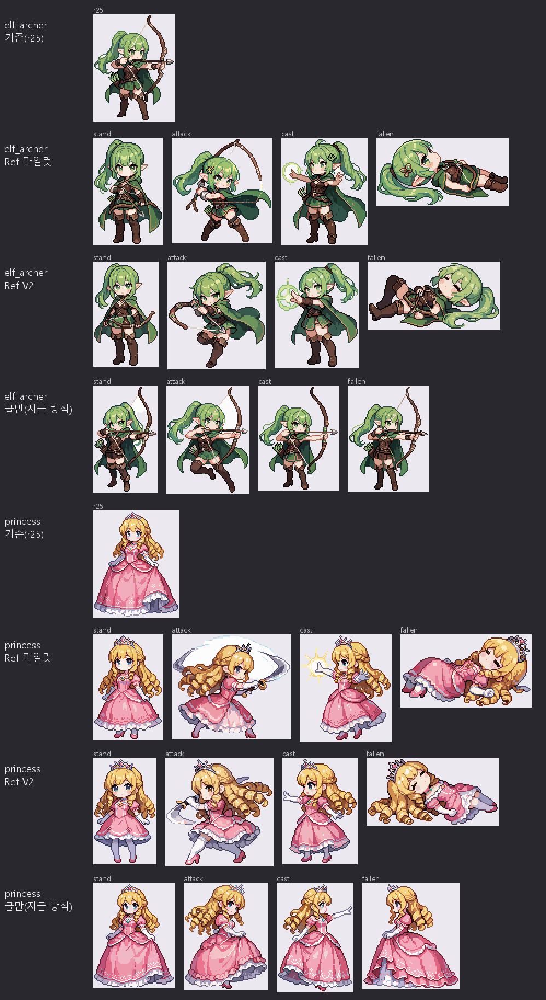
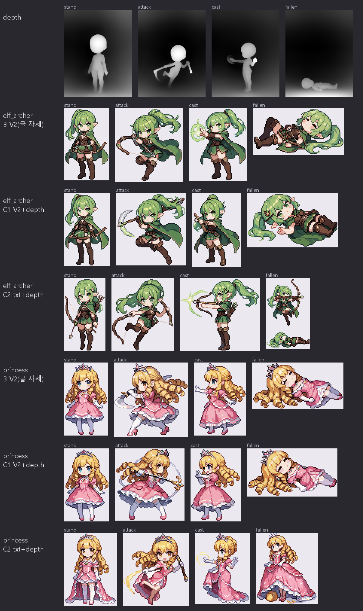

화풍을 겨우 하나로 좁혀 놓고 나니 곧바로 다음 숙제가 들이닥쳤습니다. 게임 캐릭터는 증명사진처럼 가만히 서 있기만 하는 존재가 아니니까요. 칼도 휘두르고, 주문도 외우고, 맞아서 바닥에 드러눕기도 해야 합니다. 그런데 AI에게 자세를 바꿔 달라고 부탁하면 열에 아홉은 얼굴과 옷까지 싹 갈아엎어 버립니다. 이번에는 **"한 번 고른 캐릭터는 그대로 붙들어 둔 채 자세만 갈아 끼우기"**에 도전했습니다.

<figure><figcaption>하루 동안 오간 대화를 여섯 장면으로 추렸습니다.</figcaption></figure>

## "이곳에 적용하여 사용할 수 있을지 확인해 줘"

출발점은 인터넷에서 주워 온 장난감이었습니다. 그림 한 장을 참조로 넣으면 같은 캐릭터를 다른 장면에 다시 그려 주는 Anima용 참조 어댑터였죠. 알고 보니 [지난번 모션 실험]()에서 이미 한 번 써 본 도구라, Claude가 "이미 PC에 깔려 있습니다"라고 알려 줬습니다.

그런데 제 머릿속 설계도는 이미 몇 걸음 앞서 나가 있었습니다. 3D 툴인 블렌더로 원하는 자세를 잔뜩 빚어 둔 다음, 그걸 레퍼런스로 넣어 캐릭터를 자동 생산하면 편하지 않을까 싶었거든요. **포즈 라이브러리를 만들어 두고 자세만 고르면 알아서 뚝딱 뽑히는 큰 그림**이었죠.

Claude의 답은 반은 맞고 반은 틀렸습니다. 이 참조 어댑터는 그림에서 "누구인지(얼굴·옷)"만 읽고 자세는 의도적으로 무시하게 설계되어 있다는 겁니다. 자세까지 그림으로 지정하려면 깊이 맵(depth map: 카메라에 가까운 곳은 밝게, 먼 곳은 어둡게 칠한 흑백 거리 지도)을 읽는 ControlNet 도구를 따로 붙여야 했습니다.

## "자세를 먼저 잡아야 해, 아니면 네가 합쳐서 만드는 거야?"

여기서 잠깐 헷갈렸습니다. 자세를 먼저 그려 놓고 어댑터를 얹는지, 어댑터로 사람을 먼저 뽑고 자세를 꺾는지요. 답은 **순서가 아니라 동시 진행**이었습니다. 참조 그림은 "이 사람을 그려라", 깊이 맵은 "이 자세로 서라"를 맡아 AI가 둘을 한눈에 보면서 한 장을 그려 냅니다. 애니메이터에게 배우 프로필 사진과 콘티를 양손에 동시에 건네주는 격이죠. 다만 이 두 도구를 한꺼번에 엮어 쓴 검증 사례가 아무 데도 없었고, 그걸 확인하는 게 이번 실험의 핵심이 됐습니다.

화풍도 이참에 정리했습니다. 지난 비교표를 다시 들춰 보다가 "t08이 제일 좋아 보이네. 그런데 그냥 기본 베이스인 s00도 좋아 보여"라고 했더니, Claude가 둘 다 똑같은 조건으로 돌려 비교표를 뽑아 줬습니다. t08은 눈과 머리에 광택이 돌고 옷 무늬가 화려하고, s00은 평평하고 담백해서 작은 화면에서 가독성이 좋더군요.

<figure><figcaption>왼쪽이 s00, 오른쪽이 t08입니다. 도트는 둘 다 깔끔하고, 화려함은 오른쪽이 한 수 위입니다.</figcaption></figure>

## 허락은 내 손으로 직접

중간에 재미있는 해프닝이 하나 있었습니다. 제가 깊이 ControlNet을 설치해도 된다고 분명히 허락했는데, PC 쪽에서 설치를 떡하니 막아 버린 겁니다. 제 허락이 Claude를 한 번 거쳐 PC로 전달되다 보니, 자동 보안 검사가 "사용자가 직접 입력한 말이 아니다"라며 거절한 것이죠. 결국 대화창에 "깊이 ControlNet 노드와 가중치 설치해도 돼"를 직접 한 줄 더 쳐서 통과시켰습니다.

처음엔 조금 번거로웠지만, 돌이켜 보니 꽤 든든한 안전장치입니다. **남의 코드를 내 컴퓨터에 까는 일만큼은 AI끼리 "주인님이 허락했대요" 하고 넘기지 못하게 막아 둔 것**이니까요. 여기에 Claude가 설치 전 코드를 먼저 훑어 외부 인터넷 접속이나 수상한 설치 스크립트가 없는지까지 확인해 줬습니다.

## "V2로 업데이트 됐다는데 확인해봤어?"

실험이 한창이던 참에 어댑터 V2 소식이 들려왔습니다. 확인해 보니 바로 그날 낮에 막 올라온 따끈따끈한 버전이더군요. 학습한 캐릭터가 300명에서 2,300명으로 뛰었고 속도도 두 배 가까이 빨라졌다길래 곧장 갈아 끼우고 다시 돌렸습니다. 제 PC에서 장당 55초 걸리던 작업이 33초로 확 줄었습니다. 아쉽게도 제작자는 자금이 바닥나 개발을 중단한다고 적어 두었더군요.

결과표는 군더더기 없이 명확했습니다. 어댑터 없이 기존 캐릭터 설명 뒤에 자세만 덧붙였더니, 엘프 궁수는 공격하라고 해도, 주문을 외우라고 해도, 바닥에 쓰러지라고 해도 **네 칸 모두 활만 겨눴습니다.** 원래 프롬프트에 박혀 있던 "활을 겨눈다"는 묘사가 새 자세 지시를 힘으로 눌러 버린 거죠. 반면 참조 어댑터에 캐릭터 그림을 맡기고 글로는 자세만 딱 적어 주니 공격·주문·바닥에 누운 쓰러짐까지 얼굴·머리·옷을 거의 유지한 채 그대로 나왔습니다.

<figure><figcaption>캐릭터마다 맨 아래 줄이 어댑터 없이 글만 쓴 결과입니다. 엘프가 쓰러지라는데도 끝까지 활을 놓지 않습니다.</figcaption></figure>

## 블렌더까지 꺼낼 필요는 없었습니다

그럼 야심 차게 붙여 본 깊이 맵은 어땠을까요. 다행히 참조 어댑터와 깊이 ControlNet을 동시에 걸어도 서로 싸우지 않았습니다. 캐릭터 생김새를 지키면서 서 있는 구도, 몸 기울기, 누운 실루엣을 곧잘 따라 줬죠.

하지만 마네킹 그림에서 뽑은 깊이 맵은 디테일이 너무 뭉툭해서 팔 각도나 무기 위치까지는 잡아 주지 못했습니다. **결국 글로 자세를 한 줄 적은 결과와 별 차이가 없었던 겁니다.** 게다가 어댑터를 빼고 깊이 맵만 걸면 아예 한 그림 안에 사람이 둘 그려지는 사고까지 났습니다.

<figure><figcaption>맨 위가 마네킹으로 만든 깊이 맵입니다. 큰 실루엣은 따라오지만 팔과 무기 위치까지는 잡아 주지 못합니다.</figcaption></figure>

결론은 단순해졌습니다. 기본 방식은 **"참조 어댑터 V2 + 자세는 글 한 줄"**로 확정하고, 블렌더 포즈 공장은 팔과 무기 위치까지 칼같이 맞춰야 할 때 다시 꺼내기로 했습니다. 남은 숙제는 두 가지입니다. 주문 자세마다 손끝에 뜬금없는 빛 덩어리가 따라붙는 문제와, 무기가 낫이었다가 지팡이였다가 프레임마다 갈아 끼워지는 문제죠. 다음 편에서는 화풍을 하나로 못 박고 무기까지 고정한 자세 세트를 뽑아 보겠습니다.

## 세 줄 요약

1. 같은 캐릭터의 여러 자세를 뽑을 때는 프롬프트 하나에 인물과 동작을 우겨 넣지 말고, 얼굴·옷은 참조 그림에, 자세는 글 한 줄에 나눠 맡기세요.
2. 블렌더나 ControlNet 같은 무거운 장비를 붙이기 전에 글 지시만으로 어디까지 되는지부터 재 보세요. 단순한 도구가 의외로 자주 이깁니다.
3. 쓰는 오픈소스 도구에 새 버전 소식이 들리면 바로 확인해 갈아 끼우세요. 이번엔 질문 한 마디로 생성 시간이 55초에서 33초로 줄었습니다.
