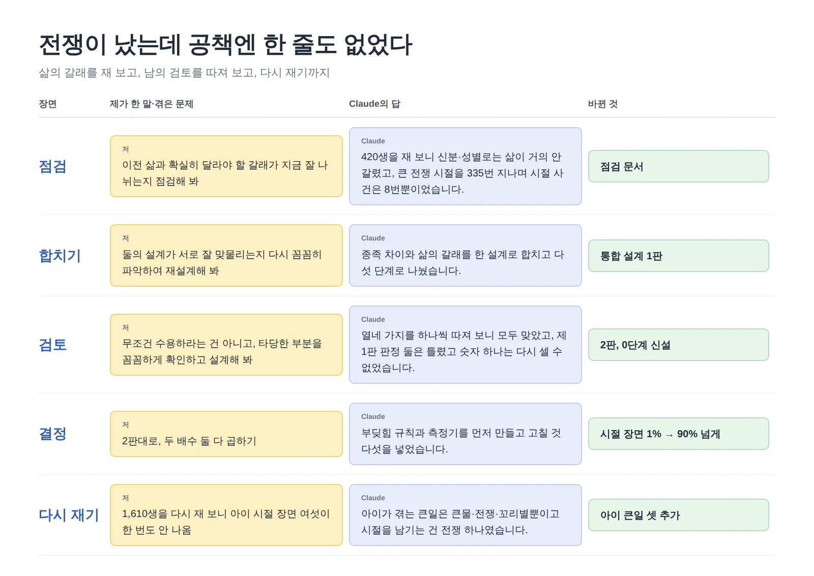
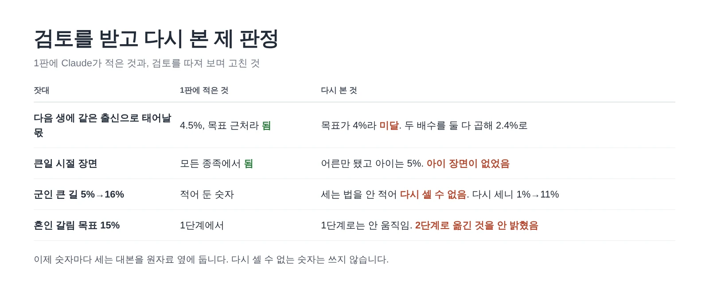
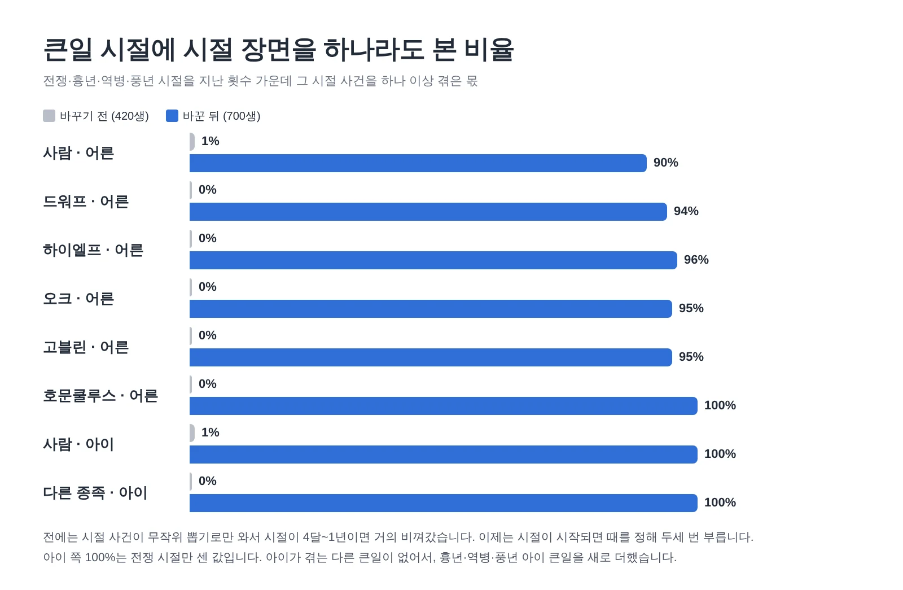
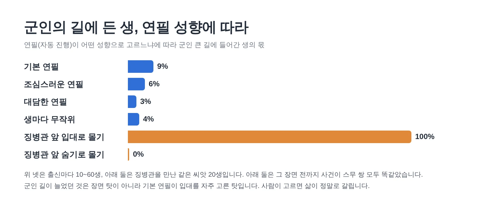

나라에 큰 전쟁이 터졌는데, 일기장엔 그날도 평화로운 동네 얘기만 적혀 있다면 좀 이상하겠죠. 제가 만드는 「공책 RPG」는 주인공이 죽으면 다음 생으로 넘어가 새 공책을 펼치는 게임입니다. 그러니 생마다 인생이 확확 갈려야 다음 권을 펼칠 맛이 날 텐데, 문득 의심이 들었습니다. 귀족으로 태어난 삶과 소작농으로 태어난 삶이, 전쟁통에 자란 삶과 풍년에 자란 삶이 공책 위에서 정말 다르게 읽힐까? Claude에게 직접 재 달라고 부탁했더니, 꽤 머쓱한 숫자표가 돌아왔습니다.

<figure><figcaption>점검을 부탁하고, 외부 검토를 건네고, 결정 카드 한 장을 누르기까지 다섯 장면입니다.</figcaption></figure>

## 335번의 전쟁, 8줄의 기록

Claude는 출신 스물한 곳에서 420번을 자동으로 살려 보고 결과를 들고 왔습니다. 같은 갈대 마을에서 소작농 아이로 태어나든 교단 견습으로 태어나든, 어른이 되고 나면 겪는 일이 거의 판박이였습니다. 같은 시드로 남자와 여자를 84쌍 살려 봤더니 **84쌍 모두 겪은 사건이 단 하나도 다르지 않았습니다.** 가장 뼈아픈 숫자는 따로 있었죠. 큰 전쟁이나 흉년 같은 격동의 시절을 335번 지나는 동안 그 시절 이야기가 공책에 뜬 건 겨우 8번이었습니다. 밖에서는 나라가 뒤집어졌는데, 주인공 공책만 태평하게 흘러가고 있었던 겁니다.

마침 다른 대화 스레드에서는 종족 차이를 손보고 있었습니다. 두 작업이 똑같은 사건 테이블을 건드리니 따로 가면 십중팔구 충돌하겠더군요. 그래서 하나로 합치고 이렇게 부탁했습니다. "둘의 설계가 서로 잘 맞물리는지, 그리고 내가 말한 방향성들이 해당 설계로 잘 보완이 되는지를 다시 한 번 꼼꼼히 파악하여 재설계해봐." 그렇게 다섯 단계짜리 통합 설계 1판이 나왔습니다.

## "무조건 수용하라는 건 아니고"

1판을 다른 곳에서 검토받았더니 고칠 점이 열네 가지나 쏟아졌습니다. 그대로 복붙하면 편했겠지만, 남의 지적을 걸러 듣지 않고 통째로 붙이면 설계가 금세 누더기가 되거든요. 그래서 이렇게 건넸습니다. "무조건적으로 수용하라는건 아니고 보고 타당한 부분이나 더 보완해야겠다고 생각되는 부분을 다시 꼼꼼하게 확인하고 설계해 봐."

Claude는 열네 개를 하나씩 따져 본 끝에 모두 타당하다며 받아들였습니다. 그보다 반가웠던 건 따져 보는 과정에서 **자기 실수를 먼저 자백한 것**입니다. 1판에 '목표 달성'이라고 적어 둔 항목 중 둘이 사실 미달이었고, 숫자 하나는 세는 법을 안 남겨 둬서 다시 셀 수조차 없었다고요.

<figure><figcaption>목표가 4%인데 4.5% 옆에 '됨'이라고 적어 뒀더군요. 이제 숫자마다 집계 스크립트를 원자료 옆에 묶어 둡니다.</figcaption></figure>

검토를 녹인 2판에는 0단계가 새로 생겼습니다. 장면을 무작정 늘리기 전에, 장면끼리 부딪힐 때의 교통정리 규칙과 그걸 잴 측정기부터 세우자는 겁니다. 저는 결정 카드에서 "2판대로, 두 배수 둘 다 곱하기"를 눌렀습니다.

## 규칙부터 세우고, 1,610번의 삶

장면을 늘리자마자 정말로 교통체증이 터졌습니다. 엘프는 수백 년을 사니까 혼인, 출산, 전쟁 장면이 한 해에 우르르 몰려들 수 있었거든요. 그래서 신호등 세 개를 먼저 세웠습니다.

1. **먼저 올 것**: 태어남, 여읨, 큰일 시절, 자람, 혼인과 아이 순서로 우선순위를 매겼습니다.
2. **반 년 간격**: 시기를 정해 부르는 장면끼리는 반 년을 띄웁니다. 처음엔 종족 수명 속도에 맞춰 늘이려 했는데, 엘프한테 적용했더니 간격이 10년으로 벌어지면서 장면이 죄다 증발해 버리더군요.
3. **같은 뜻 묶음**: 전쟁 시절 모병관, 출신 따라 오는 징집, 사람 마을의 모병관처럼 결국 '군대가 부른다'는 같은 이야기는 10년 안에 한 번만 찾아옵니다.

그다음 새 측정기로 1,610번의 삶을 돌렸습니다. 큰일 시절을 지나며 시절 장면을 하나라도 마주친 비율이 사람 어른은 1%에서 90%로, 다른 종족 어른은 0%에서 94~100%로 껑충 뛰었습니다.

<figure><figcaption>눈을 가늘게 떠야 보이는 회색 막대가 바꾸기 전입니다. 아이 쪽은 전쟁 시절만 집계한 값입니다.</figcaption></figure>

그런데 측정기가 숨은 구멍도 하나 끄집어냈습니다. 아이 때 겪는 시절 장면을 여덟 개나 새로 써 뒀는데, 그중 여섯 개가 700번을 사는 동안 코빼기도 안 비친 겁니다. 파고들어 보니 아이 시절에 벌어지는 큰일은 큰물, 전쟁, 꼬리별 셋뿐이었고, 그중 시절을 남기는 건 전쟁 하나뿐이었거든요. **흉년 장면만 열심히 써 놓고 정작 흉년이 찾아올 길은 안 뚫어 둔 겁니다.** 바로 어릴 적 흉년, 역병, 대풍년 세 가지를 추가했습니다.

## 군인이 쏟아진 건 연필 탓이었습니다

그래프를 훑다가 찜찜한 숫자도 하나 걸렸습니다. 전쟁 장면을 늘렸더니 군인의 길로 빠지는 삶이 1%에서 11%로 확 늘고, 아이를 둔 삶이 슬쩍 줄어들었거든요. 장면이 플레이어의 인생을 억지로 한쪽으로 떠미는 건 아닐까 싶었습니다.

그래서 연필을 바꿔 가며 다시 쟀습니다. 여기서 연필은 플레이어 대신 선택지를 고르는 자동 진행 기능인데, 조심스럽게도, 대담하게도, 매 생 무작위로도 고르게 돌려 보았죠. 거기에 같은 시드 스무 명을 징병관 앞에 줄 세워 놓고 한쪽은 입대, 한쪽은 숨기로 몰아 보았습니다.

<figure><figcaption>징병관 앞에서 입대를 고른 스무 명은 전원 군인이 됐고, 숨은 스무 명은 한 명도 안 됐습니다.</figcaption></figure>

범인은 기본 연필이었습니다. 징병관만 만나면 반사적으로 입대를 고르는 버릇이 있었던 거죠. 뒤집어 말하면 사람이 직접 선택할 때는 삶이 확실하게 갈린다는 뜻이기도 합니다. 덤으로 성격 쪽 숙제도 하나 건졌습니다. 연필을 완전 무작위로 돌려도 다혈질이 72%나 쏟아져서, 성격 쏠림은 연필이 아니라 사건과 선택지 자체의 문제로 드러났거든요. 이건 성격을 다루는 단계에서 손보기로 했습니다.

이번 업데이트는 여기까지 담아 올렸습니다. 아이를 둔 삶이 살짝 준 것과, 혼인한 삶과 안 한 삶이 아직 덜 갈리는 문제는 종족마다 가족의 모양을 나누는 다음 단계에서 다시 재 볼 예정입니다. 그 전에 신분, 소속, 살림 같은 다섯 가지 상태와 동네가 나를 보는 평판 계산법부터 바로잡아 두려고 합니다.

## 세 줄 요약

1. "정말 삶이 갈리나?"는 감으로 넘기지 말고 AI에게 직접 돌려 재 보게 하세요. 전쟁 335번에 기록 8줄 같은 숫자는 말로는 절대 안 잡힙니다.
2. 외부 검토는 "무조건 받지 말고 따져 보라"고 건네세요. 남의 지적을 검산하다가 AI가 자기 실수까지 스스로 털어놓습니다.
3. 숫자 옆에는 반드시 세는 법을 남겨 두세요. 다시 셀 수 없는 숫자는 다음 결정을 버텨 주지 못합니다.
