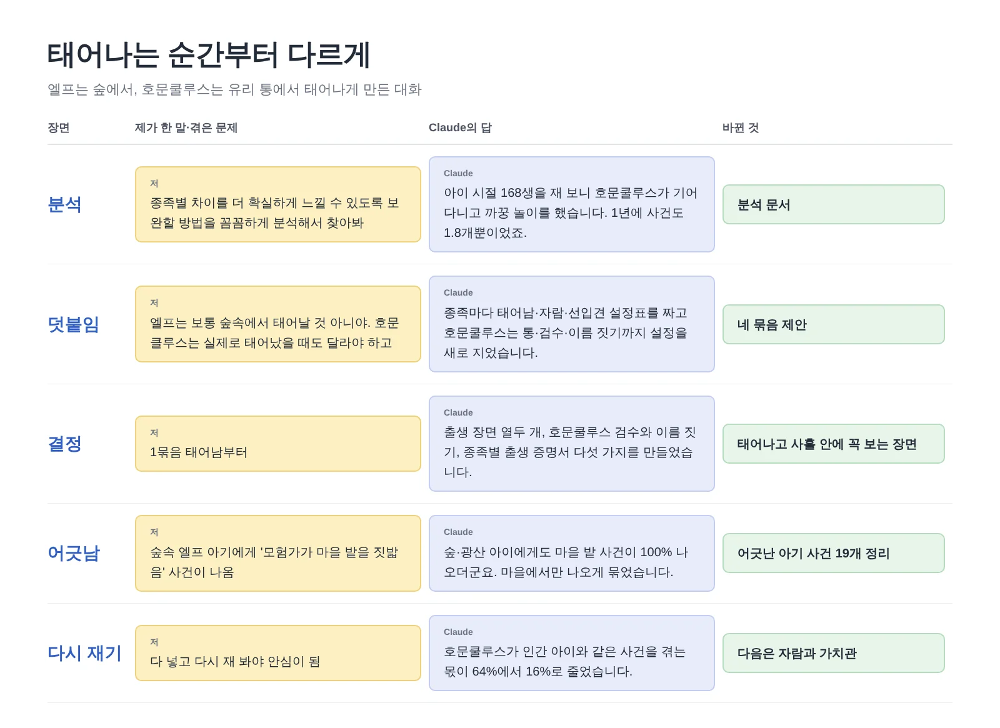
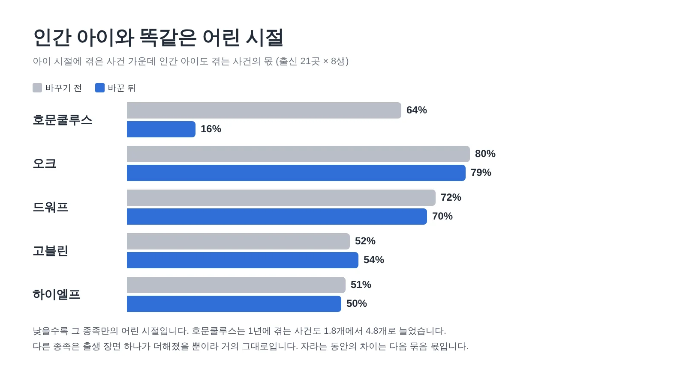

앞 글에서 드워프는 모루로, 엘프는 서고로 기울게 만들어 두었습니다. 그런데 하나를 고치고 나니 엉뚱한 데가 눈에 밟히더군요. 어른이 된 뒤는 종족마다 색깔이 생겼는데, 정작 태어나서 자라는 동안은 다들 똑같은 동네 꼬맹이였거든요. 아예 첫 장부터 손을 보기로 했습니다.

<figure><figcaption>분석을 부탁하고, 덧붙이고, 카드 한 장을 누르기까지 다섯 장면입니다.</figcaption></figure>

## 기어 다니는 호문쿨루스

시작은 꽤 막연했습니다. 플레이어가 종족 차이를 더 확실하게 느끼도록 보완할 방법을 꼼꼼하게 찾아 달라고 던졌죠. 그러자 코드부터 뒤지는 대신 숫자부터 뽑아 오더라고요. 출신 스물한 곳에서 여덟 명씩, 아이 시절만 168번을 돌려서요.

결과표를 펼치자마자 헛웃음이 나왔습니다. 마법 실험실 유리 통에서 만들어진 호문쿨루스가 **기어 다니기를 배우고 까꿍 놀이를 하고 있었습니다.** 1년 동안 겪는 사건은 고작 1.8개, 그마저 인간 아이와 64%가 겹쳤습니다. 숲속 엘프 아기나 광산 드워프 아기나 똑같이 '모험가가 마을 밭을 짓밟는' 사건을 겪고 있었고요. 숲에 무슨 밭이 있다고요.

## "엘프는 보통 숲속에서 태어날 것 아니야"

분석이 돌아가는 동안 생각이 하나 더 꼬리를 물었습니다. 태어나는 장소만 다를 게 아니라 교육받는 환경도, 거기서 배어 나오는 가치관과 선입견도 종족마다 다를 텐데 싶었죠. 그래서 슬쩍 한 마디 덧붙였습니다. "호문쿨루스는 평범한 생명체와는 완전히 다르게 태어난 거니까" 배경과 문화를 세세하게 잡고, 실제 태어날 때도 달라야 하지 않겠냐고요.

돌아온 설정표에는 종족마다 태어남, 자람, 가치관, 선입견이 한 줄씩 정리돼 있었습니다. 호문쿨루스는 아예 설정을 새로 짰더군요. 통에서 깨어나 걷기, 말하기, 시킨 일 세 가지 검수를 통과하고 학원 밖으로 나가는 날 **스스로 이름을 짓는** 겁니다. 전체 작업은 네 묶음으로 나뉘었는데, 결정 카드에서 "1묶음 태어남부터"를 눌렀습니다. 한꺼번에 다 뒤집으면 정작 뭐가 먹혔는지 알 도리가 없으니까요.

<figure class="narrow"><figcaption>호문쿨루스의 첫 장면입니다. '태어났습니다' 대신 '만들어졌습니다'로 시작하고, 기어 다니기 대신 '왜냐고 묻는다'가 있습니다.</figcaption></figure>

## 태어나고 사흘 안에 꼭 보는 장면

이제 누구로 시작하든 태어나고 1~3일 안에 그 종족, 그 출신만의 장면 하나를 반드시 마주칩니다. 모두 열두 가지입니다.

1. **드워프**: 씨족 어른들이 갓난아기 손바닥에 숯검정을 묻혀 조상 석판에 꾹 찍습니다. 수백 년 치 손바닥 아래 맨 귀퉁이가 내 자리입니다.
2. **폐허의 엘프**: 숲에 아기가 태어난 게 사십 년 만입니다. 숲지기들이 아기가 어느 별에 손을 뻗는지 숨죽여 보는데, 별 대신 반딧불이를 잡아도 별말 안 합니다.
3. **고블린과 오크**: 고블린은 형제 열한 마리가 바글거리는 새끼 우리에서, 오크는 얼음 강물에 풍덩 담기는 부족 전통으로 첫날을 맞습니다.
4. **인간**: 요새에서는 경보 북이 울리는 밤에, 바닷가에서는 물때가 바뀌는 새벽에, 무덤지기 집에서는 까마귀가 한꺼번에 날아오르는 순간에 태어납니다.

호문쿨루스는 여기에 두 장면이 더 붙습니다. 몇 달 뒤 검수 날이 오는데, 하나라도 삐끗하면 다시 통 신세입니다. 옆 통은 지난주에 비었고요. 출고 날이 가까워지면 같은 통 형제가 몰래 묻습니다. 너는 이름 지었냐고요. 번호를 그대로 쓸지, 먼저 간 형제의 번호를 손등에 옮겨 적을지는 플레이어 몫입니다.

## 첫 장부터 서류가 다릅니다

게임을 켜면 제일 먼저 마주치는 게 출생 증명서입니다. 여기도 종족마다 양식을 싹 갈아엎었습니다. 도장 글씨까지요.

<figure><figcaption>호문쿨루스의 이름 칸은 "아직 없음 (스스로 지을 때까지)"이고 도장은 "반응 있음"입니다.</figcaption></figure>

인간은 "태어남!", 드워프는 "새겨짐!", 고블린은 "깸!", 오크는 "울었다!"가 찍힙니다. 고블린 증명서는 아예 부화장 배급표입니다. 깬 순서에 "열두 마리 가운데 2번째"라고 적혀 있고, 배급 칸에는 "하루 썩은 고기 한 덩이(나눠 먹음)"가 박혀 있죠. 서류 한 장만 봐도 이 아이가 어떤 대접을 받으며 클지 감이 옵니다.

## 다시 재 보니 호문쿨루스만 확 달라졌습니다

다 밀어 넣고 168생을 다시 돌렸습니다. 출생 장면은 예외 없이 첫 사건으로 떴고, 호문쿨루스도 더는 바닥을 기어 다니지 않습니다.

<figure><figcaption>낮을수록 그 종족만의 어린 시절입니다. 호문쿨루스 막대만 크게 줄었습니다.</figcaption></figure>

막상 그래프를 펼쳐 보니 솔직한 숫자가 찍혀 있습니다. 호문쿨루스는 인간 아이와 겹치는 비중이 64%에서 16%로 뚝 떨어졌는데, 나머지 종족은 거의 제자리걸음이거든요. 출생 장면이 아무리 강렬해도 결국 사건 하나일 뿐이니까요. 오크 아이는 여전히 열 번 중 여덟 번꼴로 인간 아이와 같은 일을 겪고 있습니다. 다음 편은 그래서 2묶음, 종족마다 다르게 자라고 어릴 때 들은 말이 가치관으로 남는 이야기입니다.

## 세 줄 요약

1. "확실히 달라야 한다"는 느낌은 AI에게 먼저 측정해 달라고 하세요. 기어 다니는 호문쿨루스처럼 말로는 못 찾던 어긋남이 숫자에서 나옵니다.
2. 큰 일은 묶음으로 나눠 하나씩 하세요. 하나만 바꾸고 다시 측정해야 무엇이 먹혔는지 보입니다.
3. 결과가 기대보다 덜 움직였으면 그대로 받아들이세요. 그 빈칸이 다음에 할 일을 정해 줍니다.
