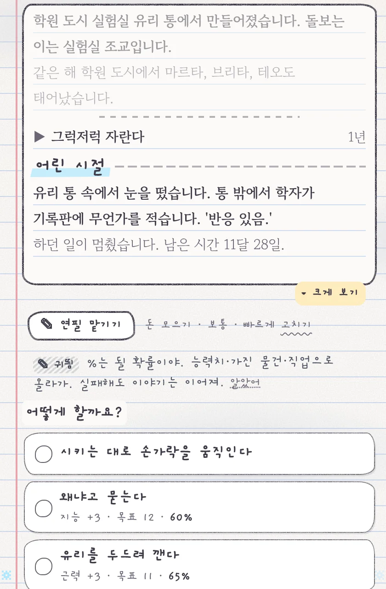
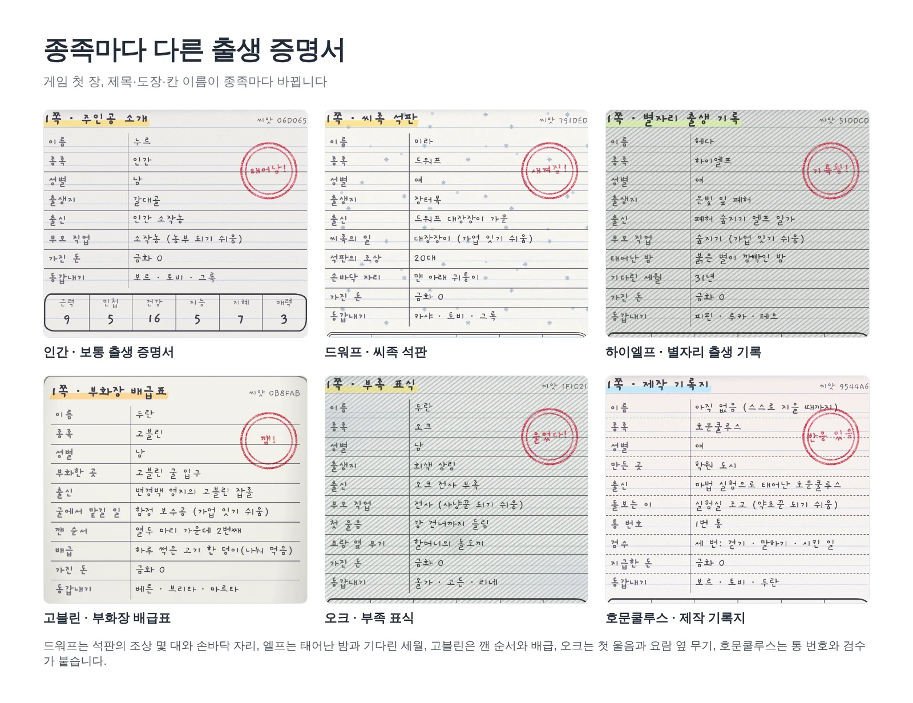

마법 실험실 유리 통에서 막 깨어난 인조인간이 바닥을 기어 다니며 까꿍 놀이를 하고 있었습니다. 앞 글에서 드워프는 모루로, 엘프는 서고로 기울게 손봐 두었더니, 정작 어른이 되기 전 어린 시절의 어긋남이 더 선명하게 눈에 밟히더군요. 다 크면 종족 색깔이 좀 나는데, 태어나서 자라는 동안은 여섯 종족이 죄다 똑같은 동네 꼬맹이였거든요. 아예 공책 첫 장부터 뜯어고치기로 했습니다.

<figure><figcaption>분석을 부탁하고, 조건을 덧붙이고, 결정 카드 한 장을 누르기까지 다섯 장면입니다.</figcaption></figure>

## 기어 다니는 호문쿨루스

시작은 꽤 막연했습니다. 플레이어가 종족 차이를 더 확실하게 체감할 방법을 꼼꼼하게 찾아 달라고 던졌죠. 그러자 Claude는 코드부터 헤집는 대신 숫자부터 뽑아 왔습니다. 출신 스물한 곳에서 여덟 명씩, 아이 시절만 168번을 자동으로 굴려서요.

결과표를 펼치자마자 헛웃음이 터졌습니다. 실험실 유리 통에서 만들어진 호문쿨루스가 **기어 다니기를 배우고 까꿍 놀이를 하고 있었던 겁니다.** 첫 1년 동안 겪는 사건은 고작 1.8개, 그마저 인간 아이와 64%가 겹쳤습니다. 숲속 엘프 아기와 광산 드워프 아기도 사이좋게 '모험가가 마을 밭을 짓밟는' 사건을 겪고 있었고요. 깊은 숲에 무슨 밭이 있다고요.

## "엘프는 보통 숲속에서 태어날 것 아니야"

분석이 돌아가는 동안 생각이 하나 더 꼬리를 물었습니다. 태어나는 장소만 다를 게 아니라 자라는 환경도, 거기서 자연스레 배어 나오는 가치관과 선입견도 종족마다 달라야 맞겠죠. 그래서 한마디 슬쩍 얹었습니다. "호문쿨루스는 평범한 생명체와는 완전히 다르게 태어난 거니까" 배경과 문화를 세세하게 잡고, 실제 세상에 나오는 순간부터 완전히 다르게 만들자고요.

돌아온 설정표에는 종족마다 태어남, 자람, 가치관, 선입견이 한 줄씩 정리돼 있었습니다. 호문쿨루스는 아예 설정을 새로 짰더군요. 통에서 눈을 뜨고 걷기, 말하기, 시킨 일 세 가지 검수를 통과한 뒤, 학원 밖으로 나가는 날 **스스로 이름을 짓는** 겁니다. 전체 작업은 네 묶음으로 나뉘어 결정 카드로 올라왔고, 저는 "1묶음 태어남부터"를 눌렀습니다. 한꺼번에 다 뒤집으면 나중에 뭐가 먹혔는지 알 도리가 없으니까요.

<figure class="narrow"><figcaption>호문쿨루스의 첫 장면입니다. '태어났습니다' 대신 '만들어졌습니다'로 시작하고, 기어 다니기 대신 '왜냐고 묻는다'가 뜹니다.</figcaption></figure>

## 태어나고 사흘 안에 꼭 보는 장면

이제 어느 종족으로 시작하든 태어나고 1~3일 안에 그 종족, 그 출신만의 장면 하나를 반드시 마주칩니다. 모두 열두 가지입니다.

1. **드워프**: 씨족 어른들이 갓난아기 손바닥에 숯검정을 묻혀 조상 석판에 꾹 찍습니다. 수백 년 치 손바닥 아래 맨 귀퉁이가 내 자리입니다.
2. **폐허의 엘프**: 숲에 아기가 태어난 게 사십 년 만입니다. 숲지기들이 아기가 어느 별에 손을 뻗는지 숨죽여 보는데, 별 대신 반딧불이를 잡아도 별말 안 합니다.
3. **고블린과 오크**: 고블린은 형제 열한 마리가 바글거리는 새끼 우리에서, 오크는 얼음 강물에 풍덩 담기는 부족 전통으로 첫날을 맞습니다.
4. **인간**: 요새에서는 경보 북이 울리는 밤에, 바닷가에서는 물때가 바뀌는 새벽에, 무덤지기 집에서는 까마귀가 한꺼번에 날아오르는 순간에 태어납니다.

호문쿨루스는 여기에 두 장면이 더 붙습니다. 몇 달 뒤 검수 날이 오는데, 하나라도 삐끗하면 다시 통 신세입니다. 옆 통은 지난주에 조용히 비었고요. 출고 날이 가까워지면 같은 통 형제가 몰래 묻습니다. 너는 이름 지었냐고요. 번호를 그대로 쓸지, 먼저 사라진 형제의 번호를 손등에 옮겨 적을지는 플레이어 몫입니다.

## 첫 장부터 서류가 다릅니다

게임을 켜면 제일 먼저 마주치는 화면이 출생 증명서입니다. 공책 첫 장부터 분위기를 잡으려고 종족마다 양식을 싹 갈아엎었습니다. 도장 글씨까지요.

<figure><figcaption>호문쿨루스의 이름 칸은 "아직 없음 (스스로 지을 때까지)"이고 도장은 "반응 있음"입니다.</figcaption></figure>

인간은 "태어남!", 드워프는 "새겨짐!", 고블린은 "깸!", 오크는 "울었다!"가 찍힙니다. 고블린 증명서는 아예 부화장 배급표입니다. 깬 순서에 "열두 마리 가운데 2번째"라고 적혀 있고, 배급 칸에는 "하루 썩은 고기 한 덩이(나눠 먹음)"가 박혀 있죠. 서류 한 장만 훑어도 이 아이가 어떤 대접을 받으며 클지 단박에 감이 옵니다.

## 다시 재 보니 호문쿨루스만 확 움직였습니다

전부 밀어 넣고 다시 168생을 굴렸습니다. 출생 장면은 예외 없이 첫 사건으로 떴고, 호문쿨루스도 더는 연구실 바닥을 기어 다니지 않습니다.

<figure><figcaption>낮을수록 그 종족만의 어린 시절입니다. 호문쿨루스 막대만 뚝 떨어졌습니다.</figcaption></figure>

그래프는 솔직했습니다. 호문쿨루스는 인간 아이와 겹치는 비중이 64%에서 16%로 뚝 떨어졌지만, 나머지 종족은 거의 제자리걸음이거든요. 출생 장면이 아무리 강렬해도 결국 사건 하나일 뿐이니까요. 오크 아이는 여전히 열 번 중 여덟 번꼴로 인간 아이와 같은 오후를 보내고 있습니다. 다음 편은 그래서 2묶음, 종족마다 다르게 자라고 어릴 때 들은 말이 가치관으로 굳어 가는 이야기입니다.

## 세 줄 요약

1. "종족마다 달라야 한다"는 느낌만 있을 땐 AI에게 먼저 지금 비율부터 재 보게 하세요. 까꿍 놀이 하는 호문쿨루스 같은 어긋남은 숫자표에서 바로 들통납니다.
2. 큰 작업은 묶음으로 쪼개 하나씩 넣으세요. 한 번에 하나만 바꾸고 다시 재야 진짜 무엇이 먹혔는지 보입니다.
3. 그래프가 기대만큼 안 움직였어도 괜히 포장하지 말고 그대로 받아들이세요. 그 빈칸이 다음 작업 목록을 정확히 알려 줍니다.
