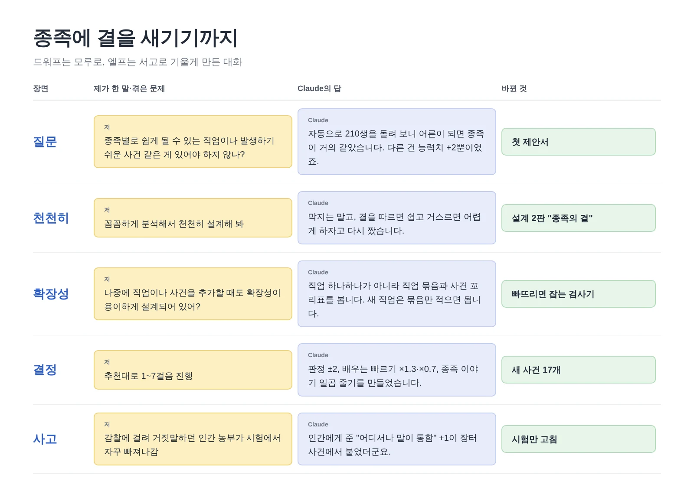
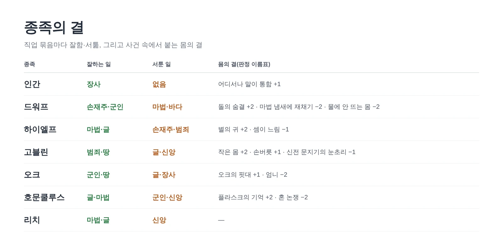
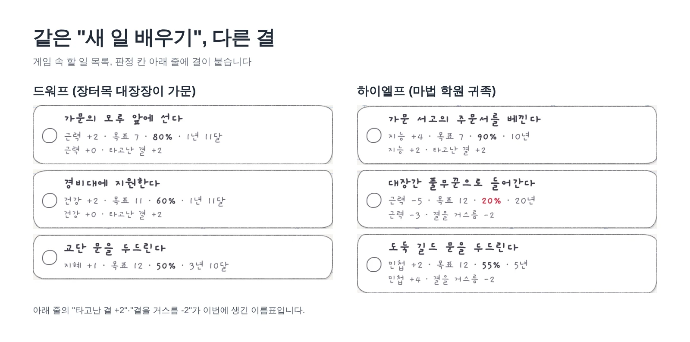
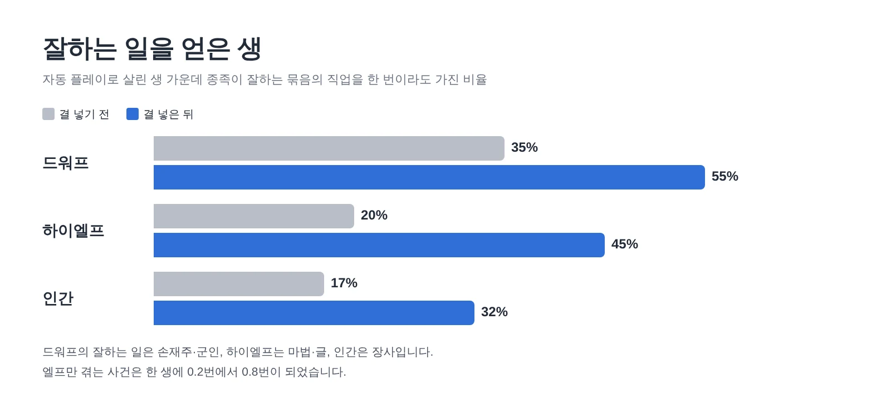

제가 만들고 있는 「공책 RPG」는 초등학생이 공책에 끄적여 만든 듯한 판타지 인생 시뮬레이션 웹 게임입니다. 인간, 드워프, 하이엘프, 고블린, 오크, 호문쿨루스까지 종족만 여섯이나 들어가 있죠. 그런데 어느 날 문득 찜찜한 질문이 하나 떠올랐습니다. 판타지라면 드워프는 망치를 들고 엘프는 마법서를 펼쳐야 제맛인데, 우리 게임에서도 진짜 그렇게 살고 있을까? Claude에게 툭 던져 봤더니 꽤 민망한 성적표가 돌아왔습니다.

<figure><figcaption>질문 하나가 규칙 하나로 자리 잡기까지 다섯 장면입니다.</figcaption></figure>

## "있어야 하지 않나?"

물어본 건 아주 소박했습니다. 드워프는 보통 마법에 서툴고 엘프는 잘하잖아, 종족마다 쉽게 붙는 직업이나 자주 겪는 사건쯤은 있어야 하지 않냐고요.

Claude는 대답부터 내놓는 대신 게임을 210번 자동으로 돌려 보았습니다. 돌아온 결론은 뼈아팠습니다. 어른이 되는 순간, 종족이라는 설정이 거의 증발해 버렸거든요. 드워프가 무두장이, 묘지기, 도둑을 아무렇지 않게 오가고, 하이엘프는 스무 명 중 일곱이 은둔자나 한량으로 세월을 보내고 있었습니다. 종족 차이라고 붙어 있던 건 능력치 +2, 판정 확률로 쳐 봐야 고작 5%p 남짓. 엘프만 겪는 사건은 820년을 사는 동안 평균 0.2번 떴습니다. **800년 넘게 살면서 인간과 거의 똑같은 인생을 복붙하고 있었던 겁니다.**

## "천천히 설계해 봐"가 바꾼 분위기

첫 제안서는 번개처럼 나왔습니다. 종족마다 적성표를 깔고 숫자를 매기는 안이었죠. 틀린 말은 아닌데, 읽다 보니 판타지 세계가 아니라 인사팀 평가표 같은 엑셀 냄새가 진하게 풍겼습니다. 그래서 슬쩍 브레이크를 걸었습니다. "꼼꼼하게 분석해서 천천히 설계해 봐." 지금 있는 사건과 규칙에 자연스럽게 맞물리면서도 플레이하는 손맛이 살도록요.

잠시 숨을 고른 두 번째 설계서는 이름부터 달랐습니다. **'종족의 결'**. 원칙은 딱 하나입니다. 아무것도 막지 않는다. 대신 결을 따르면 수월하고, 거스르면 뻑뻑하다. 드워프도 얼마든지 마법사가 될 수 있습니다. 다만 나뭇결을 거슬러 대패질하듯 손에 힘이 좀 더 들어갈 뿐이죠.

<figure><figcaption>드워프는 마법 사건에서 "마법 냄새에 재채기"를 하고, 바다에서는 "물에 안 뜨는 몸"이 됩니다.</figcaption></figure>

이 결은 세 겹으로 짰습니다.

1. **손**: 잘하는 일은 배우기 판정 +2에 숙련 속도 1.3배, 서툰 일은 −2에 0.7배로 더딥니다. 플레이어 대신 선택지를 고르는 자동 진행 '연필'도 잘하는 일을 두 배 더 자주 집습니다.
2. **몸**: 직업이 없어도 사건 속에서 종족의 체취가 묻어나도록 판정 이름표 열세 개를 붙였습니다. 오크가 귀족 앞에서 말발을 세우려 들면 "엄니" 때문에 −2가 깎입니다.
3. **삶**: 종족마다 자주 겪는 사건 비중을 손보고, 전용 이야기 여섯 줄기를 새로 썼습니다. 하이엘프가 사람 친구를 사귀면 친구 머리가 하얗게 세고 장례식에서 손주가 옷자락을 잡을 때까지, 엘프의 달력으로는 고작 몇 철이 지나갈 뿐입니다.

## 공사 전에 던진 질문 하나

설계서를 읽다 보니 슬그머니 걱정이 올라왔습니다. 앞으로 직업과 사건은 계속 불어날 텐데, 새 직업을 하나 넣을 때마다 이 표를 뜯어고쳐야 한다면 몇 주 못 가 누더기가 될 테니까요. 그래서 삽 뜨기 전에 한마디 물었습니다. "나중에 직업을 추가하거나 사건을 추가할 때도 확장성이 용이하게 설계되어 있어?"

다행히 구조가 깔끔했습니다. 결은 직업 하나하나가 아니라 **직업 묶음과 사건 꼬리표**만 봅니다. 새 직업을 추가할 때 "손재주 묶음" 한 줄만 달아 두면 드워프가 알아서 반갑게 달려드는 식이죠. 여기에 꼬리표를 빼먹으면 바로 빨간 줄을 긋는 검사기까지 얹어 두기로 했습니다. 착공 전에 질문 하나 던진 덕분에 나중에 벽을 헐어 낼 수고를 미리 막았습니다.

실행은 AI가 선택지를 정리해 띄워 주는 결정 카드 한 장으로 끝냈습니다. "추천대로 1~7걸음 진행"을 누르자 일곱 단계가 차례대로 착착 들어갔습니다.

## 드워프는 모루로, 엘프는 서고로

이제 똑같은 "새 일 배우기" 목록이라도 종족마다 표정이 확 달라집니다. 드워프에게는 가문의 모루와 경비대 옆에 "타고난 결 +2"가 반짝이고, 하이엘프가 대장간 풀무질을 기웃거리면 "결을 거스름 −2"가 뜹니다.

<figure><figcaption>엘프의 풀무꾼 수습은 성공률 20%에 20년짜리입니다. 그래도 하지 말라는 건 아닙니다.</figcaption></figure>

물론 결을 거스르는 고집쟁이를 빈손으로 돌려보내진 않습니다. 서툰 일을 끝까지 파서 능숙 단계에 올리면 고향 어른이 팔짱을 끼고 구경을 오고, 나중에는 같은 종족 아이가 제자로 받아 달라며 찾아옵니다. 공책에는 "결을 거스른 공책" 도장이 쾅 찍히고, 다음 생에 같은 종족으로 태어나면 그 일은 더 이상 서툴지 않게 됩니다. 전생의 고집이 영혼에 눌러앉는 거죠.

작업 도중에 웃긴 사고도 하나 터졌습니다. 조합 감찰에 걸려 거짓말로 버티다 직업을 잃어야 하는 인간 농부가 자동 테스트에서 자꾸 무사통과하는 겁니다. 범인은 인간에게 달아 둔 "어디서나 말이 통함" +1이었습니다. 장터에서 흥정 좀 잘하라고 붙여 준 말발이 감찰관 앞 거짓말까지 술술 넘겨 버린 거죠. 게임은 그대로 두고 테스트 쪽을 고쳤습니다. 이 정도면 꽤 인간다운 결과잖아요.

## 다시 재 보니 절반쯤 왔습니다

일곱 걸음을 다 밀어 넣고 다시 210생을 굴려 보았습니다.

<figure><figcaption>회색이 바꾸기 전, 파랑이 바꾼 뒤입니다. 엘프만 겪는 사건도 네 배로 늘었습니다.</figcaption></figure>

드워프는 경비병과 경비대장으로, 엘프는 은둔자 옆에 필경사와 노래지기가 나란히 서기 시작했습니다. 다만 솔직히 털어놓자면 전체 사건 분야의 비중 자체는 종족마다 아직 1~4%p밖에 차이가 안 납니다. 지금은 큰 통계보다 판정 이름표와 전용 이야기에서 종족의 색깔이 먼저 묻어나는 단계죠. 실제 플레이 기록이 좀 더 쌓이면 사건 비중도 한층 과감하게 조여 볼 생각입니다.

## 세 줄 요약

1. "원래 이래야 하지 않나?" 싶은 건 감으로 고치지 말고 AI에게 지금 상태부터 재 보게 하세요. 820년에 0.2번 같은 숫자가 눈을 확 틔워 줍니다.
2. 답이 엑셀 표처럼 밋밋하게 나올 땐 "천천히 설계해 봐" 한마디로 숨을 고르게 하면, 기존 규칙과 맞물리는 아이디어가 나옵니다.
3. 짓기 전에 "나중에 늘릴 때도 괜찮아?"를 먼저 물으세요. 그 질문 하나가 빠뜨림을 잡아 주는 검사기까지 챙겨 옵니다.
