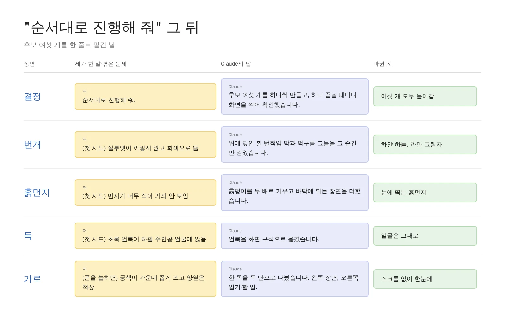
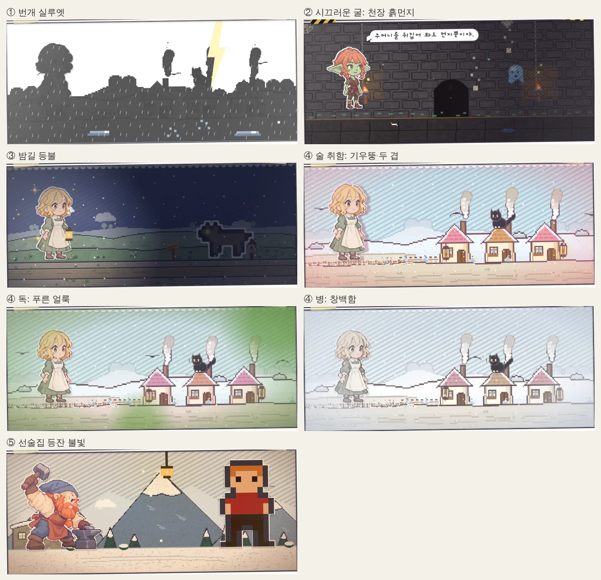
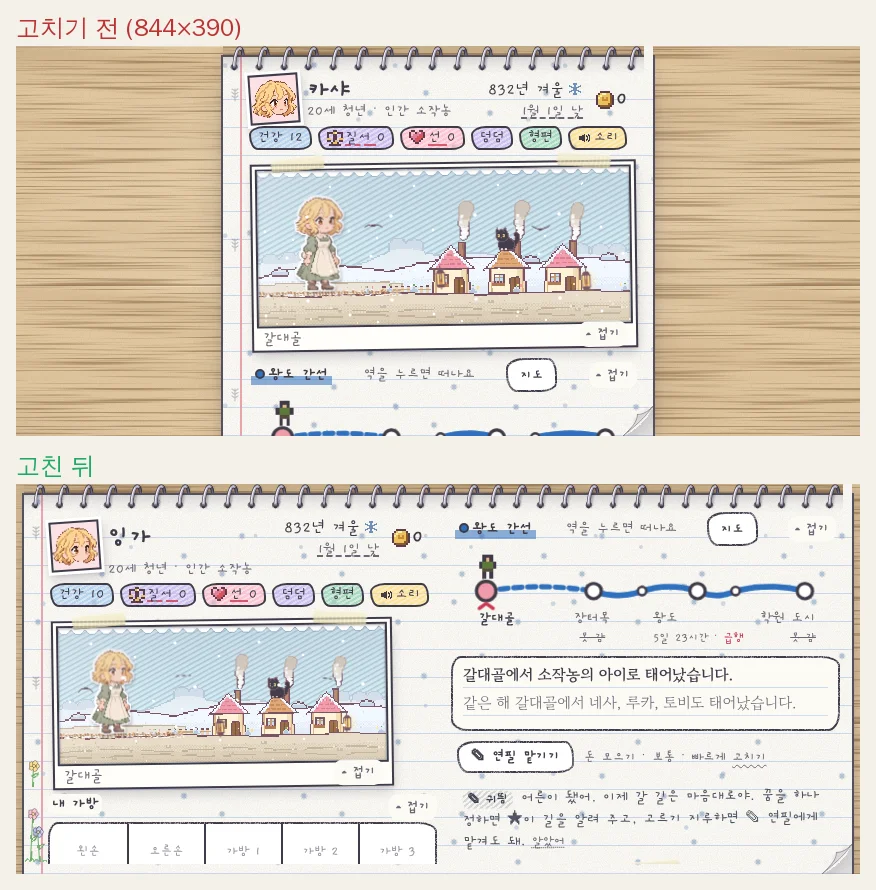

결재 서류에 도장 하나 쾅 찍었을 뿐인데, 퇴근할 때쯤 게임에 번개가 치고 선술집 등잔이 켜져 있었습니다. [지난 글]() 끝에서 Claude가 다음에 넣을 만한 분위기 효과 후보 여섯 개를 번호까지 매겨 적어 왔거든요. 번개, 굴 먼지, 밤길 초롱, 술 취한 화면, 실내 불빛, 그리고 폰 가로 화면. 하나씩 뜯어보며 우선순위를 정하려니 죄다 탐이 나서 고르는 게 더 일이더군요. 그래서 딱 한 줄만 보냈습니다. "순서대로 진행해 줘."

<figure><figcaption>한 줄 결재 뒤에 Claude가 스스로 화면을 찍어 보며 고친 장면들입니다.</figcaption></figure>

## 결재 서류에 도장 하나

후보가 이미 번호 붙은 목록으로 깔끔하게 정리돼 있었으니, 제가 할 일은 정말 결재란에 서명 하나 남기는 것뿐이었습니다. **선택지가 단정하게 정리돼 있으면 "순서대로"라는 짧은 말 한마디가 그대로 작업 지시서가 됩니다.** Claude는 효과를 하나 끝낼 때마다 장면을 직접 촬영해 보고, 어색하다 싶으면 제게 묻기도 전에 그 자리에서 다시 손봤습니다. 그사이 저는 커피를 마시며 딴일을 보고 있었고요.

## 번개가 치면 세상이 오려 낸 그림자극처럼

첫 타자는 번개 실루엣입니다. 폭풍이 몰아치는 바깥에서 번개가 번쩍이는 찰나, 하늘은 새하얗게 날아가고 땅과 집과 사람만 먹물처럼 까만 그림자로 남는 연출이죠.

<figure><video src="/assets/img/posts/mood-effects/bolt.mp4" poster="/assets/img/posts/mood-effects/bolt.jpg" controls muted playsinline preload="none"></video><figcaption>8초에 한 번, 번쩍이는 그 짧은 순간만 공책이 그림자 연극 무대가 됩니다.</figcaption></figure>

재미있었던 건 첫 시도입니다. 그림자가 새까맣지 않고 물 빠진 회색으로 뜬 겁니다. Claude가 자기 스크린샷을 들여다보더니 범인을 금세 찾아냈습니다. 번쩍일 때 화면 전체를 덮는 흰 막이 하필 까만 실루엣 위까지 덮어 버려서, 그림자까지 같이 표백되고 있었던 거죠. 그 짧은 찰나에만 흰 막과 먹구름 그늘을 걷어 내니 비로소 **하얀 하늘 위로 쨍한 까만 그림자**가 또렷하게 섰습니다.

## 굴이 시끄러우면 천장이 무너질 것 같다

나머지 효과들도 차례대로 줄을 지어 들어왔습니다.

<figure><figcaption>번개, 흙먼지, 초롱, 술·독·병, 등잔까지 한 장에 모았습니다.</figcaption></figure>

1. **시끄러운 굴**: 동굴 속 소음이 괴물이 몰려오기 직전까지 차오르면 천장에서 흙먼지가 우수수 떨어지고 화면이 덜덜 떨립니다. 첫 판엔 먼지가 돋보기를 대야 보일 만큼 자잘해서, 흙덩이를 두 배로 키우고 바닥에 툭 튀는 동작까지 붙였습니다.
2. **밤길 초롱**: 야밤에 길을 걸으면 주인공이 초롱을 들고, 딱 그 주변만 따스하게 밝아집니다. 어둠 너머에서 늑대 눈빛이 스르르 걸어 나올 땐 제법 등골이 서늘합니다.
3. **술·독·병**: 술에 취하면 세상이 기우뚱하고 사람이 두 겹으로 흔들립니다. 독에 걸리면 화면 가장자리부터 푸르스름한 얼룩이 번지고, 병이 들면 핏기가 쭉 빠져 창백해지죠. 독 얼룩은 첫 시도에 하필 주인공 얼굴 한복판에 피어오를 뻔해서 구석으로 내쫓았습니다.
4. **선술집 등잔**: 선술집이나 여관 사건이 뜨면 천장에 등잔이 매달리고 호박색 불빛이 아른거립니다. 지붕 아래로 들어온 셈이니 바깥 빗줄기도 자연스럽게 멎고요.

## 폰을 눕혔더니 공책이 두 쪽으로 펼쳐졌다

마지막 주자는 폰 가로 화면입니다. 예전엔 폰을 가로로 돌려도 공책이 세로 폭 그대로 화면 한가운데 좁다랗게 떠 있었습니다. 양옆엔 텅 빈 책상만 휑하니 남고, 정작 일기와 선택지를 보려면 손가락을 한참 내려야 했죠.

<figure><figcaption>왼쪽엔 장면과 가방, 오른쪽엔 노선도와 일기, 할 일. 이제 스크롤 없이 한눈에 들어옵니다.</figcaption></figure>

이번엔 공책을 두 쪽으로 쫙 펼쳤습니다. 왼쪽 단이 조금만 넘쳐도 눈치 없이 셋째 단이 툭 생겨 버리는 함정이 있었는데, **장면 크기를 화면 높이에 맞춰 자동으로 줄이게** 해서 말끔히 잡았습니다. 마지막으로 [지난번에 만든 점검기]()를 한 번 더 돌렸더니, 역이 많은 이동 노선에서 역 이름끼리 어깨를 밀치던 작은 버그까지 공짜로 잡혀 나왔습니다.

## 세 줄 요약

1. AI에게 다음 후보를 번호 붙인 목록으로 받아 두면, 다음 작업은 "순서대로 진행해 줘" 한 줄로 결재가 끝납니다.
2. 항목을 끝낼 때마다 화면을 찍어 스스로 점검하게 하면 회색 번개 그림자나 얼굴 위 독 얼룩 같은 실수를 알아서 고칩니다.
3. 이전에 만들어 둔 자동 점검 도구는 새 기능을 얹을 때마다 꼭 다시 돌리세요. 덤으로 버그 하나를 더 물어다 줍니다.
