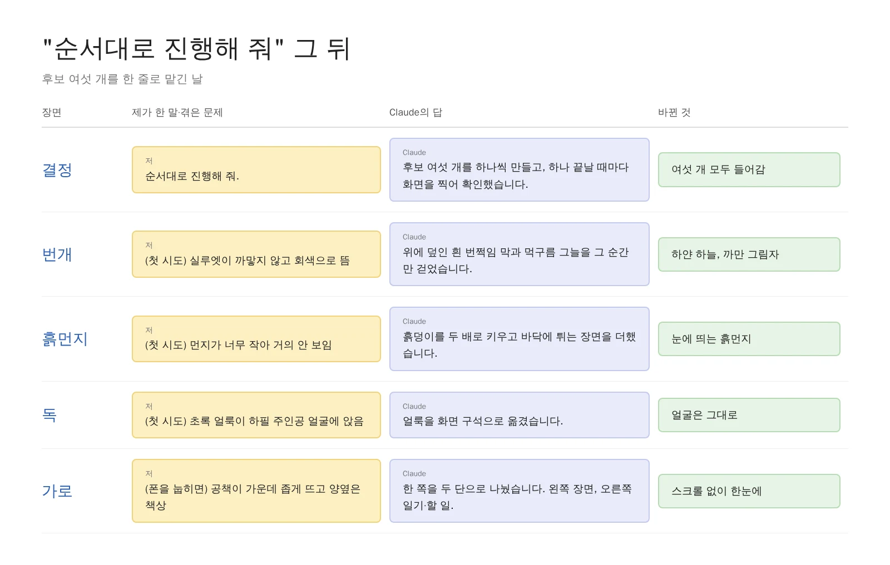
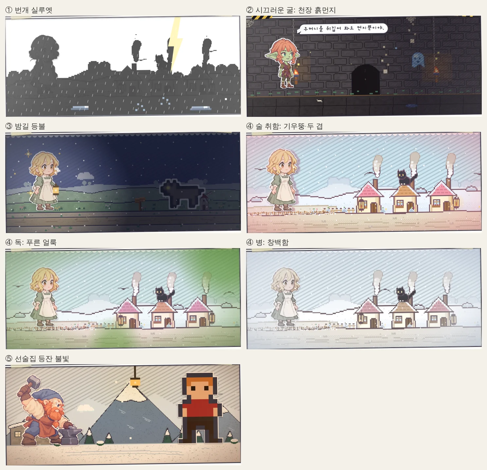
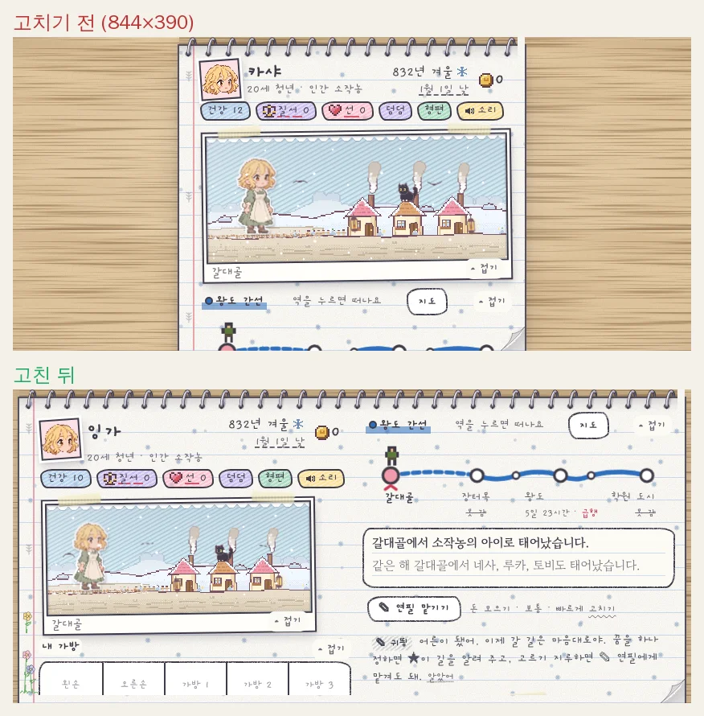

[지난 글]() 끝에서 Claude가 다음에 넣을 만한 분위기 효과 후보 여섯 개를 적어 왔습니다. 번개, 굴 먼지, 밤길 등불, 취했을 때의 화면, 실내 불빛, 그리고 폰 가로 화면이었죠. 하나씩 뜯어보며 순위를 매기려니 다 탐이 나서 고르는 게 더 일이더군요. 그래서 아예 결재 도장 찍듯 한 줄만 보냈습니다. "순서대로 진행해 줘."

<figure><figcaption>한 줄 결재 뒤에 Claude가 스스로 고친 장면들입니다.</figcaption></figure>

## 결재 서류에 도장 하나

후보가 이미 번호 붙은 목록으로 깔끔하게 와 있었으니, 제가 할 일은 사실상 도장 하나 쾅 찍는 것뿐이었습니다. **선택지가 잘 정리돼 있으면 "순서대로"라는 말 한마디가 그대로 작업 지시서가 됩니다.** Claude는 효과를 하나 끝낼 때마다 장면을 직접 찍어 보고, 어색하다 싶으면 제게 묻기도 전에 그 자리에서 다시 손봤습니다. 그사이 저는 커피 마시며 다른 일을 하고 있었고요.

## 번개가 치면 세상이 오려 낸 종이처럼

첫 타자는 번개 실루엣입니다. 폭풍이 몰아치는 바깥에서 번쩍하는 찰나, 하늘은 하얗게 날아가고 땅과 집과 사람만 새까만 그림자로 남는 연출이죠.

<figure><video src="/assets/img/posts/mood-effects/bolt.mp4" poster="/assets/img/posts/mood-effects/bolt.jpg" controls muted playsinline preload="none"></video><figcaption>8초에 한 번, 번쩍이는 그 짧은 순간만 그림자 연극이 됩니다.</figcaption></figure>

재미있는 건 첫 시도였습니다. 실루엣이 새까맣지 않고 물 빠진 회색으로 떴거든요. Claude가 직접 찍은 사진을 보더니 범인을 찾아냈습니다. 번쩍일 때 화면 전체를 덮는 흰 막이, 하필 까만 그림자 위까지 덮어 버려서 같이 하얗게 바래고 있었던 겁니다. 그 짧은 찰나에만 흰 막과 먹구름 그늘을 걷어 내니 비로소 **하얀 하늘에 쨍한 까만 그림자**가 제대로 섰습니다.

## 굴이 시끄러우면 천장이 무너질 것 같다

나머지 효과도 줄줄이 들어왔습니다.

<figure><figcaption>번개, 흙먼지, 초롱, 술·독·병, 등잔까지 한 장에 모았습니다.</figcaption></figure>

1. **시끄러운 굴**: 굴 속 소음이 괴물이 몰려오기 직전까지 차오르면 천장에서 흙먼지가 떨어지고 화면이 덜덜 떨립니다. 처음엔 먼지가 너무 자잘해서 눈에 안 띄길래, 흙덩이를 두 배로 키우고 바닥에 툭 튀는 동작까지 붙였습니다.
2. **밤길 초롱**: 밤에 길을 걸으면 주인공이 초롱을 들고, 딱 그 둘레만 따뜻하게 밝습니다. 어둠 저편에서 늑대 눈빛이 걸어 나오면 제법 오싹합니다.
3. **술·독·병**: 술에 취하면 세상이 기우뚱하고 사람이 두 겹으로 보입니다. 독을 먹으면 가장자리부터 푸르스름한 얼룩이 번지고, 병에 걸리면 핏기가 쭉 빠져 창백해집니다. 독 얼룩은 첫 판에 하필 주인공 얼굴 한가운데에 퍼질 뻔해서 구석으로 내쫓았습니다.
4. **선술집 등잔**: 선술집이나 여관 사건이 뜨면 천장에 등잔이 매달리고 호박색 불빛이 일렁입니다. 실내에 들어온 셈이니 바깥 빗줄기도 자연스럽게 멎습니다.

## 폰을 눕혔더니 공책이 두 쪽이 됐다

마지막 주자는 폰 가로 화면입니다. 예전엔 폰을 가로로 눕혀도 공책이 세로 폭 그대로 화면 한가운데 좁다랗게 떠 있었습니다. 양옆엔 텅 빈 책상만 넓고, 정작 일기와 선택지를 보려면 손가락을 한참 내려야 했죠.

<figure><figcaption>왼쪽엔 장면, 오른쪽엔 일기와 할 일. 이제 스크롤 없이 한눈에 보입니다.</figcaption></figure>

이번엔 한 페이지를 두 단으로 쫙 펼쳤습니다. 왼쪽 단이 조금이라도 넘치면 눈치 없이 셋째 단이 생겨 버리는 함정이 있었는데, **장면 크기를 화면 높이에 맞춰 자동으로 줄이게** 해서 깔끔하게 잡았습니다. 그리고 이걸 [지난번에 만든 점검기]()로 다시 훑었더니, 역이 많은 노선에서 역 이름끼리 어깨를 밀치던 작은 버그도 덤으로 잡혔습니다.

## 세 줄 요약

1. AI에게 후보를 번호 붙인 목록으로 받아 두면, 다음엔 "순서대로 진행해 줘" 한 줄로 결재가 끝납니다.
2. 하나 끝날 때마다 화면을 찍어 보게 하면 회색 그림자나 얼굴에 앉은 독 얼룩 같은 실수를 AI가 알아서 잡습니다.
3. 지난번에 만든 점검 도구는 새 기능을 넣을 때마다 꼭 다시 돌리세요. 공짜로 버그 하나를 더 얹어 줍니다.
