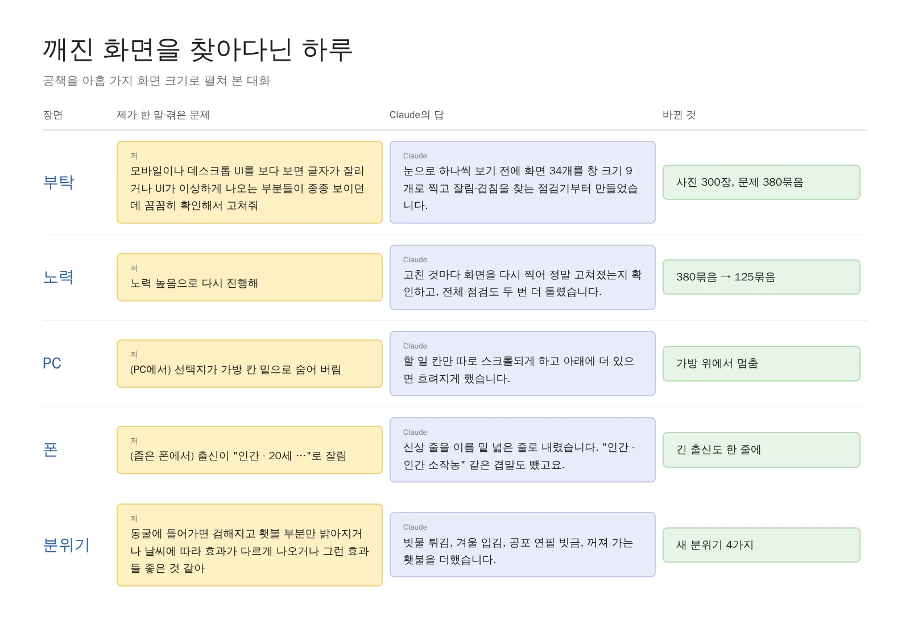
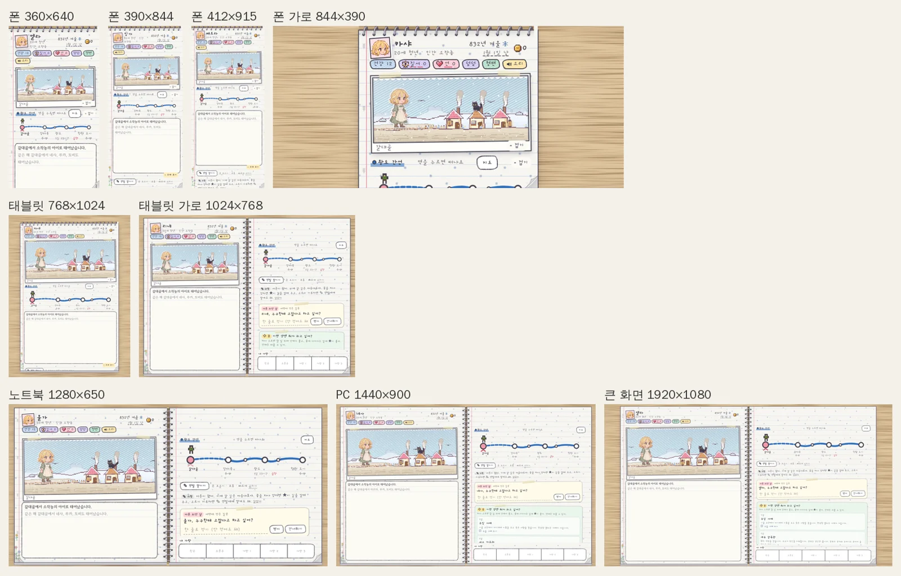
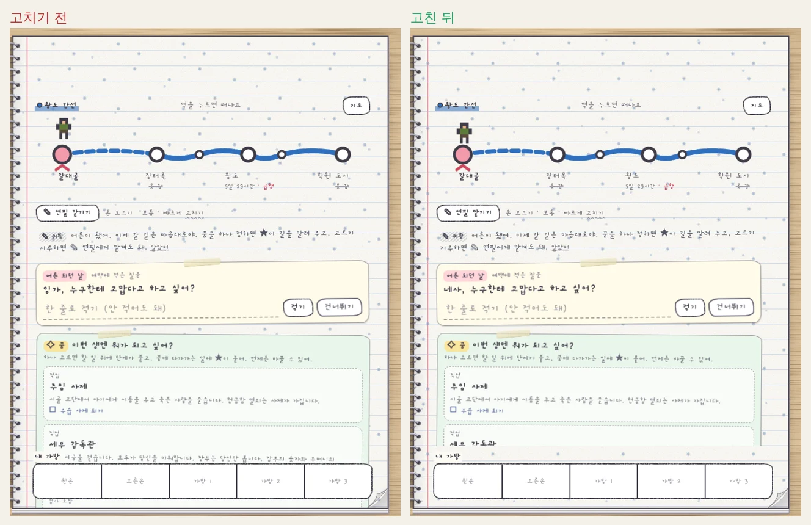
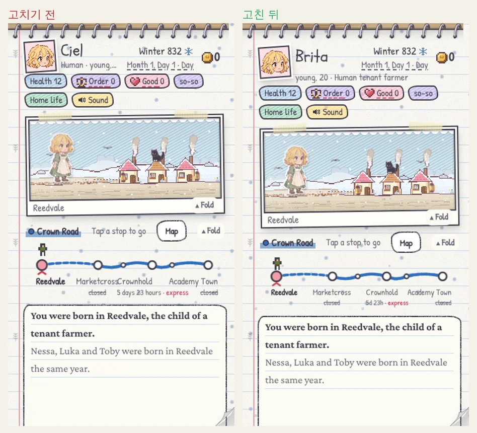
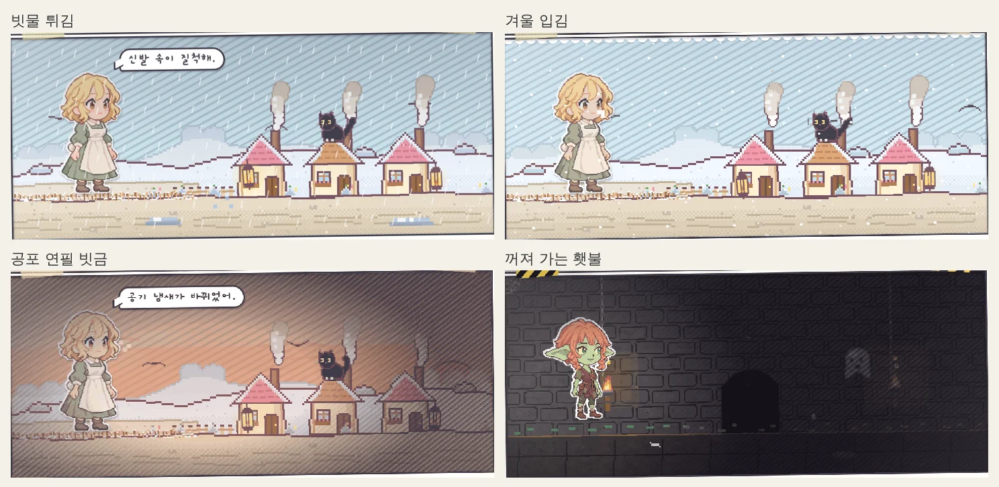
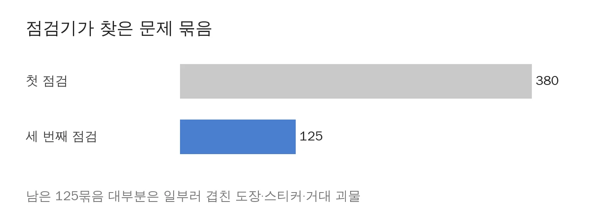

게임을 폰으로 켜 보면 가끔 눈엣가시 같은 장면이 보입니다. 이름 옆 출신이 "…"로 뚝 잘려 있거나, PC에서 버튼 하나가 슬그머니 어디론가 숨어 버리는 식이죠. 하나하나는 별일 아닌데, 한번 눈에 밟히기 시작하면 게임이 아니라 오타 찾기 시험지를 보는 기분이 듭니다. 그래서 Claude에게 통째로 맡기면서, 겸사겸사 요즘 마음에 드는 동굴 어둠 효과 같은 걸 더 넣을 데가 없는지도 슬쩍 물었습니다.

<figure><figcaption>부탁 한 줄에서 분위기 효과 네 개까지, 다섯 장면입니다.</figcaption></figure>

## 사람 눈 대신 점검기부터

제 부탁은 간단했습니다. "모바일이나 데스크톱 UI를 보다 보면 글자가 잘리거나 UI가 이상하게 나오는 부분들이 종종 보이던데 꼼꼼히 확인해서 고쳐줘."

그런데 Claude는 곧장 고치러 달려들지 않았습니다. 대신 **사람 눈 대신 화면을 훑어 줄 점검기**부터 만들더군요. 표지, 태어나는 장면, 싸움, 동굴, 지도, 마지막 쪽까지 화면 34개를 작은 폰부터 큰 모니터까지 아홉 가지 크기로 띄워 찍고, 상자 밖으로 삐져나온 글자나 서로 겹친 글자를 골라내는 도구입니다. 말하자면 폰 아홉 대를 사서 책상에 줄 세워 두고 하나씩 째려보는 일을 기계한테 시킨 셈이죠.

<figure><figcaption>같은 장면을 아홉 가지 크기로 펼쳐 보면 숨어 있던 문제가 드러납니다.</figcaption></figure>

첫 점검에서 튀어나온 문제 묶음은 무려 380개였습니다. 물론 전부 진짜 버그는 아니었습니다. 공책 느낌 내려고 비스듬히 붙인 도장이나, 공책 밖으로 불쑥 튀어나오는 거대 괴물까지 기계 눈에는 똑같이 "겹쳤다!"로 잡히거든요. 그런 억울한 정상 참작들을 사진으로 하나씩 걸러 내고 나니, 진짜 손봐야 할 녀석들만 남았습니다.

## 선택지가 가방 밑에 숨어 있었다

PC에서 제일 얄미운 사고는 오른쪽 페이지에 있었습니다. 질문 쪽지, 꿈 고르기, 귀띔이 한꺼번에 뜨면 할 일 칸이 길어지면서 맨 아래 버튼들이 그 밑의 "내 가방" 칸 속으로 쏙 들어가 버렸거든요. 정작 눌러야 할 선택지가 내 가방 밑에 깔려 있으니, 플레이하는 사람 입장에서는 가방을 뒤져도 안 나오는 답답한 노릇이죠.

<figure><figcaption>이제 할 일 칸이 가방 위에서 멈추고, 아래에 더 있으면 끝이 살짝 흐려집니다.</figcaption></figure>

그래서 할 일 칸만 따로 스크롤되게 바꾸고, 아래에 내용이 더 남았을 때는 끝이 살짝 흐려져서 "밑에 더 있어요" 신호를 주게 했습니다. 노트북 크기(1280×650)에서는 마지막 쪽의 "다음 권 쓰기" 버튼이 보이지 않는 셋째 단으로 밀려나 있던 것도 찾았습니다. 두 단으로 고르게 나누어 바로잡았는데, 한 생을 다 살고 나서 다음 공책을 펼 버튼이 증발해 있었다니 생각만 해도 아찔하더군요.

## "인간 · 인간 소작농"이라니

폰에서는 이름 밑 신상 줄이 말썽이었습니다. 360px 좁은 폰에서 "인간 · 20세 …"까지만 보이고 출신이 뚝 잘렸죠. 그런데 잘린 글자를 들여다보다가 웃지 못할 보너스를 하나 더 건졌습니다. 출신 이름 안에 이미 종족이 들어 있어서 **"인간 · 인간 소작농"처럼 같은 말을 두 번** 쓰고 있었던 겁니다. 자기소개를 할 때마다 성을 두 번 붙이고 다닌 격이죠.

<figure><figcaption>영어판은 노선도 역 이름까지 서로 밀치고 있었습니다.</figcaption></figure>

좁은 폰에서는 신상 줄을 이름과 날짜 밑의 넓은 자리로 내리고, 중복되던 종족 이름은 뺐습니다. 영어판 노선도에서 자리만 차지하던 "5 days 23 hours"는 "5d 23h"로 다이어트시켰고, 태블릿을 세로로 세우면 공책이 덩달아 폰 폭으로 쪼그라들던 것도 넓혀 주었습니다.

## 동굴은 어둡게, 겁나면 연필이 떨리게

이제 즐거운 이야기입니다. 저는 그저 "동굴에 들어가면 검해지고 횃불 부분만 밝아지거나 날씨에 따라 효과가 다르게 나오거나 그런 효과들 좋은 것 같아"라고 취향만 슬쩍 흘렸는데, Claude가 기존 효과들을 훑어보더니 **아직 심심하게 비어 있는 순간 네 군데**를 콕 집어 채워 왔습니다.

<figure><figcaption>빗물 튀김, 겨울 입김, 공포 연필 빗금, 꺼져 가는 횃불입니다.</figcaption></figure>

1. **비 오는 날**: 바깥이면 땅에 빗방울이 튀고 물웅덩이가 반짝입니다. 폭우가 쏟아지는데 태평하게 나비가 날아다니던 모순도 이참에 정리했습니다.
2. **추운 날**: 눈이 오거나 겨울이면 주인공 입에서 하얀 입김이 피어오릅니다.
3. **겁에 질렸을 때**: 공포 눈금이 높아지면 화면 가장자리에 연필 빗금이 어둡게 깔리면서 심장 박동처럼 조여 옵니다.
4. **횃불이 하나 남았을 때**: 굴 안의 밝은 원이 확 줄어들고, 불빛이 당장이라도 꺼질 것처럼 위태롭게 흔들립니다.

덤으로 맑은 밤하늘을 닭이 가로질러 뛰어다니던 장면은 별똥별로 바꿨습니다. 아무리 판타지라도 야밤에 웬 닭이 하늘을 건너가나 싶었거든요.

## 횃불이 한 번 남으면

네 가지 중 가장 마음에 드는 건 마지막 횃불입니다. 처음 만든 판은 너무 얌전해서 불이 줄어든 줄도 모를 정도였는데, Claude가 직접 찍은 영상을 보더니 이건 약하다 싶었는지 알아서 더 어둡게 손봐 왔습니다.

<figure><video src="/assets/img/posts/screen-check/torch.mp4" poster="/assets/img/posts/screen-check/torch.jpg" controls muted playsinline preload="none"></video><figcaption>횃불이 한 번 남으면 밝은 원이 70%로 줄고 불빛이 흔들립니다. 슬슬 나갈 때가 됐다는 무언의 압박이죠.</figcaption></figure>

## "노력 높음으로 다시 진행해"

사실 부탁을 던져 놓고 제가 뒤에 한 줄을 더 붙였습니다. "노력 높음으로 다시 진행해." Claude에게도 얼마나 공들여 궁리할지 고르는 단계가 있는데, 그걸 바짝 올려 준 셈입니다. 그 뒤로 Claude는 고친 것마다 **같은 화면을 다시 찍어 정말 고쳐졌는지** 확인했고, 전체 점검도 두 번 더 돌렸습니다.

<figure><figcaption>380에서 125로. 남은 건 대부분 일부러 겹쳐 둔 장식입니다.</figcaption></figure>

AI에게 "고쳤어요"라는 말만 믿고 넘어가면, 겉만 번지르르하고 반쯤 고쳐진 채로 남기 쉽습니다. **고친 뒤 사진을 다시 찍어 보여 달라고 하는 것**, 이게 이번에 건진 제일 쏠쏠한 요령이었습니다. 점검기는 저장소에 그대로 넣어 두었으니 앞으로 화면을 크게 손볼 때마다 꺼내 돌리면 됩니다.

다음에는 이번에 후보로만 받아 둔 효과들을 얹을 차례입니다. 번개 칠 때 번쩍이는 실루엣, 굴이 시끄러워지면 천장에서 떨어지는 흙먼지, 밤길의 등불 원, 술에 취하거나 독에 걸렸을 때의 흐린 화면 같은 것들이요.

## 세 줄 요약

1. 화면 깨짐은 눈으로 찾아 헤매기 전에 여러 화면 크기로 찍어 훑는 점검기부터 만들게 하세요.
2. AI가 "고쳤다"고 하면 말만 믿지 말고, 고친 뒤 사진을 다시 찍어 보여 달라고 하세요.
3. 분위기 효과는 "이런 느낌이 좋더라" 한마디만 흘려도 비어 있는 순간을 찾아 알아서 채워 줍니다.
