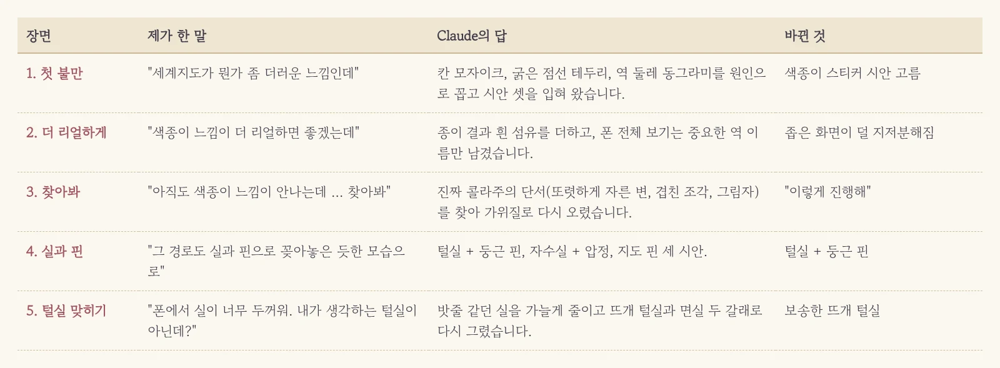
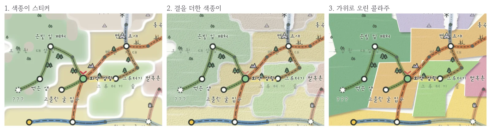
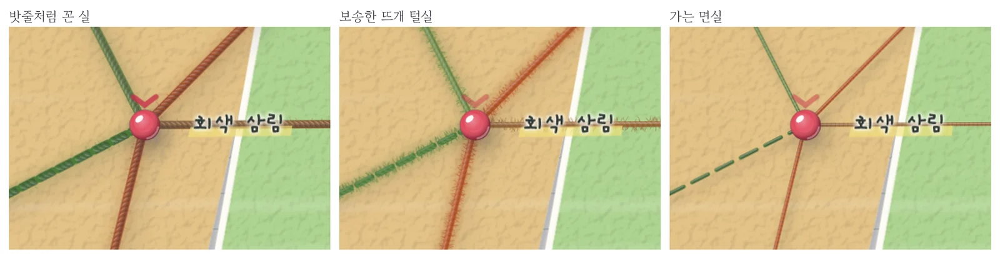
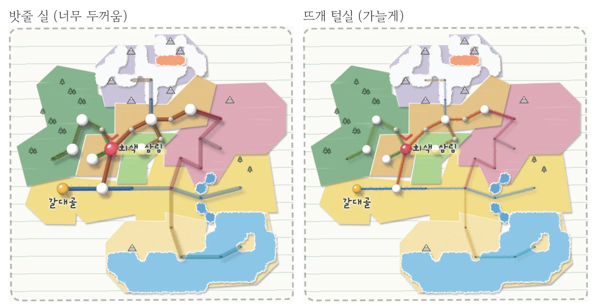
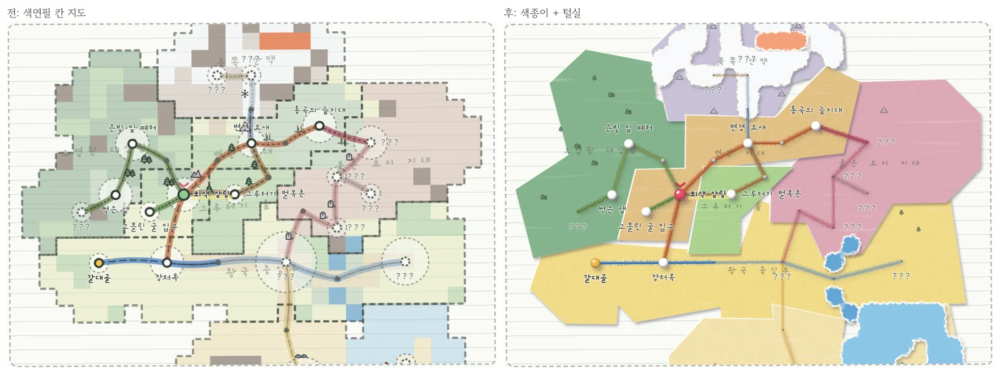

노선도를 색연필 지도로 바꾸고 나니 이번엔 세계 지도가 눈에 밟혔습니다. 칸칸이 칠한 땅에 굵은 점선 테두리, 역마다 둘린 동그라미까지 겹쳐서 공책 한 쪽이 아니라 얼룩진 모눈종이 같았거든요. 어디가 문제인지 콕 집어 말할 자신은 없어서 그냥 느낌대로 던졌습니다. "세계지도가 뭔가 좀 더러운 느낌인데 … 여러 시안을 보여줘."

<figure><figcaption>"더러운 느낌"이라는 한마디가 다섯 번의 주고받기로 이어졌습니다.</figcaption></figure>

## 막연한 불만도 원인 목록이 되어 돌아온다

Claude는 먼저 지저분해 보이는 이유를 셋으로 짚었습니다. 땅이 칸 모자이크로 칠해져 있고 지역마다 굵은 점선 테두리가 둘러져 있고 역마다 땅 크기를 나타내는 동그라미가 또 겹쳐 있다는 거였죠. **"더럽다"는 제 감상이 고칠 수 있는 항목 세 개로 바뀌니 그다음부터는 고르기만 하면 됐습니다.** 시안은 색연필로 칠한 땅, 깨끗한 종이, 색종이 스티커 세 가지였고 저는 색종이를 골랐습니다.

## "아직도 색종이 느낌이 안 나는데?"

그런데 막상 크게 보니 색종이라기보다 흐릿한 물감 덩어리 같았습니다. 한 번 더 리얼하게 해 달라고 했더니 종이 결과 흰 섬유가 더해졌지만 여전히 '색종이를 붙였다'는 느낌은 아니었어요. 그래서 이번에는 답을 바로 달라고 하지 않고 색종이를 붙여서 만든 느낌이 뭔지 찾아보라고 했습니다.

<figure><figcaption>왼쪽부터 첫 시안, 결을 더한 시안, 가위로 오린 콜라주. 세 번째에서야 "이렇게 진행해"가 나왔습니다.</figcaption></figure>

조사해 온 단서는 의외로 단순했습니다. 진짜 콜라주는 가장자리가 흐리지 않고 가위로 자른 듯 또렷하고 조각끼리 살짝 겹쳐 있으며 겹친 곳마다 얇은 그림자가 진다는 거였죠. 손으로 찢은 종이는 가장자리에 흰 섬유가 드러나고요. 그래서 땅을 몇 번의 가위질로 오린 조각처럼 단순하게 만들고 조각마다 살짝 돌려 겹쳐 붙였습니다. 바다와 눈밭만 찢은 종이로 남겼고요. **"더 리얼하게"를 두 번 해도 안 될 때는 방향을 바꿔 진짜가 왜 진짜처럼 보이는지부터 찾게 하는 게 빨랐습니다.** 덤으로 폰 전체 보기에서는 지금 있는 곳과 이번 생에 가 본 곳 이름만 남겨서 글씨가 빽빽하게 엉키던 것도 정리했어요.

## 길을 실과 핀으로 걸어 보자

색종이 지도 위에 연필 점선이 지나가니 이번엔 길이 따로 노는 느낌이었습니다. 문득 여행 지도에 핀을 꽂고 실을 걸어 둔 모습이 떠올라서 그대로 말했습니다. "그 경로도 실과 핀으로 꽂아놓은 듯한 모습으로 바꾸면 더 좋을 것 같아. 무슨 말인지 알겠어?"

Claude는 털실과 둥근 핀, 가는 자수실과 압정, 옆에서 본 지도 핀 세 가지를 실제 지도에 입혀 왔습니다. 지도 핀은 입체감은 좋았지만 핀 머리가 역 이름을 가려서 털실과 둥근 핀을 골랐죠. 한 번 더 리얼하게 해 달라고 하니 핀에는 반짝이는 하이라이트와 떨어진 그림자가 생기고, 실에는 두 가닥을 꼰 결이 생겼습니다.

<figure><figcaption>같은 '털실'이라는 말로 나온 세 가닥. 제가 떠올린 건 가운데였습니다.</figcaption></figure>

## 털실이라는 말 하나에도 그림이 셋

그런데 폰으로 보니 실이 굵은 밧줄처럼 지도를 덮고 있었습니다. "폰에서 실이 너무 두꺼워. 그리고 내가 생각하는 털실이 아닌데?" Claude는 꼰 결을 너무 세게 그려서 털실보다 밧줄에 가까워졌다고 인정하고 굵기를 줄인 두 갈래를 다시 그려 왔습니다. 잔털이 보송하게 삐져나온 뜨개 털실, 그리고 매끈하고 가는 면실이었죠. Claude는 면실을 추천했지만 제가 떠올린 건 뜨개 털실이었습니다. **같은 단어라도 머릿속 그림은 저마다 다르니, 말로 설명하기보다 후보를 나란히 놓고 고르는 게 훨씬 빨랐습니다.**

<figure><figcaption>폰에서는 실과 핀을 PC보다 가늘게 그려서 역 이름이 묻히지 않습니다.</figcaption></figure>

이제 세계 지도는 오려 붙인 색종이 위에 구슬 핀을 꽂고 털실을 건 모습입니다. 지금 있는 곳은 빨간 핀, 이번 생에 가 본 곳은 노란 핀, 아직 모르는 곳은 핀 없이 작은 구멍만 남았어요. 지도 아래 범례도 같은 핀 그림으로 바꿨습니다.

<figure><figcaption>왼쪽이 원래 지도, 오른쪽이 색종이와 털실로 다시 붙인 지도입니다.</figcaption></figure>

## 세 줄 요약

1. "더러운 느낌"처럼 막연한 불만도 그대로 말하면 AI가 고칠 수 있는 원인 목록으로 바꿔 옵니다.
2. "더 리얼하게"가 두 번 연속 빗나가면 진짜가 왜 진짜처럼 보이는지부터 찾아보게 하세요.
3. 털실처럼 흔한 단어도 사람마다 떠올리는 그림이 다르니 후보를 나란히 놓고 고르세요.
