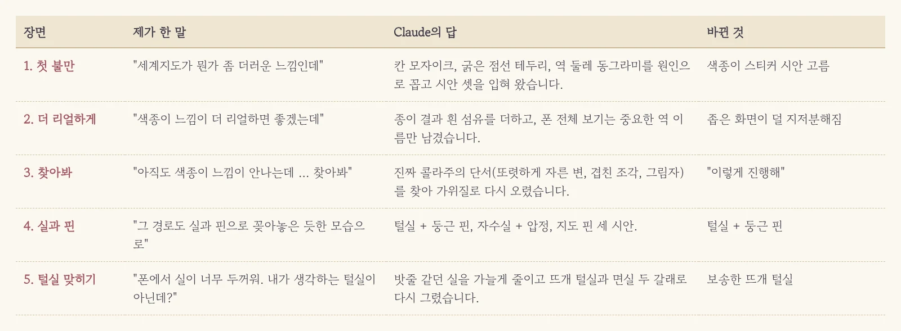
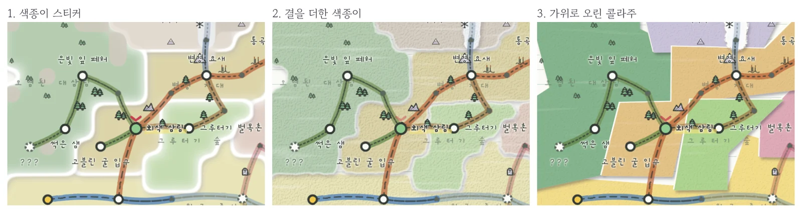
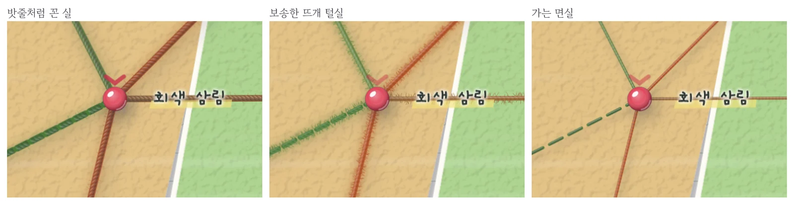
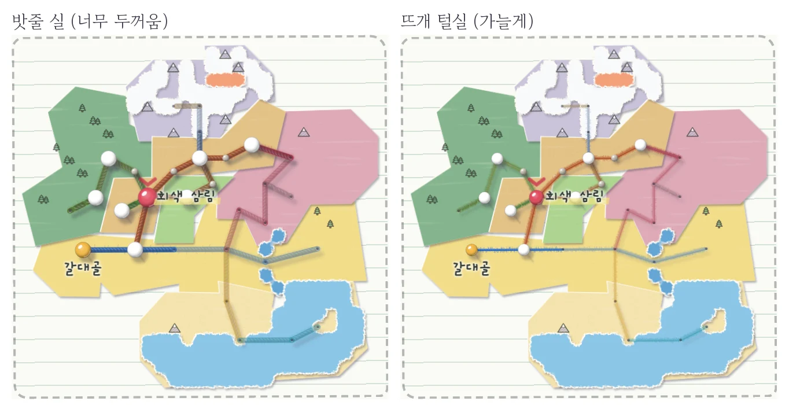
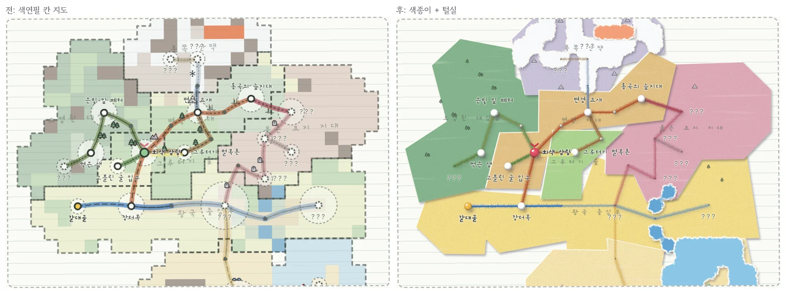

[노선도를 색연필 지도로]() 갈아입히고 나니, 바로 옆에 붙은 세계 지도가 갑자기 눈에 거슬리기 시작했습니다. 칸칸이 칠한 땅에 굵은 점선 울타리, 역마다 둘러친 동그라미까지 한데 얽혀 공책 한 쪽이라기보다 쓰다 만 얼룩진 모눈종이 같았거든요. 어디가 어떻게 틀렸는지 콕 집어 설명할 재주는 없으니 그냥 느낀 대로 던졌습니다. "세계지도가 뭔가 좀 더러운 느낌인데 … 여러 시안을 보여줘."

<figure><figcaption>"더러운 느낌" 한마디로 시작해 시안을 다섯 번 주고받았습니다.</figcaption></figure>

## 막연한 불만도 원인 목록이 되어 돌아옵니다

Claude는 무작정 그림부터 고치지 않고, 지도가 지저분해 보이는 이유를 셋으로 정리해 왔습니다. 땅이 네모 칸 모자이크로 칠해져 있고, 지역마다 굵은 점선 테두리가 둘러쳐져 있으며, 역마다 땅 크기를 보여 주는 동그라미까지 겹쳐 있다는 진단이었죠. **제 입에서 나온 "더럽다"는 두루뭉술한 불평이 고칠 수 있는 항목 세 개로 번역되니, 그때부터는 골라 주기만 하면 됐습니다.** 색연필로 칠한 땅, 깨끗한 종이, 색종이 스티커 세 시안 가운데 저는 색종이를 찍었습니다.

## "아직도 색종이 느낌이 안 나는데?"

막상 확대해 보니 색종이라기보다 물감 번진 얼룩 덩어리에 가까웠습니다. "조금 더 리얼하게"를 외치자 종이 결과 흰 섬유가 올라왔지만, 여전히 '가위로 오려 붙인 색종이'와는 거리가 멀었죠. 그래서 이번엔 새 그림을 그리기 전에 아예 숙제를 바꿨습니다. 색종이 콜라주가 대체 왜 진짜 종이처럼 보이는지부터 찾아보라고 시킨 겁니다.

<figure><figcaption>왼쪽부터 첫 시안, 결을 더한 시안, 가위로 오린 콜라주. 세 번째에서야 "이렇게 진행해"가 나왔습니다.</figcaption></figure>

찾아온 단서는 의외로 단순했습니다. 진짜 색종이 콜라주는 가장자리가 흐릿하지 않고 가위 날처럼 또렷하고, 조각끼리 살짝 겹쳐 있으며, 겹친 틈마다 얇은 그림자가 깔립니다. 반대로 손으로 찢은 종이는 가장자리에 하얀 속살이 삐져나오고요. 그래서 땅은 몇 번의 큼직한 가위질로 오린 모양으로 단순화해 살짝 비틀어 겹쳐 붙이고, 바다와 눈밭만 손으로 찢은 종이로 남겼습니다. **"더 리얼하게"가 두 번 연달아 빗나가면, 억지로 다시 그리게 하기보다 '진짜가 왜 진짜처럼 보이는지'부터 조사시키는 편이 훨씬 빠릅니다.** 덤으로 폰 전체 보기에서는 지금 있는 곳과 이번 생에 밟아 본 곳 이름만 남겨, 엉켜 붙던 글씨도 깔끔하게 정돈했습니다.

## 길을 실과 핀으로 걸어 볼까?

색종이 공작 위에 연필 점선이 지나가니 이번엔 길 혼자 따로 놀았습니다. 문득 벽에 걸린 세계 지도에 핀을 꽂고 실로 여행 경로를 잇던 장면이 떠올라 그대로 말해 봤죠. "그 경로도 실과 핀으로 꽂아놓은 듯한 모습으로 바꾸면 더 좋을 것 같아. 무슨 말인지 알겠어?"

Claude는 털실과 둥근 핀, 가는 자수실과 압정, 옆에서 본 지도 핀 세 가지를 실제 지도 위에 올려 왔습니다. 입체 지도 핀은 꽤 그럴싸했지만 핀 대가리가 역 이름을 가려 버려서, 털실과 둥근 핀으로 방향을 잡았습니다. 여기에 "한 번 더 리얼하게"를 덧붙이자 핀에는 반짝이는 하이라이트와 그림자가, 실에는 두 가닥을 꼰 결이 들어갔습니다.

<figure><figcaption>똑같이 '털실'이라고 불렀는데 나온 세 가닥. 제 머릿속 그림은 가운데였습니다.</figcaption></figure>

## '털실'이라는 단어 하나에도 그림이 셋

그런데 폰으로 열어 보고 웃음이 터졌습니다. 실이 항구에서 배 묶는 굵은 밧줄처럼 대륙을 뒤덮고 있었거든요. "폰에서 실이 너무 두꺼워. 그리고 내가 생각하는 털실이 아닌데?" 제가 떠올린 건 목도리 뜨는 보송보송한 털실이지 닻줄이 아니었습니다. Claude도 꼬임을 너무 세게 줘서 밧줄이 됐다며 순순히 인정하고, 굵기를 줄인 두 갈래를 새로 그려 왔습니다. 잔털이 살짝 삐져나온 뜨개 털실과 매끈하고 가는 면실이었죠. Claude는 깔끔한 면실에 표를 던졌지만, 제 눈에 꽂힌 건 역시 뜨개 털실이었습니다. **똑같은 한국어 단어라도 머릿속에 띄우는 그림은 제각각이니, 말로 열 줄 늘어놓는 것보다 후보를 나란히 세워 두고 손가락으로 찍는 게 백 배 빠릅니다.**

<figure><figcaption>폰에서는 실과 핀을 PC보다 가늘게 그려 역 이름이 묻히지 않게 했습니다.</figcaption></figure>

이제 세계 지도는 가위로 오려 붙인 색종이 위에 구슬 핀을 꽂고 뜨개 털실을 건 손공작이 됐습니다. 지금 서 있는 곳은 빨간 핀, 이번 생에 들른 곳은 노란 핀, 아직 밟아 보지 못한 미지의 땅은 핀 없이 작은 바늘구멍만 콕 남아 있습니다.

<figure><figcaption>왼쪽이 원래 지도, 오른쪽이 색종이와 털실로 다시 붙인 지도입니다.</figcaption></figure>

## 세 줄 요약

1. "뭔가 더럽다"처럼 막연한 불만도 솔직하게 던지면, AI가 고칠 수 있는 구체적 원인 목록으로 번역해 옵니다.
2. "더 리얼하게"를 두 번 외쳐도 감이 안 잡힐 땐, 진짜가 왜 진짜처럼 보이는지 원리부터 조사시키는 게 지름길입니다.
3. '털실'처럼 흔한 단어에도 사람마다 떠올리는 그림이 다르니, 후보를 나란히 띄워 놓고 고르는 편이 가장 빠릅니다.
