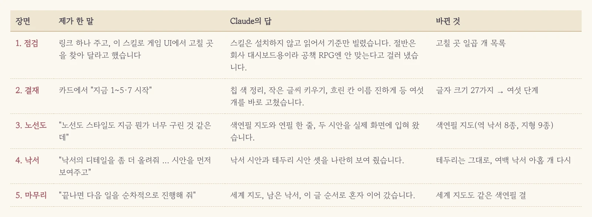
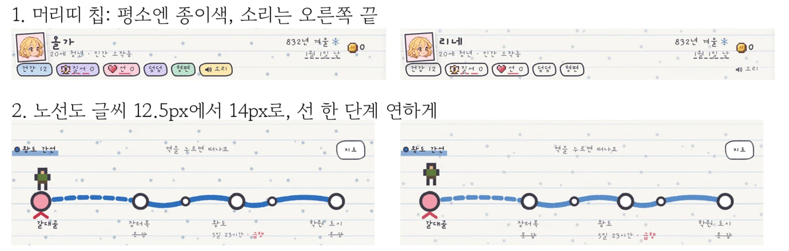
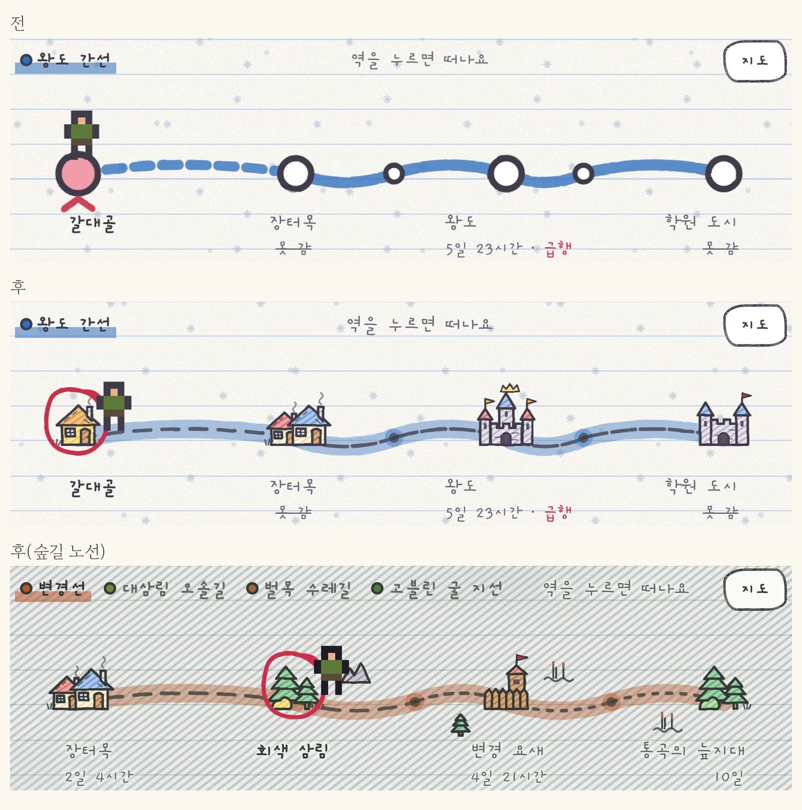
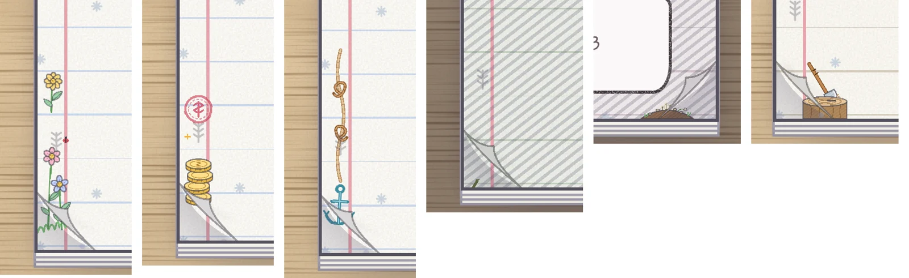
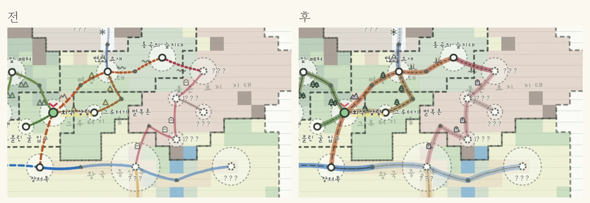
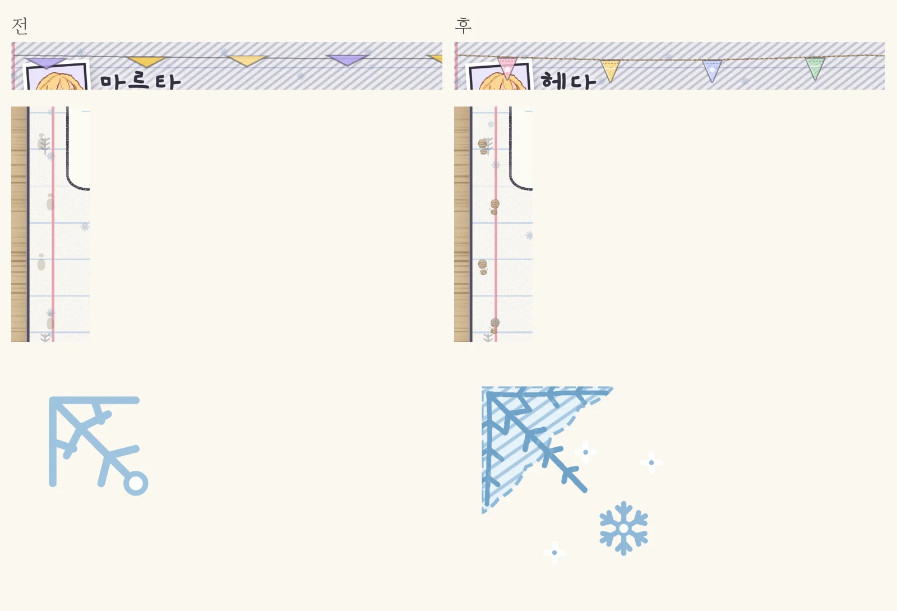

화면을 오래 들여다보고 있으면 어느 순간 눈이 무뎌집니다. 분명 어딘가 어색한데, 딱 꼬집어 뭐가 이상한지는 말이 안 나오죠. 그러던 참에 [unslop](https://github.com/heydamir/unslop)이라는 스킬을 발견했습니다. 흔히 말하는 "AI가 만든 티가 나는 뻔한 화면"을 잡아 주는 점검표라더군요. 혹시 우리 게임도 어딘가 기계 티가 나나 싶어서 링크를 툭 던져 주고 고칠 곳을 찾아 달라고 했습니다.

<figure><figcaption>링크 하나로 시작해서 세계 지도까지 번진 하루입니다.</figcaption></figure>

## 남의 점검표는 절반만 빌려 쓰기로

Claude는 스킬을 무턱대고 설치하는 대신 내용부터 읽어 보았습니다. 그리고 돌아온 첫 판정은 꽤 명쾌했습니다. 절반은 우리 게임에 안 맞는다는 거였죠. 이 점검표는 회사 대시보드나 홍보 페이지 기준으로 만든 거라 이모지와 스티커를 빼라, 바탕은 회색으로, 삐뚤한 모서리는 금지, 반복되는 움직임도 금지라고 적혀 있었습니다. 하지만 우리 게임은 초등학생 공책 RPG입니다. **스티커와 삐뚤빼뚤한 손글씨가 곧 개성인데 그걸 다 걷어 내면 판타지 모험이 아니라 회사 분기 보고서가 돼 버리죠.** 그래서 안 맞는 규칙은 과감히 버리고, 나머지 잣대로만 훑어서 고칠 곳 일곱 개를 추려 왔습니다.

<figure><figcaption>머리띠 칩 여섯 개가 전부 다른 색이던 걸 평소엔 종이색으로 바꿨습니다.</figcaption></figure>

목록을 받아 보니 생각보다 구석구석 허점이 많았습니다. 머리띠 칩이 저마다 알록달록해서 정작 위험한 상태가 눈에 안 띈다, 노선도 글씨가 너무 작다, 겨울 눈송이 무늬가 글씨 위를 지나간다, 가방 칸 이름이 흐리다, 표지 단추 하나만 브라우저 기본 회색이다, PC 일기 상자 아래가 텅 비었다. 그리고 압권은 하나 더 있었는데, 게임 안 글자 크기가 무려 스물일곱 가지나 됐다는 겁니다. 카드에서 바로 시작을 눌렀고, 27가지나 되던 글자 크기는 12픽셀부터 28픽셀까지 깔끔하게 여섯 단계로 정리했습니다.

## 1차 고백: 노선도가 구렸다

그렇게 목록을 치우고 화면을 다시 보는데, 이번엔 노선도가 자꾸 눈에 거슬렸습니다. 파란 굵은 선에 하얀 동그라미가 줄줄이 달린 게 영락없는 2호선 지하철 노선도였거든요. 손그림 공책 한가운데 혼자 너무 반듯하고 매끈하게 앉아 있으니 이질감이 컸습니다. 그래서 포장 없이 솔직하게 말했습니다. "노선도 스타일도 지금 뭔가 너무 구린 것 같은데 현재 컨셉에 맞게 세련된 스타일로 변경해 줘."

Claude는 말로 변명하는 대신 시안 두 장을 실제 게임 화면에 입혀 왔습니다. 하나는 색연필로 칠한 길 위에 역마다 낙서를 그린 지도, 다른 하나는 가는 연필 점선만 남긴 담백한 줄이었죠. 보자마자 고민할 것도 없이 색연필 지도를 찍었습니다.

<figure><figcaption>위가 원래 노선도, 아래 둘이 색연필 지도입니다. 지금 있는 곳은 빨간 펜 동그라미로 칩니다.</figcaption></figure>

이제 마을은 굴뚝 연기가 피어오르는 지붕, 왕도는 성, 요새는 깃발 꽂힌 나무 울타리, 숲은 침엽수로 그려집니다. 역 낙서가 여덟 가지, 길 옆 지형 표시가 아홉 가지예요. 숲길엔 나무가, 늪길엔 갈대가, 묘지 길엔 비석이 서 있습니다. **노선도가 딱딱한 '안내 표지판'에서 '공책 귀퉁이에 그린 지도'로 바뀌고 나니, 화면 전체가 비로소 한 사람의 공책처럼 숨을 쉬더군요.**

## 시안을 먼저 보여 달라고 했더니 테두리는 그대로 남았다

욕심이 발동해서 한 걸음 더 밀어붙였습니다. 여백 낙서도 디테일을 올리고 UI 테두리도 공책 컨셉에 맞게 바꿔 달라고 했죠. 다만 이번엔 바로 고치지 말고 시안부터 보여 달라고 못 박았습니다.

테두리 시안은 연필로 두 번 그은 선, 색연필 안쪽 선, 가위로 오린 종이 가장자리 세 가지가 왔습니다. 그런데 나란히 세워 놓고 보니 뜻밖에도 지금 테두리가 제일 깔끔해 보이는 겁니다. **시안을 먼저 받은 덕분에 '안 바꾸고 남기는 것'도 당당한 결정이 됐습니다.** 성급하게 바로 칠해 버렸다면 다시 되돌리느라 한참을 씨름했겠죠. 그래서 테두리는 그대로 두고 여백 낙서만 새로 그리기로 했습니다.

<figure><figcaption>꽃, 동전, 밧줄과 닻, 덩굴, 무덤 손, 도끼 그루터기. 색연필 빗금과 크레용 결을 넣었습니다.</figcaption></figure>

꽃잎에는 무당벌레가 내려앉았고, 동전 더미에는 '흥정' 도장이 찍혔으며, 도끼는 나이테가 선명한 그루터기에 콱 박혔습니다. 크레용 질감이 처음엔 너무 거칠어서 선이 뚝뚝 끊겨 보였는데, Claude가 찍어 보고 제 눈에 띄기 전에 알아서 한 단계 낮춰 왔어요.

## "끝나면 다음 일을 순차적으로 진행해 줘"

여기까지 오니 남은 숙제가 자꾸 눈에 밟혔습니다. 세계 지도는 아직 옛날 모양 그대로였고, 여백 낙서 중 깃발 줄·발자국·서리꽃 셋도 예전 그림이었거든요. 하나씩 불러 가며 고치기도 번거로워서 한 줄로 넘겼습니다.

<figure><figcaption>세계 지도도 노선도와 같은 색연필 결이 됐습니다. 가 본 곳을 나타내는 역 동그라미는 그대로 뒀어요.</figcaption></figure>

세계 지도는 이미 땅이 색칠된 칸 위로 길이 지나가기 때문에, 노선도 색을 그대로 얹으면 땅 색에 묻혀 버렸습니다. 그래서 세계 지도에서만 색연필 띠를 한 단계 진하게 눌렀습니다. 남은 낙서 셋도 같은 색연필 결로 다시 그렸고요.

<figure><figcaption>깃발 줄, 장화 발자국, 서리 낀 귀퉁이. 서리꽃은 다섯 배로 키워서 보여 드려요.</figcaption></figure>

깃발 줄에서는 은근한 함정도 하나 잡았습니다. 원래는 통짜 그림 하나를 화면 폭에 맞춰 쭉 늘이다 보니, PC 큰 화면에서는 깃발들이 옆으로 납작하게 찌그러져 있었거든요. 이번엔 끈만 늘이고 깃발은 하나씩 따로 매달아서, 화면이 아무리 넓어져도 깃발이 쫀쫀하게 제 모양을 지킵니다.

## 세 줄 요약

1. 남이 만든 점검표는 AI에게 먼저 읽히고, 내 프로젝트의 개성을 죽이는 규칙부터 걸러 달라고 하세요.
2. "구린 것 같은데" 같은 막연한 투덜거림도 그대로 말하면 AI가 시안 몇 장으로 번역해 옵니다.
3. 시안을 먼저 받아 보면 "안 바꾸는 것"도 깔끔한 결정이 되어 되돌릴 수고를 덜어 줍니다.
