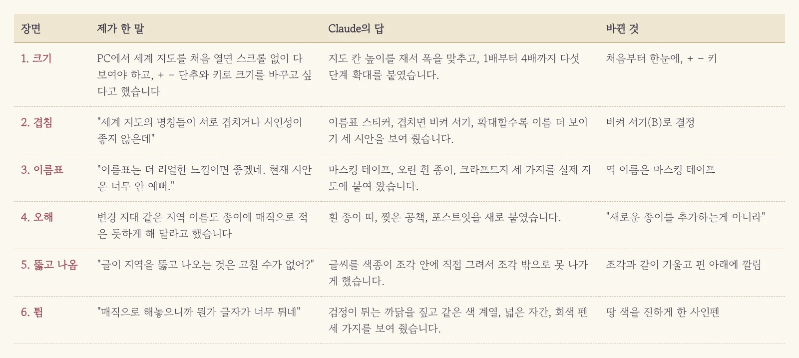
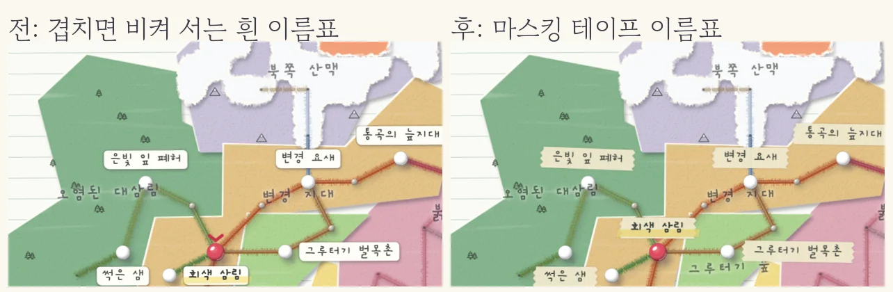
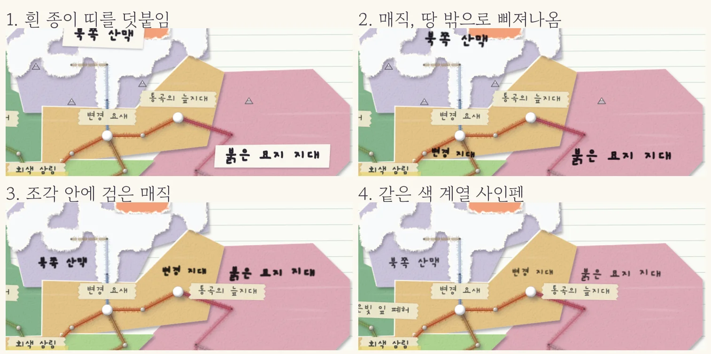
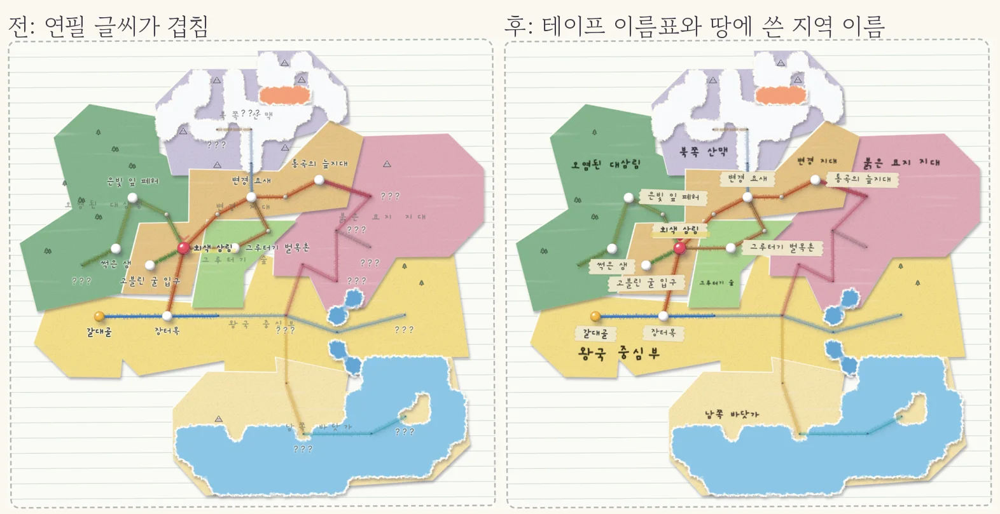

색종이와 털실로 새로 오려 붙인 세계 지도는 꽤 마음에 들었습니다. 그런데 막상 PC에서 열어 보니 이번엔 글씨가 말썽이더군요. 역 이름과 지역 이름이 서로 어깨를 밀치며 엉겨 붙어 있었고, 연필로 흐릿하게 적은 지역 이름은 색종이 색에 묻혀서 숨은그림찾기 수준이었습니다. 그래서 Claude에게 이렇게 던졌습니다. "세계 지도의 명칭들이 서로 겹치거나 시인성이 좋지 않은데 이를 개선할 아이디어를 제시해 줘."

<figure><figcaption>크기 조절에서 시작해 지역 이름 펜 고르기까지 여섯 번을 주고받았습니다.</figcaption></figure>

## 몸풀기: 지도부터 시원하게 키우고

이름 이야기에 들어가기 전에 지도 크기부터 손봤습니다. PC에서 지도를 처음 열면 스크롤이 생겨 전체가 한눈에 안 들어왔고, 원하는 만큼 확대하거나 줄일 방법도 없었거든요. Claude는 공책 높이를 재서 지도를 화면에 딱 맞게 키우고, 크게 보기 옆에 `−` `+` 단추를 달아 1배부터 4배까지 다섯 단계로 확대되게 만들었습니다. 키보드의 `+` `−` 키도 먹도록 했고요. 역 설명 쪽지를 열었을 때 지도가 덩달아 쪼그라들던 문제는 "지도를 줄이지 말고 쪽지 쪽에 스크롤을 달아 달라"고 한 번 더 짚어서 바로잡았습니다.

## 시안 셋에서 하나, 그리고 "너무 안 예뻐"

본격적인 겹침 문제에 대해 Claude는 시안 세 개를 들고 왔습니다. 이름을 이름표 스티커에 쓰는 안, 거기에 겹치면 빈 쪽으로 비켜 서는 규칙을 더한 안, 그리고 확대할수록 이름이 더 나타나는 안이었죠. 제가 "C는 그럼 A, B, C가 다 섞인 거네?" 하고 물으니 맞다고, 앞의 것을 차례로 쌓은 안이라고 하더군요. 저는 B를 골랐는데, 막상 화면에 올려 보니 하얀 이름표가 영 밋밋했습니다. "이름표는 더 리얼한 느낌이면 좋겠네. 현재 시안은 너무 안 예뻐."

<figure><figcaption>밋밋한 흰 이름표가 손으로 뜯어 붙인 마스킹 테이프가 됐습니다.</figcaption></figure>

돌아온 다음 판은 마스킹 테이프, 가위로 오린 흰 종이, 크라프트지 세 가지였습니다. 고민할 것도 없이 마스킹 테이프를 찍었죠. 양 끝이 톱니처럼 뜯겨 있고 이름표마다 조금씩 비뚤게 붙어서, 정말 공책 위에 손으로 뜯어 붙인 느낌이 났거든요. 이제 겹치는 이름은 알아서 슬쩍 비켜 서고, 끝내 자리가 없으면 덜 중요한 이름부터 숨습니다. 가 보지 않은 곳을 채우던 '???'도 싹 걷어 내고 핀 구멍만 남겼더니 지도가 한결 차분해졌습니다.

## "새로운 종이를 추가하는 게 아니라"

이제 지역 이름 차례였습니다. "변경 지대나 붉은 묘지 지대 같은 지형 이름도 종이에다가 매직으로 적어 놓은 듯한 느낌을 주도록 변경하고 싶어." 그런데 돌아온 시안이 제 머릿속 그림과 영 딴판이었습니다. 흰 종이 띠, 찢은 공책 조각, 노란 포스트잇에 매직으로 쓴 이름이 지도 위에 새로 붙어 있었거든요. 저는 새 종이를 덧붙이라는 게 아니라, **땅을 이루는 색종이 위에 바로 쓰라는 뜻**이었는데 말이죠. AI가 엉뚱한 방향으로 알아들었을 때는 구구절절 설명할 것 없이 "새로운 종이를 추가하는 게 아니라"처럼 한 줄만 콕 집어 고쳐 주면 곧바로 방향을 틀어 옵니다.

<figure><figcaption>엇갈린 첫 판부터 고른 마지막 판까지, 같은 자리를 네 번 찍었습니다.</figcaption></figure>

## 뚫고 나오는 글씨, 혼자 튀는 글씨

군더더기 종이를 걷어 내고 땅 위에 바로 쓰니 이번엔 다른 문제가 눈에 밟혔습니다. 글씨가 땅 경계를 넘어 옆 지역까지 삐져나오고, 어딘가 지도 위에 둥둥 떠 있는 기분이었거든요. "글이 지역을 뚫고 나오는 것은 고칠 수가 없어? 그리고 전혀 색종이에 직접 적은 듯한 느낌이 나지 않아."

Claude는 글씨를 지도 위에 얹는 방식을 버리고, 아예 색종이 조각 안에 직접 그려 넣는 쪽으로 판을 바꿨습니다. 이제 글씨는 조각과 함께 살짝 기울고, 조각 밖으로는 절대 못 나가며, 핀과 털실 아래에 깔립니다. 조각 안에서 역을 피해 빈자리를 찾아 들어가고, 자리가 좁으면 알아서 글씨를 줄여서 일곱 지역 이름이 모두 제 땅 안에 얌전히 안착했습니다. 돋보기로 종이를 들여다보듯 지도를 확대하면 글씨도 함께 커지고요.

그런데 마지막 복병이 남았습니다. 새카만 매직이 파스텔 톤 색종이 위에서 혼자 소리를 지르고 있었거든요. "매직으로 해 놓으니까 뭔가 글자가 너무 튀네." 이번에는 Claude가 무작정 새 시안부터 그리지 않고 까닭부터 짚었습니다. 순수한 검정인 데다 역 이름표보다 훨씬 굵어서, 파스텔 종이와 명암 차이가 너무 크다는 거였죠. 손그림 지도에서도 지역 이름은 보통 땅 색보다 한 톤 진한 색으로 가늘게 쓴다고 하더군요. 같은 색 계열 사인펜, 넓은 자간, 연한 회색 펜 세 가지 시안 중에서 저는 땅 색을 진하게 누른 사인펜을 골랐습니다. 분홍 땅에는 진한 자주, 초록 땅에는 진한 초록으로 적히고 나니 비로소 글씨가 지도에 스며들었습니다.

<figure><figcaption>왼쪽이 원래 지도, 오른쪽이 테이프 이름표와 땅에 쓴 지역 이름입니다.</figcaption></figure>

## 세 줄 요약

1. "겹친다, 안 보인다" 같은 답답함은 시안 몇 개로 받아서 나란히 보고 고르면 결정이 훨씬 빨라집니다.
2. AI가 엉뚱하게 알아들으면 길게 설명하지 말고 "이게 아니라 이거"라고 한 줄만 정확히 고쳐 주세요.
3. 결과가 어딘가 거슬리면 새 시안부터 요구하기 전에 왜 거슬리는지부터 짚게 하면 다음 판이 단번에 가까워집니다.
