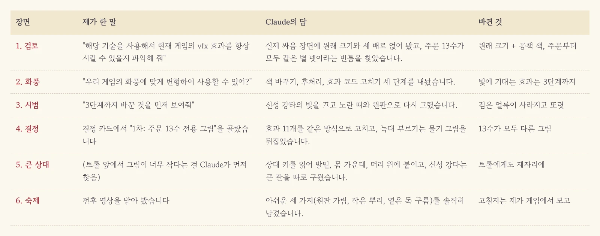
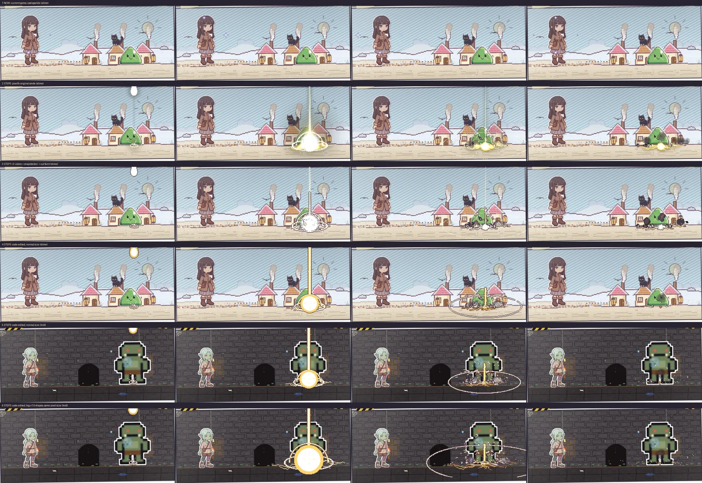
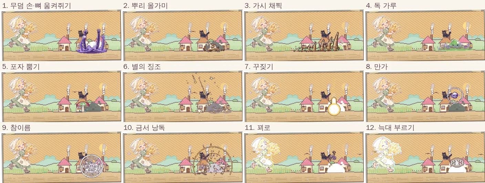
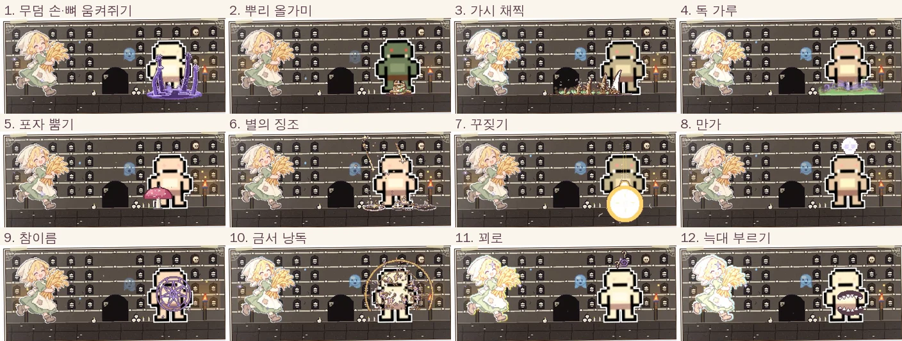

우리 공책 RPG에는 주문이 열세 가지나 있습니다. 땅속에서 손을 불러내고, 뿌리로 발목을 휘감고, 독초 가루를 뿌리고, 심지어 신의 이름으로 꾸짖기까지 하죠. 그런데 정작 화면에서는 열세 개가 전부 똑같았습니다. 무슨 주문을 외우든 주인공 머리 옆에서 작은 별 네 개가 반짝이고 끝이었거든요. 거창한 주문 이름에 비해 연출이 너무 민망했습니다. 마침 코드로 그리는 픽셀 효과 244개를 무료로 공개한 [pixelfx](https://github.com/patch-gg/pixelfx)를 발견해 Claude에게 곧바로 들고 갔습니다.

<figure><figcaption>질문 세 번과 결정 한 번으로 주문 열세 가지가 각자 제 그림을 얻었습니다.</figcaption></figure>

## "향상시킬 수 있을지 파악해 줘"

첫마디는 단순했습니다. "해당 기술을 사용해서 현재 게임의 vfx 효과를 향상시킬 수 있을지 파악해 줘." Claude는 저장소 설명서만 읽고 보고서를 쓰는 대신, 효과를 우리 실제 전투 화면 위에 바로 올려 보았습니다. 원래 크기 그대로 한 번, 주인공 키에 맞춰 세 배로 키워서 한 번요.

비교해 보니 답이 바로 나왔습니다. 세 배로 키우는 순간 이펙트의 도트(점)가 주인공보다 세 배나 굵어져, 전혀 다른 게임 두 개를 가위로 오려 붙인 꼴이 되더군요. 픽셀 아트에서 흔히 빠지는 '점 굵기 불일치' 함정입니다. 반대로 원래 크기 그대로 두고 우리 공책 색만 입히니 슬라임 옆에 감쪽같이 녹아들었습니다. 그리고 Claude가 덤으로 민망한 사실 하나를 짚어 줬습니다. **주문 열세 가지가 전부 똑같은 별 네 개를 돌려 쓰고 있었다는 것.** 매일 게임을 테스트하면서도 정작 저는 무뎌져서 지나치고 있던 빈틈이었습니다.

## "우리 게임의 화풍에 맞게 변형하여 사용할 수 있어?"

진짜 숙제는 화풍이었습니다. pixelfx는 어두운 배경 위에서 빛이 화려하게 번지도록 설계된 효과라, 밝은 크림색 공책 종이 위에 올리면 빛이 종이 색에 먹혀 그대로 증발해 버렸거든요. 대낮에 손전등을 켜 놓은 격이었죠. 우리 공책 화풍에 맞게 고쳐 쓸 수 있느냐고 물었더니 Claude가 작업을 세 단계로 나눠 제안했습니다.

1. 색만 우리 팔레트로 바꾼다(옵션 하나로 끝).
2. 그림을 뽑은 뒤 게임 팔레트에 맞추고 자두색 외곽선을 두른다.
3. 효과 코드 자체를 뜯어고친다.

빛에 크게 기대는 주문은 3단계까지 가야 한다는데, 말만 들어서는 감이 잘 안 왔습니다. 그래서 열세 개를 한꺼번에 맡기는 대신 "3단계까지 바꾼 것을 먼저 보여줘"라고 했습니다.

## 신성 강타로 미리 보기

첫 시험대는 하늘에서 빛 망치가 내리꽂히는 '신성 강타'였습니다. 1·2단계까지만 거친 결과물은 솔직히 처참했습니다. 웅장해야 할 빛 기둥은 흰 실선 한 가닥으로 쪼그라들고, 연기는 시커먼 얼룩이 되어 슬라임 발밑에 들러붙었거든요. 밝은 종이 위에 먹물만 튄 꼴이었습니다.

3단계에서 Claude는 발상을 통째로 뒤집었습니다. **화려한 빛 효과를 아예 꺼 버리고, 빛이 맡고 있던 자리를 불투명한 노란 띠와 동그란 원판으로 다시 그린 겁니다.** 연기는 공책 크림색으로 바꾸고, 재생 시간도 2.8초에서 1.5초로 군더더기를 덜어 냈죠. 빛을 껐더니 오히려 밝은 마을에서도, 어두운 던전에서도 칼같이 또렷하게 읽혔습니다.

<figure><figcaption>위에서 셋째 줄이 1·2단계의 검은 얼룩, 넷째 줄부터가 빛을 끄고 다시 그린 3단계입니다.</figcaption></figure>

## 열세 가지에 열세 그림

이 시범을 보고 결정 카드(Claude가 선택지와 장단점을 정리해 주는 표)에서 "1차: 주문 13수 전용 그림"을 골랐습니다. Claude는 같은 방식으로 효과 열한 개를 줄줄이 길들였습니다. 땅속 손, 뿌리, 가시 줄, 독 구름, 버섯 포자, 별똥, 신성 강타, 해골 저주, 봉인 문양, 마력 폭발, 머리 위 물음표까지요. '늑대 부르기'는 아예 새로 그리지 않고, 원래 늑대가 주인공을 무는 그림을 적 쪽으로 좌우 반전해 써먹었습니다. 꽤 알뜰한 재활용이더군요.

<figure><figcaption>열두 칸 모두 주문이 슬라임에 적중하는 순간입니다. 슬라임이 회색인 건 맞았다는 표시입니다.</figcaption></figure>

눈에 잘 안 띄는 타이밍 손질도 함께 들어갔습니다. 예전에는 무슨 주문을 쓰든 0.16초 만에 기계적으로 적이 맞았는데, 이제는 손이 움켜쥐는 순간, 해골이 내리찍는 순간처럼 **그림이 실제로 적에게 닿는 프레임에 맞춰 상대가 움찔합니다.** 대성공 때 화면이 살짝 느려지는 연출도 그 타격 프레임에 정확히 맞췄고요.

## 트롤 앞에서 쪼그라든 주문

이제 다 끝난 줄 알았는데, 덩치 큰 트롤을 화면에 세워 보니 문제가 또 튀어나왔습니다. 원래 크기를 슬라임 기준으로 잡아 두다 보니, 트롤 앞에서는 해골 저주가 배꼽 근처에 뜨고 봉인 문양이 다리에 걸려 버린 겁니다.

Claude는 적마다 키를 읽어 발밑·몸 가운데·머리 위 중 제자리에 효과를 붙이도록 고쳤습니다. 신성 강타는 트롤용 큰 버전을 따로 만들었는데, 여기서도 원칙은 하나였습니다. **도트 굵기는 그대로 둔 채 모양 크기만 1.6배로 키우는 것.** 이렇게 하니 커져도 그림이 뭉개지거나 이질감이 생기지 않았습니다.

<figure><figcaption>같은 주문을 트롤에게 쏜 화면. 해골은 머리 위로, 봉인 문양은 몸 한가운데로 자리를 찾았습니다.</figcaption></figure>

<figure><video src="/assets/img/posts/pixelfx-spells/spells.mp4" poster="/assets/img/posts/pixelfx-spells/spells.jpg" controls muted playsinline preload="none"></video><figcaption>왼쪽이 옛날 별 네 개, 가운데와 오른쪽이 바꾼 뒤입니다. 주문마다 2.6초씩 이어집니다.</figcaption></figure>

Claude는 아쉬운 구석도 먼저 털어놓았습니다. 큰 버전 신성 강타의 원판이 맞는 순간 0.1초쯤 트롤 아랫몸을 가리고, 뿌리는 트롤에게 작아서 발목만 감싸며, 독 구름은 반투명이라 다른 주문보다 옅게 보인다는 겁니다. "다음 단계도 있어?"라고 물으니 선택지 몇 개를 내밀었고, 저는 "아쉬움 고치고 상자·회복"을 골랐습니다.

## 숙제 셋, 그리고 덤 둘

밀린 숙제 세 개부터 깔끔하게 치웠습니다. 큰 버전 신성 강타의 원판은 더 커지지 않게 묶어 두었고, 뿌리는 트롤용 큰 버전을 따로 만들어 허리까지 감기게 했습니다. 독 구름은 반투명 농도를 두 배쯤 진하게 칠해 존재감을 살렸고요.

그다음이 기다리던 덤입니다. 지금까지 우리 게임에서는 상처가 나아도, 보물 상자에서 돈이 쏟아져도 화면이 꿈쩍도 하지 않았습니다. 글 한 줄 뜨고 끝이었죠. 이제는 **상처·병·저주가 나으면 주인공 발밑에 꽃잎이 피고 빛 고리가 머리까지 올라가며 하트가 톡 터집니다.** 돈이 10닢 넘게 들어오거나 상자에서 돈이 나오면 먼지가 펑 일고 금화가 바닥에 통통 튑니다. 일반 사건에서 받는 돈은 대개 1~5닢이라, 아무 때나 금화가 쏟아지지 않도록 10닢 문턱을 둔 센스도 챙겼고요.

회복 이펙트도 처음엔 작은 인형 기준이라 주인공 앞에선 발목에 핀 들꽃 같았습니다. 여기도 똑같이 점 굵기는 고정하고 모양만 2.5배로 키웠습니다. 금화는 주인공에 비해 조금 작긴 하지만, 점을 굵게 키우면 또 화풍이 어긋나기 때문에 원래 크기를 지키기로 했습니다.

<figure><video src="/assets/img/posts/pixelfx-spells/heal-coins.mp4" poster="/assets/img/posts/pixelfx-spells/heal-coins.jpg" controls muted playsinline preload="none"></video><figcaption>1~3번은 손본 주문, 4번 회복과 5번 금화는 왼쪽이 원래 상태(아무 일 없음), 오른쪽이 바꾼 뒤입니다.</figcaption></figure>

## 세 줄 요약

1. 남의 픽셀 효과를 가져올 때는 화면 크기가 아니라 내 게임의 도트 굵기에 먼저 맞추세요. 크기를 키우고 싶다면 배율 확대 대신 점 굵기를 고정한 채 모양만 새로 키워야 합니다.
2. 밝은 배경에서 빛 효과가 녹아 사라진다면, 밝기를 더 올리지 말고 빛을 꺼 버린 뒤 불투명한 도형으로 다시 그리는 편이 훨씬 잘 보입니다.
3. "먼저 하나만 바꿔서 보여줘"라는 한 마디가 열세 개를 전부 뜯어고치는 수고를 아껴 줍니다. 자잘한 마감 숙제는 다음 단계를 물어볼 때 묶어서 처리하면 깔끔합니다.
