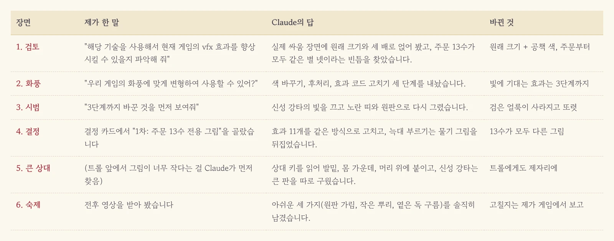
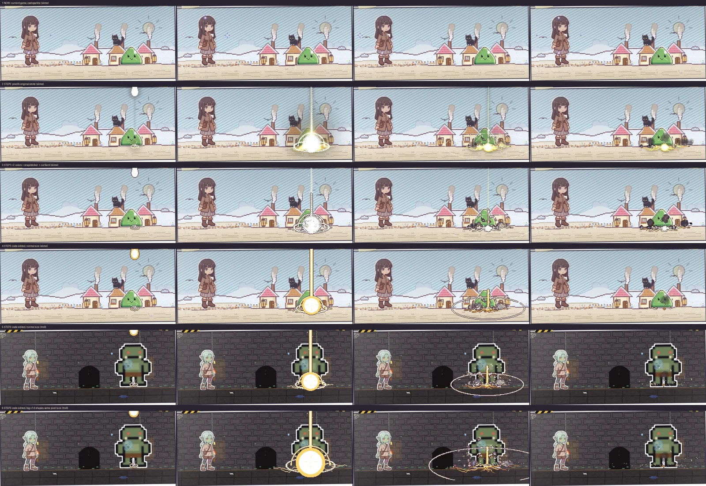
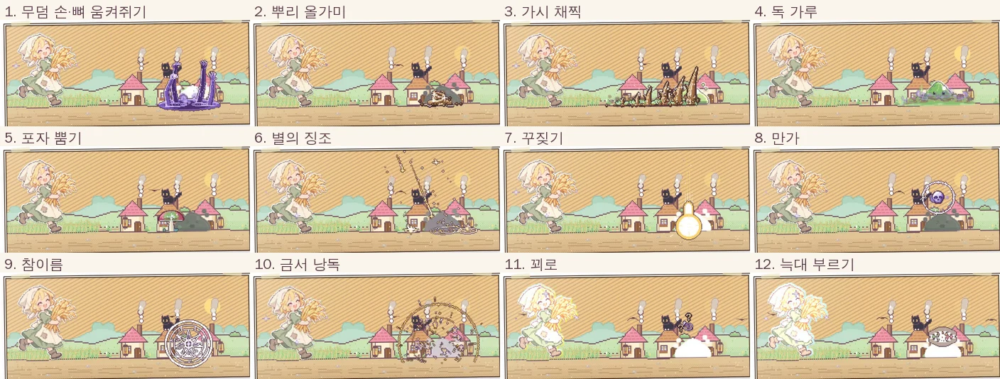
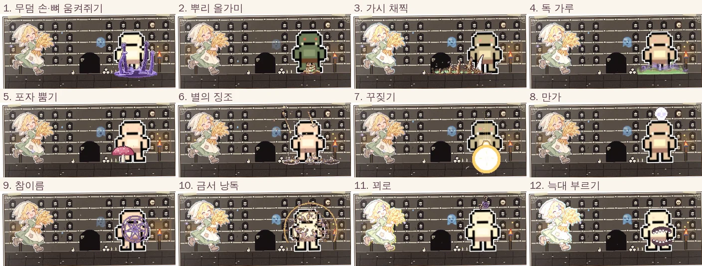

우리 게임에는 주문이 열세 가지나 있습니다. 땅속에서 손을 부르고, 뿌리로 발목을 묶고, 독초 가루를 뿌리고, 신의 이름으로 꾸짖기까지 하죠. 그런데 화면에서는 이게 전부 똑같았습니다. 무슨 주문을 쓰든 주인공 머리 옆에 작은 별 네 개가 반짝이고 끝이었거든요. 그러던 차에 코드로 그리는 픽셀 효과 244개를 공짜로 풀어 둔 [pixelfx](https://github.com/patch-gg/pixelfx)를 발견해서 Claude에게 들고 갔습니다.

<figure><figcaption>질문 세 번과 결정 한 번으로 주문 열세 가지가 제 그림을 얻었습니다.</figcaption></figure>

## "향상시킬 수 있을지 파악해 줘"

처음 던진 말은 이랬습니다. "해당 기술을 사용해서 현재 게임의 vfx 효과를 향상시킬 수 있을지 파악해 줘." Claude는 저장소 설명만 읽고 끝내지 않고 효과를 진짜 우리 싸움 장면 위에 얹어 봤습니다. 원래 크기 그대로 한 번, 주인공 크기에 맞춰 세 배로 한 번요.

결과는 꽤 분명했습니다. 세 배로 키우니 점이 주인공보다 세 배 굵어져서 한 화면에 두 가지 그림이 섞인 꼴이 됐습니다. 원래 크기에 우리 공책 색만 입히니 슬라임 옆에 딱 맞았고요. 그리고 Claude가 덤으로 찾아낸 게 있었습니다. **주문 열세 가지가 모두 같은 별 네 개를 쓰고 있다는 사실**이었죠. 저는 매일 보면서도 몰랐던 빈틈이었습니다.

## "우리 게임의 화풍에 맞게 변형하여 사용할 수 있어?"

문제는 화풍이었습니다. pixelfx는 어두운 배경에서 빛이 번지도록 만든 효과라, 밝은 공책 종이 위에서는 빛이 그냥 사라져 버렸거든요. 그래서 물었더니 Claude가 세 단계로 나눠 줬습니다.

1. 색만 우리 것으로 바꾼다(옵션 하나로 끝).
2. 그림을 뽑은 뒤 게임 색표에 맞추고 자두색 테두리를 두른다.
3. 효과 코드 자체를 고친다.

빛에 기대는 효과는 3단계까지 가야 한다길래, 말로만 들어서는 감이 안 와서 "3단계까지 바꾼 것을 먼저 보여줘"라고 했습니다.

## 신성 강타로 미리 보기

시험 대상은 하늘에서 빛 망치가 내리꽂히는 신성 강타였습니다. 1·2단계까지만 손댄 판은 처참했습니다. 빛 기둥은 흰 실선만 남고 연기는 시커먼 얼룩이 되어 슬라임 발밑에 들러붙었거든요. 마치 고급 화장품을 바르고 사진 보정을 했더니 얼굴에 먹물이 튄 꼴이었습니다.

3단계에서 Claude는 발상을 뒤집었습니다. **빛을 아예 꺼 버리고, 빛이 하던 일을 노란 띠와 동그란 원판으로 다시 그린 것**이죠. 연기는 공책 크림색으로, 길이는 2.8초에서 1.5초로 줄였습니다. 그랬더니 밝은 마을에서도, 어두운 던전에서도 또렷하게 읽혔습니다.

<figure><figcaption>위에서 셋째 줄이 1·2단계의 검은 얼룩, 넷째 줄부터가 빛을 끄고 다시 그린 3단계입니다.</figcaption></figure>

## 열세 가지에 열세 그림

이걸 보고 결정 카드에서 "1차: 주문 13수 전용 그림"을 골랐습니다. Claude는 같은 방식으로 효과 열한 개를 고쳤습니다. 땅속 손, 뿌리, 가시 줄, 독 구름, 버섯 포자, 별똥, 신성 강타, 해골 저주, 봉인 문양, 마력 폭발, 머리 위 물음표까지요. 늑대 부르기는 새로 그리지 않고 원래 늑대가 주인공을 무는 그림을 상대 쪽으로 뒤집어 썼습니다. 재활용의 달인이더군요.

<figure><figcaption>열두 칸 모두 주문이 슬라임을 맞히는 순간입니다. 슬라임이 회색인 건 맞았다는 표시고요.</figcaption></figure>

화면 안쪽 일도 같이 바뀌었습니다. 예전에는 무슨 주문이든 0.16초 만에 상대가 맞았는데, 이제는 손이 움켜쥐는 순간, 해골이 내리찍는 순간처럼 **그림이 실제로 닿는 칸에 맞춰 상대가 움찔합니다.** 대성공 때 느려지는 연출도 그 칸에 맞췄고요.

## 트롤 앞에서 쪼그라든 주문

여기서 끝인 줄 알았는데, 원래 크기로 맞춘 효과는 슬라임 기준이었습니다. 트롤 앞에 세우니 해골 저주가 트롤 배꼽 근처에서 뜨고 봉인 문양은 다리에 걸려 있었죠. Claude는 상대마다 키를 읽어서 그림을 발밑, 몸 가운데, 머리 위 중 맞는 자리에 붙이게 했습니다. 신성 강타는 모양만 1.6배 키운 큰 판을 따로 구웠고요. 점 크기는 그대로라 그림이 뭉개지지 않습니다.

<figure><figcaption>같은 주문을 트롤에게. 해골은 머리 위에, 봉인 문양은 몸 한가운데에 뜹니다.</figcaption></figure>

<figure><video src="/assets/img/posts/pixelfx-spells/spells.mp4" poster="/assets/img/posts/pixelfx-spells/spells.jpg" controls muted playsinline preload="none"></video><figcaption>왼쪽이 지금까지의 별 네 개, 가운데와 오른쪽이 바꾼 뒤입니다. 수마다 2.6초씩 이어집니다.</figcaption></figure>

Claude는 아쉬운 점도 숨기지 않았습니다. 신성 강타 큰 판의 원판이 맞는 순간 0.1초쯤 트롤 아랫몸을 가리고 뿌리는 큰 상대에게 작아서 발목만 감고 독 구름은 반투명이라 다른 것보다 옅다고요. 고칠지 말지는 제가 직접 게임을 해 보고 정하기로 했습니다. 다음에는 회복, 상자 열기 같은 사건 연출에도 같은 방식을 쓸지 볼 생각입니다.

## 세 줄 요약

1. 남이 만든 효과를 가져올 때는 크기부터 우리 그림의 점 굵기에 맞추세요. 키우는 순간 그림이 섞여 보입니다.
2. 밝은 화면에서 빛 효과가 사라지면, 빛을 더 세게 하지 말고 꺼 버린 뒤 그 자리를 불투명한 모양으로 다시 그려 달라고 해 보세요.
3. "먼저 하나만 보여줘"라는 한마디가 열세 개를 한꺼번에 만들고 뒤집는 것보다 훨씬 쌉니다.
