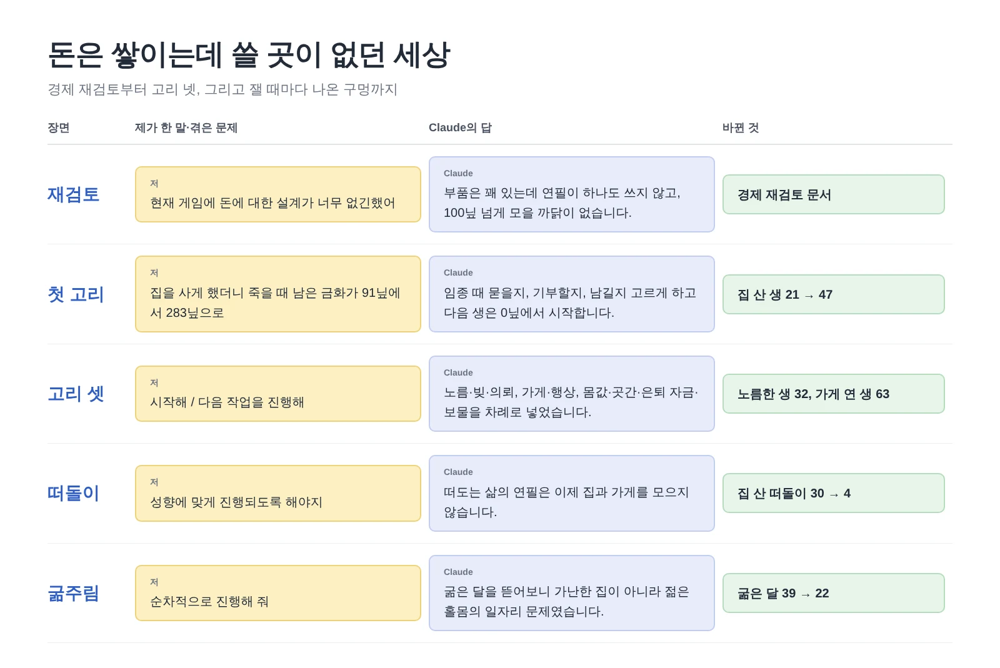
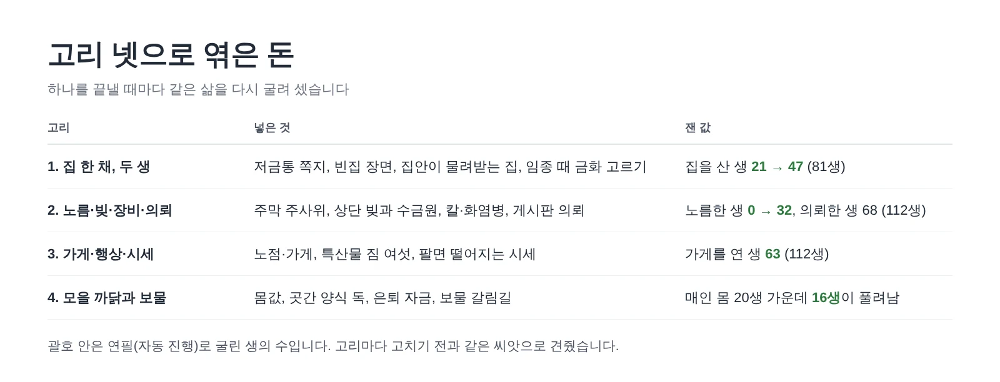
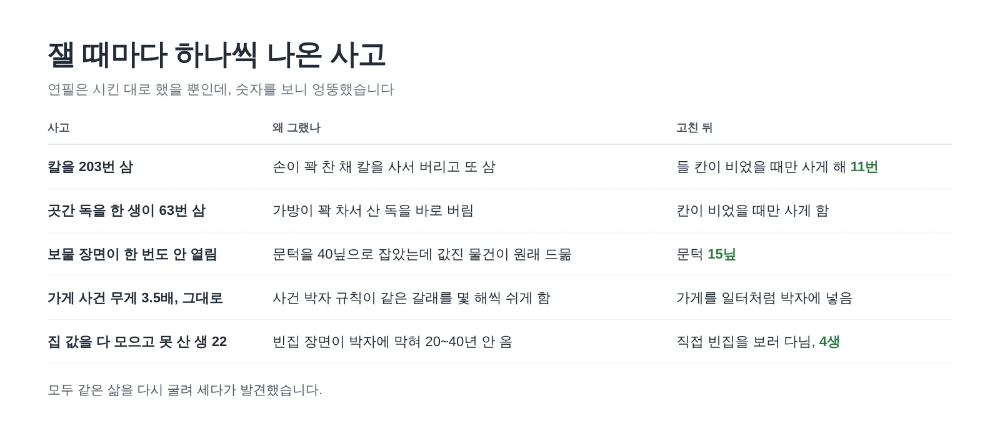
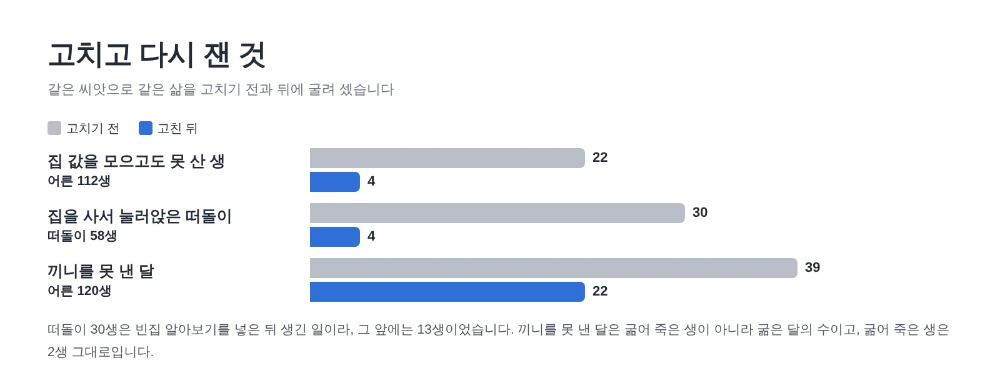
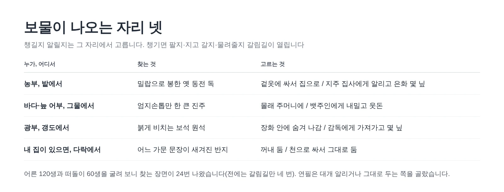

공책 RPG 속 사람들은 참 성실합니다. 평생 뼈 빠지게 일해 금화를 수백 닢씩 모으죠. 딱 한 가지 문제가 있다면, 그 돈으로 할 수 있는 게 아무것도 없다는 점이었습니다. 주머니에 수백 닢을 묵직하게 쥔 채 아무 미련 없이(?) 눈을 감는 삶이 수두룩했거든요. 결국 어느 날 그 풍경이 영 거슬려 Claude에게 말을 걸었고, 그렇게 이틀짜리 경제 대공사가 시작됐습니다.

<figure><figcaption>제 몫은 말 몇 마디였고, 고리를 엮고 세고 다시 세는 일은 Claude 몫이었습니다.</figcaption></figure>

## "돈에 대한 설계가 너무 없긴 했어"

첫마디는 솔직했습니다. "현재 게임에 돈에 대한 설계가 너무 없긴 했어." 품삯 버는 길 말고는 크게 걸고 크게 먹는 짜릿함도 없고, 번 돈을 쓸 곳도 마땅치 않다고 덧붙였죠. 끝은 "종합적인 재검토가 필요해 보여"로 닫았습니다.

Claude는 손대기 전에 이미 들어 있던 부품부터 셌습니다. 장터에 팔기, 전리품, 역 진열대, 주막 노름판까지 재료는 의외로 많더군요. 문제는 자동 진행 봇인 '연필'이 그걸 하나도 건드리지 않는다는 점이었습니다. 팔지도 사지도 않았고, 집이나 가게처럼 큰돈 들여 살 물건도 아예 없었죠. 심지어 죽을 때 남은 돈은 10닢당 영혼 1점, 최대 10점이 끝이라 100닢을 넘기면 더 모을 이유조차 없었습니다. **월급은 꼬박꼬박 들어오는데 쇼핑몰도 없고 적금 이자도 끊긴 통장**이었던 거죠.

## 선택지 지옥이냐, 저금통이냐

여기서 갈림길이 나왔습니다. 돈 쓰는 일을 전부 선택지로 띄워 줄 것인가, 아니면 공책 RPG다운 방식으로 풀 것인가. 하루 종일 '장보기' 버튼만 누르는 가계부 게임은 저부터 하기 싫었습니다. Claude가 내민 해법은 '저금통'이었습니다. 모을 목표 하나를 쪽지에 적어 두면 평소에는 연필이 알아서 벌고 아끼고, 저는 주막 노름판이나 빚쟁이, 급매로 나온 빈집 같은 굵직한 고비에서만 고르는 구조입니다. 그렇게 장만한 집과 가게는 세계에 남아 다음 생 자식이 물려받습니다.

외부 리뷰를 두 번 거쳐 설계를 2차 버전으로 다듬은 뒤, 공사를 네 개의 고리로 쪼갰습니다. 규칙은 하나였습니다. 고리 하나가 끝날 때마다 같은 삶을 다시 굴려 숫자를 센다.

<figure><figcaption>둘째와 셋째 고리를 넘길 때 제가 친 말은 "시작해"와 "다음 작업을 진행해"가 전부였습니다.</figcaption></figure>

첫 고리를 끝내고 숫자를 재 보니 이번엔 돈이 다른 쪽으로 넘쳤습니다. 죽을 때 남은 금화 중앙값이 91닢에서 283닢으로 훌쩍 뛴 겁니다. 그래서 임종 순간에 남은 돈을 묻을지, 기부할지, 남길지 고르게 했습니다. 다음 생은 깔끔하게 0닢에서 출발하고, 집과 가보만 대를 잇도록 정리했죠.

## 고리마다 하나씩 터진 코미디

봇을 다시 굴려 숫자를 뽑을 때마다 엉뚱한 사고가 줄줄이 나왔습니다. 한 번은 연필이 양손이 꽉 찬 상태로 칼을 사서 바닥에 버리고, 또 사서 버리기를 무려 203번이나 반복하고 있더군요. 넷째 고리에서는 가방이 꽉 찬 채로 곳간 양식 독을 사자마자 내다 버리는 바람에, 한 생이 독만 63번 사 모았습니다. 문도 안 닫히는 냉장고 앞에서 계속 장바구니를 결제하고 있던 꼴이죠.

또 다른 쪽에서는 보물 장면의 문턱을 40닢으로 잡았더니 0번 열렸고, 가게 사건은 등장 가중치를 3.5배로 키워도 꿈쩍도 안 했습니다. 알고 보니 범인은 같은 갈래 사건이 연달아 나오지 못하게 몇 해씩 쉬게 하는 '박자 규칙(쿨타임)'이었습니다.

<figure><figcaption>연필은 그저 시킨 대로 했을 뿐입니다. 우리가 허술하게 시킨 거죠.</figcaption></figure>

**AI가 "작업 완료했습니다"라고 보고할 때, 코드를 눈으로 훑기 전에 같은 시뮬레이션을 다시 돌려 숫자를 세게 해 보세요.** 칼 203번, 양식 독 63번 같은 사고는 코드만 읽어서는 절대 안 보이고, 숫자 표에서 제일 먼저 삐져나옵니다.

## "성향에 맞게 진행되도록 해야지"

넷째 고리까지 마쳤는데도 집값을 꼬박 다 모으고는 끝내 집을 못 산 생이 22생이나 남았습니다. 빈집 사건이 박자 규칙에 가로막혀 20~40년 동안 한 번도 얼굴을 안 비춘 탓이었죠. 돈을 다 모았으면 직접 빈집을 보러 다니게 고쳤더니 못 산 생은 4생으로 뚝 떨어졌습니다.

그런데 한쪽을 막으니 반대쪽이 터졌습니다. 정처 없이 떠도는 '떠돌이' 58생 가운데 무려 30생이 내 집 마련에 성공하고 그대로 눌러앉아 버린 겁니다. 평생 길 위를 걸어야 할 방랑자들이 부동산에 눈을 떴더군요.

여기서 Claude가 재미있는 실수도 하나 했습니다. "집을 산 떠돌이가 24년 더 살았다"고 보고서에 적어 온 건데, 가만 보니 인과가 거꾸로였습니다. 오래 살아남은 사람일수록 집을 살 기회가 많았던 것뿐이고, 그사이에 다른 패치도 섞여 있었거든요. 다행히 Claude가 곧바로 제 실수를 알아채고 문서에서 슬그머니 지웠습니다.

제가 내린 처방은 딱 한 줄이었습니다. "성향에 맞게 진행되도록 해야지." 떠돌이는 떠돌아야 제맛이죠. 이제 떠도는 길의 연필은 집이나 가게에는 눈길도 주지 않고, 몸값과 곳간 양식, 은퇴 자금만 모읍니다.

<figure><figcaption>회색이 고치기 전, 파랑이 고친 뒤입니다. 내 집 마련에 빠졌던 떠돌이들이 다시 길로 돌아갔습니다.</figcaption></figure>

## 가난한 집이 굶는 줄 알았는데

한숨 돌리고 "이후 작업할 게 더 있어?" 하고 물었더니 Claude가 후보 넷을 띄워 줬고, 저는 "순차적으로 진행해 줘"라고 답했습니다. 첫 번째 안건은 곳간 양식이 가난한 집에 더 잘 닿게 손보자는 것이었습니다.

그런데 막상 손을 대기 전에 굶은 달 69번의 기록을 하나씩 뜯어보니 뜻밖의 사실이 튀어나왔습니다. 굶고 있던 건 가난한 대가족이 아니었습니다. 69번 전부 아이 없는 젊은 홀몸이었고, 대부분 열네 살에서 열일곱 살짜리 초년생들이었죠. 음유시인이나 행상 1단계처럼 애초에 하루 끼니값도 안 나오는 일을 끝까지 붙들고 굶고 있었던 겁니다. 후보를 낼 때 Claude가 세운 '가난한 집'이라는 가설이 통째로 틀렸던 거죠. Claude는 그 사실을 먼저 솔직하게 털어놓고, 고칠 곳을 곳간이 아니라 일자리 쪽으로 바로 틀었습니다.

그래서 두 달 연속 끼니를 못 내면 숙식을 주거나 더 버는 일자리를 찾게 하고, 직업을 갈아타기 직전에는 멈춰 서서 저에게 묻도록 바꿨습니다. 어른 120생 기준으로 굶은 달은 39번에서 22번으로 줄었습니다. 은퇴한 노인이 저금을 바닥까지 긁어 쓰고 굶지 않게, 잔고가 100닢 아래로 떨어지면 다시 일터로 나가는 안전장치도 얹었고요.

마지막 손질은 보물이었습니다. 원래 값진 물건 자체가 드물다 보니 보물 갈림길은 180생에 고작 네 번 열리는 게 전부였거든요. 이제 농부는 밭을 갈다, 어부는 그물을 걷다, 광부는 갱도를 파다, 집주인은 다락을 뒤지다 뜻밖의 보물을 건져 올립니다.

<figure><figcaption>흥미롭게도 연필은 보물을 주우면 거의 늘 원주인에게 알리는 쪽을 골랐습니다. 슬쩍 챙길지는 결국 사람의 몫으로 남았네요.</figcaption></figure>

## 세 줄 요약

1. 게임 경제는 버는 길보다 쓸 곳과 모을 이유부터 깔아야 비로소 돈이 이야기가 됩니다.
2. AI가 "끝났습니다"라고 하면 같은 삶을 다시 돌려 숫자를 세어 보게 하세요. 칼 203번, 양식 독 63번 같은 코미디는 코드가 아니라 통계표에서 먼저 잡힙니다.
3. 짐작으로 처방하지 말고 로그를 열어 확인하세요. 가난한 집 문제인 줄 알았던 굶주림의 정체는 최저임금(?)도 못 버는 10대 초년생들의 일자리 문제였습니다.
