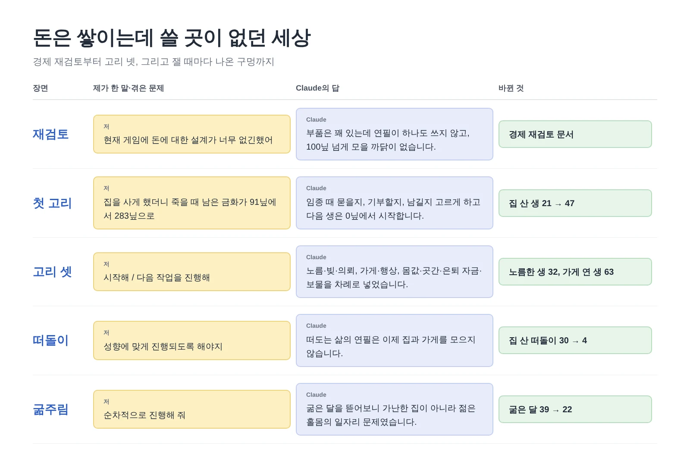
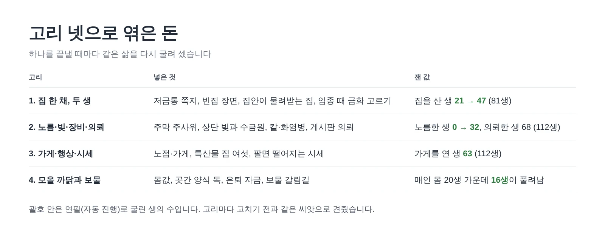
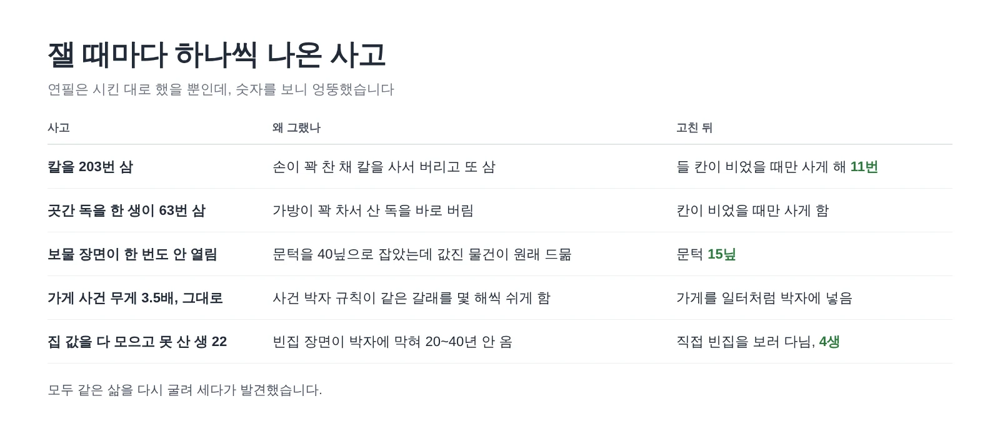
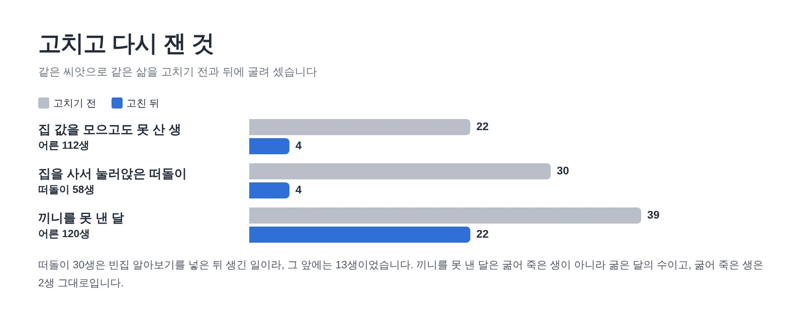
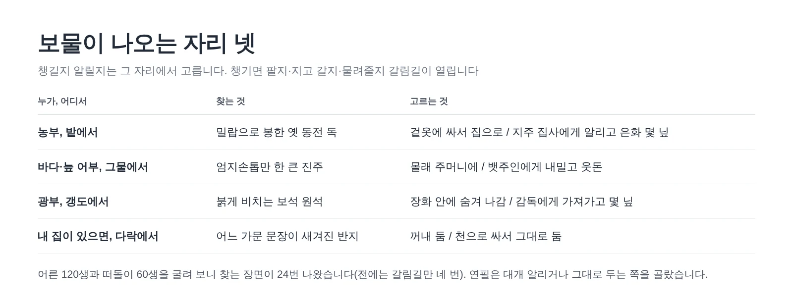

공책 RPG 속 사람들은 평생 성실하게 일했습니다. 문제는 번 돈으로 할 수 있는 게 거의 없었다는 거죠. 죽을 때 주머니에 금화를 수백 닢씩 쥐고 가는 삶이 수두룩했습니다. 어느 날 그게 영 거슬려서 Claude에게 털어놓았고 거기서 이틀짜리 공사가 시작됐습니다.

<figure><figcaption>제 몫은 말 몇 마디였고 고리를 엮고 세고 다시 세는 일은 Claude가 했습니다.</figcaption></figure>

## "돈에 대한 설계가 너무 없긴했어"

처음 보낸 말은 이랬습니다. "현재 게임에 돈에 대한 설계가 너무 없긴했어." 꾸준히 버는 길 말고는 크게 걸고 크게 먹는 길도 없고 번 돈을 쓸 데도 없다고 덧붙였죠. 그러고는 "종합적인 재검토가 필요해 보여"로 마무리했습니다.

Claude는 고치기 전에 이미 있는 것부터 셌습니다. 장터에 팔기, 전리품, 역마다 있는 진열대, 주막 노름판까지 부품은 생각보다 많았습니다. 그런데 연필(자동 진행)이 그걸 하나도 안 쓰고 있었습니다. 팔지도 사지도 않았고 누구나 살 수 있는 집이나 가게는 아예 없었습니다. 게다가 죽을 때 남은 돈은 10닢당 영혼 1점, 많아야 10점이라 100닢을 넘기면 더 모을 까닭이 없었습니다. **월급은 꼬박꼬박 들어오는데 쓸 곳도 모을 이유도 없는 통장**이었던 셈이죠.

## 선택지 천국이냐, 저금통이냐

여기서 고민이 생겼습니다. 돈 쓰는 일을 전부 선택지로 하나하나 고르게 할지, 우리 게임다운 장치로 풀지. 하루 종일 장보기 단추만 누르는 게임은 저도 하기 싫었거든요. Claude가 내민 답은 '저금통'이었습니다. 모을 목표 하나를 쪽지에 적어 두면 일상은 연필이 알아서 벌고 아끼는 사이 저는 노름판이나 빚쟁이, 급매로 나온 빈집 같은 고비에서만 고르는 방식입니다. 산 집과 가게는 내 세계에 남아 다음 생이 물려받고요.

바깥 검토 두 개를 받아 2판으로 고친 뒤 일을 고리 넷으로 나눴고 고리 하나를 끝낼 때마다 같은 삶을 다시 굴려 셌습니다.

<figure><figcaption>둘째와 셋째 고리를 시킬 때 제가 한 말은 "시작해"와 "다음 작업을 진행해"가 전부였습니다.</figcaption></figure>

첫 고리를 끝내니 이번엔 돈이 남아돌았습니다. 죽을 때 남은 금화 가운데값이 91닢에서 283닢으로 뛰었거든요. 그래서 임종 때 묻을지, 기부할지, 남길지 고르게 했습니다. 다음 생은 0닢에서 시작하고 집과 가보만 대를 잇습니다.

## 고리마다 하나씩 터진 사고

다시 굴려 셀 때마다 엉뚱한 사고가 하나씩 나왔습니다. 연필이 손이 꽉 찬 채 칼을 사서 버리고 또 사서 버리기를 203번 했습니다. 넷째 고리에서는 가방이 꽉 찬 상태로 곳간 양식 독을 사서 바로 버리는 바람에 한 생이 독을 63번 샀습니다. 꽉 찬 냉장고 앞에서 장바구니를 계속 채우는 사람이었죠. 보물 장면은 문턱을 40닢으로 잡았더니 한 번도 열리지 않았고 가게 사건은 나올 무게를 3.5배로 올려도 그대로였습니다. 범인은 같은 갈래 사건을 몇 해씩 쉬게 하는 박자 규칙이었습니다.

<figure><figcaption>연필은 시킨 대로 했을 뿐입니다. 시킨 게 허술했던 거죠.</figcaption></figure>

**AI가 "다 됐습니다"라고 하면 같은 삶을 다시 굴려 세어 보게 하세요.** 이런 사고는 코드를 읽어서는 잘 안 보이고 숫자에서 먼저 튀어나옵니다.

## "성향에 맞게 진행되도록 해야지"

넷째 고리 뒤에도 집 값을 다 모으고 못 산 생이 22생 남았습니다. 빈집 장면이 박자 규칙에 막혀 20~40년 동안 한 번도 안 왔던 겁니다. 그래서 돈을 다 모았으면 직접 빈집을 보러 다니게 했더니 4생으로 줄었는데, 이번엔 반대쪽이 터졌습니다. 떠돌이 58생 가운데 30생이 집을 사서 눌러앉아 버린 거죠.

여기서 Claude가 실수도 하나 했습니다. "집을 산 떠돌이가 24년 더 살았다"고 보고했는데 오래 산 사람일수록 집을 살 기회가 많았던 것을 거꾸로 읽은 데다 그사이 다른 작업이 섞인 숫자였습니다. Claude가 바로 짚고 문서에서 지웠습니다.

제 답은 한 줄이었습니다. "성향에 맞게 진행되도록 해야지." 떠돌이는 떠돌아야죠. 이제 떠도는 길의 연필은 집과 가게를 모으지 않고 몸값, 곳간 양식, 은퇴 자금만 모읍니다.

<figure><figcaption>회색이 고치기 전, 파랑이 고친 뒤입니다.</figcaption></figure>

## 가난한 집이 굶는 줄 알았는데

"이후 작업할게 더 있어?" 하고 물었더니 Claude가 후보 넷을 내밀었고 저는 "순차적으로 진행해 줘"라고 답했습니다. 첫째가 곳간 양식을 가난한 집에 더 잘 쓰이게 하자는 것이었습니다. 그런데 손대기 전에 굶은 달 69번을 하나씩 뜯어보니 전부 아이 없는 젊은 홀몸이었습니다. 대개 열네 살에서 열일곱 살이었고 음유시인이나 행상 첫 단계처럼 버는 돈이 끼니값에 못 미치는 일을 붙들고 있었죠. 후보를 낼 때 Claude가 짐작한 '가난한 집'이 틀렸던 겁니다. Claude는 그 사실을 먼저 털어놓고 고칠 곳은 곳간이 아니라 일자리라고 방향을 바꿨습니다.

그래서 두 달 연속 끼니를 못 내면 숙식을 주거나 더 버는 일자리를 찾게 하고 직업을 바꾸기 전에는 멈춰서 저에게 묻게 했습니다. 어른 120생 기준으로 굶은 달은 39번에서 22번으로 줄었습니다. 은퇴한 노인이 저금을 바닥까지 쓰고 굶지 않도록, 모은 돈이 100닢 밑으로 떨어지면 다시 일하게 하는 것도 함께 넣었습니다.

마지막은 보물이었습니다. 값진 물건이 원래 드물어서 보물 갈림길은 180생에 네 번 열리는 게 고작이었거든요. 이제 농부는 밭에서, 어부는 그물에서, 광부는 갱도에서, 집이 있으면 다락에서 보물을 찾습니다.

<figure><figcaption>재미있게도 연필은 거의 늘 주인에게 알리는 쪽을 골랐습니다. 챙길지는 결국 사람이 고를 몫입니다.</figcaption></figure>

## 세 줄 요약

1. 돈을 넣을 때는 버는 길보다 쓸 곳과 모을 까닭을 먼저 만들어야 돈이 이야기가 됩니다.
2. AI가 "다 됐습니다"라고 하면 같은 삶을 다시 굴려 세어 달라고 하세요. 칼 203번, 곳간 독 63번 같은 사고는 숫자에서 먼저 보입니다.
3. 짐작으로 고치지 말고 기록을 뜯어보게 하세요. 가난한 집 문제인 줄 알았던 굶주림이 젊은 홀몸의 일자리 문제였습니다.
