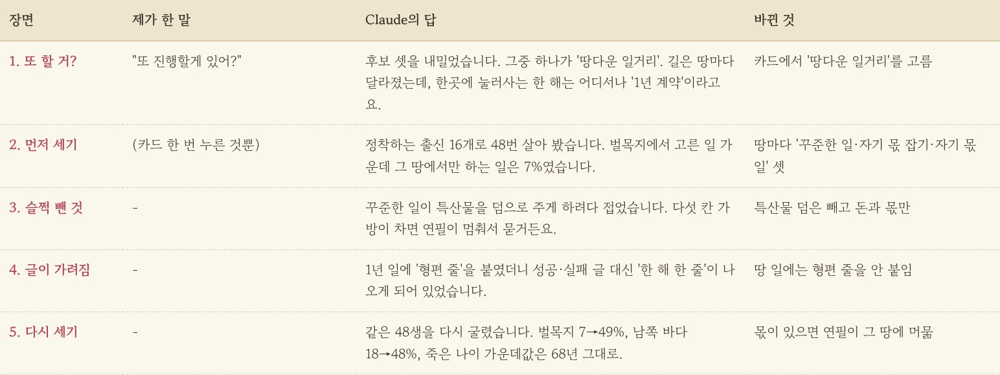
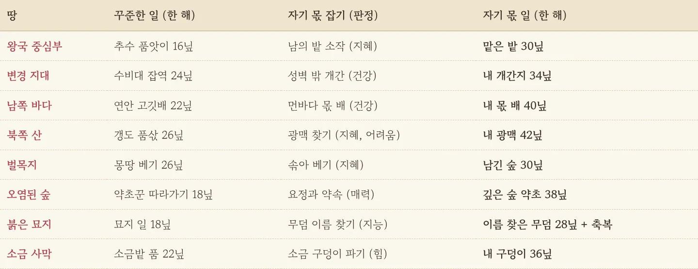

배로만 건너는 바닷길에, 대상 마차를 따라가야만 넘는 소금 사막까지 넣고 나니 이제 여행은 제법 땅맛이 납니다. 그런데 한숨 돌리고 화면을 물끄러미 보다가 묘한 위화감이 걸리더군요. 길 위에서는 온갖 유난을 다 떨어 놓았는데, 막상 아무 마을에나 짐을 풀고 눌러앉으면 벌목지든 바닷가든 한 해가 똑같이 '1년 계약 일'로 굴러가고 있었거든요. 무대 세트는 여덟 벌로 갈아 끼웠는데 대본은 달랑 한 권뿐이었던 겁니다.

<figure><figcaption>제가 친 말은 사실상 첫 줄 하나였고, 세고 고치고 다시 세는 건 전부 Claude 몫이었습니다.</figcaption></figure>

## "또 진행할 게 있어?"

지형 이동 작업을 마치고 커피 한 모금 마시다가 Claude에게 슬쩍 물었습니다. "또 진행할 게 있어?" Claude가 선택지 카드 셋을 띄워 주었는데, 그중 하나가 **'땅다운 일거리'**였습니다. 떠도는 삶은 땅마다 달라졌지만, 정착한 삶은 어느 동네를 가나 똑같은 메뉴판을 펼치고 있다는 진단이었죠. 딱 제가 찜찜해하던 그 구석이었습니다. 군말 없이 그 카드를 눌렀습니다. 솔직히 그날 제 몫의 노동은 거기서 9할이 끝났습니다.

## 고치기 전에 숫자부터 뽑아 보기

마음에 든 건 Claude가 곧장 코드부터 뜯어고치지 않고 숫자부터 쟀다는 점입니다. 광부 집안, 벌목꾼 집안, 부두 짐꾼처럼 한곳에 뿌리내리는 출신 16개를 골라, 자동 진행 봇인 '연필 맡기기'로 48번의 삶을 굴려 보았습니다. 그리고 어른이 고른 일 가운데 그 땅에서만 할 수 있는 일이 몇 %인지 지역별로 뽑아 냈죠.

결과는 생각보다 민망했습니다. 벌목지 7%, 변경 지대 8%, 남쪽 바다 18%. 벌목꾼 집안에서 태어나 도끼를 쥐고 자랐는데, 열에 아홉 해는 다른 동네 사람과 똑같은 일반 계약 일을 뛰고 있었던 겁니다. 배경은 울창한 벌목장인데 배우가 출근해서 엑셀을 두드리는 꼴이랄까요. 그저 "좀 밋밋하네" 하고 넘길 때와 "7%입니다"라는 숫자를 눈앞에 받아 들었을 때의 타격감은 영 다르더군요.

## 땅마다 일 셋, 그리고 '자기 몫'

처방은 명쾌했습니다. 여덟 땅마다 그 땅에서만 할 수 있는 1년짜리 일 세 가지를 새로 심는 것입니다.

1. **꾸준한 일**: 그 동네의 기본 품팔이입니다. 바다는 연안 고깃배, 산은 갱도 품삯, 묘지는 묘지 관리. 품삯도 위험도 땅 사정에 맞췄습니다.
2. **자기 몫 잡기**: 판정을 거는 한판 승부입니다. 남의 밭을 빌려 소작하거나, 먼바다 배에 지분을 걸고 타거나, 광맥을 찾아 산을 뒤집니다. 성공하면 내 밭·내 배·내 광맥이라는 '자기 몫(내 터전)'이 생기고, 삐끗하면 다치거나 겁만 잔뜩 집어먹습니다.
3. **자기 몫 일**: 앞의 '자기 몫'을 손에 쥔 사람에게만 열리는 일입니다. 벌이가 제일 짭짤하니, 이제 그 땅을 굳이 떠날 이유가 사라집니다.

<figure><figcaption>여덟 땅에 일이 셋씩, 모두 스물네 개입니다. 산골 광맥은 찾기가 제일 까다롭고, 일단 찾으면 제일 많이 법니다.</figcaption></figure>

땅마다 성격도 살짝씩 비틀어 두었습니다. 벌목지는 몽땅 베어 버리면 당장 푼돈은 쥐지만, 솎아 베어야 자기 몫이 남습니다. 오염된 숲에서는 요정과 약속을 맺고 금지된 약초를 캘 수 있는데, 실수하면 몸에 나무껍질 저주가 번지죠. 붉은 묘지는 돈벌이는 시원찮아도 이름 없는 무덤에 이름을 찾아 주면 선업과 축복이 따라옵니다. 연필 봇에게도 슬쩍 귀띔했습니다. 자리 잡은 어른이면 자기 몫을 한 번 노려 보고, 일단 몫이 생기면 식구가 딸렸을 때처럼 웬만해선 동네를 뜨지 말라고요.

## 슬쩍 접은 것 하나, 미리 막은 것 하나

처음 설계에는 꾸준한 일을 뛰면 그 땅 특산물을 덤으로 얹어 주는 항목이 있었습니다. 그런데 막상 굴려 보니 캐릭터 가방이 고작 다섯 칸짜리라, 해마다 소금이나 목재가 한 짐씩 굴러들어오면 가방이 순식간에 터지더군요. 연필이 매번 "가방이 꽉 찼는데 이거 버릴까요?" 하고 멈춰 서는 꼴을 보고 싶진 않았습니다. 그래서 특산물 덤은 깔끔하게 접고 돈과 몫만 남겼습니다. 사실 이건 구현 도중 Claude가 "원래 계획과 이렇게 다르게 꺾었습니다"라고 먼저 짚어 준 덕분에 저도 뒤늦게 알았습니다.

문장이 겹쳐 사라질 뻔한 버그도 하나 잡혔습니다. 이 게임은 1년짜리 일이 끝나면 '무엇을 했고 형편이 어땠다'는 한 해 한 줄 요약을 띄워 주는데, 새 땅 일에 그걸 그대로 달았더니 정성껏 써 둔 성공·실패 문구를 그 요약 한 줄이 통째로 덮어 버릴 뻔했습니다. 검사기가 미리 잡아 준 덕분에, 땅 일에는 한 해 한 줄을 붙이지 않기로 깔끔히 정리했습니다.

## 같은 48번을 다시 살아 보니

손을 보고 나서 같은 씨앗(시드)으로 똑같은 48번의 삶을 다시 굴렸습니다. 48생 중 45생이 새 땅 일을 맛봤고, 39생은 자기 몫을 손에 쥐었더군요.

<figure><figcaption>회색이 고치기 전, 빨강이 고친 뒤입니다. 북쪽 산은 광맥 찾기가 워낙 어려워 조금만 올랐습니다.</figcaption></figure>

벌목지는 7%에서 49%로, 남쪽 바다는 18%에서 48%로 훌쩍 뛰었습니다. 북쪽 산은 22%에서 29%로 찔끔 올랐는데, 광맥 찾기를 열세 번이나 시도해서 몫 일이 겨우 네 번 열렸기 때문입니다. 산이 원래 쉽게 속을 내주지 않는 법이니 이쪽은 억지로 손대지 않았습니다. 죽은 나이 중앙값은 68년 그대로고, 죽을 때 쥔 금화 중앙값은 266닢에서 237닢으로 살짝 내려갔습니다. 애초에 수명을 늘려 달란 게 아니라 땅맛이 나게 해 달란 거였으니, 수명이 그대로인 편이 오히려 안심입니다.

## 덧붙임: 몫은 자식에게 물려줘야 제맛

초고를 올리고 나서 지형 쪽에 더 건드릴 게 없냐고 물었더니, Claude가 첫손에 뼈아픈 구멍을 꼽았습니다. 밭이며 배며 광맥이며 평생 애써 잡아 둔 몫이 캐릭터가 눈을 감자마자 허공으로 증발한다는 겁니다. 가문이 대를 잇는 게 뼈대인 게임에서 정작 땅은 대물림이 안 되고 있었던 거죠. 그래서 집이나 가게처럼, 아이를 남기고 눈을 감으면 몫도 집안에 남아 다음 생이 물려받게 고쳤습니다. 이제 새 삶이 시작될 때 "그루터기 숲의 남긴 숲도 집안 몫으로 물려받았습니다" 같은 문장이 뜹니다.

두 대를 이어 굴려 보니 재미있는 구멍이 하나 더 나왔습니다. 집안은 첫 아이를 얻은 역에 터를 잡는데, 정작 물려받은 몫은 저 멀리 다른 땅에 박혀 있는 경우가 잦았거든요. 몫을 물려받은 10명 중 3명은 평생 그 근처에도 가 보지 않고 죽었습니다. 시골 땅문서를 물려받고도 평생 서울 원룸에만 눌러사는 자식 같은 꼴이었죠. 그래서 연필에게 **먼 땅에 몫이 있으면 직접 찾아가라**고 가르쳤고, 이미 몫이 하나 있으면 굳이 남의 동네 가서 새 몫을 또 잡으려 들지 않게 막았습니다.

<figure><figcaption>직접 찾아가게 고친 뒤에는 물려받은 몫으로 일한 기간이 중앙값 기준 다섯 해에서 스물세 해로 늘었습니다.</figcaption></figure>

## 세 줄 요약

1. 길은 땅마다 달라졌는데 정착한 삶은 어디서나 '1년 계약'이라, 여덟 땅에 전용 일거리 셋씩을 심고 대물림까지 붙였습니다.
2. 고치기 전에 먼저 숫자로 세어 보게 하세요. "좀 밋밋하네"보다 "7%"라는 숫자가 고칠 방향을 훨씬 또렷하게 잡아 줍니다.
3. AI가 원래 계획에서 꺾은 지점(특산물 덤 제외)을 스스로 짚어 보고하게 해 두면, 결과만 받아 보고도 무엇이 왜 바뀌었는지 한눈에 보입니다.
