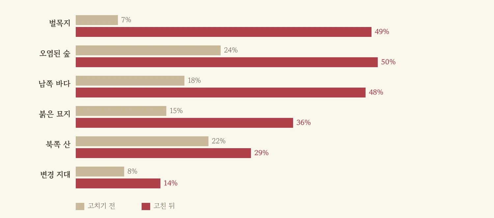
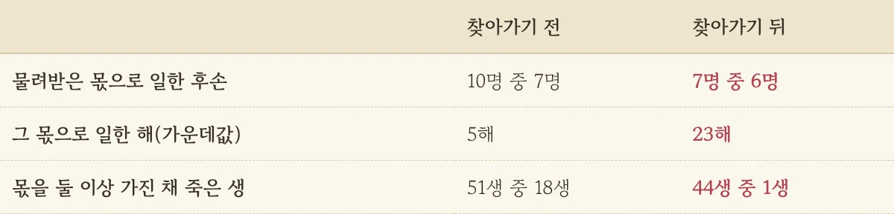

배로만 가는 길에, 마차로만 건너는 사막까지 넣고 나니 이제 여행은 제법 땅을 탑니다. 그런데 한숨 돌리고 화면을 다시 보다가 좀 기묘한 구석이 눈에 밟히더군요. 길 위에서는 그렇게 유난을 떨어 놓았는데, 막상 아무 마을에나 짐을 풀고 자리를 잡으면 벌목지든 바닷가든 한 해가 똑같이 '1년 계약 일'로 굴러가고 있었거든요. 무대 세트는 갈아 끼웠는데 대본은 그대로였던 거죠.

<figure><figcaption>제가 한 말은 사실상 첫 줄 하나였고, 나머지는 Claude가 세고 고치고 다시 셌습니다.</figcaption></figure>

## "또 진행할 게 있어?"

지형 작업을 마치고 커피 한 모금 마시다가 Claude에게 툭 던졌습니다. "또 진행할 게 있어?" 후보 셋이 올라왔는데, 그중 하나가 **'땅다운 일거리'**였습니다. 떠도는 삶은 땅마다 달라졌는데, 정착한 삶은 어느 동네를 가나 같은 메뉴판을 펼치고 있다는 진단이었죠. 딱 제가 찜찜하던 그 지점이었습니다. 카드를 꾹 눌렀습니다. 솔직히 그날 제 몫의 노동은 거기서 거의 끝났습니다.

## 고치기 전에 숫자부터

다행히 곧장 코드부터 뜯어고치지 않고 숫자부터 셌습니다. 광부 집안, 벌목꾼 집안, 부두 짐꾼처럼 한곳에 눌러사는 출신 16개를 추려서 연필 맡기기(자동 진행)로 48번을 살게 한 뒤, 어른이 고른 일 가운데 그 땅에서만 할 수 있는 일이 몇 %인지 땅별로 뽑아 봤죠.

결과는 생각보다 처참했습니다. 벌목지 7%, 변경 지대 8%, 남쪽 바다 18%. 나무꾼 집안에서 태어나 도끼를 쥐고 자랐는데 열에 아홉 해는 다른 동네 사람과 똑같은 계약 일을 뛰고 있었던 겁니다. 배경은 벌목장인데 배우가 출근해서 엑셀을 두드리는 꼴이랄까요. 그냥 "좀 밋밋하네" 할 때와 "7%입니다"라는 숫자를 받아 들었을 때의 타격감은 영 다르더군요.

## 땅마다 일 셋, 그리고 '자기 몫'

처방은 땅마다 1년짜리 일 세 가지를 새로 까는 것이었습니다.

1. **꾸준한 일**: 그 땅의 기본 품팔이입니다. 바다는 연안 고깃배, 산은 갱도 품삯, 묘지는 묘지 일. 품삯도 위험도 동네 사정에 맞췄습니다.
2. **자기 몫 잡기**: 판정을 거는 한판 승부입니다. 남의 밭을 빌려 소작하거나, 먼바다 배에 몫을 걸고 타거나, 광맥을 찾아 산을 뒤집니다. 성공하면 내 밭, 내 배, 내 광맥이 생기고, 실패하면 다치거나 겁만 잔뜩 집어먹습니다.
3. **자기 몫 일**: 앞의 '자기 몫'이 있어야만 열리는 일입니다. 벌이가 제일 짭짤하고, 덕분에 그 땅을 굳이 떠날 이유가 사라집니다.

<figure><figcaption>여덟 땅에 일이 셋씩, 모두 스물네 개입니다. 산골 광맥은 찾기가 제일 어렵고 찾으면 제일 많이 법니다.</figcaption></figure>

땅마다 성격도 조금씩 비틀어 두었습니다. 벌목지는 몽땅 베면 당장 푼돈은 만지지만 솎아 베어야 자기 몫이 남습니다. 오염된 숲에서는 요정과 약속을 맺어 금지된 약초를 캘 수 있는데, 삐끗하면 몸에 나무껍질 저주가 번지죠. 붉은 묘지는 돈벌이가 시원찮은 대신 이름 없는 무덤에 이름을 찾아 주면 선업과 축복이 따라옵니다. 연필에게도 슬쩍 귀띔해 두었습니다. 자리 잡은 어른이면 자기 몫을 좀 노려 보고, 몫이 있는 땅에서는 식구가 딸렸을 때처럼 웬만해선 뜨지 말라고요.

## 슬쩍 접은 것 하나, 막은 것 하나

처음 계획에는 꾸준한 일을 뛰면 그 땅 특산물을 덤으로 얹어 준다는 항목이 있었습니다. 그런데 막상 굴려 보니 캐릭터 가방이 다섯 칸짜리라, 해마다 소금이나 목재가 한 짐씩 굴러들어오면 가방이 순식간에 터지더군요. 연필이 매번 "이거 버릴까요?" 하고 멈춰 서는 꼴을 보고 싶진 않았습니다. 그래서 특산물 덤은 깔끔하게 접고 돈과 몫만 남겼습니다. 사실 이건 구현 중에 Claude가 계획과 달라진 점으로 먼저 짚어 줘서 저도 뒤늦게 알았습니다.

한 해 글이 겹쳐 가려지는 버그도 하나 걸렸습니다. 이 게임은 1년짜리 일이 끝나면 '무엇을 했고 형편이 어땠다'는 한 해 한 줄 요약을 띄워 주는데, 새 땅 일에 그걸 그대로 달았더니 정성껏 써 둔 성공·실패 문구 대신 그 한 줄이 화면을 덮어 버릴 뻔했습니다. 검사기가 미리 잡아 준 덕분에, 땅 일에는 한 해 한 줄을 안 붙이기로 정리했습니다.

## 같은 48번을 다시 살아 보니

손을 보고 나서 같은 씨앗으로 48번을 다시 굴렸습니다. 48생 중 45생이 땅 일을 맛봤고, 39생은 자기 몫을 손에 쥐었더군요.

<figure><figcaption>회색이 고치기 전, 빨강이 고친 뒤입니다. 북쪽 산은 광맥 찾기가 어려워 조금만 올랐습니다.</figcaption></figure>

벌목지는 7%에서 49%로, 남쪽 바다는 18%에서 48%로 뛰었습니다. 북쪽 산은 22%에서 29%로 찔끔 올랐는데, 광맥 찾기를 열세 번이나 시도해서 몫 일은 겨우 네 번 열렸기 때문입니다. 산이 원래 쉽게 속을 내주지 않는 법이니 이쪽은 그냥 뒀습니다. 죽은 나이 중앙값은 68년 그대로고, 죽을 때 손에 쥔 금화 중앙값은 266닢에서 237닢으로 살짝 내려갔습니다. 애초에 수명을 늘려 달란 게 아니라 땅맛이 나게 해 달란 거였으니, 수명이 그대로인 건 오히려 안심입니다.

## 덧붙임: 몫은 자식에게

초고를 올리고 나서 지형 쪽에 더 건드릴 게 없냐고 물었더니, 첫손에 이걸 꼽더군요. 밭이며 배며 광맥이며 평생 애써 잡은 몫이 캐릭터가 죽자마자 허공으로 증발한다는 겁니다. 가문이 대를 잇는 게 뼈대인 게임에서 정작 땅은 대물림이 안 되고 있었던 거죠. 그래서 집이나 가게처럼, 아이를 남기고 눈을 감으면 몫도 집안에 남아 다음 생이 물려받게 바꿨습니다. 새 삶이 시작될 때 "그루터기 숲의 남긴 숲도 집안 몫으로 물려받았습니다" 같은 문장이 뜹니다.

두 대를 이어 굴려 보니 구멍이 하나 더 보였습니다. 집안은 첫 아이를 얻은 역에 터를 잡는데, 정작 물려받은 몫은 저 멀리 다른 땅에 박혀 있는 경우가 잦았거든요. 물려받은 10명 중 3명은 평생 그 몫 근처에도 안 가 봤습니다. 시골 땅문서를 물려받고도 평생 서울 원룸에만 눌러사는 자식 같은 꼴이었죠. 그래서 연필에게 **먼 땅에 몫이 있으면 직접 찾아가라**고 가르쳤고, 이미 몫이 하나 있으면 굳이 남의 동네 가서 새 몫을 또 잡으려 들지 않게 막았습니다.

<figure><figcaption>찾아가게 한 뒤에는 물려받은 몫으로 일한 해가 중앙값 기준 다섯 해에서 스물세 해로 늘었습니다.</figcaption></figure>

## 세 줄 요약

1. 길은 땅마다 달라졌는데 정착한 삶은 어디서나 '1년 계약'이라, 땅마다 그 땅에서만 하는 일 셋을 심었습니다.
2. 고치기 전에 먼저 숫자로 세어 달라고 해 보세요. "좀 밋밋하다"보다 "7%"라는 숫자가 방향을 훨씬 빨리 잡아 줍니다.
3. AI가 원래 계획과 다르게 꺾은 지점(특산물 덤 빼기)을 스스로 짚어 주게 해 두면, 결과만 받아 보고도 뭐가 바뀌었는지 한눈에 보입니다.
