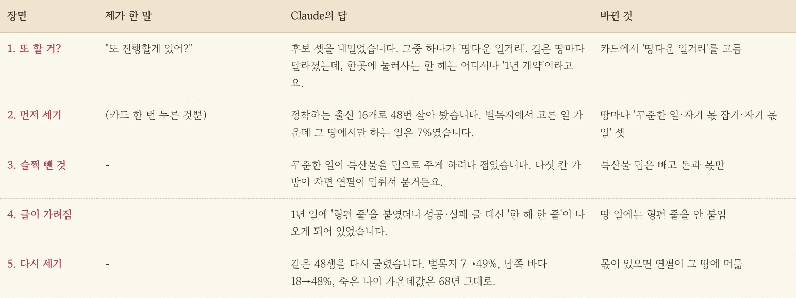
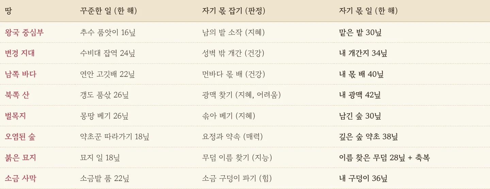
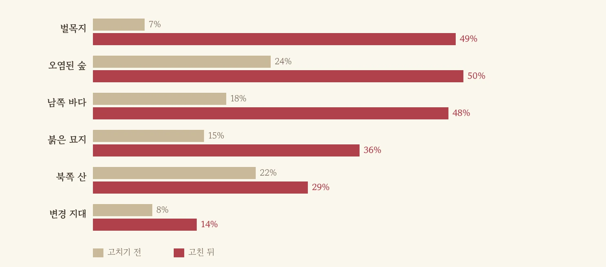
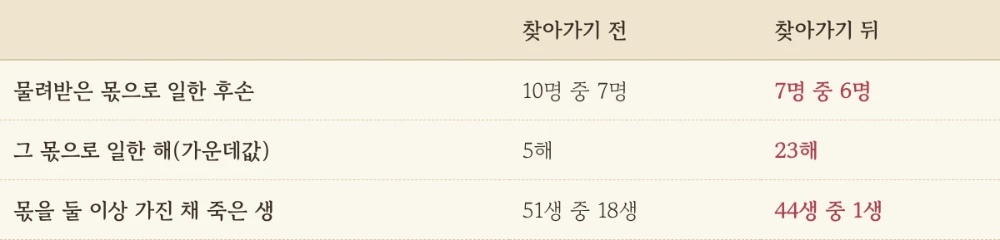

배로만 가는 길, 마차로만 건너는 사막까지 넣고 나니 여행은 확실히 땅을 타게 됐습니다. 그런데 한숨 돌리고 보니 이상한 게 눈에 들어왔습니다. 길 위에서는 그렇게 달랐는데, 막상 한 마을에 자리를 잡으면 벌목지에서도 바닷가에서도 한 해가 똑같이 '1년 계약 일'로 흘러가고 있었거든요. 이번 편은 Claude에게 툭 던진 한마디에서 시작합니다.

<figure><figcaption>제가 한 말은 사실상 첫 줄 하나였고, 나머지는 Claude가 세고 고치고 다시 셌습니다.</figcaption></figure>

## "또 진행할게 있어?"

지형 작업을 마무리하고 물었습니다. "또 진행할게 있어?" Claude는 후보 셋을 내밀었고, 그중 하나가 **'땅다운 일거리'**였습니다. 설명이 딱 제 찜찜함 그대로였습니다. 떠도는 삶은 땅마다 달라졌는데, 정착한 삶은 어느 땅에서나 같은 메뉴를 고른다는 거죠. 카드에서 그걸 눌렀습니다. 제 몫의 일은 거기까지였습니다.

## 고치기 전에 먼저 셌습니다

Claude는 바로 만들지 않고 먼저 셌습니다. 광부 집안, 벌목꾼 집안, 부두 짐꾼처럼 한곳에 눌러사는 출신 16개를 골라 연필 맡기기(자동 진행)로 48번을 살게 한 다음, 어른이 고른 일 가운데 그 땅에서만 할 수 있는 일이 몇 %인지 땅별로 뽑았습니다.

결과는 예상보다 썰렁했습니다. 벌목지 7%, 변경 지대 8%, 남쪽 바다 18%. 나무꾼 집안에서 태어나도 열에 아홉 해는 다른 동네 사람과 똑같은 계약 일을 하고 있었던 겁니다. 영화 세트장은 벌목지인데 배우는 계속 사무실 연기를 하고 있던 셈이죠. **감으로 "좀 밋밋한 것 같아"라고 하는 것과 "7%입니다"라고 듣는 것은 무게가 다르더군요.**

## 땅마다 일 셋, 그리고 '자기 몫'

Claude가 내놓은 처방은 땅마다 1년짜리 일 세 가지였습니다.

1. **꾸준한 일**: 그 땅의 품팔이입니다. 바다는 연안 고깃배, 산은 갱도 품삯, 묘지는 묘지 일. 품삯도 위험도 땅마다 다릅니다.
2. **자기 몫 잡기**: 판정을 거는 도전입니다. 남의 밭을 빌려 소작하기, 먼바다 배에 몫을 걸고 타기, 광맥 찾아 산 뒤지기. 성공하면 내 밭, 내 배, 내 광맥이 생기고 실패하면 다치거나 겁을 먹습니다.
3. **자기 몫 일**: 몫이 있어야만 열리는 일입니다. 벌이가 제일 좋고, 무엇보다 **그 땅을 떠날 까닭이 줄어듭니다.**

<figure><figcaption>여덟 땅에 일이 셋씩, 모두 스물네 개입니다. 산골 광맥은 찾기가 제일 어렵고 찾으면 제일 많이 법니다.</figcaption></figure>

땅마다 성격도 조금씩 비틀었습니다. 벌목지는 몽땅 베면 당장 많이 벌지만 솎아 베어야 몫이 남고, 오염된 숲은 요정과 약속을 맺으면 금지된 약초를 캘 수 있지만 실패하면 나무껍질 저주가 번집니다. 붉은 묘지는 돈이 적은 대신 이름 없는 무덤에 이름을 찾아 주면 선업과 축복이 따라오고요. 연필에게도 한 줄을 가르쳤습니다. 자리 잡은 어른은 몫을 잡아 보려 하고, 몫이 있는 땅에서는 식구가 있을 때처럼 잘 떠나지 않게요.

## 슬쩍 접은 것 하나, 막은 것 하나

처음 계획에는 꾸준한 일을 하면 그 땅 특산물을 덤으로 준다는 내용도 있었습니다. 그런데 만들다 보니 가방이 다섯 칸뿐이라, 해마다 소금이나 목재가 한 짐씩 들어오면 가방이 금방 차고 연필이 "이거 버릴까요?" 하고 멈춰 서게 되더군요. 그래서 덤은 빼고 돈과 몫만 남겼습니다. Claude가 이 부분을 계획과 달라진 점으로 따로 짚어 줘서 저도 알았습니다.

또 하나는 글이 가려지는 문제였습니다. 이 게임은 1년짜리 일이 끝나면 '무엇을 했고 형편이 어땠다'는 한 해 한 줄을 골라 보여 주는데, 땅 일에 그걸 붙였더니 정성껏 쓴 성공·실패 글 대신 그 한 줄이 나오게 되어 있었습니다. 검사기가 잡아 줬고, 땅 일에는 한 해 한 줄을 안 붙이기로 했습니다.

## 같은 48번을 다시 살아 보니

고친 뒤 같은 씨앗으로 48번을 다시 살게 했습니다. 48생 중 45생이 땅 일을 했고 39생은 자기 몫을 가졌습니다.

<figure><figcaption>회색이 고치기 전, 빨강이 고친 뒤입니다. 북쪽 산은 광맥 찾기가 어려워 조금만 올랐습니다.</figcaption></figure>

벌목지는 7%에서 49%로, 남쪽 바다는 18%에서 48%로 올랐습니다. 북쪽 산은 22%에서 29%로 덜 올랐는데, 광맥 찾기를 열세 번 해서 몫 일은 네 번밖에 못 했거든요. 산이 쉽게 속을 내주지 않는 셈이라 그대로 두기로 했습니다. 죽은 나이 가운데값은 68년 그대로, 죽을 때 금화 가운데값은 266닢에서 237닢으로 조금 줄었습니다. 저는 삶이 땅을 타게 해 달라고 했지 더 오래 살게 해 달라고 하지는 않았으니, 수명이 그대로인 건 반가운 소식입니다.

## 덧붙임: 몫은 자식에게

글을 올리고 나서 지형 쪽에 더 할 게 있는지 물었더니, Claude가 첫 번째로 이걸 꼽았습니다. 밭이며 배며 광맥이며 애써 잡은 몫이 죽으면 그냥 사라진다는 거였죠. 이 게임은 집안이 대를 잇는 게 중심인데 정작 땅은 대를 잇지 못하고 있었던 겁니다. 그래서 집과 가게처럼, 아이를 남기고 죽으면 몫도 집안에 남고 집안에서 태어난 다음 생이 물려받게 했습니다. 태어날 때 "그루터기 숲의 남긴 숲도 집안 몫으로 물려받았습니다" 같은 한 줄이 뜹니다.

두 대를 이어 살려 재 보니 구멍이 하나 보였습니다. 집안은 첫 아이를 얻은 역에 터를 잡는데, 몫은 먼 땅에 있는 경우가 많았거든요. 물려받은 10명 중 3명은 평생 그 몫에 손도 못 댔습니다. 시골 땅문서를 물려받고 서울에 눌러사는 자식 같은 꼴이었죠. 그래서 연필에게 **먼 땅에 몫이 있으면 찾아가라**고 가르쳤고, 이미 몫이 있으면 다른 땅에서 새 몫을 또 잡으러 들지 않게 했습니다.

<figure><figcaption>찾아가게 한 뒤에는 물려받은 몫으로 일한 해가 가운데값으로 다섯 해에서 스물세 해로 늘었습니다.</figcaption></figure>

## 세 줄 요약

1. 길은 땅마다 달라졌는데 정착한 삶은 어디서나 '1년 계약'이라, 땅마다 그 땅에서만 하는 일 셋을 넣었습니다.
2. 고치기 전에 먼저 숫자로 세어 달라고 하세요. "밋밋하다"보다 "7%"가 훨씬 빨리 방향을 정해 줍니다.
3. AI가 계획과 다르게 간 곳(특산물 덤 빼기)을 스스로 짚어 주게 해 두면, 결과만 보고도 무엇이 바뀌었는지 알 수 있습니다.
