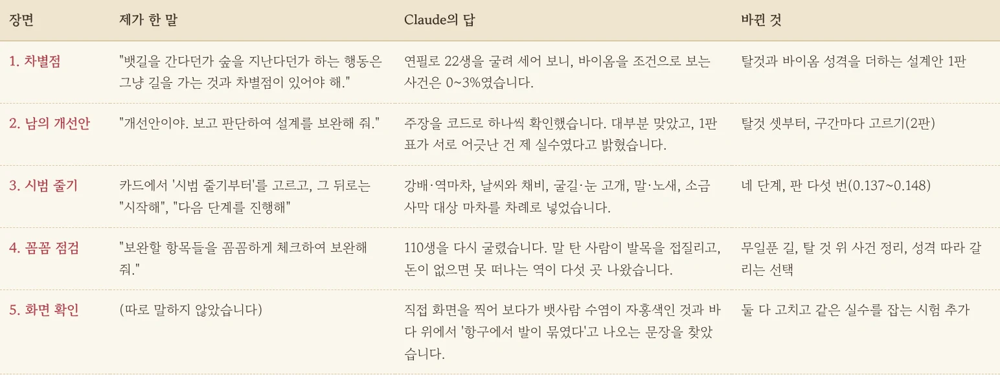
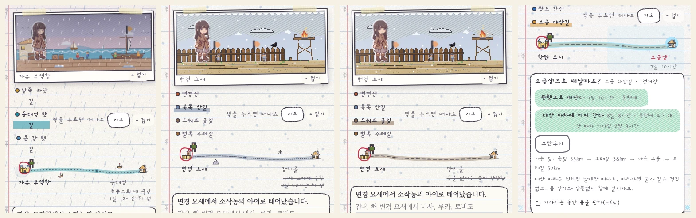
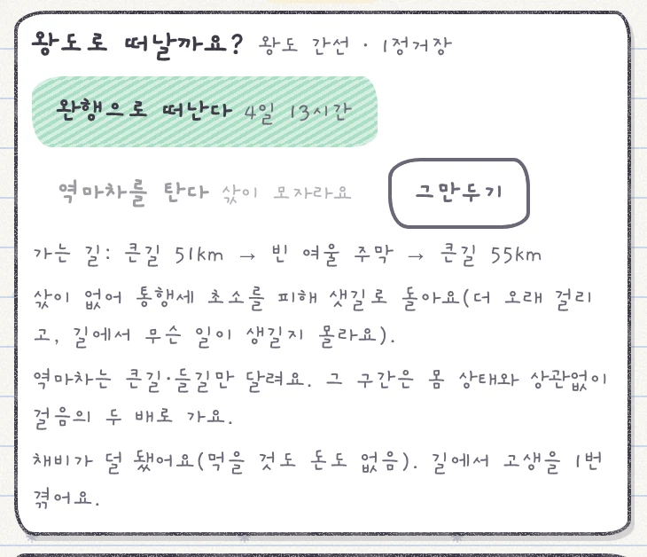
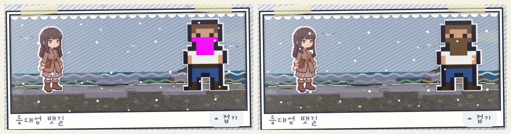

공책 RPG 세계 지도에는 바닷가, 산맥, 숲, 묘지 지대까지 땅이 일곱 가지나 있습니다. 그런데 막상 해 보면 배를 타든 숲을 지나든 그냥 '길을 간다' 한 줄로 끝났거든요. 지도만 화려하고 여행은 어딜 가나 똑같았던 셈입니다. 그래서 이렇게 적어 보냈습니다. "뱃길을 간다던가 숲을 지난다던가 하는 행동은 그냥 길을 가는 것과 차별점이 있어야 해."

<figure><figcaption>차별점을 달라는 한 줄에서 시작해 화면 점검까지 다섯 번을 주고받았습니다.</figcaption></figure>

## 바이옴은 있는데, 아무도 모른다

내친김에 하나 더 물었습니다. 바이옴이 있기는 한데, 이게 정말 게임에 영향을 주고 있는지, 플레이어가 땅마다 차이를 느끼게 되어 있는지 점검해 달라고요. Claude는 감으로 답하지 않고 연필 맡기기(자동 진행)로 스물두 번의 삶을 굴려 실제로 열린 사건을 셌습니다. 결과는 민망했습니다. **바이옴을 조건으로 보는 사건은 0~3%**였거든요. 무대 세트는 일곱 벌인데 대본은 한 권뿐인 연극이었던 거죠. 산맥에 살든 들녘에 살든 삶은 거의 똑같이 흘러가고 있었습니다.

## 다른 AI의 개선안을 들고 갔더니

Claude가 첫 설계안을 내놓자, 저는 다른 AI에게 받아 둔 개선안을 붙여 넣었습니다. "개선안이야. 보고 판단하여 설계를 보완해 줘." Claude가 개선안을 덥석 받아 적지 않아서 마음에 들었습니다. 거기 적힌 근거를 코드로 하나씩 대조했고 대부분 맞다고 인정했습니다. 다만 "연결 22개 중 12개는 끊기면 돌아갈 길이 없다"는 지적에는 단서를 달았습니다. 그중 일곱은 섬처럼 원래 막다른 곳이라, 다른 길은 세 군데에만 내면 된다고요. 그러면서 자기 첫 설계안에서 탈것 표와 지형 표가 서로 어긋났던 건 자기 실수라고 먼저 털어놓더군요. 병원에서 두 번째 의견을 듣는 것처럼, **AI 둘을 맞붙여 근거를 대조하게 하니 설계가 한 번에 단단해졌습니다.**

## 네 단계로 길을 갈라 놓기

그다음부터 제가 한 말은 사실상 "시작해"와 "다음 단계를 진행해"뿐이었습니다. 단계마다 Claude가 만들고 측정해서 결과를 들고 왔습니다.

1. 구간마다 걸어갈지, 역마차를 탈지, 배를 탈지 고릅니다. 배와 마차는 정해진 시각에만 떠납니다.
2. 날씨가 길을 바꿉니다. 여름 폭풍이 뱃길을 끊고, 눈길에서는 걸음이 느려집니다. 여행 채비 카드와 길잡이도 생겼습니다.
3. 드워프 굴길은 불이 없으면 못 들어가고, 겨울 고개는 눈에 막힙니다.
4. 말과 노새를 사서 먹이며 탑니다. 새 땅 소금 사막은 대상 마차를 따라가야만 건널 수 있습니다.

<figure><figcaption>폭풍에 끊긴 뱃길, 눈 덮인 고개, 불 없이는 못 가는 굴길, 마차로만 건너는 소금 사막입니다.</figcaption></figure>

## "꼼꼼하게 체크해 줘"의 결과

네 단계를 다 올리고 나서 마지막으로 부탁했습니다. "보완할 항목들을 꼼꼼하게 체크하여 보완해 줘." Claude가 110번의 삶을 다시 굴렸는데 웃기면서도 뜨끔한 것들이 쏟아졌습니다.

1. **말 탄 사람이 발목을 접질리고 있었습니다.** 걷는 사람용 사건이 말이나 마차 위에서도 버젓이 열렸던 거죠. 고친 뒤에는 발목 사건 47번이 모두 걷는 사람에게만 났습니다.
2. 한 선택지만 85% 넘게 고르는 사건이 25개였습니다. 성격에 따라 손이 가는 선택이 달라지게 하자 17개로 줄었습니다. 남은 것은 대부분 가난하면 품삯 일을 받는 식이라 그냥 두었습니다. 숫자를 억지로 맞추기보다 원인과 결과가 말이 되는 쪽이 먼저니까요.
3. 돈이 한 푼도 없으면 아예 떠날 수 없는 역이 다섯 곳 있었습니다. 그래서 무일푼 길을 만들었습니다. 통행세 초소는 샛길로 돌아가고 뱃삯은 배에서 일해서 대신 냅니다. 다리가 부러졌는데 수레 삯이 없으면 절뚝이며 걷습니다.

<figure class="narrow"><figcaption>빈털터리여도 이제 길은 있습니다. 대신 더 오래 걸리고 무슨 일이 생길지 모릅니다.</figcaption></figure>

## 시뮬레이션이 못 본 건 화면이 봤다

숫자 점검이 끝난 뒤 Claude가 블로그용으로 실제 게임 화면을 찍다가 하나를 더 건졌습니다. 뱃사람의 수염이 형광 자홍색이었거든요. 수염 색이 팔레트에서 빠져 있던 건데, 해적과 등대지기도 같은 신세였습니다. 바다 한가운데서 사건이 나면 "자유 무역항에서 발이 묶였습니다"라고 엉뚱하게 적히는 문장도 같이 잡았습니다. 백 번 넘게 돌린 시뮬레이션은 둘 다 못 봤습니다. 숫자는 규칙이 맞는지를 보고 화면은 보이는 게 맞는지를 보니까 **두 점검은 서로 다른 버그를 잡습니다.**

<figure><figcaption>왼쪽이 고치기 전, 오른쪽이 고친 뒤입니다. 같은 실수를 다시 잡는 시험도 붙였습니다.</figcaption></figure>

이제 땅마다 여행이 꽤 달라졌습니다. 다음에는 그 땅에 머무는 사람에게도 그곳다운 일거리와 이야기를 더 붙여 볼 생각입니다.

## 세 줄 요약

1. "차이가 느껴지나?" 같은 질문은 감으로 답하게 두지 말고 모의 플레이로 세어 오게 하세요.
2. 다른 AI의 제안은 그대로 붙이지 말고 근거를 코드와 대조하게 하세요.
3. 숫자 점검과 화면 점검은 서로 다른 버그를 잡으니 둘 다 맡기세요.
