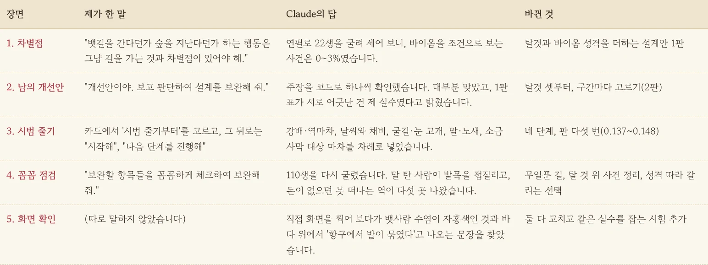
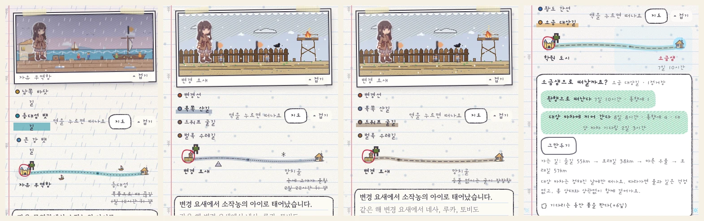
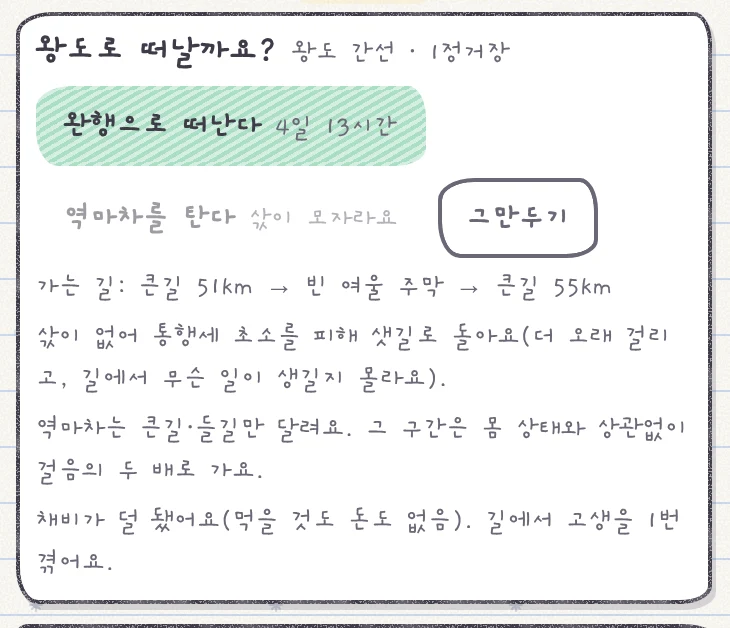
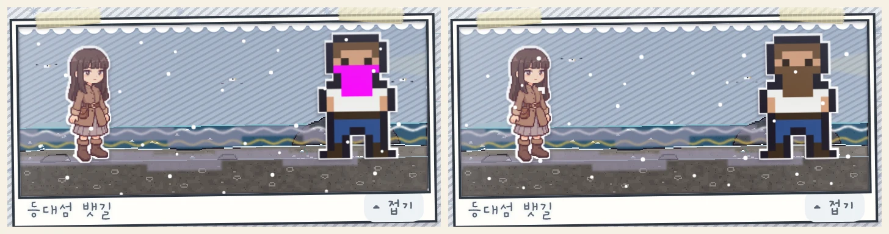

공책 RPG의 세계 지도에는 바닷가, 산맥, 숲, 붉은 묘지 지대까지 땅이 일곱 가지나 펼쳐져 있습니다. 그런데 막상 길을 떠나 보면 바다를 건너든 숲을 헤치든 화면에는 그저 '길을 간다' 한 줄이 뜨고 끝났습니다. 지도는 근사하게 그려 놓고 정작 여행은 어느 길이나 똑같은 포장도로였던 거죠. 결국 참다못해 Claude에게 한 줄을 보냈습니다. "뱃길을 간다던가 숲을 지난다던가 하는 행동은 그냥 길을 가는 것과 차별점이 있어야 해."

<figure><figcaption>차별점을 달라는 한 줄에서 출발해 화면 점검까지, 총 다섯 번을 주고받았습니다.</figcaption></figure>

## 바이옴은 일곱 개인데, 아무도 모른다

내친김에 하나 더 물었습니다. 게임 안에 바이옴(지형 구분)이 분명히 들어 있는데, 이게 정말 플레이에 영향을 주고 있는지, 플레이어가 땅마다 차이를 느낄 수 있는지 확인해 달라고요.

Claude는 감으로 대답하지 않았습니다. 자동 진행 봇인 '연필 맡기기'로 스물두 번의 삶을 굴린 뒤 실제로 열린 사건을 낱낱이 셌죠. 돌아온 성적표는 꽤 민망했습니다. **바이옴을 조건으로 보는 사건이 전체의 0~3%**뿐이었으니까요. 무대 세트는 일곱 벌을 짜 놓았는데 대본은 달랑 한 권뿐인 연극이었던 겁니다. 험한 산맥에 살든 평화로운 들녘에 살든 인생이 거의 복사본처럼 흘러가고 있었습니다.

## 다른 AI의 개선안을 들고 갔더니

Claude가 첫 설계안을 가져오자, 저는 다른 AI에게 받아 둔 개선안을 슬쩍 붙여 넣었습니다. "개선안이야. 보고 판단하여 설계를 보완해 줘."

여기서 Claude의 태도가 꽤 마음에 들었습니다. 남의 제안을 덥석 복붙하지 않고, 적힌 근거를 코드와 하나씩 대조해 보더군요. 대부분은 맞다고 수긍하면서도, "연결 22개 중 12개는 끊기면 돌아갈 길이 없다"는 지적에는 딱 잘라 단서를 달았습니다. 그중 일곱은 섬처럼 원래 막다른 곳이라 우회로는 세 군데에만 내면 된다고요. 그러면서 자기 첫 설계안에서 탈것 표와 지형 표가 서로 어긋났던 건 자기 실수라고 먼저 털어놓았습니다. 병원에서 다른 의사에게 2차 소견을 듣는 것처럼, **AI 둘을 맞붙여 코드라는 증거 앞에서 대조하게 하니 설계가 한 번에 탄탄해졌습니다.**

## 네 단계로 길을 갈라 놓기

그다음부터 제가 한 일은 사실상 "시작해"와 "다음 단계를 진행해"를 치는 게 전부였습니다. 단계가 끝날 때마다 Claude가 직접 구현하고 시뮬레이션으로 숫자를 재서 결과를 들고 왔습니다.

1. 구간마다 걸어갈지, 역마차를 탈지, 배를 탈지 고릅니다. 배와 마차는 정해진 시각에만 떠납니다.
2. 날씨가 길을 바꿉니다. 여름 폭풍이 뱃길을 끊어 놓고, 눈길에서는 발걸음이 느려집니다. 여행 채비 카드와 길잡이 고용도 생겼습니다.
3. 드워프 굴길은 불빛이 없으면 아예 못 들어가고, 겨울 고개는 눈에 묻혀 막힙니다.
4. 말과 노새를 사서 먹이며 타고 다닙니다. 새로 넣은 소금 사막은 대상 마차를 따라가야만 건널 수 있습니다.

<figure><figcaption>폭풍에 끊긴 뱃길, 눈 덮인 고개, 불 없이는 못 드는 굴길, 대상 마차로만 건너는 소금 사막입니다.</figcaption></figure>

## "꼼꼼하게 체크해 줘"가 건져 올린 것들

네 단계를 다 올리고 마지막으로 한 마디를 얹었습니다. "보완할 항목들을 꼼꼼하게 체크하여 보완해 줘." Claude가 110번의 삶을 다시 굴렸더니, 웃기면서도 등골이 서늘한 구멍들이 줄줄이 쏟아졌습니다.

1. **말을 타고 가다가 발목을 접질리고 있었습니다.** 걸어가는 사람용 길거리 사건이 말 위에서도, 역마차 안에서도 버젓이 터졌던 겁니다. 고치고 나니 발목 사건 47번이 전부 두 발로 걷는 사람에게만 났습니다.
2. 한쪽 선택지만 85% 넘게 쏠리는 사건이 25개나 됐습니다. 캐릭터 성격에 따라 손이 가는 선택이 달라지게 손보니 17개로 줄었습니다. 남은 건 대개 빈털터리일 때 품삯 일을 받는 식이라 그대로 뒀습니다. 통계를 억지로 50 대 50으로 맞추는 것보다 인과가 납득되는 쪽이 먼저니까요.
3. 돈이 한 푼도 없으면 아예 빠져나갈 수 없는 역이 다섯 곳 있었습니다. 그래서 무일푼 길을 열었습니다. 통행세 초소는 샛길로 몰래 돌아가고, 뱃삯이 없으면 배 위에서 일하며 몸으로 때웁니다. 다리가 부러졌는데 수레 삯마저 없으면 묵묵히 절뚝이며 걸어갑니다.

<figure class="narrow"><figcaption>빈털터리라도 이제 갈 길은 있습니다. 대신 시간이 더 걸리고, 샛길에서 무슨 일을 겪을지는 장담 못 합니다.</figcaption></figure>

## 시뮬레이션이 못 본 건 화면이 잡았다

숫자 점검이 끝나고, Claude가 이 블로그에 올릴 실제 게임 화면을 찍다가 뜻밖의 대어를 하나 더 건졌습니다. **뱃사람의 수염이 눈부신 형광 자홍색이었던 겁니다.** 수염 색상이 팔레트에서 빠져 기본 오류 색이 뜬 건데, 해적과 등대지기도 똑같이 힙한 형광 수염을 달고 있었습니다. 바다 한가운데서 사건이 터졌는데 "자유 무역항에서 발이 묶였습니다"라고 엉뚱한 지명을 띄우는 문장도 이때 같이 잡았습니다.

백 번 넘게 돌린 시뮬레이션 봇은 둘 중 하나도 눈치채지 못했습니다. 숫자는 규칙이 말이 되는지를 보고, 스크린샷은 눈앞에 보이는 게 말이 되는지를 보니까요. **두 점검은 애초에 잡는 버그의 종류가 다릅니다.**

<figure><figcaption>왼쪽이 고치기 전, 오른쪽이 고친 뒤입니다. 같은 팔레트 누락을 자동으로 잡는 테스트도 붙여 두었습니다.</figcaption></figure>

이제 땅마다 여행길의 표정이 꽤 달라졌습니다. 다음에는 길 위를 떠나 한곳에 눌러사는 사람들에게도 그 땅만의 일거리와 이야기를 입혀 볼 차례입니다.

## 세 줄 요약

1. "땅마다 차이가 느껴지나?" 같은 감각의 질문도 감으로 넘기지 말고 모의 플레이로 숫자를 세게 하세요.
2. 다른 AI의 개선안을 들고 갈 때는 그대로 복붙하지 말고, 코드와 근거를 맞대어 검증하게 하세요.
3. 시뮬레이션은 규칙 버그를 잡고 스크린샷은 눈으로 보이는 버그를 잡습니다. 둘 다 돌려야 형광 수염을 놓치지 않습니다.
