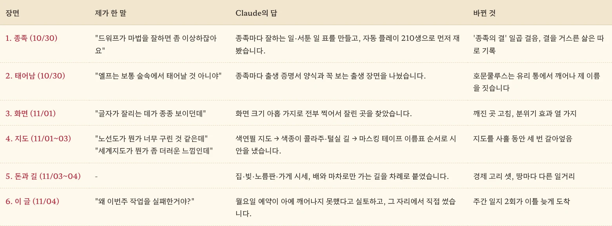
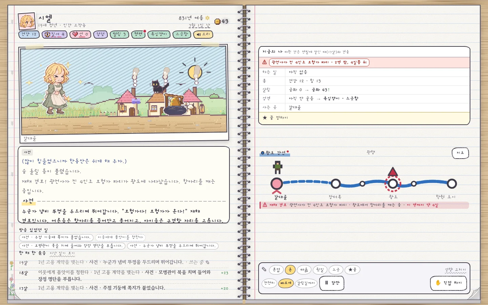
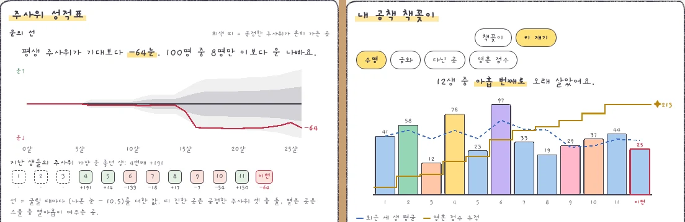
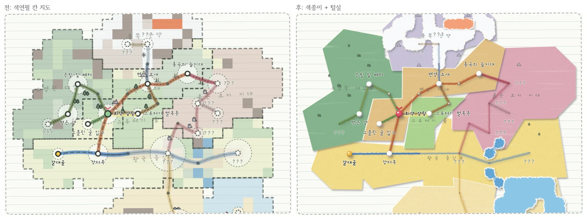
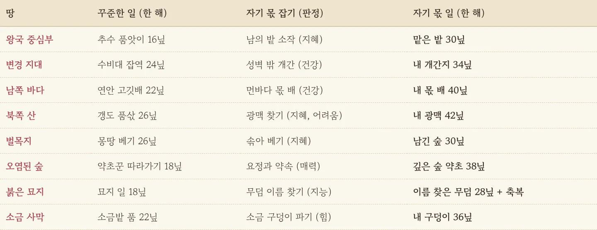
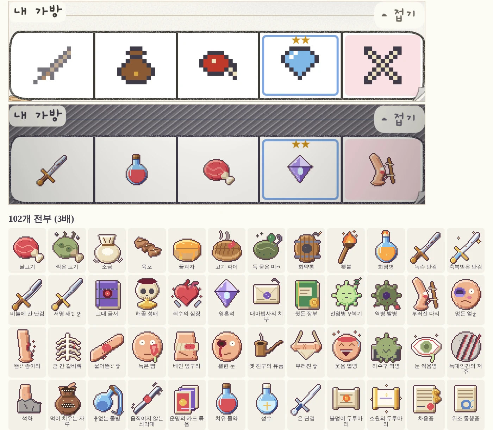

원래 이 글은 월요일 저녁에 저절로 올라와 있어야 했습니다. 지난주에 Claude에게 "매주 월요일 오후 5시에 한 주간 개발한 내용을 블로그에 올리는 예약을 만들고 싶어"라고 부탁해 예약까지 걸어 뒀거든요. 그런데 수요일이 되도록 블로그가 조용하길래 결국 제가 먼저 물었습니다. "왜 이번 주 작업을 실패한 거야?"

그 사연은 맨 뒤에 털어놓기로 하고, 먼저 지난 한 주 동안 공책 속 세상에 무슨 일이 벌어졌는지부터 훑어보겠습니다. 게임 저장소에 쌓인 커밋만 219개, 버전은 0.100.0에서 0.153.0까지 훌쩍 뛰었습니다.

<figure><figcaption>이번 주를 대화 여섯 장면으로 줄이면 이렇습니다. 절반은 제가 던진 투덜거림 한 줄에서 시작했습니다.</figcaption></figure>

## 드워프는 마법이 서툴고, 엘프는 숲에서 태어납니다

둘째 주의 큰 주제는 **"누구로 태어났느냐가 삶을 실제로 바꾸게 하자"**였습니다. 드워프가 마법을 척척 써내는 게 이상하다는 제 한마디에서 [종족의 결]()이 생겼고, 엘프가 숲이 아닌 데서 태어나는 게 어색하다는 말에서 [종족마다 다른 탄생 장면]()이 나왔습니다.

거기서 탄력이 붙어 출신, 가족 구성, 가업, 신분 대우, 성별 관습까지 삶의 뼈대를 통째로 다시 짜는 공사가 사흘쯤 이어졌습니다. 전쟁을 335번이나 지나왔는데 정작 공책에는 8번만 기록되던 황당한 문제를 [측정기부터 만들어 다시 잰 이야기]()도 이 무렵에 나왔고요.

## 연필에게 맡겨 두고 구경하는 재미

이 게임에는 '연필'에게 삶을 맡기고 구경하는 자동 진행 모드가 있습니다. 그런데 그동안은 막상 맡겨 두면 캐릭터가 지금 무슨 인생을 살고 있는지 한눈에 들어오질 않았습니다.

이번 주에는 구경꾼 자리에서도 무슨 일이 벌어지는지, 연필이 왜 그 선택을 골랐는지 한 줄로 보이게 고쳤습니다. 캐릭터가 품은 꿈에 닿는 사건이 뜨면 연필이 잠깐 멈춰 숨을 고르게 했고, 같은 나이의 남들과 내 삶을 나란히 비교하는 그래프도 붙였습니다. 남의 인생을 팔짱 끼고 훔쳐보는 재미가 제법 쏠쏠하더군요.

<figure><figcaption>연필에게 맡겨 둔 화면입니다. 오른쪽 위 '지금의 나' 표가 맡긴 뒤로 무엇이 바뀌었는지 짚어 줍니다.</figcaption></figure>

## 죽은 뒤 받는 성적표가 점점 두꺼워집니다

한 생이 끝나면 받아 보는 생활통지표에도 카드가 다섯 차례에 걸쳐 늘어났습니다. 지난 생들과 수명을 재어 보는 공책 책꽂이, 평생 주사위 운이 기대치보다 얼마나 나빴는지 그려 주는 '운의 선', 사인을 모은 도넛 차트, 명예의 전당 칠판까지 줄줄이 붙었죠. "평생 주사위가 기대보다 -64눈"이라는 문장을 처음 봤을 때는, 괜히 제 캐릭터에게 미안한 마음이 들었습니다.

<figure><figcaption>왼쪽은 운의 선, 오른쪽은 지난 생들과의 수명 비교입니다. 열두 생 중 아홉 번째로 오래 살았다니, 묘하게 서운한 순위네요.</figcaption></figure>

## 지도는 사흘 동안 세 번 갈아엎었습니다

화면 점검을 시켰다가 노선도가 너무 밋밋하다는 말이 튀어나왔고, 거기서 [색연필 지도]()가 탄생했습니다. 그다음엔 세계 지도가 지저분해 보인다며 [색종이 콜라주와 털실 길]()로 바꿨고, 마지막엔 [마스킹 테이프 이름표와 사인펜 글씨]()로 정착했습니다. 마음에 들 때까지 시안을 다시 받아 볼 수 있다는 게 AI와 일하며 누리는 가장 큰 사치라는 걸 이번에 실감했습니다.

<figure><figcaption>세 번 중 두 번째 갈아엎기의 전후입니다. 자세한 사연은 지도 글 세 편에 나눠 적어 두었습니다.</figcaption></figure>

## 공책 속 사람들에게도 생활비 걱정이 생겼습니다

주 후반에는 마침내 삶에 돈 걱정이 붙었습니다. 집 한 채를 장만해 다음 생에 물려줄 수 있게 됐고, 빚과 노름판, 게시판 의뢰, 가게와 행상의 시세까지 차례로 들어왔습니다. 끼니를 거르면 배고픔도 찾아오고요. 임종 때 남은 금화를 영혼에 챙길지, 땅에 묻어 둘지, 동네에 내놓을지도 직접 고를 수 있게 됐습니다.

길도 [배로만, 마차로만 가는 길]()로 갈렸고, 땅마다 [그 지역에서만 할 수 있는 일거리]()가 붙었습니다. 이제 어디서 태어났는지가 곧 밥벌이로 이어집니다.

<figure><figcaption>벌목지에선 나무를 베고 남쪽 바다에선 고깃배를 탑니다. 사는 곳이 곧 밥벌이가 됐습니다.</figcaption></figure>

## 눈에 덜 띄지만 손이 많이 간 작업들

효과음과 환경음 26개가 들어가면서 공책이 처음으로 소리를 내기 시작했습니다. 가방 속 카드 아이콘 102개도 32×32 픽셀 아트로 싹 새로 그렸고요. 다른 개발자의 효과 코드를 활용해 [주문 13수에 애니메이션]()을 입히고, [화면 깨짐을 잡으면서]() [분위기 효과도 여럿 더했습니다](). 플레이어가 게임 안에서 바로 개선안을 보낼 수 있는 건의 버튼도 슬쩍 달아 두었습니다.

<figure><figcaption>위가 예전, 아래가 이번 주 가방입니다. 9칸짜리 임시 그림이 드디어 정식 아이콘으로 승진했습니다.</figcaption></figure>

## 그래서, 예약은 왜 출근을 안 했을까요

맨 처음 질문으로 돌아가 보겠습니다. Claude의 대답은 의외로 담백했습니다. 글을 쓰다 도중에 실패한 게 아니라, 월요일 16시 48분에 울려야 할 알람이 아예 울리지 않았고 예약 기록에도 실행 흔적이 단 한 번도 없다는 겁니다. 알람은 맞춰 뒀는데 정작 전화기가 꺼져 있던 격이죠. 결국 그 자리에서 이 글을 직접 쓰게 했고, 다음 주부터는 제때 깨어나도록 예약 방식을 손보는 중입니다.

**AI에게 반복 업무를 맡겼다면, 첫 회만큼은 꼭 직접 눈으로 확인하세요.** 신입사원도 첫 출근 날엔 잘 나왔는지 한 번 살펴보잖아요.

다음 주에는 사건에 등장하는 인물과 몬스터 그림을 작업대에서 마저 채울 생각입니다. 부디 다음 월요일에는 예약이 지각하지 않길 바라 봅니다.

## 세 줄 요약

1. 둘째 주에는 종족·출신에 따라 인생이 갈리게 뜯어고치고, 지도를 세 번 갈아엎고, 공책 속 주민들에게 생활비 걱정을 안겼습니다.
2. 투덜거림 한 줄만 던져도 AI가 시안과 측정으로 받아 주니, 거슬리는 부분이 있으면 참지 말고 바로 꺼내 놓으세요.
3. 자동으로 돌아가게 걸어 둔 일은 첫 실행 결과를 꼭 확인하세요. 알람 자체가 안 울렸을 수도 있습니다.
