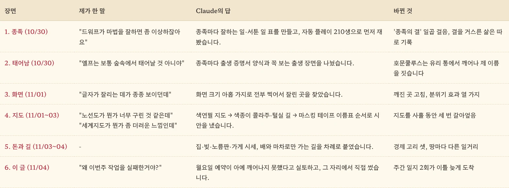
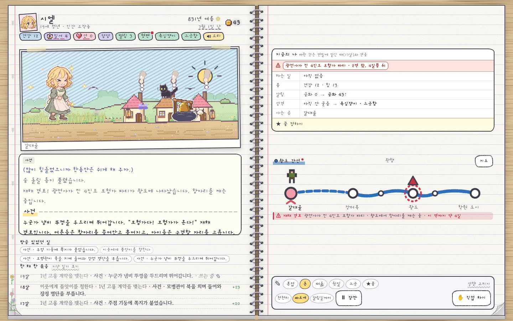
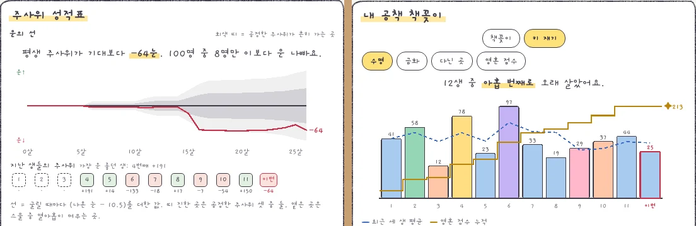
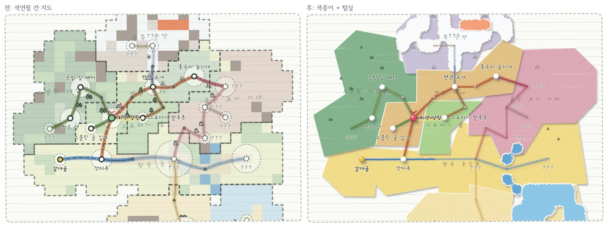
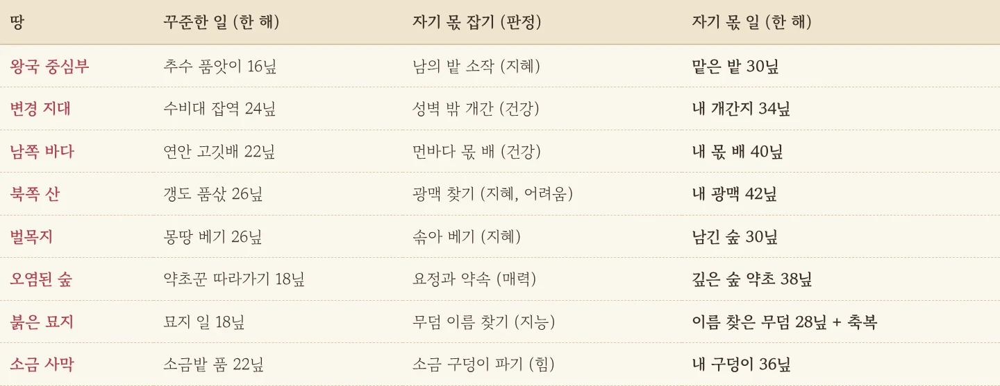
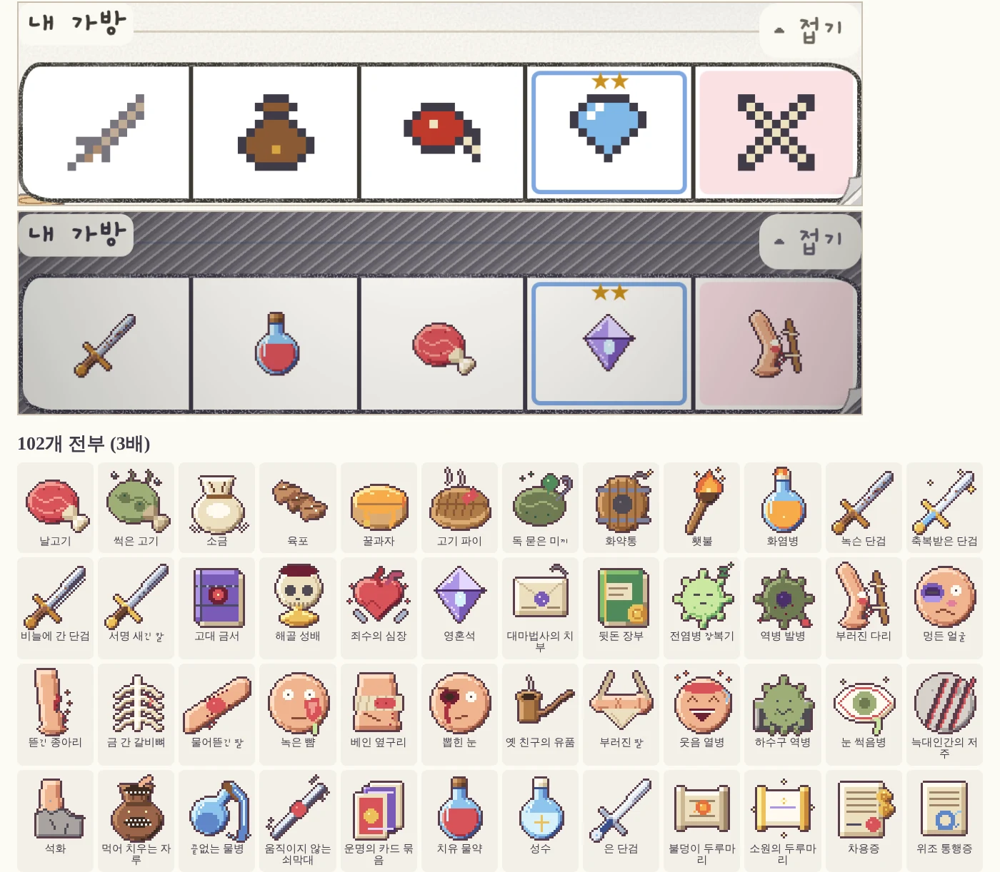

원래 이 글은 월요일 저녁에 저절로 올라와 있어야 했습니다. 지난주에 Claude에게 "매주 월요일 오후 5시에 한 주간 개발한 내용들을 블로그에 올리는 예약을 만들고 싶어"라고 말하고 예약까지 걸어 뒀거든요. 그런데 수요일이 되도록 감감무소식이라 결국 제가 먼저 물었습니다. "왜 이번 주 작업을 실패한 거야?"

그 사연은 맨 뒤에 털어놓기로 하고, 먼저 지난 한 주 동안 공책 속 세상에 무슨 일이 있었는지부터 훑어보겠습니다. 게임 저장소에 쌓인 커밋만 219개, 게임 판 버전은 0.100.0에서 0.153.0까지 훌쩍 올라갔습니다.

<figure><figcaption>이번 주를 대화 여섯 장면으로 줄이면 이렇습니다. 절반은 제가 던진 투덜거림 한 줄에서 시작했습니다.</figcaption></figure>

## 드워프는 마법이 서툴고, 엘프는 숲에서 태어납니다

이번 주의 큰 줄기는 **"누구로 태어났느냐가 삶을 정말 바꾸게 하자"**였습니다. 드워프가 마법을 척척 해내는 게 이상하다는 제 한마디에서 [종족의 결]()이 생겼고, 엘프가 숲이 아닌 데서 태어나는 게 어색하다는 말에서 [종족마다 다른 탄생 장면]()이 나왔습니다. 그 뒤로는 출신·가족 모양·가업·신분 대우·성별 관습까지 사는 방식을 통째로 다시 짜는 대공사가 사흘쯤 이어졌습니다. 전쟁을 335번 지나도 공책엔 8번만 남던 문제를 [측정기부터 만들어 다시 잰 이야기]()도 이때 나왔고요.

## 연필에게 맡겨 두고 구경하는 재미

이 게임에는 연필에게 삶을 맡기고 구경하는 자동 진행이 있는데, 그동안은 맡겨 두면 지금 무슨 삶을 사는 중인지 한눈에 알기 어려웠습니다. 이번 주에는 구경하는 자리에서도 무슨 일이 벌어지는지, 연필이 왜 그 선택을 했는지 한 줄로 보이게 바꿨습니다. 꿈에 닿는 일이 생기면 연필이 잠깐 멈춰 주고, 같은 나이의 남들과 내 삶을 견주는 그래프도 붙었습니다. 남의 인생을 훔쳐보는 재미가 이런 거구나 싶더군요.

<figure><figcaption>연필에게 맡겨 둔 화면입니다. 오른쪽 위 '지금의 나' 표가 맡긴 뒤로 무엇이 바뀌었는지 짚어 줍니다.</figcaption></figure>

## 죽은 뒤 받는 성적표가 점점 두꺼워집니다

한 생이 끝나면 받는 생활통지표에 카드가 다섯 번에 걸쳐 늘었습니다. 지난 생들과 키를 재는 공책 책꽂이, 평생 주사위 운이 기대보다 얼마나 나빴는지 보여 주는 운의 선, 사인을 모은 도넛, 명예의 전당 칠판까지 생겼습니다. "평생 주사위가 기대보다 -64눈"이라는 문장을 처음 봤을 때는 제 캐릭터에게 괜히 미안해지더군요.

<figure><figcaption>왼쪽은 운의 선, 오른쪽은 지난 생들과의 키 재기입니다. 열두 생 중 아홉 번째로 오래 살았다니, 애매하게 서운한 순위입니다.</figcaption></figure>

## 지도는 사흘 동안 세 번 갈아엎었습니다

화면 점검을 맡겼다가 노선도가 너무 구리다는 말이 튀어나왔고 거기서 [색연필 지도]()가 나왔습니다. 그다음엔 세계 지도가 지저분해 보인다며 [색종이 콜라주와 털실 길]()로, 마지막엔 [마스킹 테이프 이름표와 사인펜 글씨]()로 갔습니다. 마음에 들 때까지 시안을 받아 보는 게 AI와 일하는 가장 큰 사치라는 걸 이번에 실감했습니다.

<figure><figcaption>세 번 중 두 번째 갈아엎기의 전후입니다. 자세한 사연은 지도 글 세 편에 나눠 적어 두었습니다.</figcaption></figure>

## 공책 속 사람들에게 돈 걱정이 생겼습니다

주 후반에는 삶에 생활비가 붙었습니다. 집 한 채를 사서 다음 생에 물려주는 고리, 빚과 노름판, 게시판 의뢰, 가게와 행상의 시세가 차례로 들어왔고, 끼니를 못 챙기면 굶주림이 찾아옵니다. 죽을 때 남은 금화를 영혼에 남길지, 땅에 묻을지, 동네에 내놓을지도 고를 수 있게 됐습니다. 길도 [배로만, 마차로만 가는 길]()이 생기고 땅마다 [그 땅에서만 하는 일거리]()가 붙었습니다.

<figure><figcaption>벌목지에선 숲을 베고 남쪽 바다에선 고깃배를 탑니다. 이제 사는 곳이 곧 밥벌이입니다.</figcaption></figure>

## 자잘하지만 손이 많이 간 것들

효과음과 환경음 26개가 들어와 공책이 처음으로 소리를 냈고, 가방 속 카드 아이콘 102개를 32×32 픽셀 그림으로 새로 그렸습니다. 남의 효과 코드로 [주문 13수에 그림]()을 붙였고 [화면 깨짐을 잡으며 분위기 효과]()도 [여럿 더했습니다](). 플레이어 누구나 게임 안에서 개선안을 보낼 수 있는 건의 단추도 생겼습니다.

<figure><figcaption>위가 예전, 아래가 이번 주 가방입니다. 9칸짜리 임시 그림이 드디어 정식 그림으로 승진했습니다.</figcaption></figure>

## 출근 안 한 예약

이제 맨 처음 질문으로 돌아가 보겠습니다. Claude의 대답은 담백했습니다. 글을 쓰다 실패한 게 아니라, 월요일 16시 48분에 울려야 할 알람이 아예 울리지 않았고 예약 기록에도 실행한 흔적이 한 번도 없다는 겁니다. 말하자면 알람은 맞춰 뒀는데 휴대폰이 꺼져 있었던 셈이죠. 그래서 그 자리에서 이 글을 직접 쓰게 했고, 다음 주부터는 더 확실하게 깨어나도록 예약 방식을 손보는 중입니다.

**AI에게 반복 업무를 맡겼다면, 첫 회만큼은 꼭 제 눈으로 확인하세요.** 사람 신입사원도 첫 출근 날엔 잘 왔는지 한 번 보잖아요.

다음 주엔 사건에 나오는 인물과 몬스터 그림을 작업대에서 마저 채울 생각입니다. 이번엔 월요일에 제때 출근하길 빌어 봅니다.

## 세 줄 요약

1. 둘째 주에는 종족·출신에 따라 삶이 갈리게 하고, 지도를 세 번 갈아엎고, 공책 속 사람들에게 돈 걱정을 안겼습니다.
2. 투덜거림 한 줄을 던지면 AI가 시안과 측정으로 받아 주니, 마음에 안 드는 건 참지 말고 바로 말하세요.
3. 자동으로 돌아가게 맡긴 일은 첫 회 결과를 직접 확인하세요. 알람이 아예 안 울릴 수도 있습니다.
