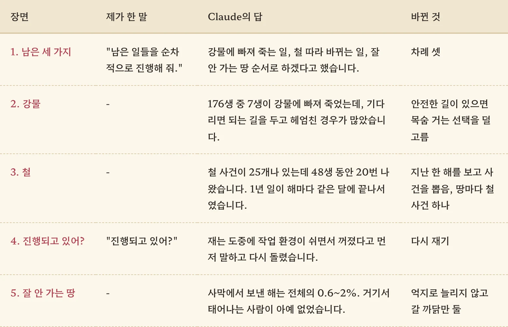
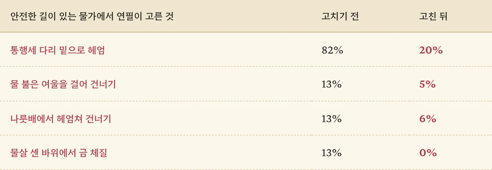
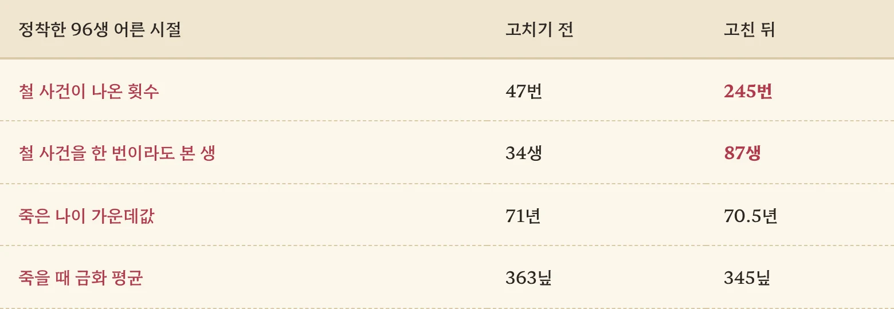
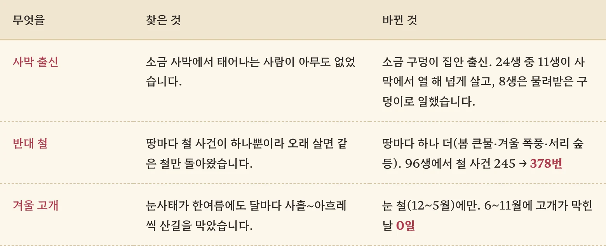

땅마다 일거리를 심고, 밭과 광맥을 자식에게 물려주게까지 만들고 나니 Claude가 메모해 둔 숙제가 셋 남아 있었습니다. 왜 이렇게 강물에 빠져 죽는 사람이 많은지, 사계절이 있는데 왜 한 해가 늘 똑같은지, 소금 사막과 북쪽 산에는 왜 아무도 발길을 안 주는지. 이번에도 제가 채팅창에 친 말은 딱 한 줄이었습니다.

<figure><figcaption>이번에도 제가 보낸 말은 딱 두 줄이었습니다. 심지어 한 줄은 "진행되고 있어?"였고요.</figcaption></figure>

## "남은 일들을 순차적으로 진행해 줘"

Claude가 알아서 순서를 잡았습니다. 강물, 계절(철), 그리고 인적 드문 땅. 셋 다 코드를 건드리기 전에 먼저 숫자를 세고, 고친 뒤 같은 씨앗으로 다시 세는 방식입니다. 이제는 제가 굳이 주문하지 않아도 이 순서를 칼같이 지킵니다.

## 기다리면 될 걸 왜 기어코 헤엄을

자동 진행 봇인 '연필 맡기기'로 176번의 삶을 굴려 보니 무려 7생이 강물에 빠져 죽어 있었습니다. 사고 기록을 하나씩 뜯어보니 어이없는 공통점이 나오더군요. 물이 불은 여울 앞에는 "물이 빠질 때까지 기다린다"가, 통행세 다리 앞에는 "해 질 녘에 몰래 건넌다"가 공짜로 열려 있었습니다. 그런데도 연필 봇은 고작 반나절을 아끼겠다고 거친 강물에 몸을 던지고 있었던 겁니다. 특히 통행세 다리 앞에서는 열에 여덟이 물로 뛰어들었으니, 이건 용기가 아니라 계산 착오였죠.

그래서 연필에게 원칙을 한 줄 가르쳤습니다. **주사위 판정 없이 몸 성히 건널 길이 보이면, 목숨 거는 선택지는 그만큼 덜 고르라고.** 다만 원래 성격이 무모한 캐릭터는 그래도 뛰어들게 내버려 두었습니다. 그건 버그가 아니라 그 사람 성격이니까요.

<figure><figcaption>같은 어른 96명을 물가에 세워 두고 선택을 셌습니다. 끝까지 뛰어드는 나머지 20%는 대개 무모한 성격입니다.</figcaption></figure>

의외의 덤도 따라왔습니다. 숲에서 부엉곰과 맞붙다 죽는 삶이 9생에서 4생으로 절반 넘게 줄었습니다. 나무 위로 올라가 피하는 안전한 길이 있을 때 굳이 주먹을 먼저 들지 않게 됐거든요.

## 계절 사건은 스물다섯 개인데, 가을이 안 온다

두 번째 숙제는 원인을 알고 나니 절로 웃음이 났습니다. 게임 안에는 봄 이불 빨래, 가을 김장, 겨울 장작 패기 같은 계절 사건이 이미 25개나 들어 있었습니다. 그런데 정착한 48생이 어른으로 평생을 사는 동안, 다 합쳐 고작 20번밖에 안 떴습니다.

Claude가 찾아낸 범인은 달력 로직에 숨어 있었습니다. 어른의 사건은 하던 일이 끝나는 순간에 뽑는데, 1년짜리 계약 일은 해마다 정확히 같은 달에 끝납니다. 그러니 게임이 사건을 뽑으려고 "지금 몇 월이지?" 하고 물을 때마다 늘 똑같은 달만 대답하는 겁니다. 해마다 3월에 일이 끝나는 사람에게는 평생 가을도 겨울도 오지 않는 영원한 봄이 펼쳐지고 있었죠. 해법은 간단했습니다. 일이 끝날 때 마지막 달 하나만 보지 말고, 그 일을 하는 동안 지나온 달을 전부 훑게 했습니다. 1년짜리 일이면 한 해 열두 달 전부를요.

여기에 땅마다 대표 계절 사건을 하나씩 더 얹었습니다. 중심부는 가을 추수, 남쪽 바다는 봄 청어 떼, 북쪽 산은 눈에 갇히는 겨울, 사막은 서늘한 철의 대상 행렬. 그 땅에 '자기 몫(내 밭이나 배)'을 갖고 있으면 "내 배로 청어 떼를 쫓는다" 같은 전용 선택지도 열립니다.

<figure><figcaption>96생 가운데 87생이 이제 살면서 한 번쯤은 뚜렷하게 계절이 바뀌는 걸 겪습니다.</figcaption></figure>

작업 도중 죽을 때 금화 중앙값이 204닢에서 122닢으로 뚝 떨어져서 잠깐 가슴이 철렁했습니다. 큰일 났다 싶었는데, Claude가 같은 표본을 여러 번 다시 뽑아 보더니 우연과 구별할 수 없는 흔들림이라고 하더군요. 실제로 평균은 363닢과 345닢으로 거의 같았습니다. 숫자 하나가 튀었다고 화들짝 놀라 코드부터 뜯기 전에 **"이게 진짜 차이야?"**부터 물어야 한다는 걸 이번에 제대로 배웠습니다.

## 사막은 사막답게 비워 두되, 문은 열어 두기

마지막 숙제는 발길이 끊긴 땅이었습니다. 출신을 고루 섞은 88생이 어른 시절을 소금 사막에서 보낸 비율은 고작 0.6~2%. 이유는 뻔했습니다. 사막에서 태어나는 출신이 아예 없고, 길은 막다른 골목이고, 땅은 거칩니다. 안 가는 게 정상이죠.

여기서 Claude는 억지로 사람들을 몰아넣지 말자고 제안했습니다. 대신 갈 만한 명분을 하나씩 열어 두자고요. 대상 철이 다가오면 왕도 장터에서 소금 대상이 일손을 구하고, 눈이 오기 전에는 드워프 씨족이 겨울 갱도 일꾼을 모읍니다. 따라나서면 자연스럽게 그 땅에 닿는 구조입니다. 다시 재 보니 머문 비율 자체는 거의 그대로였습니다. 떠돌이나 따라나서지, 한곳에 터 잡은 사람은 굳이 험한 곳으로 안 가거든요. 그래도 이제 사막으로 향하는 문은 활짝 열려 있습니다.

## 덧붙임: 사막에서 태어나는 사람, 그리고 7월의 눈사태

글을 올리고 지형 쪽에 남은 게 있는지 한 번 더 물었습니다. Claude가 세 가지를 꼽았고, 저는 다시 "순차적으로 진행해 줘."라고만 답했습니다.

첫째는 사막 출신이었습니다. 문을 열어 둬도 사막이 텅 비어 있던 근본 원인은 애초에 거기서 태어나는 사람이 없기 때문이었죠. 그래서 '소금 구덩이 집안'을 새로 만들었습니다. 오아시스에서 태어나 우물 두레박을 당기고 낙타에게 물을 먹이며 자라다가, 어른이 되면 아버지가 소금 구덩이 하나를 떼어 줍니다. 가업을 물려받을 수도 있고, 짐을 싸서 도시로 나갈 수도 있습니다.

둘째는 땅마다 반대 계절 사건을 하나씩 더 붙인 것이고, 셋째로 겨울 고개를 점검하다가 뜻밖의 코미디를 발견했습니다. **눈사태가 한여름에도 산길을 막고 있었던 겁니다.** 7월의 눈사태라니 인과가 영 안 맞아서, 깔끔하게 눈 오는 철에만 터지게 고쳤습니다.

<figure><figcaption>사막에서 태어난 24생 가운데 절반쯤은 결국 길을 떠납니다. 집안 가업이 행상이니까요.</figcaption></figure>

## 세 줄 요약

1. 연필 봇이 반나절 아끼겠다고 멀쩡한 강물에 뛰어들고 있었습니다. 안전한 길이 있을 때 위험 선택을 줄이게 고치자 다리 밑 헤엄이 82%에서 20%로 뚝 떨어졌습니다.
2. 계절 사건이 안 뜬 이유는 1년짜리 일이 해마다 같은 달에 끝나서였습니다. 지나온 열두 달을 다 보게 고치자 96생의 계절 사건이 47번에서 245번으로 뛰었습니다.
3. 측정 숫자가 뚝 떨어져도 당장 고치러 뛰어가기 전에 "이게 진짜 차이야?"부터 물어보세요. 금화가 반 토막 난 줄 알았는데 표본 우연 범위 안이었습니다.
