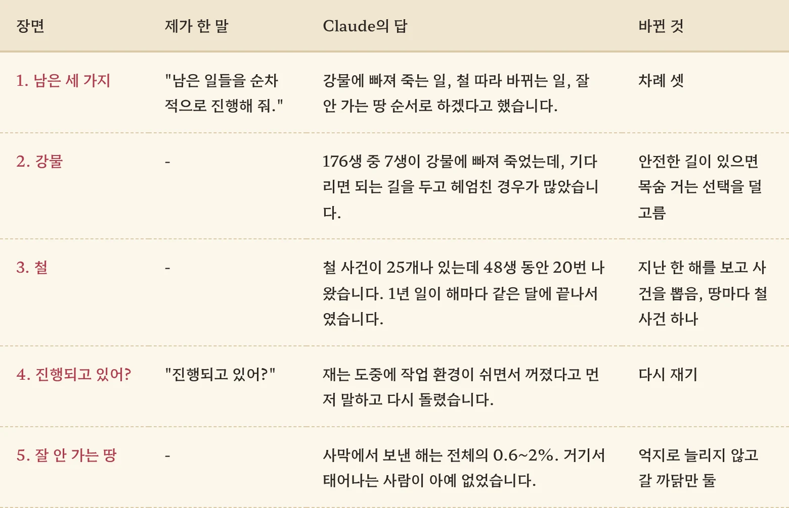
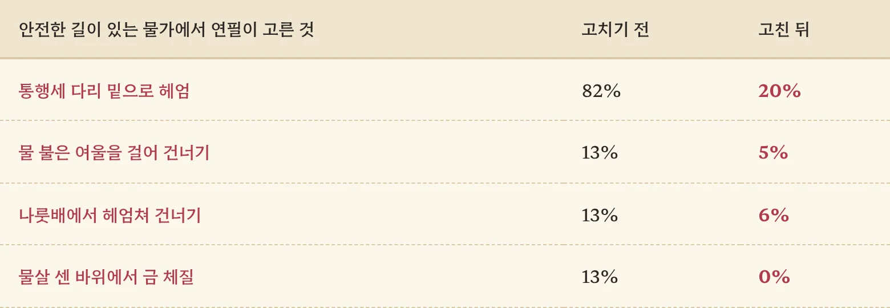
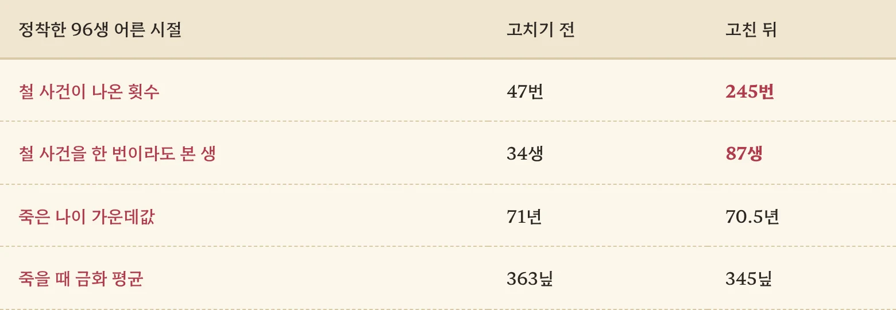
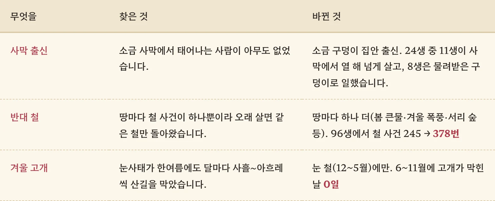

땅마다 일거리를 넣고 몫을 자식에게 물려주게까지 하고 나니, Claude가 적어 둔 숙제가 셋 남아 있었습니다. 강물에 빠져 죽는 사람이 왜 이렇게 많은지, 철이 바뀌어도 왜 한 해가 늘 똑같은지, 소금 사막과 북쪽 산에는 왜 아무도 발길을 안 주는지. 이번에도 제가 보낸 말은 딱 한 줄이었습니다.

<figure><figcaption>이번에도 제 몫은 두 줄이었습니다. 한 줄은 "진행되고 있어?"였지만요.</figcaption></figure>

## "남은 일들을 순차적으로 진행해 줘"

Claude는 순서부터 정했습니다. 강물, 철, 잘 안 가는 땅. 셋 다 고치기 전에 먼저 숫자를 셌고, 고친 뒤 같은 씨앗으로 다시 셌습니다. 이 순서는 이제 제가 따로 주문하지 않아도 알아서 지킵니다.

## 기다리면 될 걸 왜 헤엄을

176번의 삶을 연필 맡기기로 굴려 보니 7생이나 강물에 빠져 죽었습니다. 하나하나 들여다보니 황당한 공통점이 있었습니다. 물이 불은 여울 앞에서는 "물이 빠질 때까지 기다린다"가, 통행세 다리 앞에서는 "해 질 녘에 몰래 건넌다"가 공짜로 열려 있었거든요. 그런데도 연필은 반나절 아끼겠다고 기어코 물에 뛰어들고 있었습니다. 다리 앞에서는 열에 여덟이 헤엄을 쳤으니, 이건 용기라기보다 계산 실수였죠.

그래서 연필에게 한 줄을 가르쳤습니다. **판정 없이 몸 성히 건너는 길이 있으면, 목숨을 거는 선택은 그만큼 덜 고르라고.** 다만 성격이 무모한 사람은 그래도 뛰어들게 두었습니다. 그건 실수가 아니라 그 사람이니까요.

<figure><figcaption>같은 어른 96명을 물가에 세워 보고 고르는 것을 셌습니다. 남은 20%는 대개 무모한 성격입니다.</figcaption></figure>

덤으로 부엉곰과 맞붙다 죽은 생도 9에서 4로 줄었습니다. 나무 위로 피하는 길이 열려 있을 때 굳이 싸움을 걸지 않게 됐거든요.

## 철 사건이 있는데 철이 안 왔습니다

두 번째 숙제가 더 재미있었습니다. 게임에는 봄 이불 빨래, 가을 김장, 겨울 장작 같은 철 사건이 이미 25개나 들어 있었습니다. 그런데 정착한 48생이 어른으로 사는 동안 다 합쳐 고작 20번밖에 안 나왔습니다.

Claude가 찾은 까닭은 달력에 있었습니다. 어른의 사건은 하던 일이 끝날 때 뽑는데, 1년짜리 일은 해마다 같은 달에 끝납니다. 그러니 사건을 뽑을 때 "지금 몇 월이지?" 하고 물으면 언제나 똑같은 달만 대답하는 거죠. 늘 3월에 일이 끝나는 사람에게는 가을이 영영 오지 않았던 셈입니다. 고친 방법은 간단합니다. 일이 끝날 때는 그 일을 하는 동안 지나온 달을 모두 보게 했습니다. 1년 일이면 한 해 전부를요.

그 위에 땅마다 철 사건을 하나씩 얹었습니다. 중심부는 가을 추수, 남쪽 바다는 봄 청어 떼, 북쪽 산은 눈에 갇히는 겨울, 사막은 서늘한 철의 대상 행렬. 땅에 자기 몫이 있으면 "내 배로 청어 떼를 쫓는다" 같은 선택도 열립니다.

<figure><figcaption>96생 가운데 87생이 이제 한 번쯤은 철이 바뀌는 걸 겪습니다.</figcaption></figure>

중간에 죽을 때 금화 가운데값이 204닢에서 122닢으로 뚝 떨어져서 가슴이 철렁했습니다. Claude가 같은 표본을 여러 번 다시 뽑아 보더니 우연과 구별이 안 된다고 하더군요. 평균은 363닢과 345닢으로 거의 같고요. 숫자 하나에 놀라 고치러 달려가기 전에 "이게 진짜 차이야?"부터 물어야 한다는 걸 이번에 배웠습니다.

## 사막은 사막답게

마지막은 잘 안 가는 땅입니다. 고루 뽑은 88생에서 어른 시절을 소금 사막에서 보낸 몫은 0.6~2%에 불과했습니다. 까닭은 단순했습니다. 사막에서 태어나는 출신이 아예 없고, 길은 막다른 길이고, 땅은 험합니다. 사람이 안 가는 게 당연하죠.

여기서 Claude는 억지로 붐비게 하지 말자고 했습니다. 대신 갈 까닭을 하나씩 열어 두었습니다. 대상 철 앞에는 왕도 장터에서 소금 대상이 일손을 구하고, 눈 오기 전에는 드워프 씨족이 겨울 갱 일꾼을 모읍니다. 따라가면 그 땅에 닿습니다. 다시 재 보니 머문 몫은 거의 그대로였습니다. 떠도는 사람이나 따라가지, 자리 잡은 사람은 잘 따라나서지 않거든요. 그래도 문은 활짝 열려 있습니다.

## 덧붙임: 사막에서 태어나는 사람

글을 올리고 지형 쪽에 남은 게 있는지 또 물었습니다. Claude는 셋을 꼽았고, 저는 "순차적으로 진행해 줘."라고만 했습니다.

첫째는 사막 출신이었습니다. 문을 열어 둬도 사막에 사람이 없던 진짜 까닭은 거기서 태어나는 사람이 없어서였거든요. 그래서 '소금 구덩이 집안'을 만들었습니다. 오아시스에서 태어나 우물 두레박을 당기고 낙타에게 물을 먹이며 자라다가, 젊은 날 아버지가 구덩이 하나를 떼어 줍니다. 물려받을 수도 있고 도시로 나갈 수도 있습니다. 둘째는 철 사건을 땅마다 하나씩 더 넣은 것이고, 셋째로 겨울 고개를 재 보다가 엉뚱한 걸 찾았습니다. 눈사태가 한여름에도 산길을 막고 있었던 거죠. 7월의 눈사태라니, 인과가 안 맞아서 눈 철에만 나게 고쳤습니다.

<figure><figcaption>사막에서 태어난 24생 가운데 절반쯤은 결국 길을 떠납니다. 가업이 행상이니까요.</figcaption></figure>

## 세 줄 요약

1. 연필이 기다리면 될 강을 헤엄치고 있었습니다. 안전한 길이 있으면 목숨 거는 선택을 덜 고르게 하니 다리 밑 헤엄이 82%에서 20%로 줄었습니다.
2. 철 사건이 안 나온 까닭은 1년 일이 늘 같은 달에 끝나서였습니다. 지나온 한 해를 보게 고치자 96생의 철 사건이 47번에서 245번이 됐습니다.
3. 숫자가 튀면 "진짜 차이야?"부터 물어보세요. 금화가 반 토막 난 줄 알았는데 우연 범위 안이었습니다.
