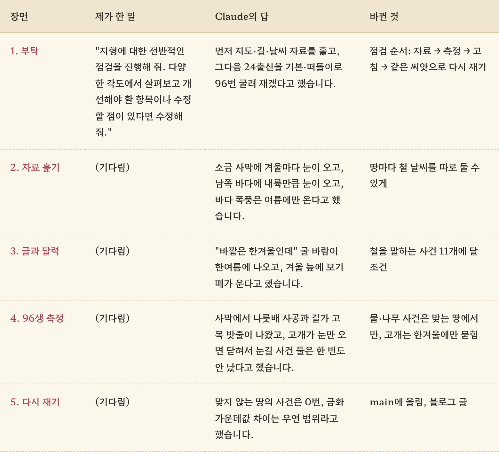
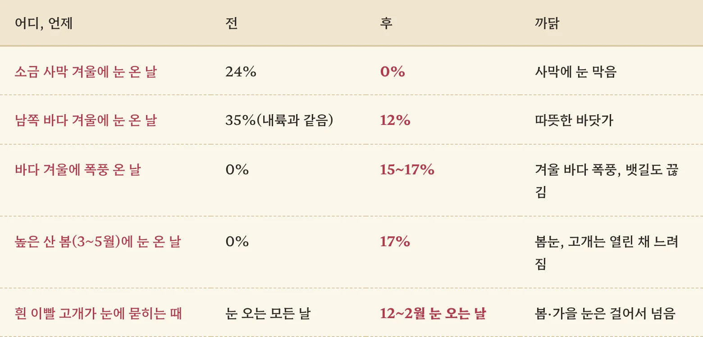
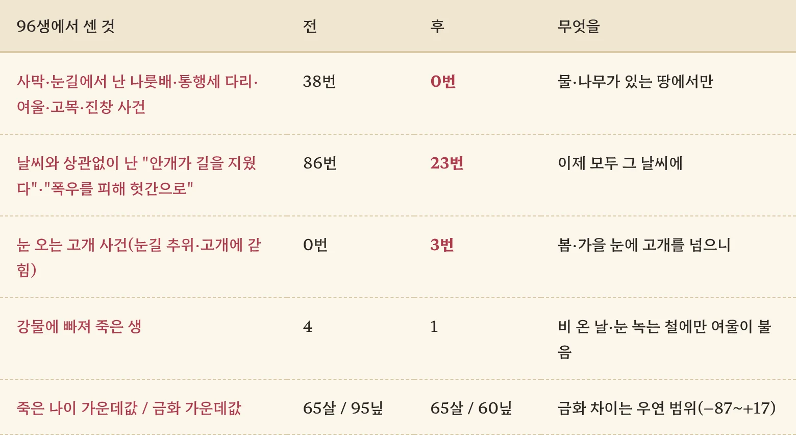

땅마다 일거리를 넣고, 철 사건을 넣고, 사막 출신까지 만들었습니다. 이쯤 되니 하나씩 땜질하는 대신 지형 전체를 한번 싹 훑어볼 때가 됐다 싶었습니다. 이번에도 제가 보낸 건 딱 한 줄이었습니다.

<figure><figcaption>제 몫은 첫 줄이 전부였고, 나머지는 기다림이었습니다.</figcaption></figure>

## "다양한 각도에서 살펴보고 고쳐 줘"

정확히는 "지형에 대한 전반적인 점검을 진행해 줘. 다양한 각도에서 살펴보고 개선해야 할 항목이나 수정할 점이 있다면 수정해 줘."였습니다. Claude는 순서부터 잡았습니다. 먼저 지도·길·날씨 자료를 눈으로 훑고, 그다음 출신 24가지를 기본 삶과 떠돌이 삶으로 나눠 96번 굴려 보겠다고요. **자료에서 이상한 구멍을 찾고, 실제 삶에서 그게 터지는지 확인하는 두 겹 점검**입니다.

## 소금 사막의 함박눈

자료 훑기에서 첫 번째로 걸린 게 날씨였습니다. 날씨는 계절별 비중에 땅마다 곱하는 값을 얹어 정하는데, 소금 사막에는 "눈은 오지 않는다"는 값이 빠져 있었습니다. 그 결과 겨울날의 24%가 눈이었습니다. 야자나무 아래 낙타 등 위로 함박눈이 펑펑 내리는 풍경이었던 거죠. 남쪽 바다는 내륙과 똑같이 겨울날의 35%가 눈이었고, 반대로 바다 폭풍은 여름에만 왔습니다. 마침 제가 지난번에 "겨울 폭풍 철" 사건을 넣었는데, 정작 하늘은 맑고 배도 태평하게 잘 다니고 있었던 겁니다.

계절 비중에 곱하기만 해서는 원래 없는 날씨를 만들어 낼 수 없어서, Claude는 땅마다 철 날씨를 **더하는** 칸을 새로 만들었습니다. 이제 바다는 겨울에도 폭풍이 몰아치고, 높은 산은 봄과 늦가을에도 눈이 옵니다.

<figure><figcaption>이제 겨울 바다에 폭풍이 오면 등대섬 배도 묶입니다.</figcaption></figure>

## 글은 한겨울인데 달력은 칠월

두 번째는 글과 달력이 엇갈리는 사건들이었습니다. "바깥은 한겨울인데 여기는 봄 같습니다"라는 드워프 굴 바람이 한여름에도 불었고, 한겨울 늪에서 모기떼가 귓가를 맴돌았습니다. 길 가다 만나는 추수 일손은 2월에도 낫을 들고 있었고요. 이렇게 글이 철을 말하는데 아무 달에나 나던 사건이 11개나 됐습니다. 전부 그 철에만 나게 달 조건을 붙였습니다.

## 사막에서 나룻배를 타다

진짜 하이라이트는 96생을 굴린 다음에 나왔습니다. 길 위 사건을 지형별로 세어 보니 사막 모래길에서 나룻배 사공이 "강 한가운데서" 웃돈을 요구하고 있었습니다. 나무 한 그루 없는 모래밭에 길가 고목이 서서 밧줄 셋을 늘어뜨리고 있었고요. 물이나 나무가 있어야 말이 되는 사건이 엉뚱한 땅에서 38번이나 나왔습니다. "안개가 길을 지웠습니다"는 쨍한 날에도 버젓이 나왔고요.

하나 더 있었습니다. 흰 이빨 고개는 눈만 오면 닫히는데, 정작 "눈 오는 밤 추위"와 "고개에 갇힘" 사건은 눈 오는 고개에서만 납니다. 눈이 오면 아무도 못 지나가니 이 둘은 96생 동안 단 한 번도 안 나왔습니다. 문을 걸어 잠그고 방 안에서 일어날 사건을 기다린 셈이죠. 그래서 **고개는 한겨울(12~2월) 눈에만 묻히고, 봄·가을 눈에는 열린 채 느려지게** 바꿨습니다.

<figure><figcaption>같은 씨앗으로 다시 굴렸습니다. 사막 나룻배는 이제 없습니다.</figcaption></figure>

금화 가운데값이 95닢에서 60닢으로 떨어진 건 이번에는 덜 놀랐습니다. 지난번에 배운 대로 "이게 진짜 차이야?"부터 물었더니, Claude가 다시 뽑아 보고 우연 범위 안이라고 답했습니다.

## 세 줄 요약

1. 땅마다 날씨를 따로 손봤습니다. 소금 사막의 겨울 눈은 24%에서 0%가 됐고, 바다는 겨울에도 폭풍이 옵니다.
2. 글이 철이나 물·나무를 말하는 사건은 그 철, 그 땅에서만 나게 했습니다. 엉뚱한 땅에서 난 사건이 38번에서 0번으로 줄었습니다.
3. 점검을 맡길 때는 "자료를 훑고, 실제로 굴려서 세어 보라"고 두 겹으로 시켜 보세요. 사막 나룻배는 자료만 봐서는 절대 안 보였습니다.
