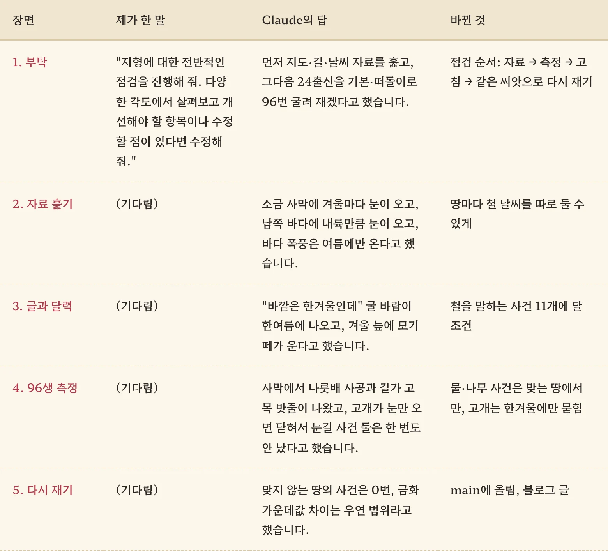
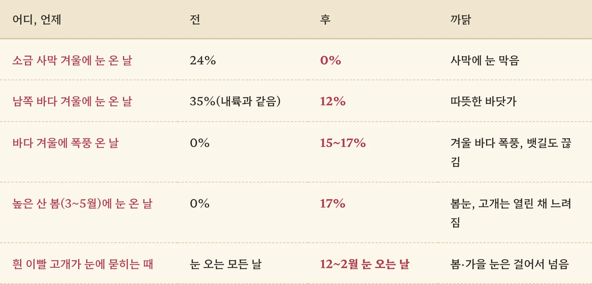
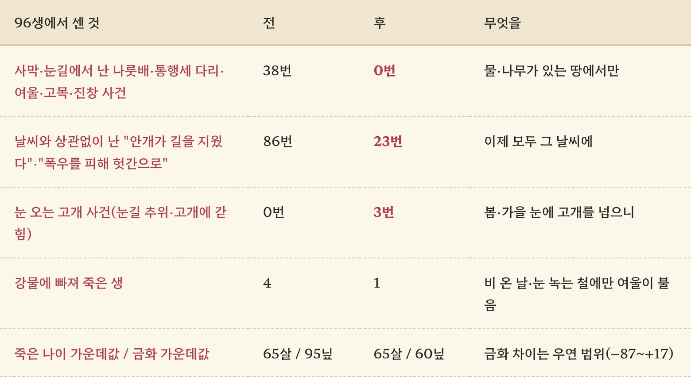

땅마다 일거리를 심고, 계절 사건을 얹고, 사막 출신까지 새로 만들었습니다. 여기까지 오니 자잘하게 땜질하는 대신 지형 전체를 한 번 싹 훑어볼 타이밍이 됐다 싶더군요. 이번에도 제가 채팅창에 던진 건 딱 한 줄이었습니다.

<figure><figcaption>제 몫은 첫 줄 한 마디가 전부였고, 나머지는 커피 마시며 기다림이었습니다.</figcaption></figure>

## "다양한 각도에서 살펴보고 고쳐 줘"

정확히는 이렇게 보냈습니다. "지형에 대한 전반적인 점검을 진행해 줘. 다양한 각도에서 살펴보고 개선해야 할 항목이나 수정할 점이 있다면 수정해 줘."

Claude는 점검을 두 겹으로 나눴습니다. 먼저 지도·길·날씨 데이터를 눈으로 꼼꼼히 훑고, 그다음 24개 출신을 기본 삶과 떠돌이 삶으로 나눠 자동 진행 봇(연필)으로 96번 굴려 보겠다고요. **데이터표에서 수상한 구멍을 찾고, 실제 플레이 로그에서 그게 어떻게 터지는지 확인하는 이중 그물**입니다.

## 야자나무 아래 낙타 위로 내리던 함박눈

데이터 훑기에서 첫 타자로 걸린 건 날씨였습니다. 이 게임의 날씨는 계절별 기본 확률에 땅별 배율을 곱해서 정하는데, 소금 사막에 "눈은 안 온다"는 배율이 쏙 빠져 있었습니다. 덕분에 사막 겨울날의 24%에 눈이 내리고 있었습니다. 야자나무 아래 낙타 등 위로 함박눈이 펑펑 쌓이는 초현실적인 풍경이 벌어지고 있었던 거죠.

남쪽 바다도 마찬가지였습니다. 내륙과 똑같이 겨울날의 35%에 눈이 왔고, 정작 바다 폭풍은 여름에만 몰아쳤습니다. 하필 제가 직전 작업에서 남쪽 바다에 '겨울 폭풍 철' 사건을 넣어 두었는데, 실제 하늘은 화창하고 배도 태평하게 출항하고 있었던 겁니다.

기본 확률이 0인 날씨에 아무리 숫자를 곱해 봐야 0은 그대로 0입니다. 그래서 Claude는 땅마다 계절 날씨를 **더하는** 칸을 새로 뚫었습니다. 이제 남쪽 바다는 겨울에도 15~17% 확률로 폭풍이 치고, 높은 산맥에는 봄과 늦가을에도 눈이 내립니다.

<figure><figcaption>이제 겨울 바다에 폭풍이 몰아치면 등대섬으로 가는 배도 발이 묶입니다.</figcaption></figure>

## 글은 한겨울인데 달력은 7월

두 번째 그물에 걸린 건 문장과 달력이 따로 노는 사건들이었습니다. "바깥은 한겨울인데 여기는 봄 같습니다"라는 드워프 굴 바람이 7월 한여름에도 불었고, 꽁꽁 언 한겨울 늪지대에서 모기떼가 귓가를 맴돌았습니다. 길에서 마주친 추수 일손 모집꾼은 2월 한겨울에 낫을 들고 서 있었고요. 본문에서는 버젓이 특정 계절을 말하면서 정작 아무 달에나 튀어나오던 사건이 11개나 됐습니다. 전부 제 계절에만 나오도록 달 조건을 걸어 잠갔습니다.

## 모래밭 한가운데 나타난 나룻배 사공

진짜 하이라이트는 96번의 삶을 시뮬레이션으로 돌려 본 뒤에 터졌습니다. 길 위 사건을 지형별로 집계해 보니, 물 한 방울 없는 소금 사막 모래길에서 나룻배 사공이 **"강 한가운데서"** 웃돈을 요구하고 있더군요. 나무 한 그루 안 자라는 황량한 모래밭에 길가 고목이 우뚝 서서 밧줄 셋을 늘어뜨리고 있기도 했습니다. 물이나 나무가 있어야 말이 되는 사건이 엉뚱한 땅에서 무려 38번이나 벌어졌고, "안개가 길을 지웠습니다"라는 문구도 해 쨍쨍한 맑은 날에 태연히 뜨고 있었습니다.

거기에 자가당착 버그도 하나 있었습니다. '흰 이빨 고개'는 눈만 오면 길이 닫히도록 만들어 두었는데, 정작 "눈 오는 밤 추위"와 "고개에 갇힘" 사건은 눈 오는 고개를 지날 때만 열리게 되어 있었습니다. 눈이 오면 아예 못 들어가니, 96생 동안 두 사건이 단 한 번도 안 뜬 겁니다. 방 문을 밖에서 걸어 잠그고 안에서 무슨 일이 일어나길 기다린 꼴이었죠. 그래서 **고개는 한겨울(12~2월) 눈에만 완전히 막히고, 봄·가을 눈에는 열린 채 발걸음만 느려지게** 고쳤습니다.

<figure><figcaption>같은 씨앗으로 96생을 다시 굴렸습니다. 모래밭 위 나룻배 사공은 이제 역사의 뒤안길로 사라졌습니다.</figcaption></figure>

금화 중앙값이 95닢에서 60닢으로 내려간 걸 보고도 이번에는 크게 안 놀랐습니다. 지난번에 배운 대로 "이게 진짜 차이야?"부터 물었더니, Claude가 표본을 다시 뽑아 보고 우연 범위 안이라고 깔끔히 정리해 주더군요.

## 세 줄 요약

1. 땅별 날씨 공식을 손봐 소금 사막의 겨울 눈을 24%에서 0%로 지우고, 겨울 바다 폭풍과 높은 산 봄눈을 되살렸습니다.
2. 계절이나 물·나무를 언급하는 사건에 달과 지형 조건을 걸어, 사막 나룻배 같은 엉뚱한 사건을 38번에서 0번으로 없앴습니다.
3. AI에게 점검을 맡길 때는 "데이터표를 훑고, 실제로 굴려서 세어 보라"고 두 겹으로 시켜 보세요. 모래밭의 나룻배는 데이터만 눈으로 봐서는 절대 안 잡혔습니다.
