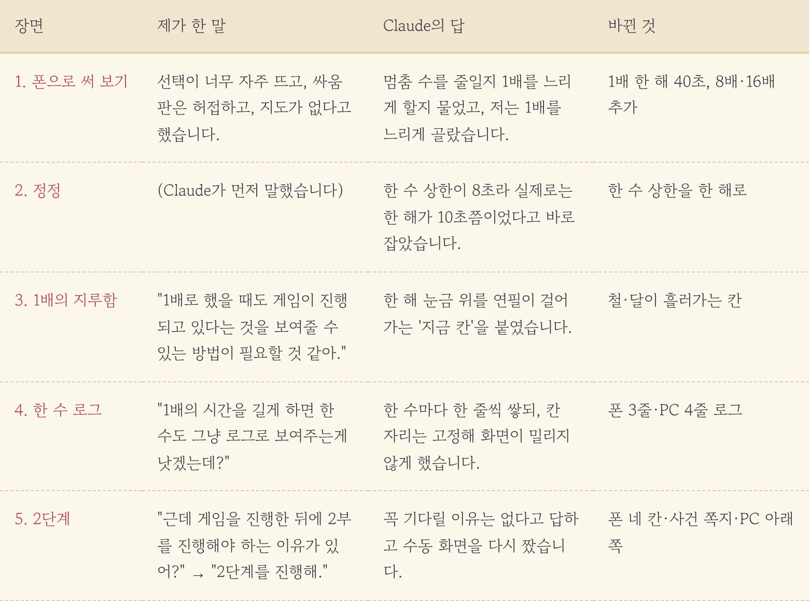
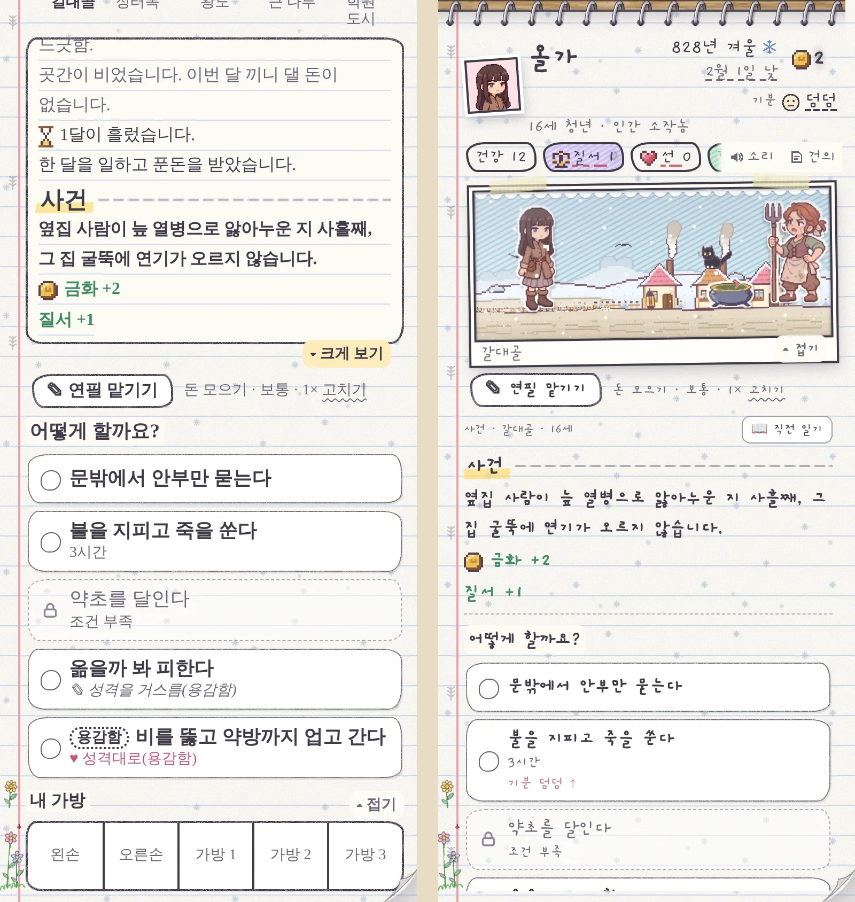
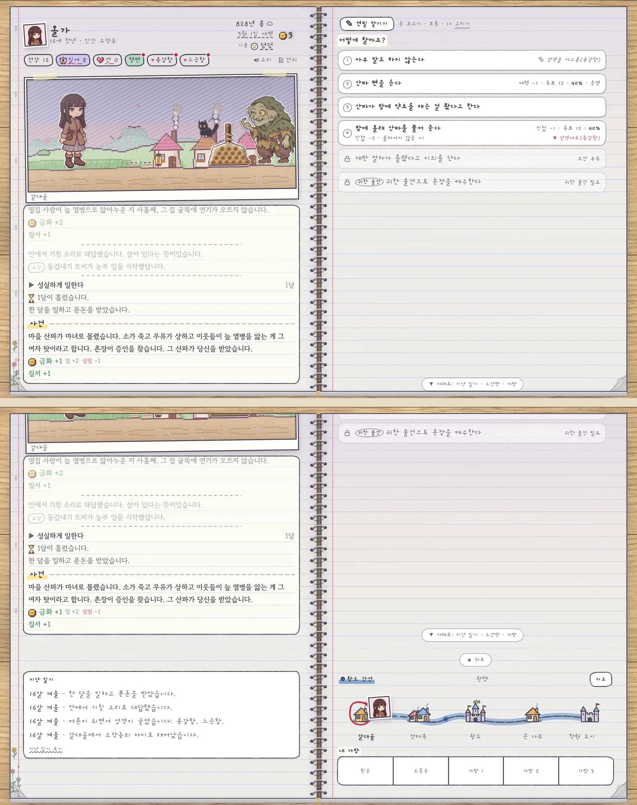
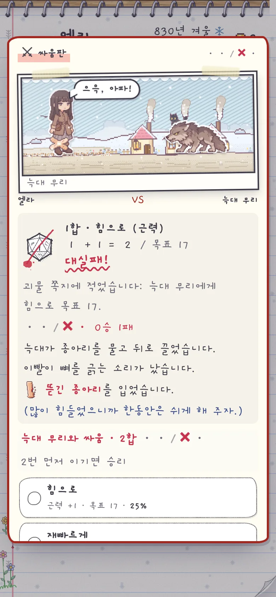

오전에 만든 스케치북 요약판을 폰으로 켜 놓고 한참 굴려 봤습니다. 책상에서 볼 때는 그럴듯했는데 손바닥 위에서는 영 딴판이더군요. 선택 쪽지는 쉴 새 없이 튀어나오고 싸움판은 허술했습니다. 오전에 설계에 분명히 있던 지도는 어디에도 없었고요. 그래서 투덜거림을 한 번에 몰아서 보냈습니다.

<figure><figcaption>아침 투덜거림 한 묶음이 저녁에는 화면 하나를 통째로 바꿨습니다.</figcaption></figure>

## 줄일까, 늦출까

선택이 너무 자주 뜬다고 했더니 Claude가 바로 고치지 않고 두 길을 내밀었습니다. 멈추는 횟수 자체를 줄일 것인가, 아니면 1배속을 느리게 해서 멈춤 사이를 넓힐 것인가. 참고하던 게임 《80억분의 1》의 16배속이 우리 옛 1배속쯤이라는 계산도 같이 붙여서요. 저는 멈춤은 그대로 두고 1배를 늦추는 쪽을 골랐습니다. 그렇게 1배에서 한 해가 40초가 됐고, 대신 8배·16배를 새로 달았습니다.

그런데 조금 뒤 Claude가 먼저 정정을 해 왔습니다. 한 수에 쓸 수 있는 시간 상한이 8초로 묶여 있어서, 한 해짜리 일을 하면 실제로는 10초쯤에 끝나고 있었다는 겁니다. **제가 눈치채기 전에 "40초라고 했던 말이 틀렸습니다"라고 먼저 말해 주니 오히려 숫자를 더 믿게 되더군요.** 상한을 한 해로 올려서 이제는 정말 40초입니다.

## 느려지니 이번엔 멈춘 것 같았습니다

1배를 늦췄더니 새 문제가 생겼습니다. 화면이 너무 조용해서 게임이 멈춘 건지 도는 건지 모르겠더라고요. "1배로 했을 때도 게임이 진행되고 있다는 것을 보여줄 수 있는 방법이 필요할 것 같아."라고 했더니, 요약판 아래에 한 해짜리 눈금을 깔고 그 위를 연필이 천천히 걸어가는 칸이 생겼습니다. 철과 달이 같이 넘어갑니다.

그걸 보다가 하나 더 떠올라서 "1배의 시간을 길게 하면 한 수도 그냥 로그로 보여주는게 낫겠는데?"라고 했습니다. 그래서 연필이 한 수 둘 때마다 한 줄씩 쌓이는 로그가 붙었습니다. 줄이 늘 때마다 화면이 밀리지 않게 칸 자리를 미리 고정해 둔 덕에 밀림 점수는 0.001 언저리로 유지됐습니다.

## 기다릴 이유가 있나요?

원래 계획은 제가 스케치북을 며칠 써 본 뒤에 수동 화면(2단계)을 손보는 거였습니다. 그런데 문득 궁금해서 물었습니다. "근데 게임을 진행한 뒤에 2부를 진행해야 하는 이유가 있어?" Claude의 답은 짧았습니다. 설계 순서였을 뿐 꼭 기다릴 이유는 없다고요. 그래서 바로 "2단계를 진행해."

가장 먼저 손본 건 폰에서 사건이 터졌을 때였습니다. 예전에는 사건 글을 읽고 나면 선택지가 화면 밖에 있어서 쪽을 한참 내려야 했거든요. **이제는 화면을 신상·장면·일기·고르는 칸 네 칸으로 고정하고, 사건이 오면 일기 칸을 접어 고르는 칸이 사건 쪽지가 됩니다.** 사건 글과 선택지가 한눈에 들어오고 그 앞에 무슨 일이 있었는지는 「📖 직전 일기」를 누르면 세 줄 펼쳐집니다. 선택지 아래에는 "기분 덤덤 ↑"처럼 기분이 어떻게 바뀔지도 적힙니다.

<figure><figcaption>같은 사건, 같은 순간입니다. 왼쪽은 쪽을 내려야 고를 수 있었고, 오른쪽은 처음부터 다 보입니다.</figcaption></figure>

## PC는 오른쪽 쪽을 통째로

PC 두 쪽 공책은 오른쪽 쪽 전체를 고르는 칸으로 비웠습니다. 노선판과 가방, 지난 일기는 두 쪽 바로 아래에 붙여서 「▼ 아래로」를 누르거나 휠을 굴리면 내려가 볼 수 있습니다. 할 일 목록이 길어도 묶음마다 탭(일거리·배우기·쉬기…)으로 나뉘어서 쪽째 헤맬 일이 줄었습니다.

<figure><figcaption>위가 처음 보이는 두 쪽, 아래가 「▼ 아래로」를 눌러 내려 본 모습입니다.</figcaption></figure>

## 싸움판은 직접 할 때도

오전에 자동 진행용으로 만든 싸움판을 직접 할 때도 띄우게 했습니다. 장면 틀 그대로 나와 늑대가 치고받고 옆에 지난 합의 주사위와 수 단추가 뜹니다. 귀찮으면 판 안의 「이번 싸움 맡기기」로 연필에게 넘기면 됩니다. 하나 웃겼던 건 PC에서 처음 띄웠을 때 공책 스프링이 싸움판 위를 가로질러 그려졌다는 겁니다. 판을 쪽 바깥으로 꺼내 그리니 해결됐습니다.

<figure class="narrow"><figcaption>직접 둘 때도 같은 싸움판입니다.</figcaption></figure>

이번에 못 한 것도 있습니다. 폰 사건 쪽지에서 결과까지 보여 주고 「다음 →」으로 넘기는 것, 스케치북 표지 넘기기 같은 건 제가 이 화면을 며칠 써 본 뒤로 미뤄 뒀습니다.

## 세 줄 요약

1. 1배속은 멈춤 수를 건드리지 않고 한 해 40초로 늦췄고 대신 연필이 걸어가는 칸과 한 수 로그로 "돌고 있다"는 걸 보이게 했습니다.
2. 폰 수동 화면은 네 칸으로 고정해서 사건이 오면 고르는 칸이 사건 쪽지가 되고 PC는 오른쪽 쪽 전체가 고르는 칸입니다.
3. 계획된 순서가 있더라도 "꼭 기다려야 해?"라고 한 번 물어보세요. 이유가 없으면 AI도 솔직하게 없다고 합니다.
