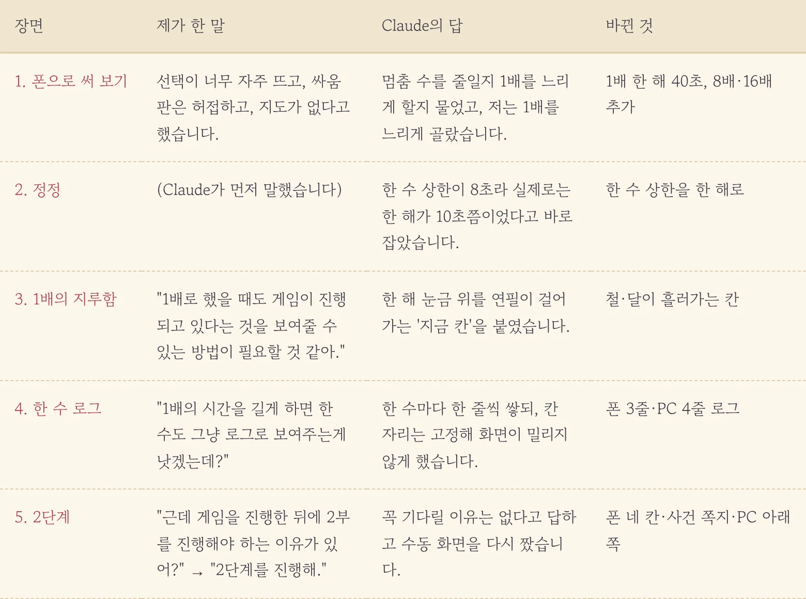
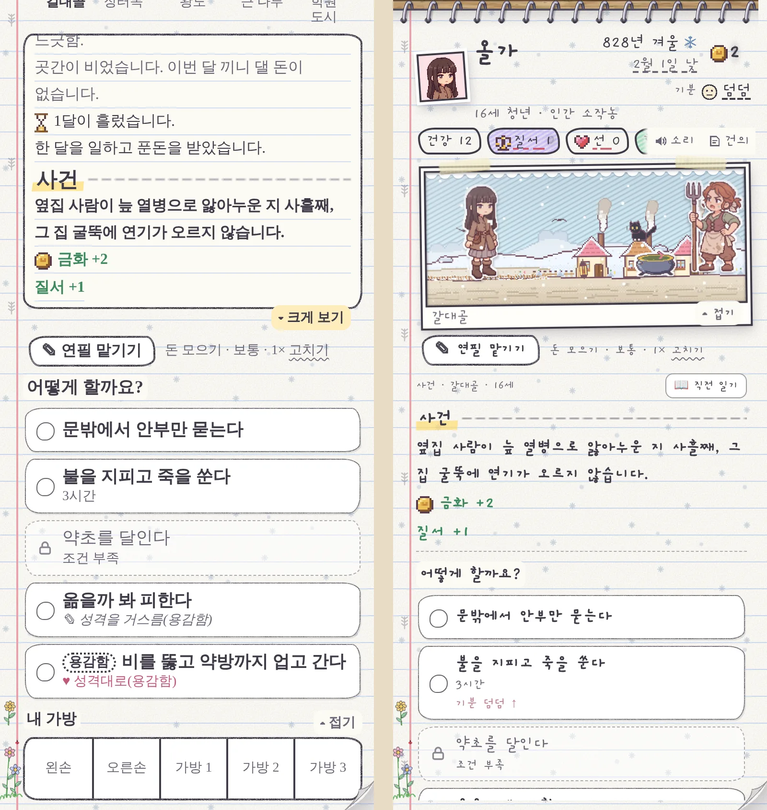
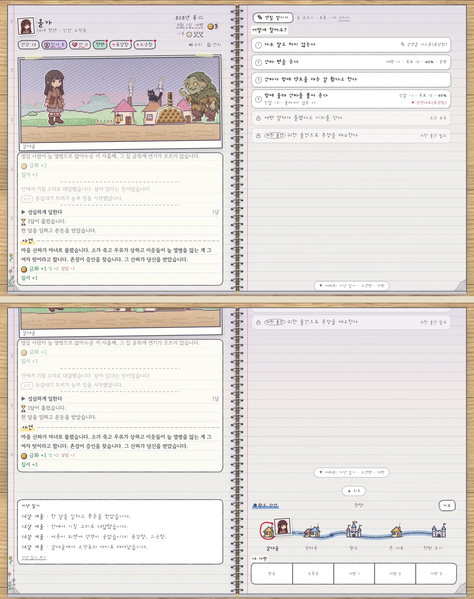
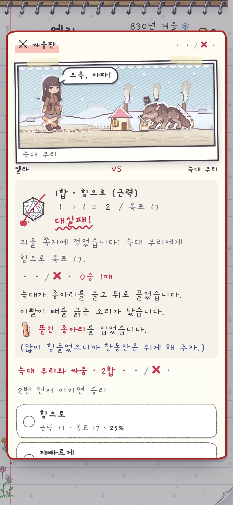

오전에 막 띄워 둔 자동 진행 스케치북 요약판을 폰으로 켜 놓고 한참 굴려 보았습니다. 책상 위 큰 모니터로 볼 때는 제법 멀쩡해 보였는데, 손바닥 위로 옮겨 오니 영 딴판이더군요. 선택 쪽지는 숨 돌릴 틈 없이 튀어나오고, 싸움판은 어딘가 허술하고, 오전 설계에 분명히 있던 지도는 코빼기도 안 보였습니다. 결국 참지 않고 투덜거림을 한 봉지 가득 묶어 Claude에게 보냈습니다.

<figure><figcaption>오전 투덜거림 한 묶음이 저녁에는 수동 화면 하나를 통째로 바꿨습니다.</figcaption></figure>

## 멈춤을 줄일까, 시계를 늦출까

선택이 너무 자주 뜬다고 하자 Claude가 두 갈래를 내밀었습니다. 멈추는 횟수를 줄일지, 1배속 시계를 늦춰 멈춤 사이를 벌릴지. 참고하던 《80억분의 1》의 16배속이 우리 옛 1배속쯤이라는 계산까지 곁들여서요. 저는 멈춤은 두고 1배속을 늦췄습니다. 한 해가 40초가 됐고, 8배·16배속을 새로 달았습니다.

잠시 뒤 Claude가 먼저 정정을 해 왔습니다. 한 수 시간 상한이 8초로 묶여 있어, 1년짜리 일이 실제로는 10초쯤에 끝나고 있었다는 겁니다. **제가 눈치채기도 전에 "40초라고 한 숫자가 틀렸습니다"라고 먼저 털어놓으니 오히려 숫자를 더 믿게 되더군요.** 상한을 한 해로 풀어 이제 진짜 40초입니다.

## 느려졌더니 이번엔 멈춘 줄 알았습니다

1배속을 40초로 늦추자 곧바로 새 문제가 찾아왔습니다. 화면이 너무 고요해서 게임이 돌아가는 건지 얼어붙은 건지 알 수가 없더라고요. "1배로 했을 때도 게임이 진행되고 있다는 것을 보여줄 수 있는 방법이 필요할 것 같아."라고 했더니, 요약판 아래에 한 해짜리 눈금이 깔리고 그 위를 연필 아이콘이 아장아장 걸어가는 막대가 생겼습니다. 계절과 달도 옆에서 같이 넘어갑니다.

그걸 멍하니 구경하다가 아이디어가 하나 더 떠올랐습니다. "1배의 시간을 길게 하면 한 수도 그냥 로그로 보여주는 게 낫겠는데?" 그렇게 연필이 한 수 둘 때마다 한 줄씩 쌓이는 미니 로그가 붙었습니다. 줄이 늘어날 때마다 화면이 덜컹거리지 않게 칸 자리를 미리 고정해 둔 덕에, 화면 밀림 점수(CLS)는 0.001 언저리로 얌전히 붙들어 뒀습니다.

## 그런데 꼭 며칠 기다려야 할 이유가 있나요?

원래 일정은 오전에 만든 스케치북을 제가 며칠 써 본 뒤에, 직접 눌러서 하는 수동 공책 화면(2단계)을 손보는 것이었습니다. 그런데 문득 이런 생각이 들어 툭 던져 봤습니다. "근데 게임을 진행한 뒤에 2부를 진행해야 하는 이유가 있어?" Claude의 답은 깔끔했습니다. 설계 문서에 적힌 순서였을 뿐, 꼭 기다려야 할 기술적 이유는 없다고요. 듣자마자 곧바로 쳤습니다. "2단계를 진행해."

가장 먼저 수술대에 오른 건 폰에서 사건이 터졌을 때의 화면이었습니다. 예전에는 사건 글을 다 읽고 나면 정작 선택지가 화면 아래로 밀려나가 있어서, 매번 엄지로 페이지를 한참 쓸어 내려야 했거든요. **이제는 폰 화면을 신상·장면·일기·고르는 칸 네 칸으로 딱 고정하고, 사건이 오면 일기 칸을 접어 고르는 칸이 그대로 사건 쪽지가 됩니다.** 사건 글과 선택지가 한 화면에 단번에 들어오고, 바로 직전에 무슨 일이 있었는지 궁금하면 「📖 직전 일기」를 눌러 세 줄만 펼쳐 보면 됩니다. 선택지 아래에는 "기분 덤덤 ↑"처럼 고르면 기분이 어떻게 바뀔지도 슬쩍 귀띔해 줍니다.

<figure><figcaption>같은 사건, 같은 순간입니다. 왼쪽은 스크롤을 내려야 고를 수 있었고, 오른쪽은 처음부터 한눈에 다 들어옵니다.</figcaption></figure>

## PC에서는 오른쪽 페이지를 통째로 비우기

PC의 두 쪽 펼침 공책은 아예 오른쪽 페이지 전체를 선택 칸에 내주었습니다. 노선판과 가방, 지난 일기는 두 쪽 바로 아래로 내려서 「▼ 아래로」 버튼이나 마우스 휠로 필요할 때만 훑어보게 정리했고요. 할 일 목록이 길어져도 묶음마다 탭(일거리·배우기·쉬기…)으로 나뉘어서 화면 안에서 눈알을 굴리며 헤맬 일이 확 줄었습니다.

<figure><figcaption>위가 처음 펼쳐지는 두 쪽, 아래가 「▼ 아래로」를 눌러 내려 본 보조 영역입니다.</figcaption></figure>

## 수동 플레이에도 같은 싸움판을

오전에 자동 진행용으로 만들어 둔 싸움판을 직접 플레이할 때도 그대로 띄우게 했습니다. 장면 틀 안에서 늑대와 내가 치고받고, 바로 옆에 지난 합 주사위 결과와 수 버튼이 나란히 뜹니다. 싸우기 귀찮아지면 판 안의 「이번 싸움 맡기기」를 눌러 연필에게 슬쩍 떠넘기면 그만입니다.

하나 웃겼던 버그는 PC에서 싸움판을 처음 띄웠을 때 벌어졌습니다. 두 쪽 공책 가운데를 묶는 **스프링 제본선이 싸움판 한가운데를 떡하니 가로질러 그려져** 있더군요. 싸움판을 페이지 레이어 바깥으로 꺼내 그리자 깔끔하게 해결됐습니다.

<figure class="narrow"><figcaption>직접 수를 둘 때도 오전과 똑같은 싸움판이 열립니다.</figcaption></figure>

물론 이번에 다 끝낸 건 아닙니다. 폰 사건 쪽지 안에서 결과까지 바로 보여 주고 「다음 →」으로 넘기는 흐름이나, 스케치북 표지 넘기기 연출 같은 디테일은 이 새 화면을 며칠 직접 굴려 본 뒤로 기분 좋게 미뤄 두었습니다.

## 세 줄 요약

1. 1배속은 멈춤 횟수를 줄이는 대신 한 해를 40초로 늦추고, 눈금 위를 걷는 연필과 한 수 로그로 "지금 잘 돌아가고 있다"는 신호를 살렸습니다.
2. 폰 수동 화면은 네 칸 고정으로 사건과 선택지가 한눈에 들어오게 바꾸고, PC는 오른쪽 페이지 전체를 선택 칸으로 시원하게 비웠습니다.
3. 계획표에 적힌 순서가 있더라도 "꼭 기다려야 해?" 하고 한 번 물어보세요. 진짜 이유가 없으면 AI도 군더더기 없이 "없습니다"라고 답해 줍니다.
