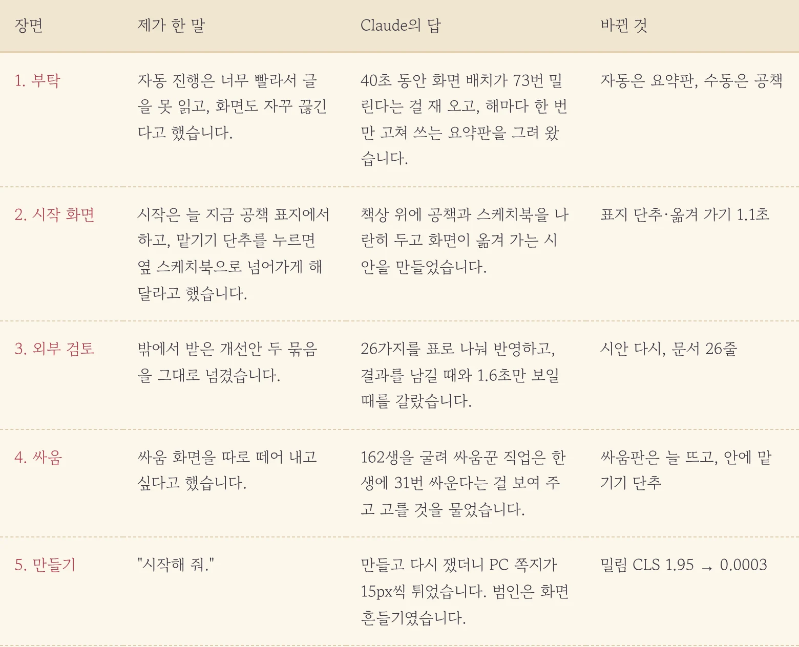
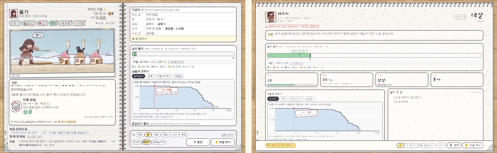
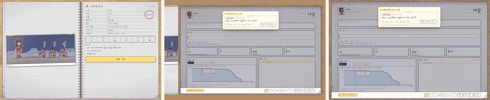
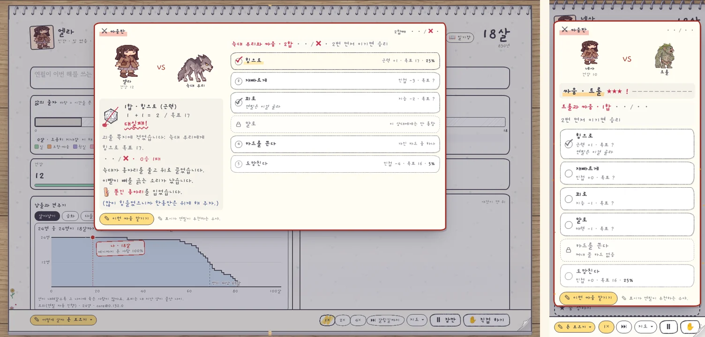
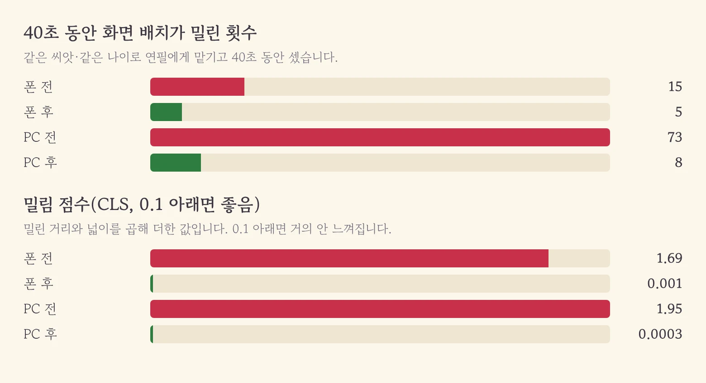

우리 게임에는 「연필에게 맡기기」가 있습니다. 누르면 연필이 알아서 삶을 굴려 주는 자동 진행입니다. 문제는 연필이 너무 부지런하다는 거였습니다. 글은 읽기도 전에 지나가고 화면은 계속 덜컹거렸거든요. 제가 투덜거린 것은 딱 그 두 가지였습니다.

<figure><figcaption>투덜거림 하나가 설계 문서 4판까지 갔습니다.</figcaption></figure>

## 느낌을 숫자로 바꿔 왔습니다

저는 화면이 끊긴다고만 했는데 Claude는 먼저 그 느낌을 재 왔습니다. 같은 아기를 같은 나이에 연필에게 맡기고 40초 동안 화면 배치가 몇 번 밀리는지 셌더니, PC에서 73번이었습니다. 글 한 줄이 붙을 때마다 아래 것들이 통째로 한 칸씩 밀려 내려간 거죠. **"불편하다"가 "73번"이 되니 고칠 방향이 바로 보였습니다.** 자동일 때는 글을 흘려보내지 말고 해마다 딱 한 번만 고쳐 쓰는 요약판을 보여 주자는 쪽으로요.

<figure><figcaption>왼쪽은 글이 폭포처럼 쏟아지던 옛 화면, 오른쪽은 한 해에 한 번만 고쳐 쓰는 새 요약판입니다.</figcaption></figure>

## 공책은 내가, 스케치북은 연필이

그다음은 제 욕심이었습니다. 시작은 늘 지금처럼 공책 표지에서 하고 맡기기 단추를 누르면 옆에 놓인 스케치북으로 넘어가게 해 달라고 했습니다. 제가 직접 쓰는 공책과 연필이 대신 그리는 스케치북을 책상 위에 나란히 놓는 그림이었죠. Claude는 책상이 옆으로 미끄러지는 움직임을 붙였고 외부 검토에서 처음 한 번만 천천히, 그다음부턴 짧게 하자는 말이 나와서 1.1초와 0.7초로 나눴습니다.

<figure><figcaption>표지의 「연필에게 맡기기」를 누르면 책상이 옆으로 미끄러집니다.</figcaption></figure>

## 한 생에 31번 싸우는 사람들

싸움 화면도 따로 떼어 달라고 했습니다. 그런데 Claude가 바로 만들지 않고 162생을 먼저 굴려 봤더니, 싸움꾼 직업은 한 생에 31번꼴로 싸우더군요. 싸울 때마다 판이 뜨면 맡긴 의미가 없습니다. 그래서 고를 거리를 카드로 내밀었고 저는 「늘 열리고, 안에 '맡기기' 단추」를 골랐습니다. 보고 싶으면 직접 두고 귀찮으면 판 안에서 연필에게 넘기면 됩니다. 목숨이 걸린 발악만은 꼭 제가 고르게 남겨 뒀습니다.

<figure><figcaption>나 대 적, 점수, 수 단추, 그리고 아래에 「이번 싸움 맡기기」.</figcaption></figure>

## 범인은 화면 흔들기였습니다

"시작해 줘."라고 한 뒤 Claude가 만들고 다시 쟀는데, PC에서 선택 쪽지가 15px씩 튀는 게 남아 있었습니다. 한참 뒤져 찾은 범인은 엉뚱하게도 한 대 맞거나 다른 곳에 닿을 때 공책을 흔드는 효과였습니다. 틀을 흔드는 순간 화면에 붙어 있어야 할 쪽지가 틀을 따라 움직였던 거죠. 스케치북에서는 흔들기를 끄자 밀림 점수가 1.95에서 0.0003이 됐습니다. 해마다 한 칸씩 붙는 줄자 때문에 몇 번 남은 밀림은 눈으로는 거의 안 보이는 수준이라 그대로 뒀습니다.

<figure><figcaption>횟수는 73번에서 8번, 점수는 거의 0이 됐습니다.</figcaption></figure>

이번에 만든 건 자동 쪽입니다. 손으로 넘기는 두 쪽 공책은 제가 이 스케치북을 며칠 써 본 뒤에 이어 가기로 했습니다.

## 세 줄 요약

1. 자동 진행은 글을 흘려보내지 않고 해마다 한 번만 고쳐 쓰는 스케치북 요약판으로 바꿨습니다.
2. 싸움은 늘 따로 판을 띄우되, 판 안에서 이번 싸움만 연필에게 맡길 수 있게 했습니다.
3. "화면이 불편하다" 싶으면 AI에게 먼저 재 보라고 하세요. 73번이라는 숫자가 고칠 곳과 범인을 같이 알려 줬습니다.
