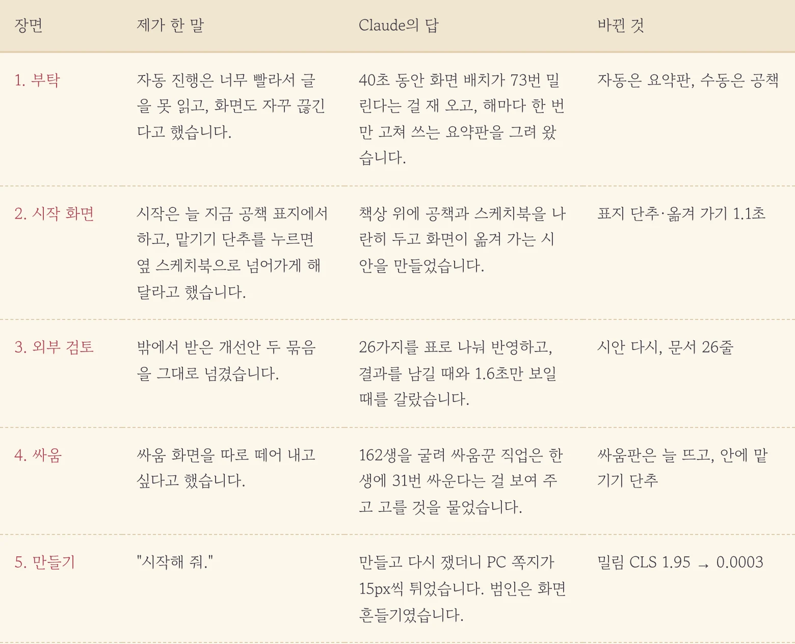
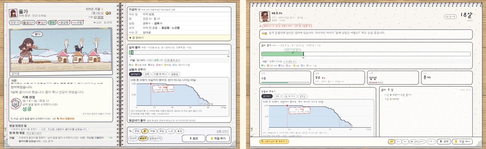
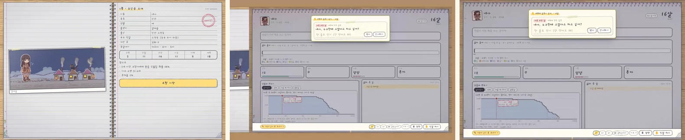
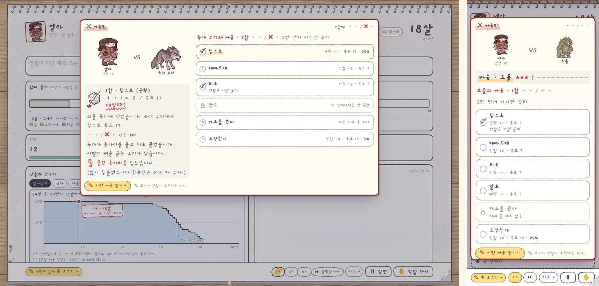
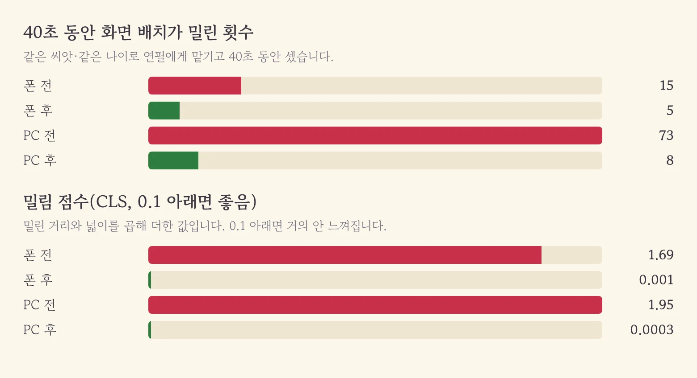

우리 게임에는 「연필에게 맡기기」가 있습니다. 누르면 연필 봇이 알아서 삶을 굴려 주는 자동 진행 모드죠. 그런데 이 연필이 지나치게 부지런했습니다. 일기는 읽기도 전에 휙휙 지나가고, 화면은 쉴 새 없이 덜컹거렸거든요. 제가 Claude에게 투덜거린 건 딱 그 두 가지였습니다.

<figure><figcaption>투덜거림 한 마디가 설계 문서 4판까지 갔습니다.</figcaption></figure>

## 느낌을 숫자로 바꿔 오다

저는 화면이 끊긴다고만 했는데, Claude가 먼저 그 느낌을 쟀습니다. 같은 아기를 같은 나이에 연필에게 맡기고 40초 동안 화면이 몇 번 밀리는지 세어 본 겁니다.

결과는 PC 기준 **73번.** 1초에 거의 두 번꼴로 들썩이고 있었습니다. 글이 한 줄 붙을 때마다 아래 UI가 통째로 밀려 내려갔던 거죠. **"불편하다"가 "73번"이 되는 순간 처방은 바로 나왔습니다.** 자동 진행 중엔 글을 쏟아내지 말고, 해마다 한 번만 고쳐 쓰는 요약판을 보여 주자고요.

<figure><figcaption>왼쪽은 글이 폭포처럼 쏟아지던 옛 화면, 오른쪽은 한 해에 한 번만 고쳐 쓰는 새 요약판입니다.</figcaption></figure>

## 공책은 내가, 스케치북은 연필이

그다음은 제 작은 욕심을 얹었습니다. 게임 시작은 지금처럼 공책 표지에서 하되, 「연필에게 맡기기」를 누르면 옆에 놓인 스케치북으로 화면이 스르륵 넘어가게 해 달라고요. 내가 직접 눌러 쓰는 공책과 연필이 대신 그려 주는 스케치북을 책상 위에 나란히 펼쳐 둔 그림입니다. Claude가 책상이 옆으로 미끄러지는 전환을 붙였고, 외부 검토에서 "처음 한 번만 천천히 보여 주고 그다음부턴 빠르게 넘기자"는 의견이 나와 첫 전환은 1.1초, 이후엔 0.7초로 나눴습니다.

<figure><figcaption>표지에서 「연필에게 맡기기」를 누르면 책상이 옆으로 미끄러지며 스케치북이 펼쳐집니다.</figcaption></figure>

## 한 생에 31번이나 싸우는 사람들

내친김에 싸움 화면도 따로 떼어 달라고 부탁했습니다. 그런데 Claude가 곧장 만들지 않고 먼저 162번의 삶을 돌려 보더니 흥미로운 숫자를 들고 왔습니다. 싸움꾼 직업은 한 생에 평균 31번꼴로 싸운다는 겁니다. 싸움이 터질 때마다 팝업이 가로막으면 자동 진행을 켠 의미가 퇴색하겠죠.

Claude가 선택지 카드를 내밀었고, 저는 **「늘 열리고, 안에 '맡기기' 버튼」**을 골랐습니다. 직접 싸우고 싶으면 바로 수를 두고, 귀찮으면 싸움판 안에서 「이번 싸움 맡기기」를 눌러 연필에게 넘기는 절충안입니다. 다만 목숨이 경각에 달린 마지막 발악 선택지만은 꼭 제가 직접 누르게 남겨 뒀습니다.

<figure><figcaption>내 초상 대 적, 점수, 수 버튼, 그리고 귀찮을 때 누르는 「이번 싸움 맡기기」.</figcaption></figure>

## 범인은 엉뚱하게도 '화면 흔들기'

"시작해 줘." 하고 맡긴 뒤 Claude가 새 화면을 올리고 다시 측정해 봤습니다. 그런데 PC에서 선택 쪽지가 15px씩 톡톡 튀는 현상이 여전히 남아 있더군요. 한참을 파고들어 찾아낸 범인은 의외였습니다. 캐릭터가 한 대 맞거나 새 역에 도착할 때 공책을 들썩이게 해 둔 **화면 흔들기 효과**였거든요. 공책 틀을 흔드는 순간, 화면에 얌전히 고정돼 있어야 할 선택 쪽지까지 틀을 붙잡고 같이 흔들렸던 겁니다.

스케치북 모드에서 흔들기 효과를 끄자 화면 밀림 점수(CLS)가 1.95에서 **0.0003**으로 곤두박질쳤습니다. 해마다 한 칸씩 자라는 연대기 줄자 때문에 몇 번 남은 미세한 밀림은 눈으로는 거의 느껴지지 않는 수준이라 깔끔하게 그대로 뒀습니다.

<figure><figcaption>PC 기준 40초 밀림은 73번에서 8번으로, 밀림 점수는 사실상 0에 수렴했습니다.</figcaption></figure>

이번 개편은 자동 진행(스케치북) 쪽입니다. 제가 직접 손으로 넘기는 두 쪽 공책 화면은 이 스케치북을 며칠 써 본 뒤에 이어서 손보기로 했습니다.

## 세 줄 요약

1. 자동 진행 화면은 글이 쏟아지던 방식을 버리고, 해마다 한 번만 차분히 갱신되는 스케치북 요약판으로 갈아탔습니다.
2. 싸움은 전용 판으로 떼어 내되, 한 생에 31번씩 싸우는 싸움꾼을 배려해 판 안에서 「이번 싸움 맡기기」로 연필에게 넘길 수 있게 했습니다.
3. "화면이 묘하게 불편하다" 싶을 때는 AI에게 먼저 측정부터 시켜 보세요. "40초에 73번"이라는 숫자가 고칠 방향과 숨은 범인(화면 흔들기)까지 한꺼번에 끌어내 줍니다.
