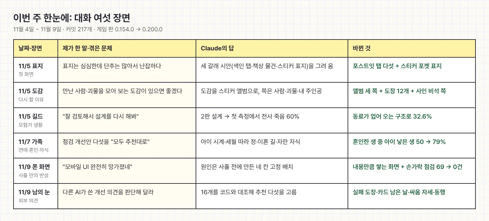
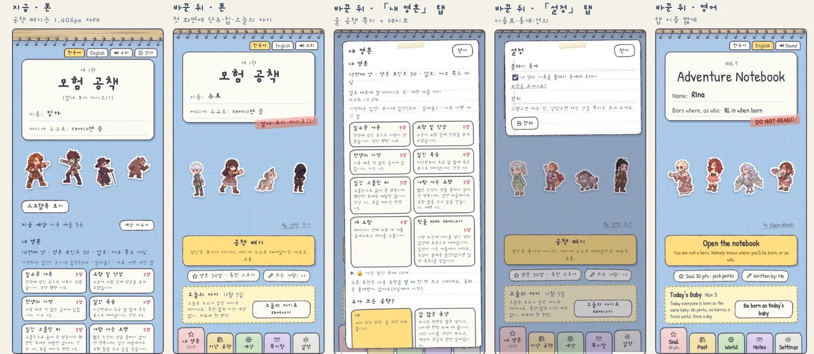
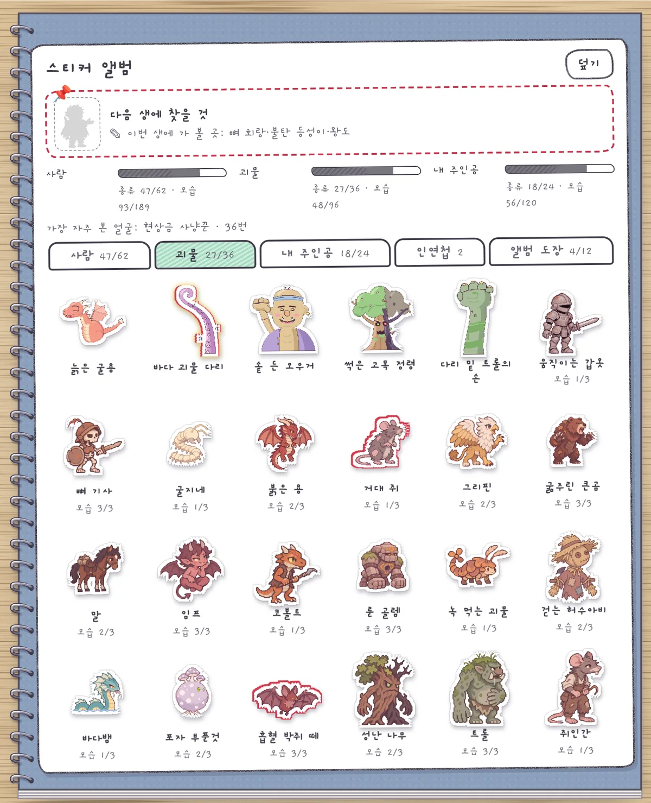
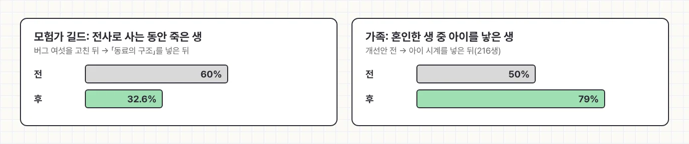
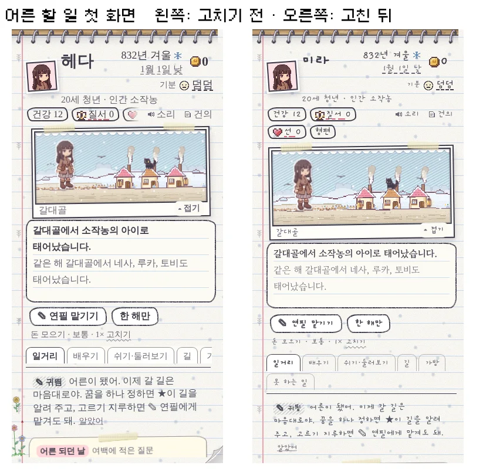
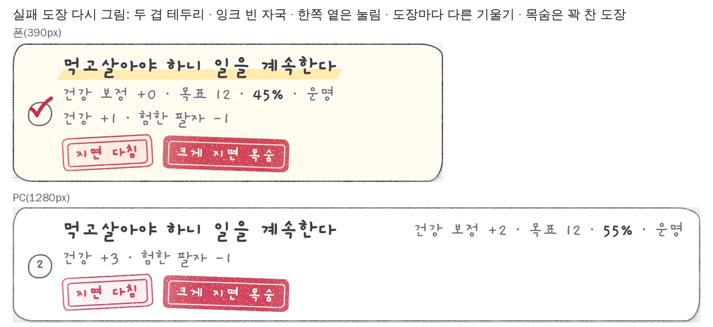

다행히 이번 주 일지는 월요일 제때 올라왔습니다. [지난주]()에 무단결근했던 예약이 이번엔 알람 소리에 딱 맞춰 출근했거든요.

11월 4일부터 오늘까지 게임 저장소에는 커밋 217개가 쌓였고, 버전도 0.154.0에서 0.200.0까지 껑충 뛰었습니다. 숫자만 보면 더없이 순항하는 듯하지만, 실은 오늘 아침 폰을 켜자마자 깊은 한숨부터 나왔습니다. 그 속 터지는 이야기는 조금 뒤에 풀어 보겠습니다.

<figure><figcaption>이번 주를 대화 여섯 장면으로 줄이면 이렇습니다. 절반은 "추천대로 해 줘" 한마디로 끝났습니다.</figcaption></figure>

## 표지가 심심한데 난잡하다는 모순

주 초에 게임 표지를 들여다보다가 스스로도 좀 억지스러운 투정을 부렸습니다. 겉보기는 심심한데 버튼은 너무 많아서 난잡하다는 거였죠. Claude가 세어 보니 재방문 플레이어의 표지에는 버튼과 입력 칸이 무려 31개나 몰려 있었고, 폰에서는 정작 게임 시작 버튼인 「공책 펴기」가 화면 1.7장 아래에 숨어 있었습니다. **현관문을 찾으려면 거실을 두 번이나 가로질러야 하는 집**이었던 겁니다.

시안을 세 갈래로 받아 본 뒤, 저는 색인 탭과 스티커 표지를 섞자고 골랐습니다. 이제 자잘한 기능들은 공책 옆면에 붙은 포스트잇 탭 다섯 개 속으로 쏙 들어갔고, 표지 비닐 포켓에는 지난 생의 캐릭터 스티커들이 꽂혀 있습니다.

<figure><figcaption>맨 왼쪽이 예전, 나머지가 새 표지입니다. 「공책 펴기」 버튼이 드디어 첫 화면에 자리를 잡았습니다.</figcaption></figure>

## 만난 괴물도, 내 죽음도 스티커로 모읍니다

"다시 플레이할 이유가 있었으면 좋겠다"는 말에서 도감이 나왔습니다. 흔한 목록 표 대신 공책 감성에 딱 맞는 **스티커 앨범**으로요. 사람, 괴물, 내 주인공 세 페이지에 그 생에서 마주친 얼굴이 한 장씩 붙는데, 같은 괴물도 모습이 최대 세 가지라 다 채우려면 꽤 여러 번 죽어 봐야 합니다. 앨범 맨 뒤에는 그동안 겪은 사인을 비석 스티커로 모으는 마지막 쪽까지 붙었습니다. 자기 죽음까지 수집하게 만드는 게임이라니, 만들면서도 조금 짓궂다는 생각이 들더군요.

<figure><figcaption>괴물 페이지입니다. 빈칸이 보이면 다음 생에 어디로 가 볼지 맨 위 핀이 슬쩍 귀띔해 줍니다.</figcaption></figure>

## 길드도 들어가고, 가정을 꾸리고

목요일에는 모험가 길드를 들였습니다. 외부 검토 두 개를 붙여 "잘 살펴보고 설계를 다시 짜 보라"고 맡긴 뒤 2판 설계를 추천대로 밀어붙였죠. 그런데 막상 첫 측정을 돌려 보니 전사로 살다가 죽는 생이 무려 60%나 나왔습니다. 모험가 길드가 아니라 사실상 장례식장 직행 코스였던 겁니다. 그래서 의뢰 중 동료가 있으면 한 생에 한 번은 죽음 대신 길드로 업혀 돌아오게 손봤고, 사망률은 32.6%까지 내려왔습니다.

같은 주에 연애·혼인·자식 시스템도 크게 고쳤습니다. 숫자를 까 보니 결혼은 곧잘 하는데 아이가 좀처럼 생기질 않더군요. Claude가 가져온 개선안 다섯 가지를 "모두 추천대로" 승인했더니 **혼인한 생 중 아이를 낳은 비율이 50%에서 79%로** 올라갔습니다. 짝과 아이 그림 17장도 오늘 게임에 들어갔고요.

<figure><figcaption>모험은 덜 험해지고 집안은 북적해졌습니다. 둘 다 수백 번의 모의 인생으로 잰 숫자입니다.</figcaption></figure>

## "모바일 UI 완전히 망가졌네"

오늘 아침 저를 한숨 쉬게 만든 사건입니다. 지난주 금요일에 [폰 화면을 네 칸으로 고정]()해 두고 제법 뿌듯해했거든요. 그런데 정작 손에 쥐고 해 보니 칸 안에서만 스크롤이 헛돌고, 버튼은 가려지고, 자동 진행 연필마저 멈춰 서 버렸습니다. 사흘 전의 제가 오늘의 저를 제대로 배신한 겁니다. 고치는 김에 Claude에게 하나 더 물었습니다. "플레이어 입장에서 미리 체크해 볼 순 없는 거야?"

Claude는 폰 크기 화면에서 실제 손가락처럼 한 생을 처음부터 끝까지 눌러 보는 점검을 만들어 왔습니다. 코드로 화면만 띄워 보던 예전 점검이 놓친 문제가 고치기 전엔 무려 69건이나 튀어나왔고, 칸 높이를 풀어 내용만큼 자연스럽게 늘어나게 바꾼 뒤엔 0건이 됐습니다. 이제 화면을 건드리면 배포하기 전에 이 손가락 점검을 반드시 통과해야 합니다.

<figure class="narrow"><figcaption>왼쪽이 고치기 전, 오른쪽이 고친 뒤입니다. 장면이 화면 폭을 꽉 채우고, 탭도 넘치면 자연스럽게 아랫줄로 내려갑니다.</figcaption></figure>

## 남의 눈으로 한 번 더 훑어보기

오후에는 다른 AI가 써 준 개선 의견 16개를 가져와 Claude에게 판정을 맡겼습니다. Claude는 항목마다 코드를 대조해 이미 있는 것, 하지 않을 것, 새로 넣을 것을 가려냈고 추천 다섯 가지를 곧장 반영했습니다. 이제 가방 카드에는 날고기가 상하기까지 남은 날짜가 뜨고, 처음 만나는 괴물은 첫인상 한 줄로 약점을 넌지시 알려 주며, 싸움에서는 둘째 합부터 적의 자세와 동행의 한 수가 끼어듭니다.

선택지 아래에는 실패했을 때 무엇을 잃는지 빨간 고무 도장이 찍힙니다. 첫 시안을 보고 "좀 더 리얼하게"라고 주문했더니, 테두리가 두 겹이 되고 잉크가 군데군데 덜 묻은 자국까지 살려 왔습니다. 그 밖에 연필이 다음 수를 미리 계산해 두도록 고쳐, 느린 폰 기준 자동 진행 한 수당 엔진 계산 시간도 37~63ms에서 4ms로 확 줄었습니다.

<figure><figcaption>"크게 지면 목숨"은 잉크를 꾹 눌러 찍었습니다. 누르기 전에 한 번만 더 생각해 보시라는 뜻입니다.</figcaption></figure>

이번 주엔 굵직한 기능을 잔뜩 실었으니, 다음 주에는 플레이어 손가락으로 구석구석 눌러 보며 거친 모서리를 다듬어 보겠습니다.

## 세 줄 요약

1. 셋째 주에는 표지를 포스트잇 탭과 스티커로 정리하고, 스티커 앨범·모험가 길드·가족 시스템을 게임에 들였습니다.
2. 큰 기능을 넣었다면 수백 번의 모의 인생으로 숫자를 확인하세요. 전사 사망률 60%처럼 눈대중으로는 놓치기 쉬운 구멍이 단번에 드러납니다.
3. 화면 점검은 코드로 띄워 보는 것만으로는 부족합니다. AI에게 "플레이어처럼 손가락으로 끝까지 눌러 보라"고 시켜 보세요.
