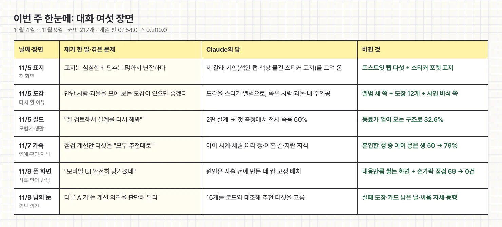
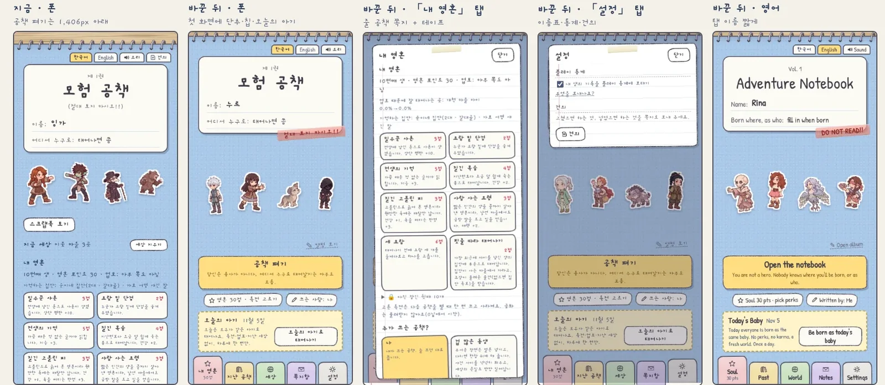
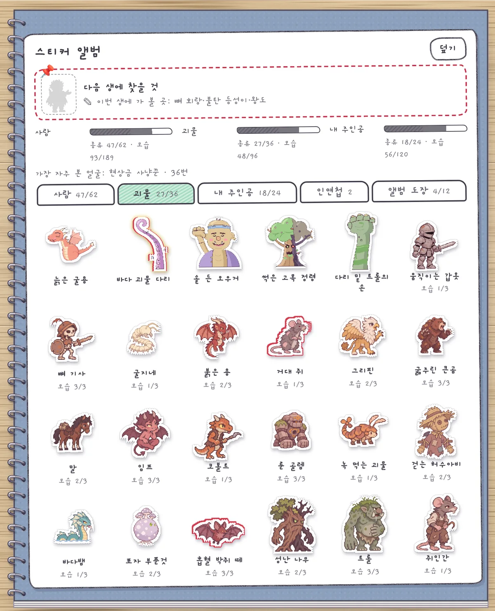
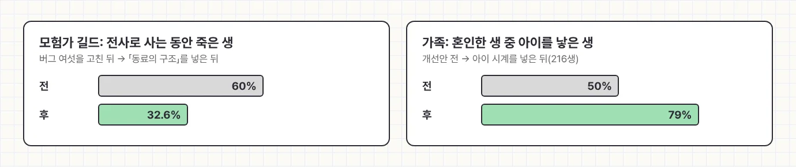
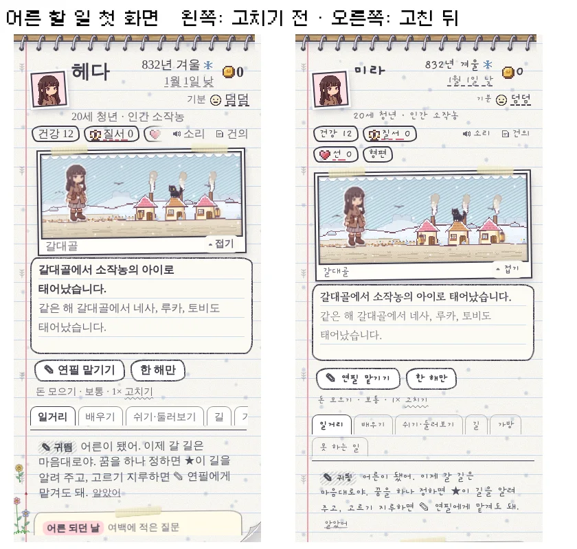
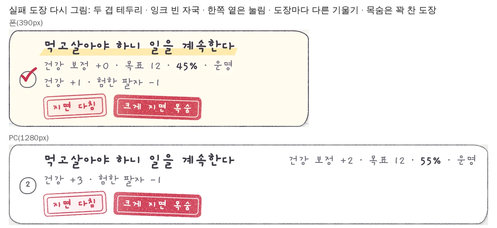

이번 주 일지는 다행히 월요일에 제때 올라왔습니다. [지난주]()에 출근을 안 했던 예약이 이번엔 알람 소리에 맞춰 일어난 셈이죠. 11월 4일부터 오늘까지 게임 저장소에 커밋 217개가 쌓였고 게임 판 버전은 0.154.0에서 0.200.0까지 올라갔습니다. 숫자만 보면 순항 같지만 오늘 아침엔 폰을 켜자마자 한숨부터 나왔습니다. 그 이야기는 뒤에서 하겠습니다.

<figure><figcaption>이번 주를 대화 여섯 장면으로 줄이면 이렇습니다. 절반은 "추천대로 해 줘"로 끝났습니다.</figcaption></figure>

## 표지가 심심한데 난잡하다는 모순

주 초에 표지를 보다가 이상한 투정을 했습니다. 보기엔 심심한데 단추는 너무 많아서 난잡하다는 거였죠. Claude가 세어 보니 다시 온 플레이어의 표지에는 단추와 입력 칸이 31개나 있었고 폰에서는 정작 「공책 펴기」가 화면 1.7장 아래에 숨어 있었습니다. **현관문을 찾으려면 거실을 두 번 지나야 하는 집**이었던 겁니다.

시안을 세 갈래로 받아 본 뒤 저는 색인 탭과 스티커 표지를 섞자고 골랐습니다. 이제 기능들은 공책 옆에 붙은 포스트잇 탭 다섯 개 속으로 들어가고 표지에는 지난 생의 스티커가 비닐 포켓에 꽂혀 있습니다.

<figure><figcaption>맨 왼쪽이 예전, 나머지가 새 표지입니다. 공책 펴기 단추가 드디어 첫 화면에 올라왔습니다.</figcaption></figure>

## 만난 괴물을 스티커로 모읍니다

다시 할 이유가 있었으면 좋겠다는 말에서는 도감이 나왔습니다. 그냥 표가 아니라 **스티커 앨범**으로요. 사람, 괴물, 내 주인공 세 쪽에 그 생에서 만난 얼굴이 한 장씩 붙고 같은 괴물도 모습이 셋까지 있어서 다 채우려면 꽤 여러 번 죽어야 합니다. 앨범 맨 뒤에는 겪은 사인을 비석 스티커로 모으는 마지막 쪽도 붙었습니다. 죽음까지 수집하게 만드는 게임이라니, 만들면서도 좀 짓궂다 싶었습니다.

<figure><figcaption>괴물 쪽입니다. 빈칸이 보이면 다음 생에 어디로 가 볼지 맨 위 핀이 귀띔해 줍니다.</figcaption></figure>

## 길드도 가고 결혼도 하고

목요일에는 모험가 길드가 들어왔습니다. 외부 검토 두 개를 붙여 "잘 검토해서 설계를 다시 해봐"라고 했고 2판 설계를 추천대로 진행했습니다. 그런데 첫 측정에서 전사로 사는 동안 죽은 생이 60%나 나왔습니다. 그래서 의뢰 중에 동료가 있으면 한 생에 한 번은 죽음 대신 길드로 업혀 오게 했고 숫자는 32.6%로 내려왔습니다.

같은 주에 연애·혼인·자식도 크게 손봤습니다. 점검해 보니 결혼은 해도 아이가 잘 안 생겼거든요. 개선안 다섯을 "모두 추천대로" 받았더니 **혼인한 생 중 아이를 낳은 생이 50%에서 79%로** 올랐습니다. 짝과 아이 그림 17장도 오늘 게임에 들어갔습니다.

<figure><figcaption>모험은 덜 위험해지고 집안은 북적해졌습니다. 둘 다 수백 번의 모의 인생으로 잰 숫자입니다.</figcaption></figure>

## "모바일 UI 완전히 망가졌네"

오늘 아침의 한숨이 바로 이겁니다. 지난주 금요일에 [폰 화면을 네 칸으로 고정]()해 두고 뿌듯해했는데, 막상 손에 들고 해 보니 칸 안에서만 스크롤이 돌고 단추가 덮이고 연필이 멈춰 버렸습니다. 사흘 전의 제가 오늘의 저를 배신한 셈이죠. 고치는 김에 하나 더 물었습니다. "플레이어 입장에서 체크할 수 없는거야?"

Claude는 폰 크기 화면에서 손가락으로 한 생을 처음부터 끝까지 눌러 보는 점검을 만들었습니다. 코드로 화면을 띄워 보는 예전 점검은 못 잡던 문제를 고치기 전엔 69건 찾아냈고 칸 높이를 풀어 내용만큼 쌓이게 바꾼 뒤엔 0건이 됐습니다. 이제 화면을 고치면 올리기 전에 이 점검을 꼭 돌립니다.

<figure class="narrow"><figcaption>왼쪽이 고치기 전, 오른쪽이 고친 뒤입니다. 장면은 폭을 꽉 채우고 탭은 넘치면 다음 줄로 내려갑니다.</figcaption></figure>

## 남의 눈으로 다시 보기

오후에는 다른 AI가 쓴 개선 의견을 들고 와서 판단해 달라고 했습니다. Claude는 16개를 하나씩 코드와 대조해 이미 있는 것, 하지 않을 것, 새로 할 것을 가려냈고 추천 다섯 가지를 바로 넣었습니다. 이제 가방 카드에는 날고기가 상하기까지 남은 날이 뜨고, 처음 만난 괴물은 첫인상 한 줄로 약점을 귀띔해 주며, 싸움에서는 둘째 합부터 적의 자세와 동행의 한 수가 끼어듭니다.

선택지 아래에는 지면 무엇을 잃는지 빨간 고무 도장이 찍힙니다. 처음 그림을 보고 "더 리얼하게"라고 했더니 테두리가 두 겹이 되고 잉크가 덜 묻은 자국까지 생겼습니다. 그 밖에 연필이 다음 수를 미리 계산해 두게 해서 자동 진행의 한 수당 엔진 계산이 느린 폰 기준 37~63ms에서 4ms로 줄었습니다.

<figure><figcaption>"크게 지면 목숨"은 잉크를 꽉 채워 찍었습니다. 누르기 전에 한 번 더 생각하시라고요.</figcaption></figure>

이번 주는 큰 덩어리를 많이 들였고 다음 주엔 들어간 것들을 플레이어 손가락으로 한 번 더 눌러 보며 다듬을 생각입니다.

## 세 줄 요약

1. 셋째 주에는 표지를 포스트잇 탭과 스티커로 정리하고 스티커 앨범·모험가 길드·가족 이야기를 들였습니다.
2. 큰 기능은 들인 뒤 수백 번의 모의 인생으로 재 보세요. 전사 죽음 60%처럼 눈으로는 못 보던 문제가 숫자로 튀어나옵니다.
3. 화면은 코드로 띄워 보는 것만으로는 부족합니다. AI에게 "플레이어처럼 손가락으로 눌러 봐 달라"고 하세요.
